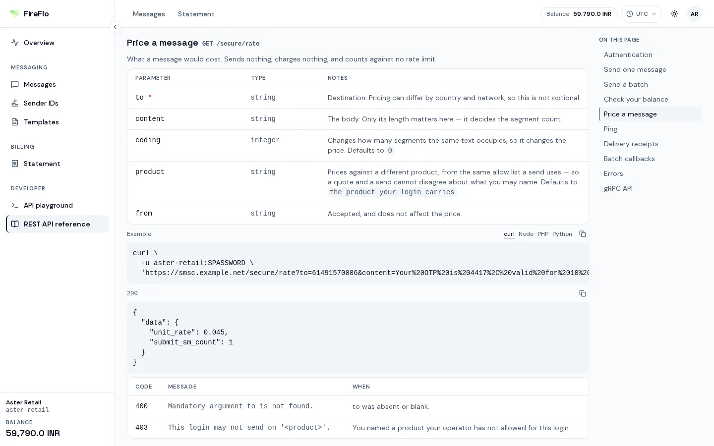
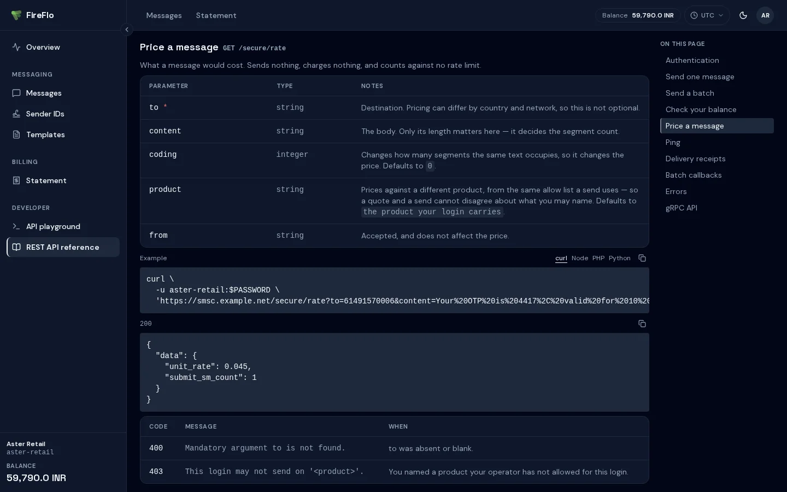

Two endpoints, neither of which sends anything.

## What is left

```bash
curl -u "$SMS_LOGIN:$SMS_PASSWORD" 'https://sms.example.com/secure/balance'
```

```json
{
  "data": {
    "balance": 4182.6,
    "sms_count": "ND"
  }
}
```

`balance` is money on the account this login bills to. `sms_count` is `"ND"` — not determined —
whenever the platform cannot convert money into a message count, which is the normal case as soon as
you have more than one price.

<Warning>
**Do not poll this before every send.** It is a database read, it tells you nothing about whether
*this* message will be accepted, and it doubles your request volume. Poll it on a schedule for
alerting, and let a `402` be your per-message signal.
</Warning>

## What a message will cost

```bash
curl -u "$SMS_LOGIN:$SMS_PASSWORD" \
  --get --data-urlencode 'to=61491570006' \
  --data-urlencode 'content=Your OTP is 4417, valid for 10 minutes.' \
  'https://sms.example.com/secure/rate'
```

```json
{
  "data": {
    "unit_rate": 0.045,
    "submit_sm_count": 1
  }
}
```

**The cost is `unit_rate × submit_sm_count`.** `submit_sm_count` is the segment count, so this is
also how you find out that a message you thought was one is actually three.

<Frame caption="Price a message in the REST API reference in your customer portal: the parameters, an example for your login, the answer, and the two refusals particular to it.">
  
  
</Frame>

`/secure/rate` **sends nothing, charges nothing, and counts against no rate limit.** That makes it
safe to call on user-generated content before committing to a send — the one pre-flight check that is
genuinely free.

<Tip>
Pricing can differ by country and network, which is why `to` is required rather than optional. A quote
without a destination would be a guess.
</Tip>

## The block behaviour, which explains an occasional refusal

Credit is **reserved in blocks, not per message** — around twenty messages' worth at a time — which is
what keeps the send path off the database.

<Warning>
**A message arriving while the next reservation is being taken waits for it** rather than being
refused. Only if the credit is still not confirmed after the wait — usually the gateway's database
being slow for a moment — is it refused, and from 0.17.2 that refusal has its own answer: `503` with
code `CREDIT_PENDING` and `Retry-After: 2` over REST, `0x58` over SMPP. Nothing is charged. **Retrying
succeeds.**

A `402` means the balance will not cover the message. A *persistent* `402` with a healthy balance is a
different matter — raise it with your provider.
</Warning>

**The block size does not strand your credit.** A reservation falls back through the full block, then
the floor, then the single message that asked — so an account spends every unit it holds, and a small
top-up works exactly as you would expect.

## Product changes the price

`product` on either endpoint prices against a different product — from an allow list your provider
maintains per login, and **most logins are allowed none**.

The same allow list governs both endpoints, deliberately: a quote and a send cannot disagree about
what you are permitted to name.

## Related

<CardGroup cols={2}>
  <Card title="Statements and limits" icon="file-invoice" href="/developers/billing/statements-and-limits">
    Your usage history, and the ceilings that apply to you.
  </Card>
  <Card title="Price a message" icon="calculator" href="/reference/api/rate">
    Every field on `/secure/rate`.
  </Card>
</CardGroup>
