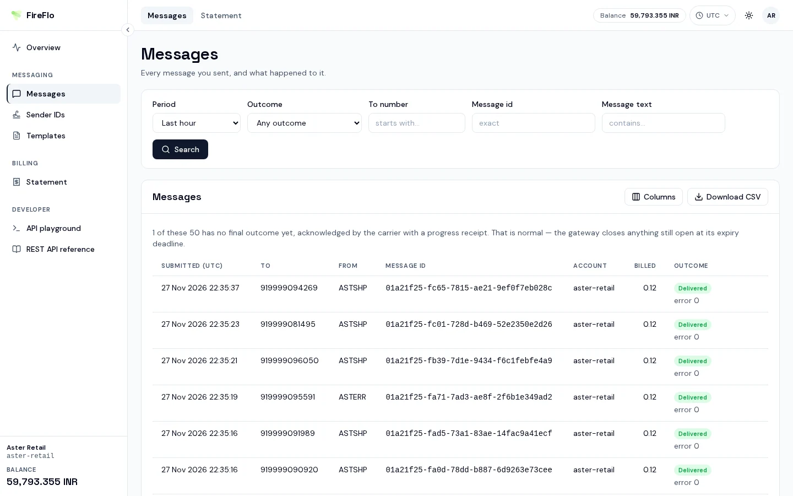
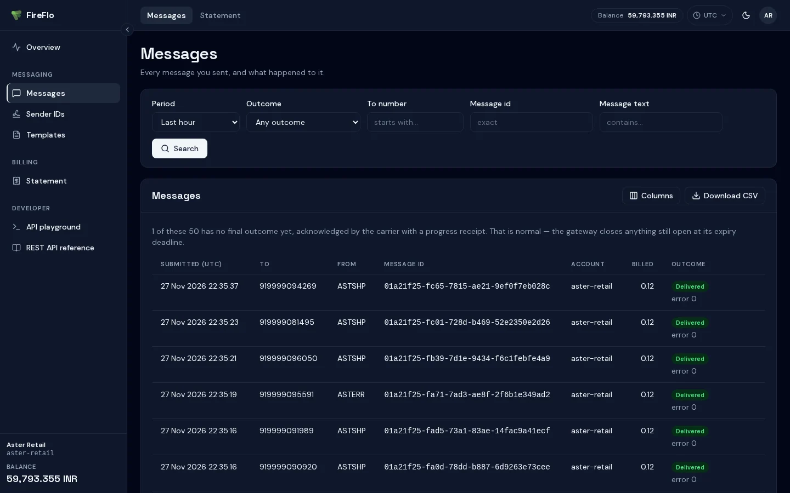
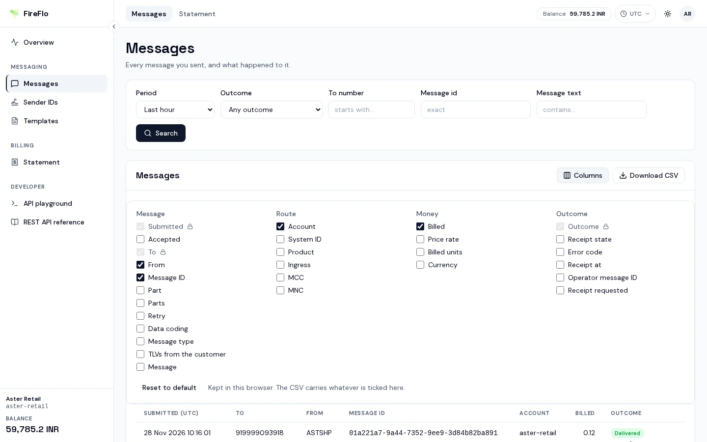
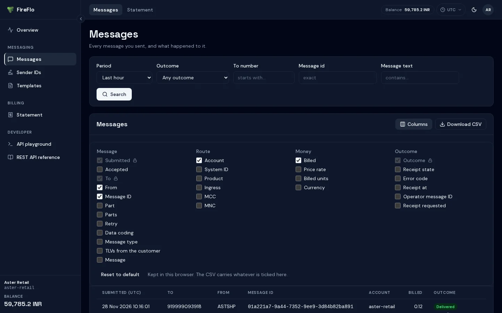
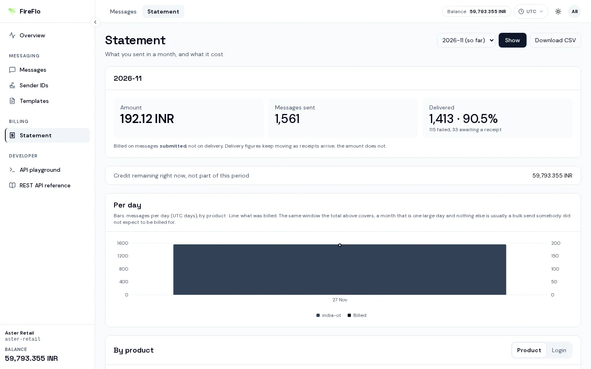
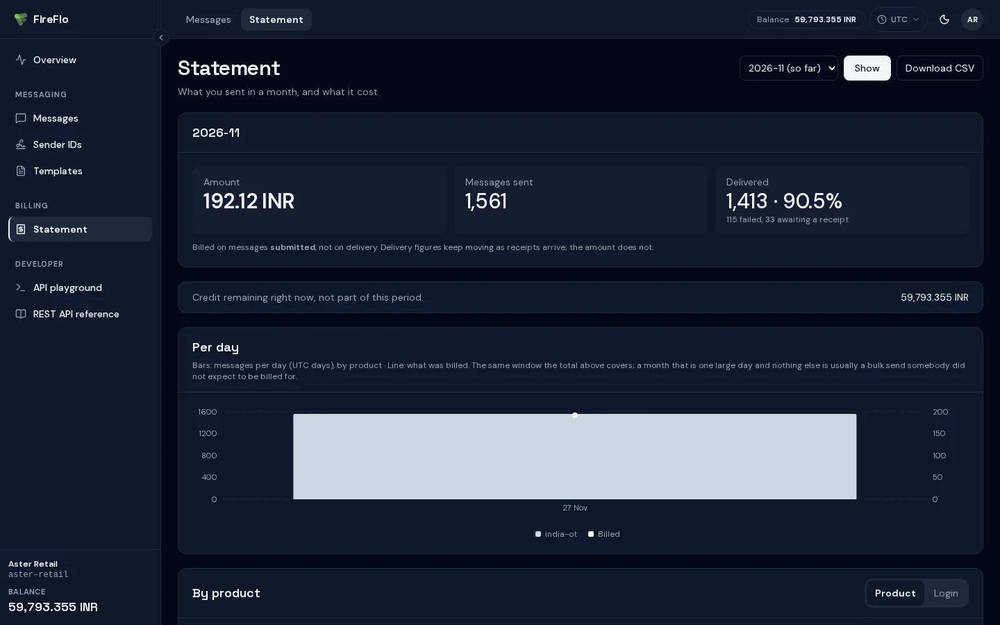
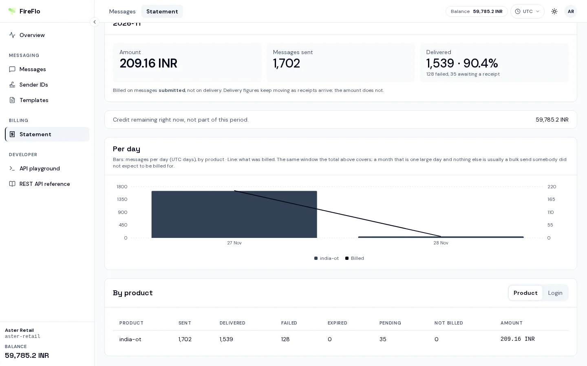
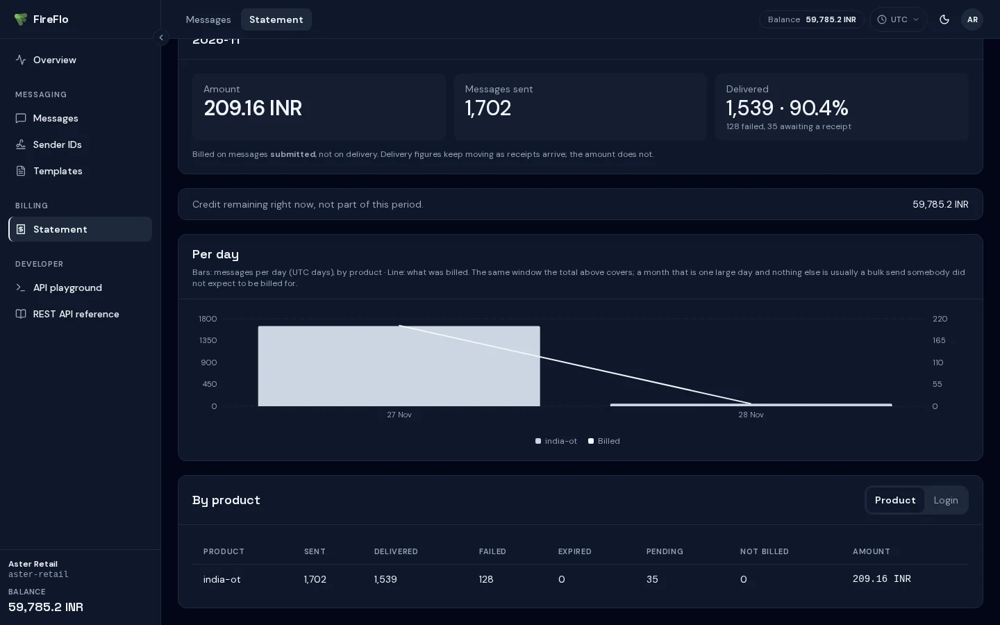

Two screens answer two different questions. **Messages** is "what happened to this one". **Statement**
is "what am I paying for". They disagree slightly on purpose, and the reason is at the bottom of this
page.

## Messages

A filter bar over a table. Filters apply when you press **Search**, not as you type, and they are
carried in the address bar — so a filtered view can be bookmarked, or pasted into a support request
so that whoever reads it sees exactly what you saw.

<Frame caption="Messages: the filter bar, then the table with Columns and Download CSV above it. The line over the rows says how many have no final outcome yet, so a column of blanks does not read as a fault.">
  
  
</Frame>

| Filter | Notes |
| :--- | :--- |
| **Period** | Last hour, 24 hours, 7 days, 30 days, or a custom range. Opens on the last hour, or on the period you last chose in that browser |
| **Outcome** | Any, or one specific outcome |
| **To number** | Matches from the start of the number |
| **Message id** | Exact |
| **Message text** | Searches inside message bodies |

**Awaiting a receipt** is listed first among the outcomes rather than alphabetically, because it is
the one people come looking for.

<Note>
**Message text search finds nothing unless your provider records message content.** Storing bodies is
a deployment choice with obvious privacy consequences, and plenty of operators switch it off. An
empty result here may mean the content is not kept, not that no message matched.
</Note>

Resellers get one extra filter to narrow to a single account or search across all of them.

### Columns

Seven are shown by default: submitted, to, from, message id, account, billed and outcome. **Columns**
opens a chooser grouped under Message, Route, Money and Outcome — around thirty in all, including
part and retry counts, data coding, the TLVs you sent, message type, MCC and MNC, price rate, billed
units, receipt state, error code and receipt time.

<Frame caption="The column chooser. The padlocks mark the three that cannot be turned off, and the line at the foot is the rule to remember: the CSV carries whatever is ticked here.">
  
  
</Frame>

Three cannot be turned off — **Submitted**, **To** and **Outcome** — since a row without them is not
identifiable.

Your choice is kept in that browser, and **the CSV carries whatever is ticked**. Set the columns you
want before exporting.

<Warning>
**Cost, margin and vendor are not in the chooser and not in the data.** You see what you were billed.
What your provider paid to carry it, and who carried it, are theirs — no column, no export, no API
field.
</Warning>

**Download CSV** honours the current filters and the current columns.

Times are shown in the zone picked in the top bar — your provider's platform zone unless you choose
your browser's own or UTC. Each time column names the zone in its heading, and the footer says it
again, so a row discussed across time zones can be pinned down. The CSV keeps its time columns in
UTC and adds a local copy of each in the zone you were reading the table in.

Where some rows have no outcome yet, a line above the table says so:

> *n* of these *total* have no final outcome yet. That is normal — the gateway closes anything still
> open at its expiry deadline.

Where the carrier has already acknowledged some of them with a progress receipt, the line says that
too.

## Statement

Choose a month and press **Show** — the last thirteen are offered, the current one marked
**(so far)**. Picking a month only marks it changed; the figures and the CSV stay those of the month
they are labelled with until you press Show. It opens on the *previous* complete month, because that
is the one you are being asked to pay.

<Frame caption="A month's statement: the amount, messages sent and delivered with what became of the rest, then — on a row of its own, because it is not part of the month — what is on the account right now.">
  
  
</Frame>

The headline card shows the amount, messages sent, and delivered with its rate. Under delivered, the
rest are accounted for — how many failed, expired and are still awaiting a receipt — so every message
sent is in one of those figures.

Beneath it, on its own row and labelled as **right now** rather than as part of the month, one of two
figures, never both: a **credit limit** for accounts billed in arrears, or the **credit remaining**
for accounts on prepaid credit. Reading a credit limit as a balance is the misreading that costs
money, so they are never given the same name.

If some traffic went out unpriced, a note says how many messages and confirms they are not in the
amount.

Below: a **per-day** chart — messages per day by product, with what was billed as a line — then a
breakdown **by product**, or **by login** if you switch it. Each row has sent, delivered, failed,
expired, pending, not billed and amount; **Not billed** is what reconciles a row's sent count with its
amount. Where they exist, a list of **invoiced periods** follows.

<Frame caption="The breakdown by product. Delivered, failed, expired, pending and not billed are counted apart; the Product and Login switch at the top right changes what the rows are.">
  
  
</Frame>

> A closed period is final. Anything landing against one afterwards appears as an adjustment on the
> period that follows it.

Each month exports as CSV with **Download CSV**, beside Show.

Days on the chart and in the statement run midnight to midnight in your provider's platform zone,
whatever zone you have chosen for times.

## Why the two screens disagree

> Billed on messages **submitted**, not on delivery. Delivery figures keep moving as receipts arrive;
> the amount does not.

A message accepted on the 31st and reported on the 1st is billed in the earlier month and delivered
in the later one. So the delivered count on Messages will drift after a statement is cut, and the
statement amount will not.

This is the alternative to a bill that changes for weeks after you receive it. Prices are fixed at
submission, which is also why a tariff change does not restate history.
