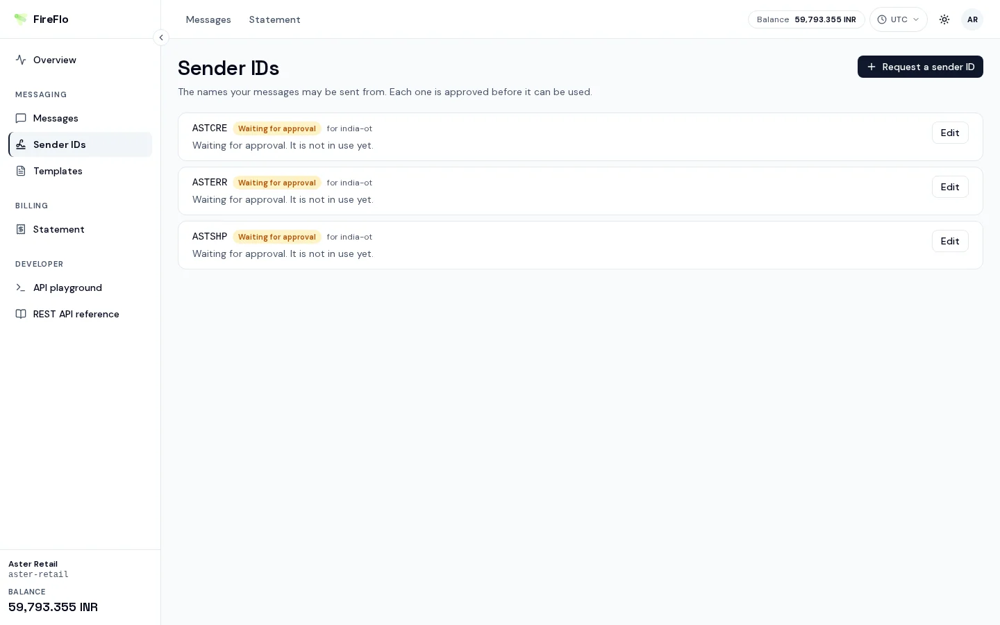
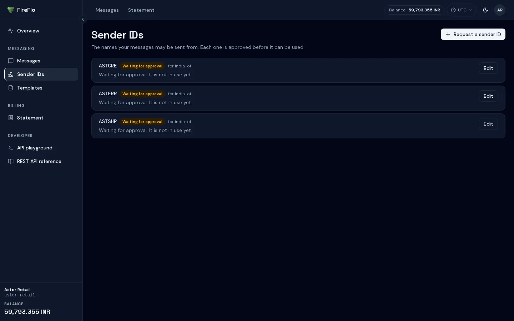
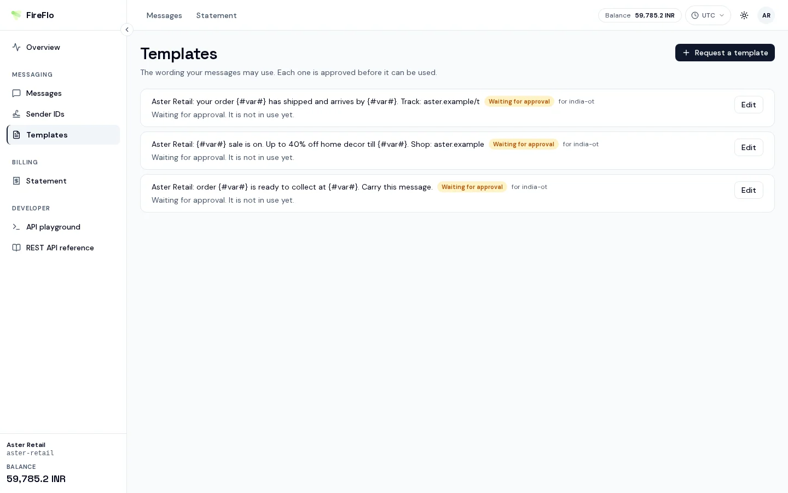
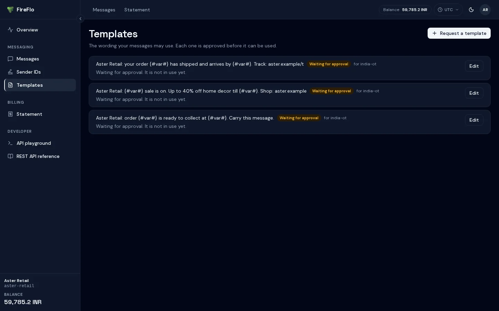
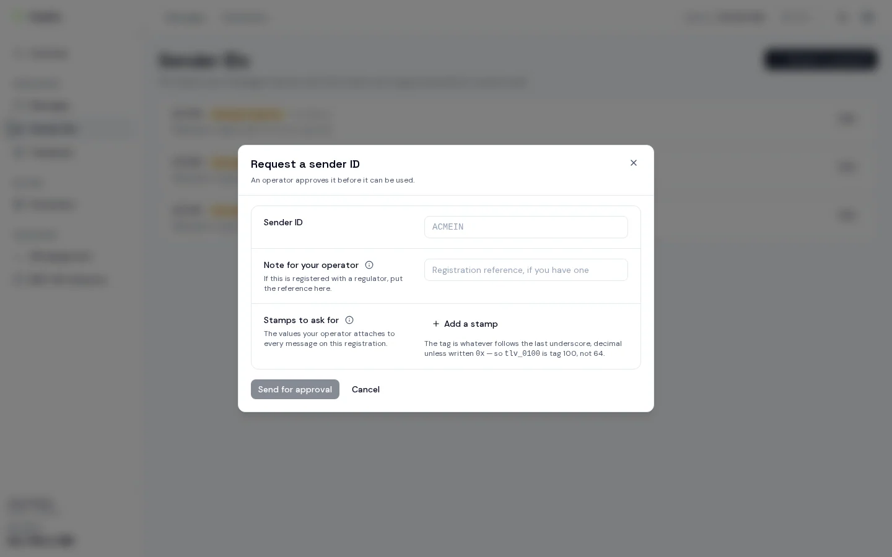
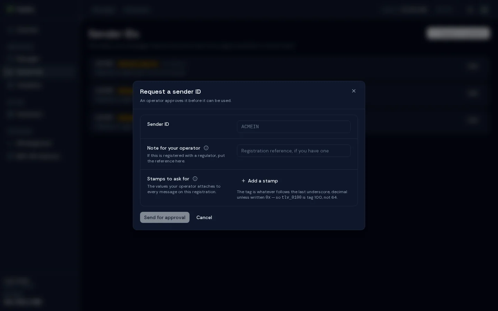

Two screens, one shape. **Sender IDs** are the names your messages may be sent from. **Templates**
are the wording they may use. Each one is approved by your provider before it can be used.

<Note>
**Nothing on these screens approves anything.** Every save is a request. This is the part customers
are most often surprised by: a registration you have just created and can see in the list is not yet
usable.
</Note>

Whether either is enforced at all is your provider's choice. Where it is — India's DLT regime being
the obvious case — an unregistered sender or unapproved wording is refused at submission.

## The four states

| Badge | On the API | Meaning |
| :--- | :--- | :--- |
| **Waiting for approval** | `PENDING` | Submitted, not yet reviewed. Not usable |
| **In use** | `APPROVED` | Approved and live |
| **Not approved** | `REJECTED` | Refused, with your provider's reason shown |
| **Withdrawn** | `WITHDRAWN` | Was approved, switched off by your provider. Not usable |

The middle column is what [`/secure/senders`](/reference/api/senders) and
[`/secure/templates`](/reference/api/templates) return, so the two surfaces describe the same four
states rather than eight. **Only `APPROVED` is usable** — the other three all mean a message will be
refused, for different reasons.

Each row also says which product it applies to. Once any of your registrations is bound to one login,
every row says which login it covers as well — either a named one or **all your logins**.

<Frame caption="Sender IDs, each with its state and the product it is for. These three are still waiting for approval, and each says so in words: it is not in use yet.">
  
  
</Frame>

<Frame caption="Templates, on the same pattern. The {#var#} gaps are what may change; everything around them is matched exactly.">
  
  
</Frame>

## Requesting a sender ID

**Request a sender ID** opens a short form: the sender ID itself, a **note for your operator** and the
[stamps to ask for](#stamps).

<Frame caption="The request form. Only the sender ID is needed; the note is where a regulator's registration reference goes, and nothing is usable until your operator approves it.">
  
  
</Frame>

> **Note for your operator** — if this is registered with a regulator, put the reference here. Your
> operator sets the value the gateway sends; you do not need to.

The sender ID is the field that is checked. The refusals are worth knowing before you hit them:

- A sender ID is at most 64 characters, **but SMPP allows 21** — anything near the upper bound could
  be stored here and never delivered.
- Leading or trailing spaces are refused outright. A sender ID is compared exactly, and a trailing
  space is invisible in every place it is displayed.
- It must be printable ASCII.

## Requesting a template

A **name**, for you and your provider to recognise it, matched against nothing. Then the **wording**,
which is matched — exactly, apart from the gaps you mark. The note for your operator and the stamps
follow, as for a sender ID.

> Put `{#var#}` where the message changes — a name, a code, an order number. Everything else has to
> match exactly.

Three placeholders exist:

| Placeholder | Accepts |
| :--- | :--- |
| `{#var#}` | Anything |
| `{#num#}` | Digits 0–9 |
| `{#alp#}` | Letters, spaces and name punctuation |

A live preview shows an example message your template would accept, which is the fastest way to catch
a template that is narrower or wider than you meant.

### Where templates go wrong

The form refuses each of these with a sentence rather than a code:

**A token spelled wrong.** `{#VAR#}` or `{#Var#}` is not a placeholder. Write the token lower case
with no spaces inside it — that is the spelling, not a statement about what it accepts.

**Something that looks like a placeholder and is not**, such as `{#VAR}` or `{{#var#}}`. The
characters around a real placeholder are matched literally, so this would only ever approve a message
carrying them exactly as written.

**Two placeholders touching.** Two variables with nothing between them cannot be told apart, so they
act as one variable of twice the length. Put the wording that separates them in between.

**A template of nothing but a placeholder**, which accepts every message — the same as having no
template at all.

You may also get a warning rather than a refusal, where the wording repeats itself around the
changing part. That can make a template match less than you expect, and is worth checking with your
provider.

## Stamps

Under **Stamps to ask for** you can propose the values your provider attaches to every message on
this registration — under DLT, your entity and template identifiers. **Add a stamp** gives you a tag
and a value per row.

> The tag is whatever follows the last underscore, decimal unless written `0x` — so `tlv_0100` is
> tag 100, not 64.

> **Asking is free:** nothing here reaches a message until your operator accepts it, so an approved
> registration keeps working meanwhile.

If you have already asked and had no answer, saving replaces what your provider will see rather than
queueing a second request.

## Which login

Where your account has more than one API login, the form also offers **Which login**, to bind a
registration to one of them. With a single login the choice is not shown.

<Warning>
**Leave this on "All my logins" unless you know you want otherwise.** Bound to one login, a
registration does nothing for the others — and a login with nothing approved for it can send nothing
at all.
</Warning>

## Asking for one of your customers

If you resell, the form also asks **Who this is for**: your own account, or one of your customers.
Pick a customer and the registration is requested against their account, and your operator approves
it before they can send with it. A registration asked for a customer covers all of their logins.

## Editing something that is in use

Changing the wording, the sender ID, the name, the note or the login on a live registration sends it
back for approval, and the save button asks you to confirm:

> This stops being usable until an operator approves the change.

If it is your only registration in use, it says so, because the consequence is larger:

> This stops being usable until an operator approves the change — and it is your only one in use, so
> nothing will be accepted from this account until then.

**Changing only the proposed stamps suspends nothing** and saves without confirmation, since those do
not take effect until accepted anyway.

If you need altered wording live before the old wording can go, request the new one as a separate
template and let your provider withdraw the old one afterwards.

## Doing this from your own code

Everything on these two screens is also on the REST API, so a customer with many registrations does
not have to work through the portal one at a time:

<CardGroup cols={2}>
  <Card title="/secure/senders" icon="id-card" href="/reference/api/senders">
    List, request, change and withdraw sender IDs.
  </Card>
  <Card title="/secure/templates" icon="align-left" href="/reference/api/templates">
    The same four calls for wording.
  </Card>
</CardGroup>

Same credentials you send with, and the same rules — what you write is a **request**, and the API
says which state each registration is in and whether registrations are being enforced on your
account at all.

<Note>
**Available from gateway 0.9.7.** If those endpoints answer `404`, your provider is running an
older gateway and these screens are the way to ask.
</Note>

