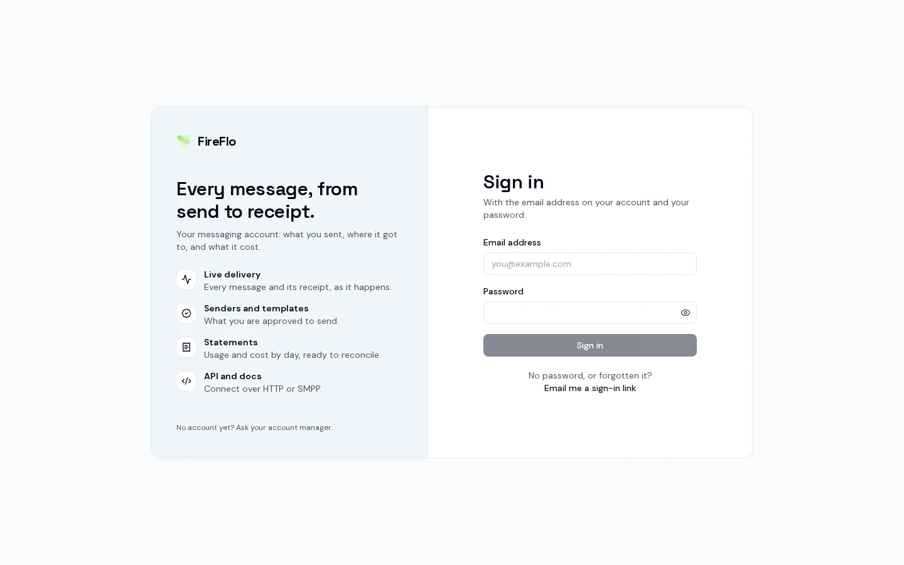
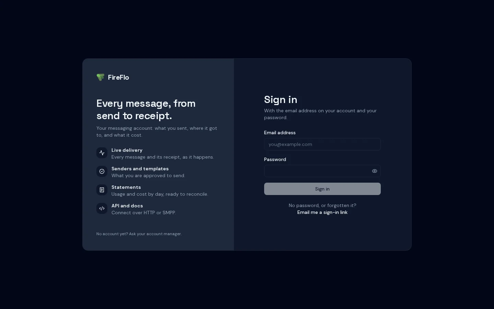
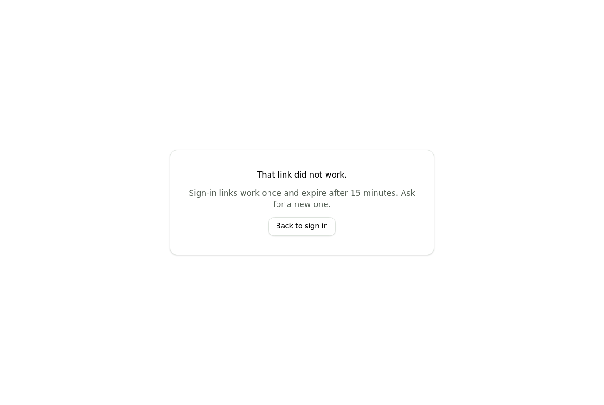
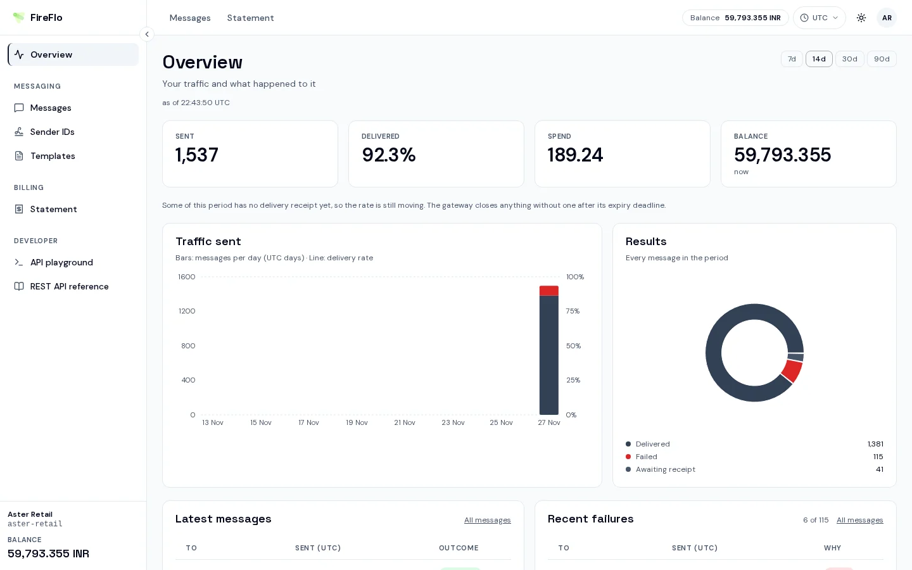
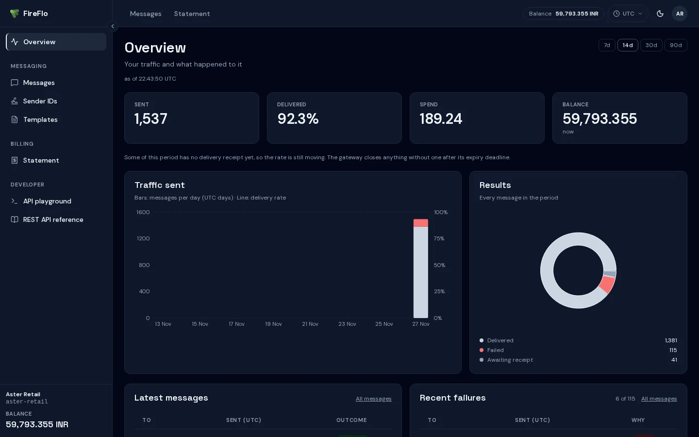

You sign in to the portal with the email address your operator holds for your login, and one of two
things: **your password**, or **a one-time link** sent to that address. Both land you in the same
place, and you can use either on any day — having a password does not switch the link off.

<Frame caption="The portal sign-in page. Email address and password first; below them, a sign-in link by email for anyone who has no password or has forgotten it.">
  
  
</Frame>

## With a password

> Sign in — with the email address on your account and your password.

If either half is wrong, the answer is one sentence:

> That email and password do not match, or that login has no password yet. You can sign in by
> emailed link instead.

<Note>
**That sentence is the same whatever was wrong** — an address that is not on any account, a wrong
password, a login that has no password, or a disabled account. A form that said which half was wrong
would tell anyone with a list of addresses which of them are your provider's customers.
</Note>

### Too many wrong passwords

After **ten** wrong passwords for one address from the same network inside a quarter of an hour — or
**thirty** for that address from anywhere — sign-in with a password is refused for that address until
the quarter hour is up, **even with the right password**. The refusal reads exactly like a wrong
password, so it will not tell you it has happened.

If a password you are sure of keeps failing, wait fifteen minutes or use the sign-in link: the link is
not affected.

## Getting a password

There are two ways to have one:

- **Your operator sets it** when they add your login, or later.
- **You set it yourself.** Sign in by link, open the account menu at the top right and choose
  **Password**. Setting your first one asks for nothing more — signing in by link has already shown
  that the address is yours.

> At least 12 characters. A sentence works well.

The form shows how strong the password is as you type, and refuses one that is too easy to guess —
one of the most common passwords, your own email address, one character repeated, a run along the
keyboard or the alphabet.

**Changing a password asks for the current one first**, so a session left open on a shared machine
cannot be used to take your login over. Wrong guesses there count towards the same quarter-hour
limit as sign-in:

> Too many wrong attempts. Try again in a quarter of an hour.

Setting or changing your password **signs you out everywhere else**. The browser you changed it in
stays signed in.

<Tip>
**Forgotten your password?** Sign in by link — it always works. The Password page will not change a
password without the current one, so to replace a forgotten one, ask your operator to reset it or to
remove it. With no password set, you sign in by link until you set a new one.
</Tip>

## With a sign-in link

**Email me a sign-in link**, below the password form, switches to a single field:

> Email me a link — we will email a single-use sign-in link to the address on your account.

Whatever you typed, the screen then says the same thing:

> **Check your inbox.** If that address is on an account, a sign-in link is on its way to
> *you@example.com*. It works once and expires in 15 minutes.

<Note>
**That answer does not change if the address is wrong.** It is identical for an address on an
account, an address on a disabled account, and an address that has never been seen.

This is deliberate, for the same reason as the password answer above. The cost of that protection is
that a typo looks exactly like success — so if nothing arrives, check the address before assuming a
fault.
</Note>

Two controls sit beneath it. **Send it again** is disabled for two minutes and counts down; the timer
survives a page reload and corrects itself when you come back from your mail client, rather than
showing a stale number. **Use a different address** returns you to an empty form.

> Nothing after a minute or two? Check the spam folder, then send it again. The newest link is the
> one that works.

That last clause matters: requesting a second link does not leave the first one valid. Follow the
most recent email.

**Have a password? Sign in with it** takes you back to the password form.

### Following the link

If the link has already been used, or is more than fifteen minutes old:

> **That link did not work.** Sign-in links work once and expire after 15 minutes. Ask for a new one.

<Frame caption="What a used or expired link shows. Both are normal — a link is spent the moment it succeeds, so following the same email twice produces this.">
  
</Frame>

Both are normal. A link is spent the moment it succeeds, so following the same email twice — or
having a mail scanner follow it before you do — will produce this.

### Limits on links

Link requests are rate limited per account and per network. The per-account limit answers with the
same neutral sentence as a success, so you will not be told you have hit it. The per-network limit
does say so:

> Too many sign-in requests from this address. Try again shortly.

If your provider has not configured the panel to send mail, you get a real error rather than a link
that never comes:

> Sign-in by email is not available on this panel. Ask your account manager.

That is a deployment setting on their side, not something you can work around. A password, if you
have one, still works.

## Where you land

Either way you land on **Overview** — not on your messages, because the first question after signing
in is usually "how are things", not "show me row 4,000".

<Frame caption="Overview, the first page after signing in: sent, delivered, spend and balance for the period, the traffic chart and the results, with the latest messages and recent failures underneath.">
  
  
</Frame>

The chart, the tiles and the results on that page are built from your traffic once a minute and
served from there; a line under the title says **as of** what time. Your balance and the two lists of
recent messages are read live every time. Should the last build have failed, the line says the
figures are the previous ones rather than showing you an error page.

Times across the portal are shown in the zone picked in the top bar: your provider's **platform
zone** by default, so that you and they quote the same times to each other, or **your browser's**
zone, or **UTC**. The choice is kept in that browser. Days on charts and statements always run
midnight to midnight in the platform zone, whatever you pick.

## Staying signed in

Your session is held in a cookie in the browser you signed in with. It lasts twelve hours and is
renewed while the portal is open, so a portal left untouched for longer asks you to sign in again.
**Sign out** is in the account menu at the top right. Signing in on a phone does not sign you out on
a desktop. If you use the portal from a shared machine, sign out rather than closing the tab.
