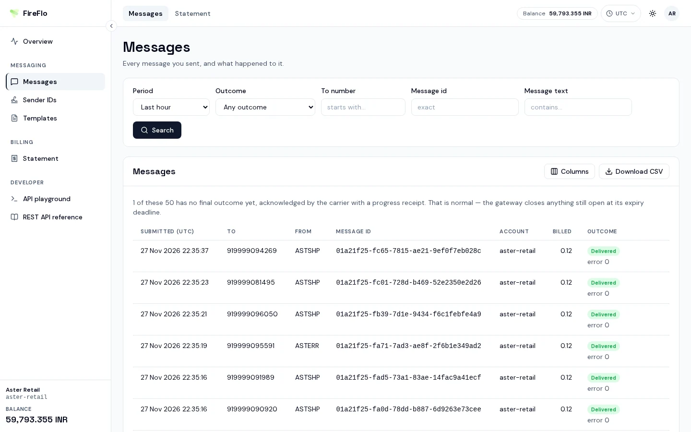
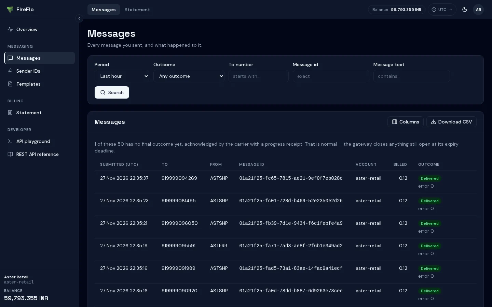
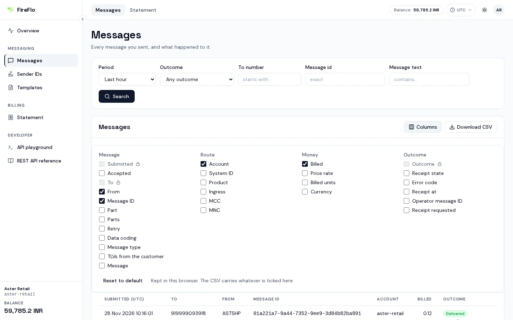
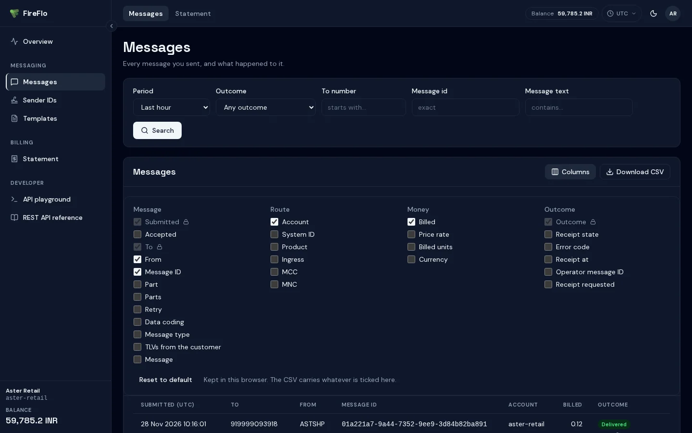
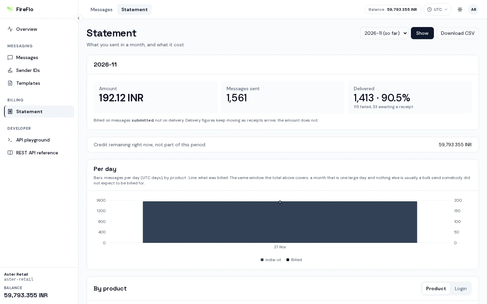
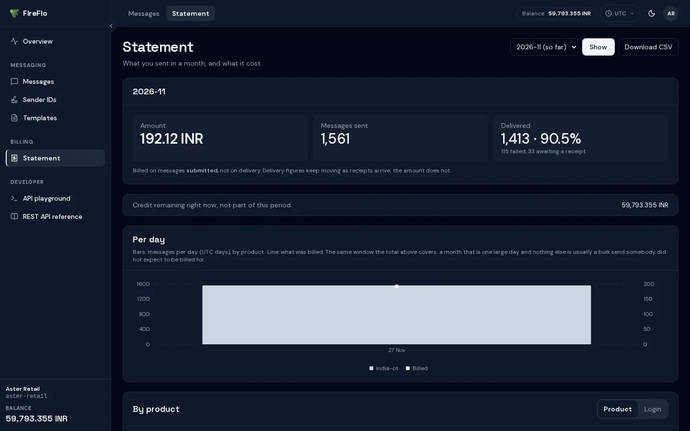
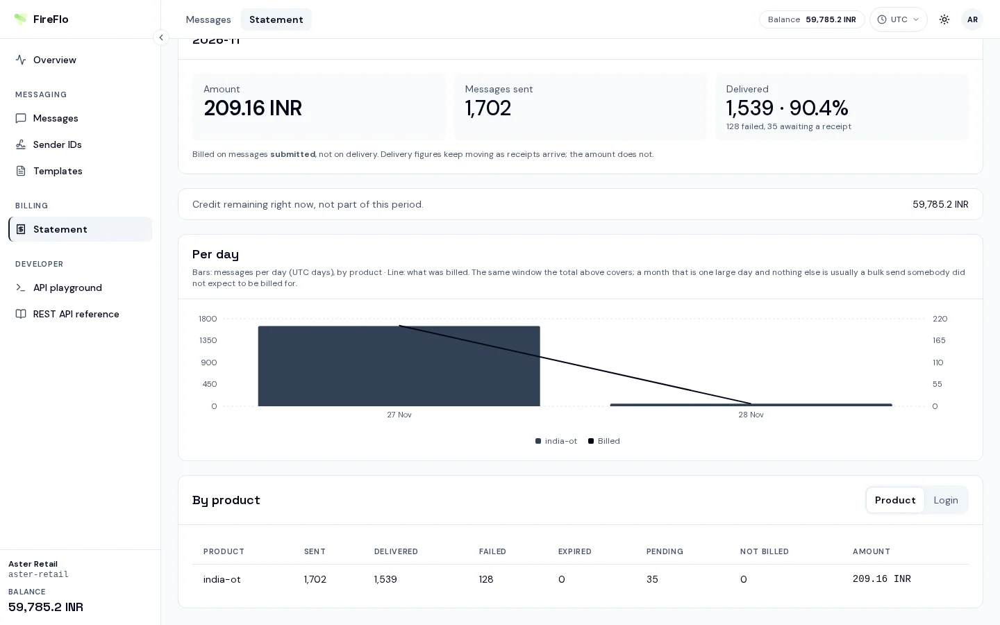
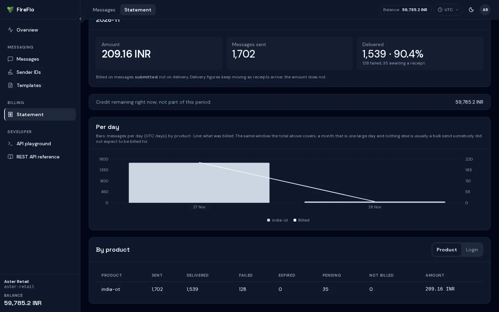

Dos pantallas responden a dos preguntas distintas. **Messages** es "qué le pasó a este". **Statement**
es "qué estoy pagando". Discrepan ligeramente a propósito, y la razón está al pie de esta página.

## Mensajes

Una barra de filtros sobre una tabla. Los filtros se aplican al pulsar **Search**, no mientras
escribe, y se llevan en la barra de direcciones. Así, una vista filtrada puede marcarse como
favorita, o pegarse en una petición de soporte para que quien la lea vea exactamente lo que usted vio.

<Frame caption="Messages: la barra de filtros y después la tabla, con Columns y Download CSV encima. La línea sobre las filas dice cuántas aún no tienen resultado final, para que una columna en blanco no se lea como un fallo.">
  
  
</Frame>

| Filtro | Notas |
| :--- | :--- |
| **Period** | Última hora, 24 horas, 7 días, 30 días o un rango personalizado. Se abre en la última hora, o en el período que eligió por última vez en ese navegador |
| **Outcome** | Cualquiera o uno específico |
| **To number** | Coincide desde el inicio del número |
| **Message id** | Exacto |
| **Message text** | Busca dentro del cuerpo de los mensajes |

**Awaiting a receipt** aparece primero entre los resultados en lugar de por orden alfabético, porque
es el que la gente viene a buscar.

<Note>
**La búsqueda por texto no encuentra nada a menos que su proveedor registre el contenido de los
mensajes.** Guardar cuerpos es una decisión de despliegue con consecuencias evidentes de privacidad,
y muchos operadores lo desactivan. Un resultado vacío aquí puede significar que el contenido no se
guarda, no que ningún mensaje coincidiera.
</Note>

Los revendedores obtienen un filtro adicional para acotar a una única cuenta o buscar entre todas.

### Columnas

Siete se muestran por defecto: submitted, to, from, message id, account, billed y outcome.
**Columns** abre un selector agrupado bajo Message, Route, Money y Outcome: unas treinta en total,
incluyendo recuentos de partes y reintentos, data coding, las TLV que envió, tipo de mensaje, MCC y
MNC, unit rate, unidades facturadas, estado del acuse, código de error y hora del acuse.

<Frame caption="El selector de columnas. Los candados marcan las tres que no pueden desactivarse, y la línea del pie es la regla que conviene recordar: el CSV lleva lo que esté marcado aquí.">
  
  
</Frame>

Tres no pueden desactivarse: **Submitted**, **To** y **Outcome**, porque una fila sin ellas no es
identificable.

Su elección se conserva en ese navegador, y **el CSV se lleva lo que esté marcado**. Ajuste las
columnas que quiere antes de exportar.

<Warning>
**Coste, margen y vendor no están en el selector ni en los datos.** Ve lo que se le facturó. Lo que
su proveedor pagó por transportarlo, y quién lo transportó, son suyos. Sin columna, sin exportación,
sin campo de API.
</Warning>

**Download CSV** respeta los filtros y las columnas actuales.

Las horas se muestran en la zona elegida en la barra superior: la zona de la plataforma de su
proveedor, salvo que elija la de su propio navegador o UTC. Cada columna de hora nombra la zona en su
encabezado, y el pie lo repite, de modo que una fila comentada entre zonas horarias puede fijarse. El
CSV mantiene sus columnas de hora en UTC y añade una copia local de cada una en la zona en la que
estaba leyendo la tabla.

Cuando algunas filas todavía no tienen resultado, una línea sobre la tabla lo indica:

> *n* de estos *total* todavía no tienen resultado final. Es normal. La pasarela cierra todo lo que
> siga abierto en su fecha límite de expiración.

Cuando el operador ya ha confirmado algunos de ellos con un acuse de progreso, la línea también lo
dice.

## Extracto

Elija un mes y pulse **Show**: se ofrecen los últimos trece, con el actual marcado como
**(so far)**. Elegir un mes solo lo marca como cambiado; las cifras y el CSV siguen siendo los del mes
con el que están etiquetados hasta que pulse Show. Se abre en el mes *anterior* completo, porque es
el que se le pide pagar.

<Frame caption="El extracto de un mes: el importe, los mensajes enviados y entregados con lo que pasó con el resto y después, en una fila propia porque no forma parte del mes, lo que hay en la cuenta ahora mismo.">
  
  
</Frame>

La tarjeta principal muestra el importe, los mensajes enviados y los entregados con su tasa. Bajo los
entregados se da cuenta del resto: cuántos fallaron, expiraron y siguen esperando un acuse, de modo
que cada mensaje enviado está en una de esas cifras.

Debajo, en su propia fila y etiquetada como **right now** en lugar de como parte del mes, una de dos
cifras, nunca las dos: un **límite de crédito** para cuentas facturadas a plazos, o el **crédito
restante** para cuentas con crédito prepago. Leer un límite de crédito como saldo es el error de
lectura que cuesta dinero, así que nunca se les da el mismo nombre.

Si algo de tráfico salió sin tarificar, una nota indica cuántos mensajes y confirma que no están en
el importe.

Debajo: un gráfico **por día** (mensajes por día por producto, con lo facturado como línea) y después
un desglose **por producto**, o **por login** si lo cambia. Cada fila tiene enviados, entregados,
fallidos, expirados, pendientes, no facturados e importe; **Not billed** es lo que concilia el
recuento de enviados de una fila con su importe. Cuando existen, sigue una lista de **períodos
facturados**.

<Frame caption="El desglose por producto. Entregados, fallidos, expirados, pendientes y no facturados se cuentan por separado; el selector Product y Login arriba a la derecha cambia lo que representan las filas.">
  
  
</Frame>

> Un período cerrado es definitivo. Cualquier cosa que caiga contra él después aparece como ajuste
> en el período siguiente.

Cada mes se exporta como CSV con **Download CSV**, junto a Show.

Los días del gráfico y del extracto van de medianoche a medianoche en la zona de la plataforma de su
proveedor, sea cual sea la zona que haya elegido para las horas.

## Por qué las dos pantallas no coinciden

> Se factura sobre mensajes **enviados**, no sobre entrega. Las cifras de entrega siguen moviéndose
> a medida que llegan los acuses; el importe no.

Un mensaje aceptado el día 31 y reportado el día 1 se factura en el mes anterior y se entrega en el
posterior. Así que el recuento de entregas en Messages derivará después de cerrar un extracto, y el
importe del extracto no.

Esta es la alternativa a una factura que cambia durante semanas después de recibirla. Los precios
se fijan en el momento del envío, lo que también explica por qué un cambio de tarifa no reformula
el histórico.
