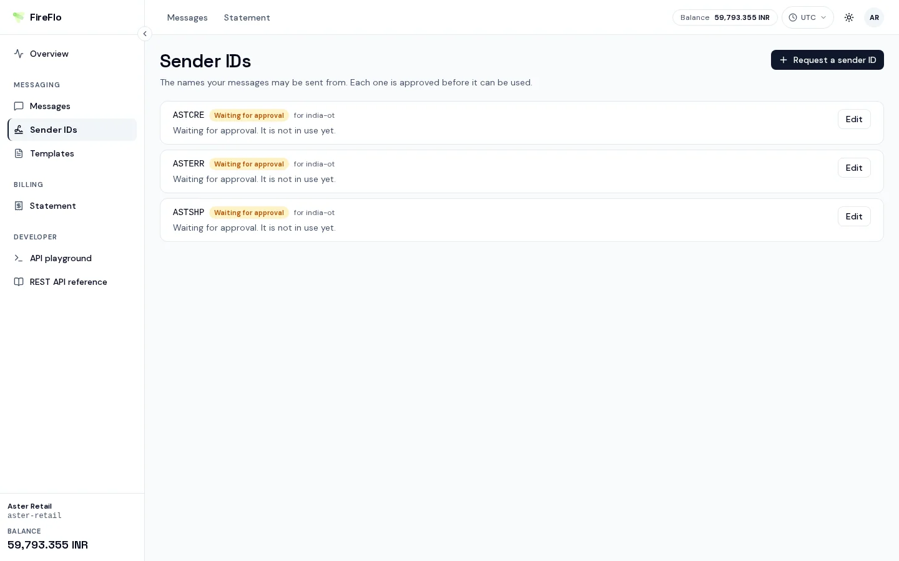
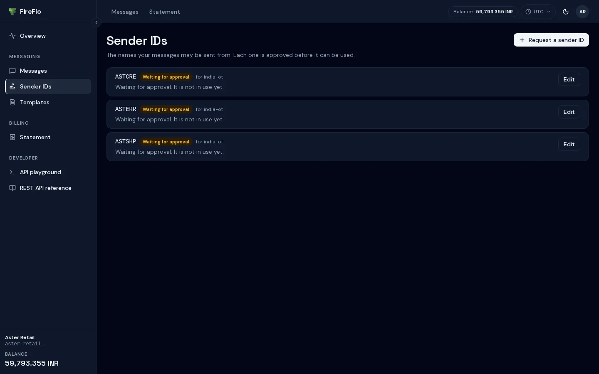
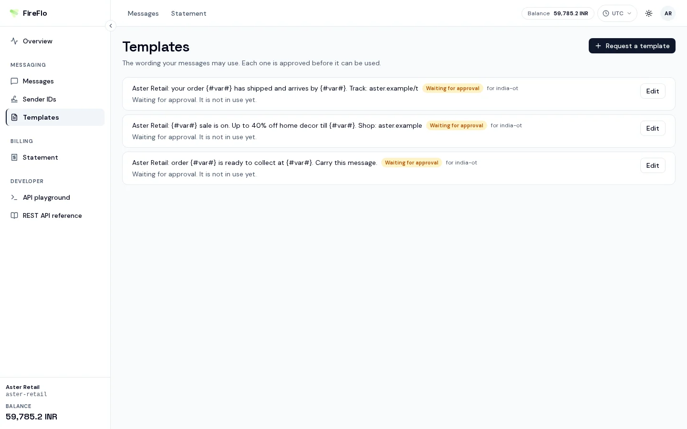
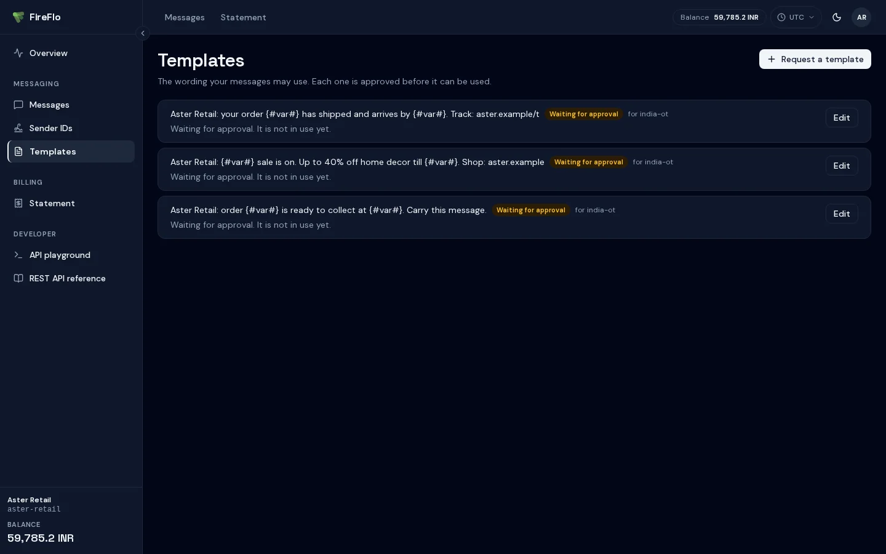
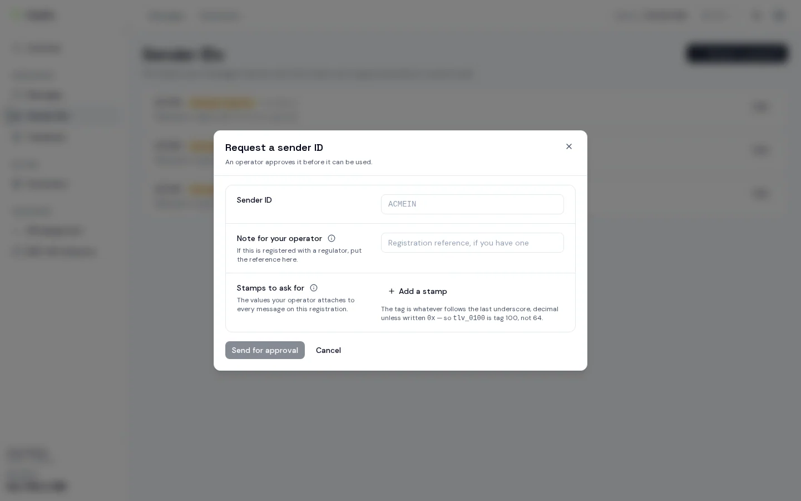
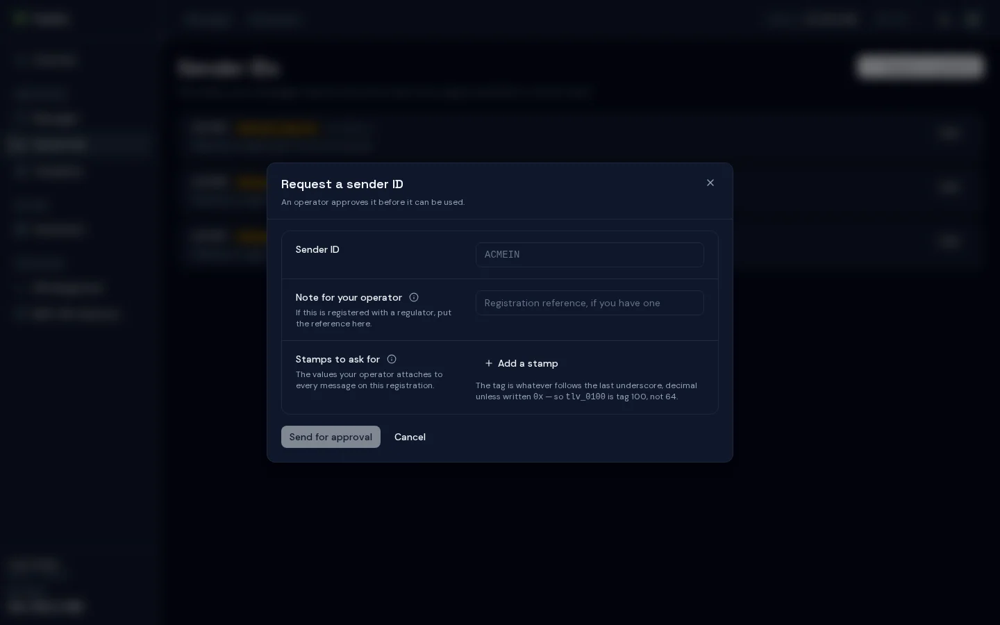

Dos pantallas, una misma forma. **Sender IDs** son los nombres desde los que se pueden enviar sus
mensajes. **Templates** son la redacción que pueden usar. Cada una es aprobada por su proveedor
antes de que pueda usarse.

<Note>
**Nada en estas pantallas aprueba nada.** Cada guardado es una solicitud. Es la parte que más
sorprende a los clientes: un registro que acaba de crear y que puede ver en la lista todavía no es
utilizable.
</Note>

Si alguno se impone en absoluto es decisión de su proveedor. Cuando se impone —el régimen DLT de
India es el caso obvio—, un remitente sin registrar o una redacción no aprobada se rechaza en el
envío.

## Los cuatro estados

| Distintivo | En la API | Significado |
| :--- | :--- | :--- |
| **Waiting for approval** | `PENDING` | Enviado, aún sin revisar. No utilizable |
| **In use** | `APPROVED` | Aprobado y activo |
| **Not approved** | `REJECTED` | Rechazado, con el motivo de su proveedor visible |
| **Withdrawn** | `WITHDRAWN` | Estaba aprobado, desactivado por su proveedor. No utilizable |

La columna del medio es lo que devuelven [`/secure/senders`](/reference/api/senders) y
[`/secure/templates`](/reference/api/templates), así que las dos superficies describen los mismos
cuatro estados en lugar de ocho. **Solo `APPROVED` es utilizable**: los otros tres significan que un
mensaje será rechazado, por motivos distintos.

Cada fila indica también a qué producto se aplica. En cuanto alguno de sus registros está vinculado
a un login, cada fila dice también qué login cubre: uno concreto o **todos sus logins**.

<Frame caption="Sender IDs, cada uno con su estado y el producto al que corresponde. Estos tres siguen esperando aprobación, y cada uno lo dice con palabras: todavía no está en uso.">
  
  
</Frame>

<Frame caption="Templates, con el mismo patrón. Los huecos {#var#} son lo que puede cambiar; todo lo demás alrededor se compara exactamente.">
  
  
</Frame>

## Solicitar un sender ID

**Request a sender ID** abre un formulario corto: el propio sender ID, una **nota para su operador** y
los [stamps que pedir](#stamps).

<Frame caption="El formulario de solicitud. Solo hace falta el sender ID; la nota es donde va la referencia de registro de un regulador, y nada es utilizable hasta que su operador lo aprueba.">
  
  
</Frame>

> **Note for your operator**: si está registrado ante un regulador, ponga aquí la referencia. Su
> operador establece el valor que envía la pasarela; usted no necesita hacerlo.

El sender ID es el campo que se comprueba. Los rechazos merecen conocerse antes de tropezar con ellos:

- Un sender ID tiene un máximo de 64 caracteres, **pero SMPP permite 21**. Cualquier valor cerca
  del límite superior podría almacenarse aquí y no entregarse nunca.
- Los espacios iniciales o finales se rechazan de plano. Un sender ID se compara exactamente, y un
  espacio final es invisible en cualquier lugar donde se muestre.
- Debe ser ASCII imprimible.

## Solicitar una plantilla

Un **nombre**, para que usted y su proveedor la reconozcan, no comparado con nada. Luego la
**redacción**, que sí se compara. Exactamente, salvo los huecos que marque. Después vienen la nota
para su operador y los stamps, como para un sender ID.

> Ponga `{#var#}` donde el mensaje cambie: un nombre, un código, un número de pedido. Todo lo
> demás debe coincidir exactamente.

Existen tres marcadores:

| Marcador | Acepta |
| :--- | :--- |
| `{#var#}` | Cualquier cosa |
| `{#num#}` | Dígitos 0–9 |
| `{#alp#}` | Letras, espacios y puntuación de nombres |

Una vista previa en vivo muestra un mensaje de ejemplo que su plantilla aceptaría. Es la forma más
rápida de detectar una plantilla más estrecha o más ancha de lo que pretendía.

### Dónde salen mal las plantillas

El formulario rechaza cada una de estas con una frase en lugar de un código:

**Un token mal escrito.** `{#VAR#}` o `{#Var#}` no es un marcador. Escriba el token en minúsculas y
sin espacios dentro. Es la ortografía, no una declaración sobre lo que acepta.

**Algo que parece un marcador y no lo es**, como `{#VAR}` o `{{#var#}}`. Los caracteres alrededor
de un marcador real se comparan literalmente, así que esto solo aprobaría un mensaje que los
llevara exactamente tal cual.

**Dos marcadores pegados.** Dos variables sin nada entre ellas no pueden distinguirse, así que
actúan como una única variable del doble de longitud. Ponga entre ellas la redacción que las
separa.

**Una plantilla que solo es un marcador**, que acepta cualquier mensaje: lo mismo que no tener
plantilla.

También puede recibir un aviso en lugar de un rechazo, cuando la redacción se repite alrededor de
la parte cambiante. Eso puede hacer que una plantilla coincida menos de lo que espera, y merece la
pena comentarlo con su proveedor.

## Stamps

Bajo **Stamps to ask for** puede proponer los valores que su proveedor asocia a cada mensaje en
este registro: bajo DLT, sus identificadores de entidad y plantilla. **Add a stamp** le da una
etiqueta y un valor por fila.

> La etiqueta es lo que sigue al último guion bajo, en decimal salvo que se escriba `0x`; así que
> `tlv_0100` es la etiqueta 100, no 64.

> **Preguntar es gratis:** nada aquí llega a un mensaje hasta que su operador lo acepte, así que
> un registro aprobado sigue funcionando entretanto.

Si ya preguntó y no obtuvo respuesta, guardar sustituye lo que verá su proveedor en lugar de
encolar una segunda solicitud.

## Qué login

Cuando su cuenta tiene más de un login de API, el formulario ofrece también **Which login**, para
vincular un registro a uno de ellos. Con un único login no se muestra la opción.

<Warning>
**Deje esto en "All my logins" a menos que sepa que quiere lo contrario.** Vinculado a un solo
login, un registro no hace nada por los demás, y un login sin nada aprobado no puede enviar nada
en absoluto.
</Warning>

## Pedir uno para uno de sus clientes

Si usted revende, el formulario pregunta también **Who this is for**: su propia cuenta o uno de sus
clientes. Elija un cliente y el registro se solicita contra su cuenta, y su operador lo aprueba antes
de que pueda enviar con él. Un registro pedido para un cliente cubre todos sus logins.

## Editar algo que está en uso

Cambiar la redacción, el sender ID, el nombre, la nota o el login de un registro activo lo envía
de vuelta a aprobación, y el botón de guardar le pide confirmar:

> Esto deja de ser utilizable hasta que un operador apruebe el cambio.

Si es su único registro en uso, así lo dice, porque la consecuencia es mayor:

> Esto deja de ser utilizable hasta que un operador apruebe el cambio, y es el único que tiene en
> uso, así que nada se aceptará desde esta cuenta hasta entonces.

**Cambiar solo los stamps propuestos no suspende nada** y se guarda sin confirmación, ya que esos
no surten efecto hasta que se aceptan de todos modos.

Si necesita una redacción alterada en vivo antes de retirar la antigua, solicite la nueva como una
plantilla aparte y deje que su proveedor retire la antigua después.

## Hacerlo desde su propio código

Todo lo que hay en estas dos pantallas está también en la API REST, así que un cliente con muchos
registros no tiene que recorrer el portal uno a uno:

<CardGroup cols={2}>
  <Card title="/secure/senders" icon="id-card" href="/reference/api/senders">
    Listar, solicitar, cambiar y retirar sender IDs.
  </Card>
  <Card title="/secure/templates" icon="align-left" href="/reference/api/templates">
    Las mismas cuatro llamadas para la redacción.
  </Card>
</CardGroup>

Las mismas credenciales con las que envía, y las mismas reglas — lo que escribe es una
**solicitud**, y la API dice en qué estado está cada registro y si los registros se están
imponiendo siquiera en su cuenta.

<Note>
**Disponible a partir de la pasarela 0.9.7.** Si esos endpoints responden `404`, su proveedor
ejecuta una pasarela más antigua y estas pantallas son la forma de pedir.
</Note>
