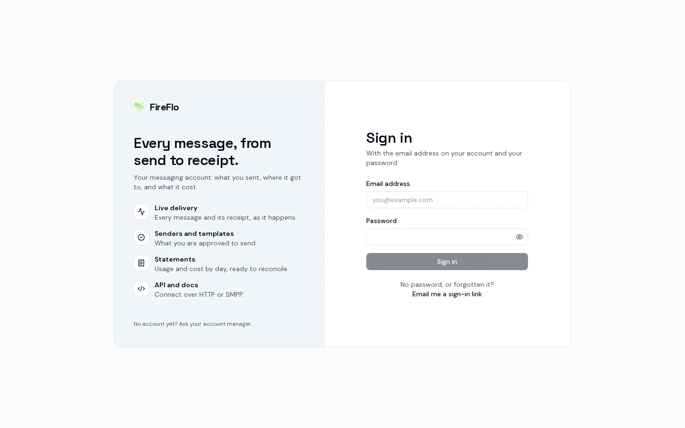
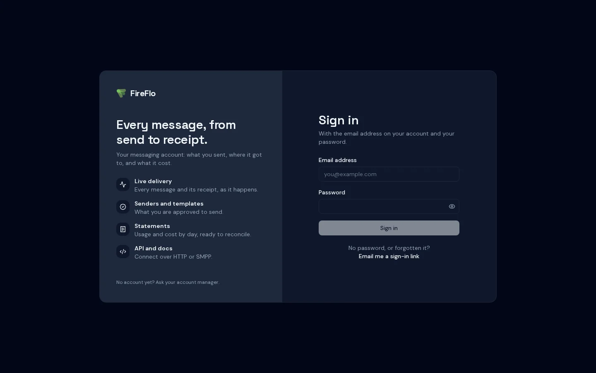
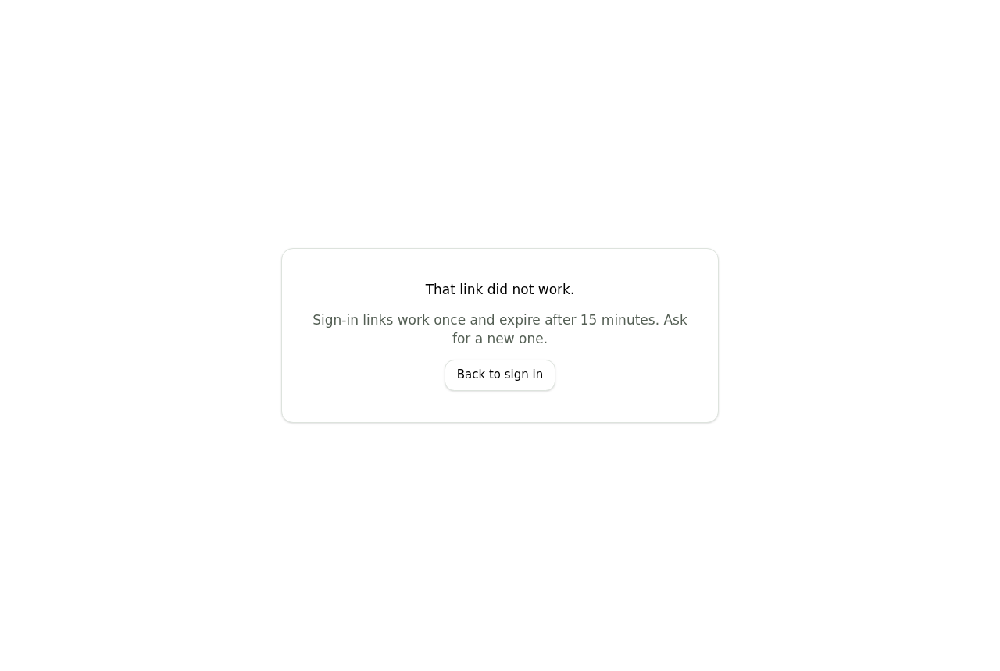
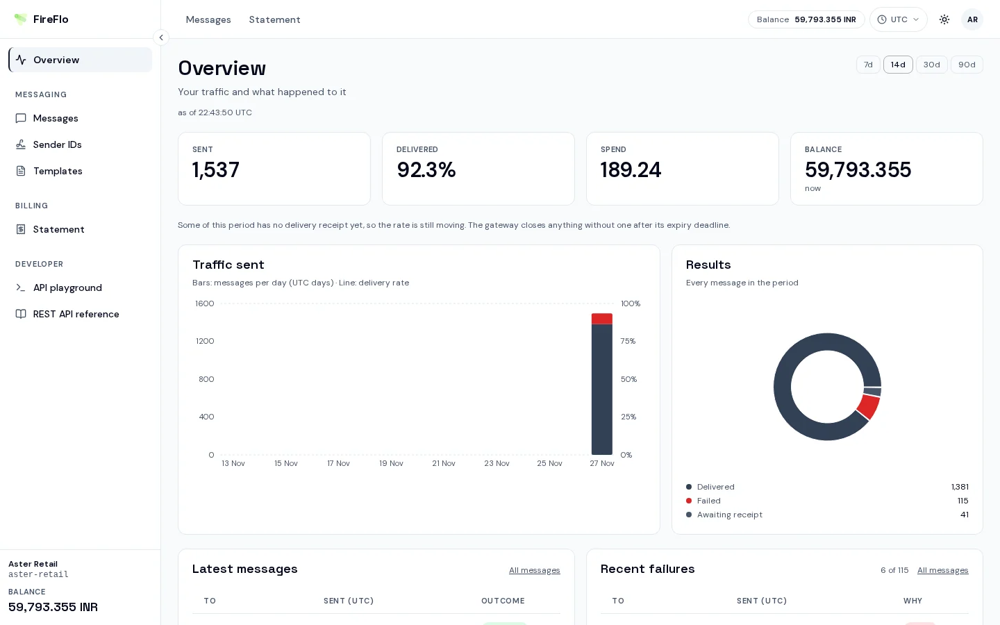
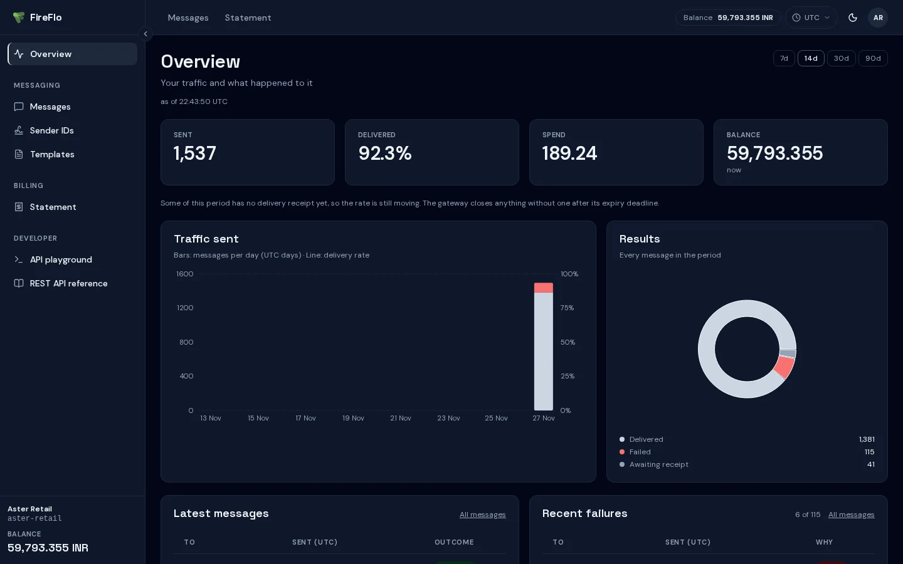

Usted inicia sesión en el portal con la dirección de email que su operador tiene para su login, y una
de dos cosas: **su contraseña** o **un enlace de un solo uso** enviado a esa dirección. Ambos le llevan
al mismo sitio, y puede usar cualquiera de los dos cualquier día: tener contraseña no desactiva el
enlace.

<Frame caption="La página de inicio de sesión del portal. Primero la dirección de email y la contraseña; debajo, un enlace de inicio de sesión por email para quien no tenga contraseña o la haya olvidado.">
  
  
</Frame>

## Con contraseña

> Inicie sesión con la dirección de email de su cuenta y su contraseña.

Si alguna de las dos partes es incorrecta, la respuesta es una sola frase:

> Ese email y esa contraseña no coinciden, o ese login aún no tiene contraseña. En su lugar puede
> iniciar sesión con un enlace por email.

<Note>
**Esa frase es la misma sea cual sea el error**: una dirección que no está en ninguna cuenta, una
contraseña incorrecta, un login sin contraseña o una cuenta deshabilitada. Un formulario que dijera
qué parte estaba mal le diría a cualquiera con una lista de direcciones cuáles de ellas son clientes
de su proveedor.
</Note>

### Demasiadas contraseñas incorrectas

Tras **diez** contraseñas incorrectas para una dirección desde la misma red en un cuarto de hora, o
**treinta** para esa dirección desde cualquier sitio, el inicio de sesión con contraseña se rechaza
para esa dirección hasta que pase el cuarto de hora, **incluso con la contraseña correcta**. El rechazo
se lee exactamente igual que una contraseña incorrecta, así que no le dirá que ha ocurrido.

Si una contraseña de la que está seguro sigue fallando, espere quince minutos o use el enlace de
inicio de sesión: el enlace no se ve afectado.

## Obtener una contraseña

Hay dos formas de tener una:

- **Su operador la establece** cuando añade su login, o más tarde.
- **Usted la establece.** Inicie sesión con un enlace, abra el menú de cuenta arriba a la derecha y
  elija **Password**. Establecer la primera no pide nada más: iniciar sesión con el enlace ya ha
  demostrado que la dirección es suya.

> Al menos 12 caracteres. Una frase funciona bien.

El formulario muestra lo fuerte que es la contraseña mientras escribe, y rechaza una que sea demasiado
fácil de adivinar: una de las contraseñas más comunes, su propia dirección de email, un mismo carácter
repetido, una secuencia del teclado o del alfabeto.

**Cambiar una contraseña pide primero la actual**, para que una sesión abierta en una máquina compartida
no pueda usarse para apoderarse de su login. Los intentos fallidos ahí cuentan para el mismo límite de
un cuarto de hora que el inicio de sesión:

> Demasiados intentos fallidos. Inténtelo de nuevo dentro de un cuarto de hora.

Establecer o cambiar su contraseña **cierra su sesión en todos los demás sitios**. El navegador en el
que la cambió sigue con la sesión iniciada.

<Tip>
**¿Ha olvidado su contraseña?** Inicie sesión con un enlace: siempre funciona. La página Password no
cambia una contraseña sin la actual, así que para sustituir una olvidada, pida a su operador que la
restablezca o que la elimine. Sin contraseña establecida, inicia sesión con enlace hasta que
establezca una nueva.
</Tip>

## Con un enlace de inicio de sesión

**Email me a sign-in link**, debajo del formulario de contraseña, cambia a un único campo:

> Envíenme un enlace: enviaremos un enlace de inicio de sesión de un solo uso a la dirección de su
> cuenta.

Escriba lo que escriba, la pantalla dice entonces lo mismo:

> **Revise su bandeja de entrada.** Si esa dirección está en una cuenta, un enlace de inicio de
> sesión va de camino a *you@example.com*. Funciona una vez y caduca en 15 minutos.

<Note>
**Esa respuesta no cambia si la dirección es incorrecta.** Es idéntica para una dirección de una
cuenta, una dirección de una cuenta deshabilitada y una dirección que nunca se ha visto.

Es deliberado, por la misma razón que la respuesta de contraseña de arriba. El coste de esa
protección es que un tecleo erróneo parece exactamente un éxito. Así que si no llega nada,
compruebe la dirección antes de asumir un fallo.
</Note>

Debajo hay dos controles. **Send it again** se deshabilita durante dos minutos y hace cuenta
atrás; el temporizador sobrevive a una recarga de la página y se corrige a sí mismo cuando vuelve
del cliente de correo, en lugar de mostrar un número obsoleto. **Use a different address** le
devuelve a un formulario vacío.

> ¿Nada tras un minuto o dos? Revise la carpeta de spam y envíelo de nuevo. El enlace más nuevo es
> el que funciona.

Esa última cláusula importa: pedir un segundo enlace no deja válido el primero. Siga el email más
reciente.

**Have a password? Sign in with it** le devuelve al formulario de contraseña.

### Seguir el enlace

Si el enlace ya se ha usado, o tiene más de quince minutos:

> **Ese enlace no funcionó.** Los enlaces de inicio de sesión funcionan una vez y caducan a los 15
> minutos. Pida uno nuevo.

<Frame caption="Lo que muestra un enlace usado o caducado. Ambos son normales: un enlace se consume en el momento en que tiene éxito, así que seguir el mismo email dos veces produce esto.">
  
</Frame>

Ambos son normales. Un enlace se consume en el momento en que tiene éxito, así que seguir el mismo
email dos veces —o que un escáner de correo lo siga antes que usted— producirá esto.

### Límites de los enlaces

Las peticiones de enlace están limitadas por cuenta y por red. El límite por cuenta responde con la
misma frase neutra que un éxito, así que no se le dirá que lo ha alcanzado. El límite por red sí lo
dice:

> Demasiadas peticiones de inicio de sesión desde esta dirección. Inténtelo en breve.

Si su proveedor no ha configurado el panel para enviar correo, obtiene un error real en lugar de
un enlace que nunca llega:

> El inicio de sesión por email no está disponible en este panel. Pregunte a su gestor de cuenta.

Es un ajuste de despliegue del lado de ellos, no algo que pueda sortear. Una contraseña, si la tiene,
sigue funcionando.

## Dónde aterriza

De cualquiera de las dos formas aterriza en **Overview**. No en sus mensajes, porque la primera
pregunta tras iniciar sesión suele ser "cómo va todo", no "muéstrame la fila 4000".

<Frame caption="Overview, la primera página tras iniciar sesión: enviados, entregados, gasto y saldo del periodo, el gráfico de tráfico y los resultados, con los últimos mensajes y los fallos recientes debajo.">
  
  
</Frame>

El gráfico, las tarjetas y los resultados de esa página se construyen a partir de su tráfico una vez
por minuto y se sirven desde ahí; una línea bajo el título dice **as of** qué hora. Su saldo y las dos
listas de mensajes recientes se leen en vivo cada vez. Si la última construcción falló, la línea dice
que las cifras son las anteriores en lugar de mostrarle una página de error.

Las horas en todo el portal se muestran en la zona elegida en la barra superior: la **zona de la
plataforma** de su proveedor por defecto, para que usted y ellos se citen las mismas horas, la **de su
navegador** o **UTC**. La elección se guarda en ese navegador. Los días de los gráficos y los extractos
siempre van de medianoche a medianoche en la zona de la plataforma, elija lo que elija.

## Mantenerse conectado

Su sesión se guarda en una cookie en el navegador con el que inició sesión. Dura doce horas y se
renueva mientras el portal está abierto, así que un portal que se deja sin tocar más tiempo le pide
que inicie sesión de nuevo. **Sign out** está en el menú de cuenta arriba a la derecha. Iniciar sesión
en un teléfono no cierra su sesión en un escritorio. Si usa el portal desde una máquina compartida,
cierre sesión en lugar de cerrar la pestaña.
