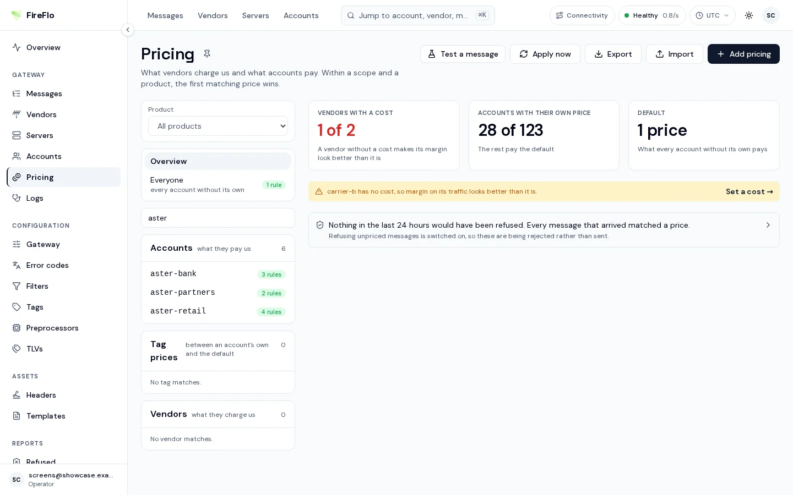
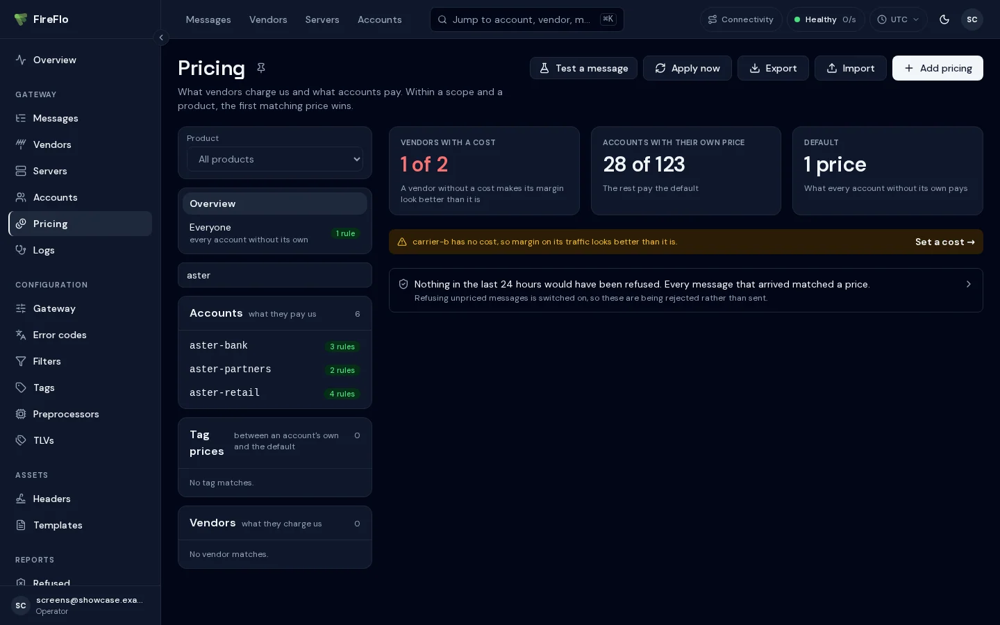
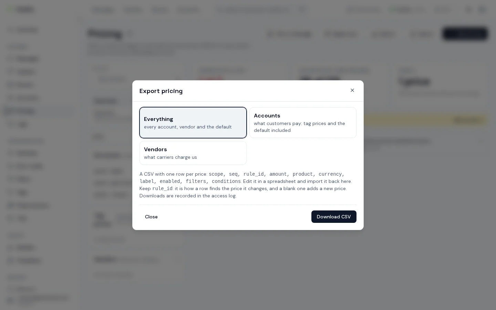
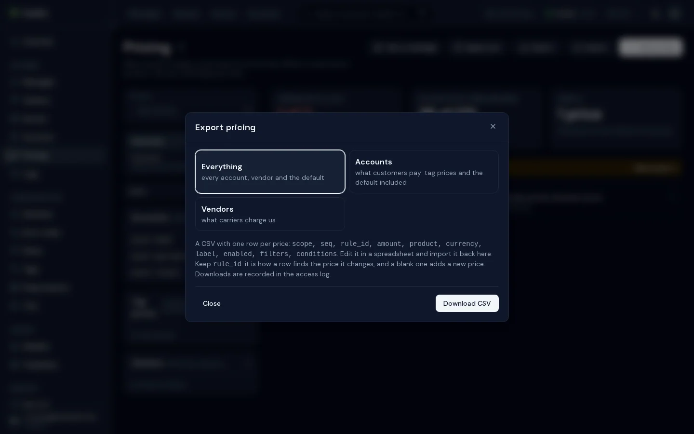

## Edición de tasas desde el panel

Los precios se editan en la página **Pricing**. A la izquierda están los ámbitos: **Everyone** (el
valor por defecto `*`), **Accounts** (lo que nos pagan), **Tag prices** y **Vendors** (lo que nos
cobran). El selector **Product** acota la página a un producto.

<Frame caption="La página Pricing. Las tarjetas responden a las preguntas que cuestan dinero: qué vendors no tienen coste, cuántas cuentas pagan su propio precio y qué paga todo el mundo.">
  
  
</Frame>

Abra un ámbito para ver sus precios, agrupados por producto. Las ediciones, adiciones, movimientos y
la activación o desactivación de un precio se preparan y se guardan juntos. **Add pricing** pregunta
de quién son los precios que se añaden (una cuenta, un vendor, una etiqueta o todo el mundo) y abre ese
ámbito. Cuando un producto no tiene valor por defecto, su página y el resumen de Pricing ofrecen
**Set what everyone pays**.

Desde 0.17.0 la página *Pricing* también muestra **Tag prices**: una lista de precios por
[etiqueta de cuenta](/platform/routing/account-tags), probada después de los precios propios de una
cuenta y antes del valor por defecto, en el orden de la lista Tags.

La pestaña **Tariff** de una cuenta muestra los mismos precios para esa cuenta, y qué nivel la
tarificaría. Cuando una plataforma gestora ha establecido una tarifa personalizada para la cuenta, la
pestaña la muestra encima de las reglas: se tarifica antes que ellas, y solo se cambia en esa
plataforma.

<Warning>
Las reglas propias de una cuenta se prueban primero y **gana la primera coincidencia**, por lo que
cualquier cosa que lleve la cuenta vence al valor por defecto, **incluido un catch-all desnudo**.

Eso es lo que hace de una tarifa negociada un override en lugar de una sugerencia. También significa
que un catch-all a nivel de cuenta desactiva silenciosamente todos los valores por defecto que
establezca después.
Lo mismo vale para los precios por etiqueta: el catch-all propio de una cuenta también los vence.
</Warning>

## Exportar e importar precios

**Export** en la página Pricing descarga los precios como CSV, una fila por precio: **Everything**,
**Accounts** (lo que pagan los clientes, con los precios por etiqueta y el valor por defecto) o
**Vendors** (lo que nos cobran los operadores). Las descargas quedan registradas en el log de acceso.

<Frame caption="Export pricing. Conserve la columna rule_id cuando edite el archivo: es como una fila encuentra el precio que cambia.">
  
  
</Frame>

Edite el archivo en una hoja de cálculo y tráigalo de vuelta con **Import** (hasta 2 MB). Una fila con
`rule_id` en blanco añade un precio nuevo.

<Warning>
**Cada cuenta o vendor nombrado en el archivo se sustituye por las filas del archivo.** Un precio que
el archivo no lista para ese ámbito se elimina. Los ámbitos que el archivo no nombra se quedan como
están.
</Warning>

Nada cambia hasta que haya leído la vista previa. Lista, por ámbito, lo que se añade, se cambia y se
elimina. Las eliminaciones tienen que activarse aparte antes de que se ofrezca **Apply**, y aplicar
pide confirmación una vez más. Cada ámbito se guarda por separado, así que si uno falla, los
anteriores ya están aplicados. La pasarela tarifica con las filas nuevas desde su siguiente consulta
de configuración.

## Dos identidades, no una

Si el crédito de una cuenta cuadra se comprueba contra **dos** ecuaciones. Equivocarse en esto
informa una falsa discrepancia en cada cuenta, así que vale la pena enunciarlo con precisión.

```
MONEY:        Σ(RECHARGE + TRANSFER)  =  balance + reserved
CONSUMPTION:  reserved − consumed     =  credit reserved but not yet spent   (≥ 0)
```

<Warning>
**La ecuación obvia es incorrecta.** `acreditado − consumido = saldo + reservado` se escribió así en
el diseño y los datos la refutaron inmediatamente: estaba desviada exactamente en el consumo en cada
cuenta.

El consumo nunca toca las columnas de saldo. El crédito se reserva en bloques (`balance -= n,
reserved += n`), se gasta desde un contador en memoria, y **la parte gastada nunca se vuelve a
escribir**. Por tanto `reserved` es un contador de consumo vitalicio, no una retención, y cada
movimiento que la base de datos ve deja `balance + reserved` sin cambios.
</Warning>

La identidad del dinero se cumple a la unidad en cada cuenta, que es lo que hace significativa una
discrepancia genuina.

### Qué se excluye, y por qué

| Tipo de entrada | ¿Se cuenta? | Por qué |
| :--- | :--- | :--- |
| `RECHARGE`, `TRANSFER` | **Sí** | Dinero entrando en la cuenta |
| `RESERVE`, `RELEASE` | No | Mueven un importe entre dos columnas de la misma fila, netando a cero |
| `BILL` | No | Un periodo cerrado registra lo facturado y no mueve nada |

## Vitalicia, nunca un periodo

El crédito es un **total corrido**. Cualquier ventana más corta necesita un saldo de apertura que
nada registra. Y una cifra de apertura errónea inventa una discrepancia cada vez que se ejecuta.

<Tip>
Por eso "concilie esta cuenta para marzo" no es una pregunta a la que los datos puedan responder.
"Concilie esta cuenta" sí lo es, y siempre lo ha sido.
</Tip>

## De dónde vienen los dos lados

| Lado | Fuente |
| :--- | :--- |
| Acreditado | `Σ RECHARGE + TRANSFER`, **solo aplicado**: las entradas pendientes no han movido dinero |
| Consumido | `usage_daily` para días con rollup **más** `cdr_submit` para la cola en vivo |

Nunca ambos para un día. Esa es la unión que hace que la conciliación sobreviva a la ventana de
retención: una vez un día se resume y se purga, su consumo sigue contando.

## Cuando los números no coinciden

Trabaje en este orden:

<Steps>
  <Step title="¿Hay recargas pendientes?">
    Un `RECHARGE` para una cuenta sin fila `account_balance` no acredita nada y queda pendiente.
    Está en el libro mayor y no en el saldo, que es exactamente un hueco del lado del dinero.
  </Step>
  <Step title="¿Hubo un apagado no limpio?">
    Un `kill -9` vara crédito en `reserved`. `balance + reserved` sigue conservándose, así que la
    identidad del dinero se cumple. Pero la cuenta tiene menos gastable de lo que debería hasta que
    se ejecute `POST /ops/credit/release`.
  </Step>
  <Step title="¿Va el rollup atrasado?">
    Un día ni resumido ni aún en `cdr_submit` es consumo que nadie cuenta. Se supone que la purga
    hace esto imposible; compruebe que no se la ha saltado.
  </Step>
  <Step title="¿Lee el panel la misma base de datos?">
    `METRICS_DATABASE_URL` frente al `FIREFLO_DB_URL` de la pasarela. Una división aquí hace que
    cada cifra discrepe de una forma que parece un bug contable.
  </Step>
</Steps>

## Relacionado

<CardGroup cols={2}>
  <Card title="Cómo funciona la tarificación" icon="tag" href="/platform/billing/how-pricing-works">
    Ámbitos, el default `*` y LCR.
  </Card>
  <Card title="Crédito prepago" icon="wallet" href="/platform/billing/prepaid-credit">
    Bloques, reservas y el libro mayor.
  </Card>
</CardGroup>
