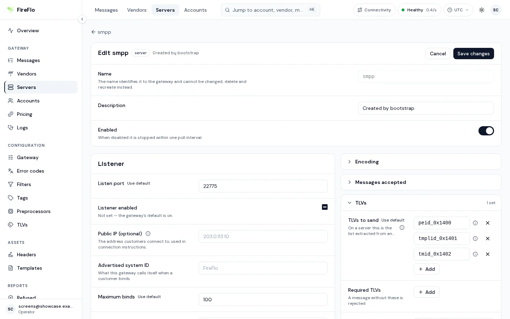
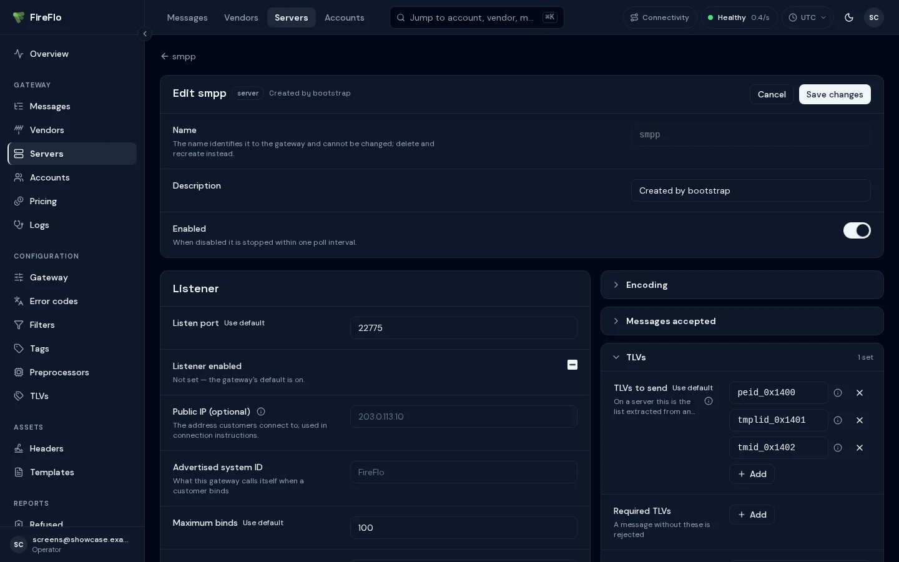
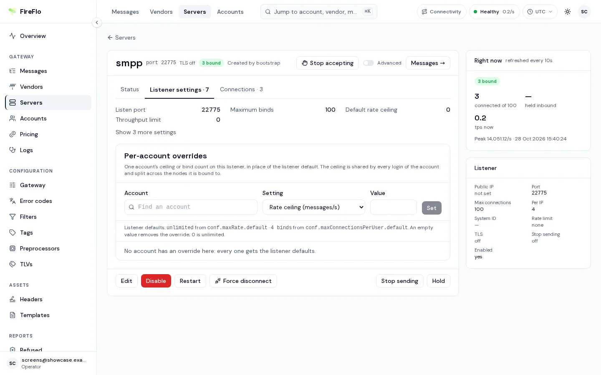
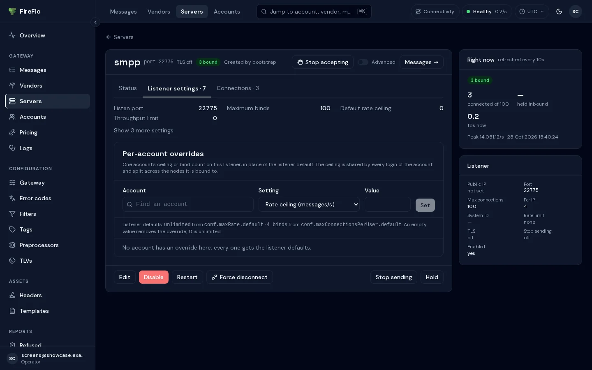
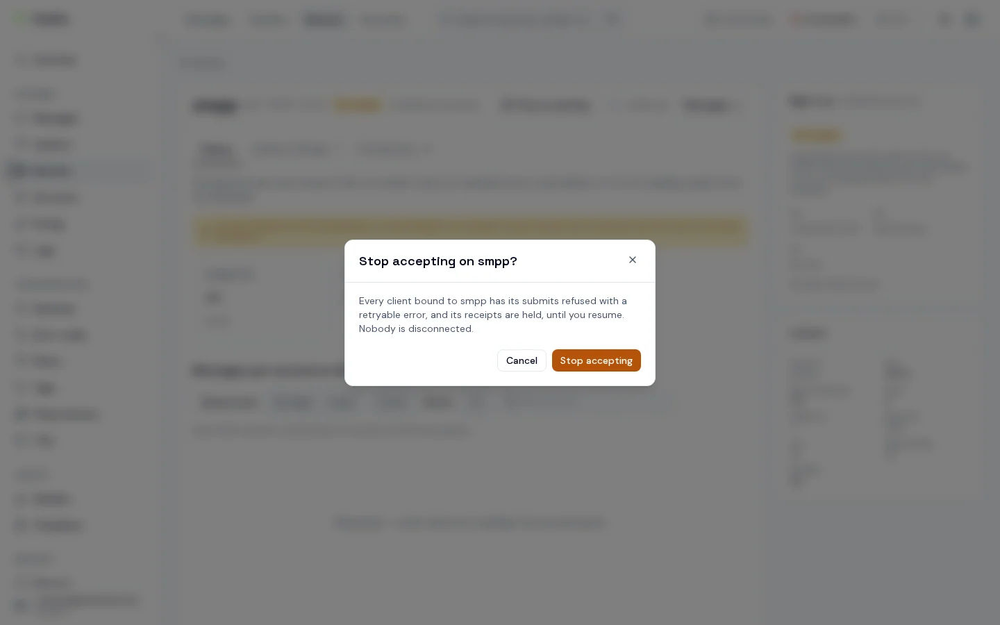
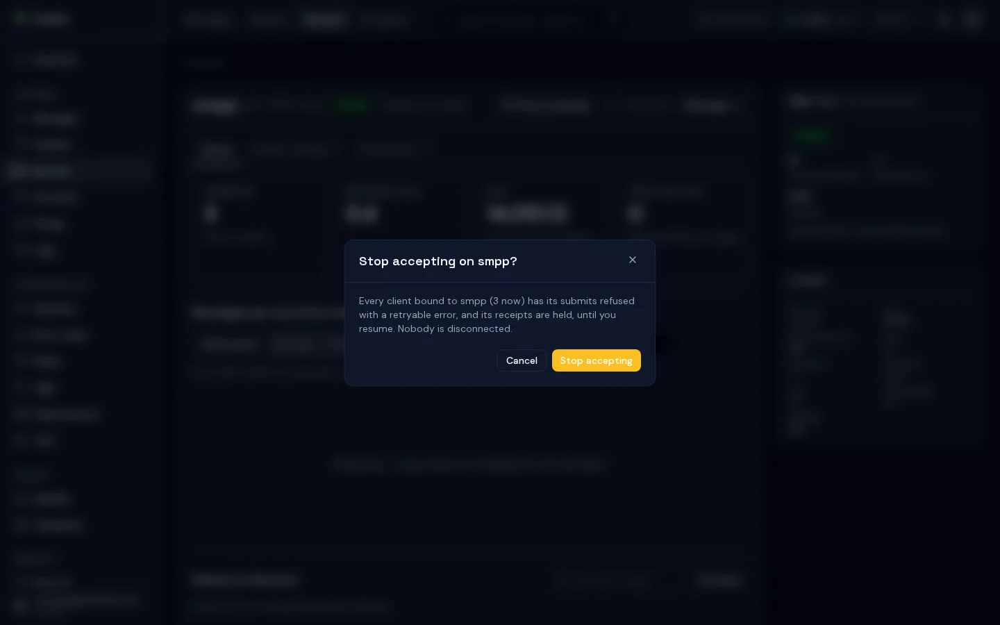
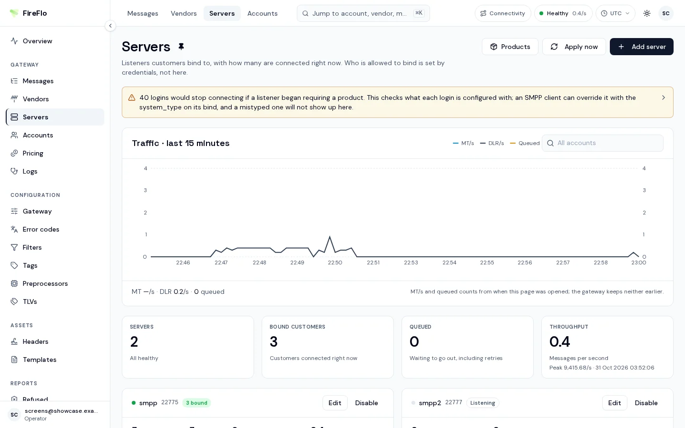
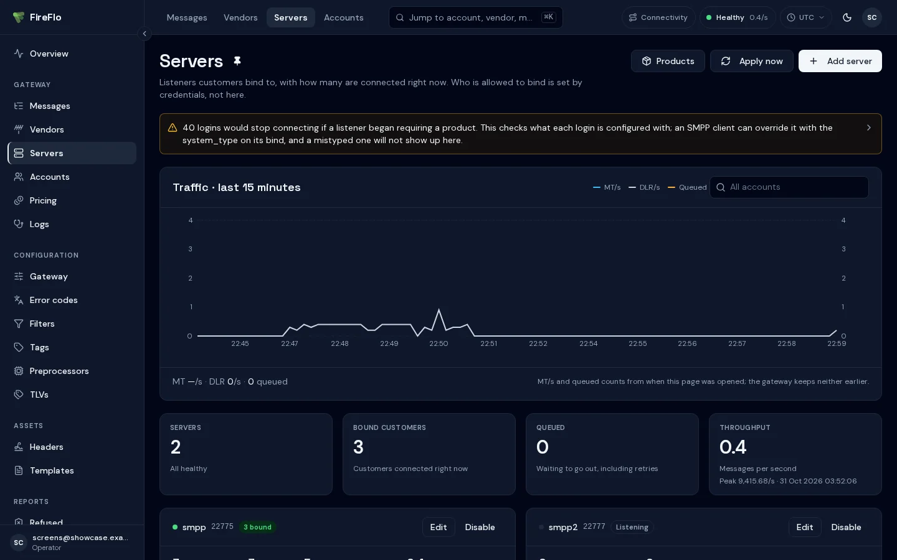
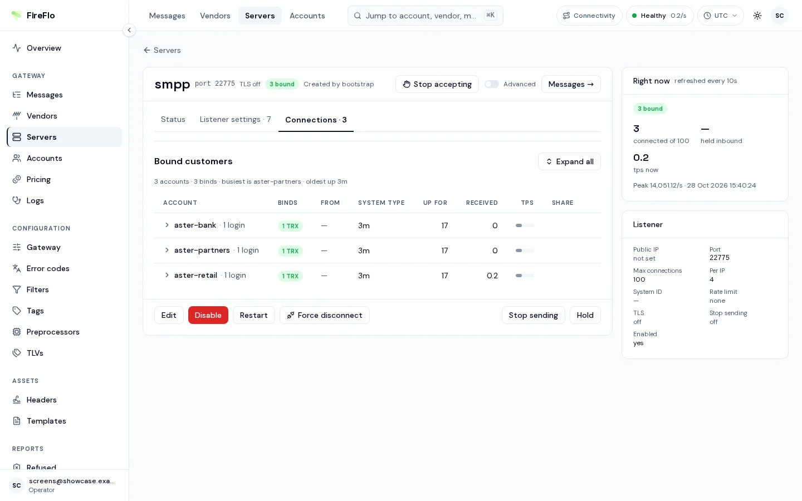
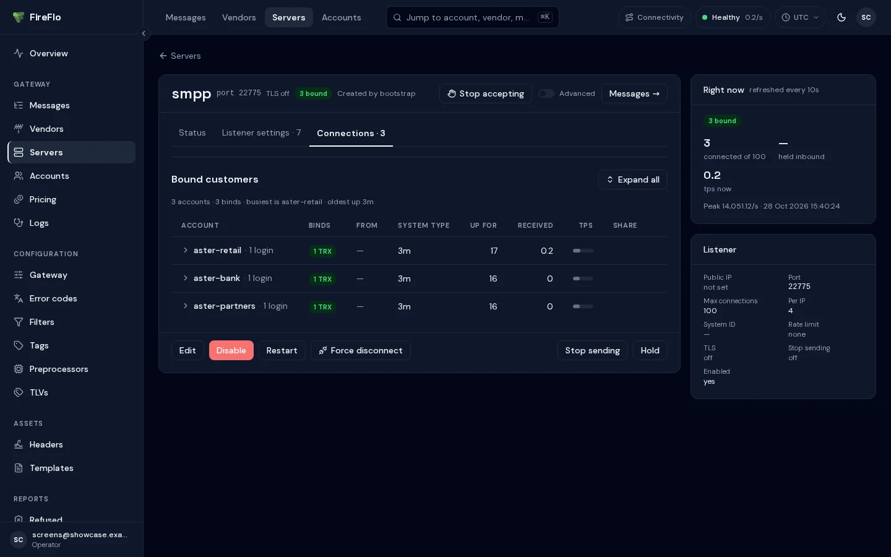

Un **server** es un listener al que sus clientes se conectan. Añadir uno son un puerto, un nombre y
luego la política que quiere aplicar a todos los que se conecten.

## Añadir uno

<Tabs>
  <Tab title="Panel de control">
    **Servers → Añadir server.** El nombre y el puerto son los únicos campos requeridos; todo lo
    demás tiene un valor por defecto que funciona.
  </Tab>
  <Tab title="smsg.properties">
```properties
outSms.instance.smpp.type     = smppserver
outSms.instance.smpp.srv.port = 27777
outSms.instance.smpp.enable   = true
```
  </Tab>
</Tabs>

Todos los ajustes están en [Ajustes de listener](/reference/smpp/server).

<Frame caption="El formulario de edición de un listener. El nombre no se puede cambiar una vez añadido el listener; en su lugar, bórrelo y añádalo de nuevo.">
  
  
</Frame>

<Warning>
**Un listener que no puede tomar su puerto no detiene la pasarela.** Registra y todo lo demás sigue
funcionando: correcto para un despliegue con varios listeners, y sorprendente la primera vez.

Un arranque limpio no es prueba de que cada listener esté arriba. Compruebe `/ops/health`.
</Warning>

## Con qué se comprueba un bind, en orden

<Steps>
  <Step title="La credencial">
    `systemId` y `password` deben coincidir con una credencial `SMPP` activada. Consulte
    [credentials.yml](/reference/files/credentials-yml).
  </Step>
  <Step title="allowedIps, si está establecido">
    Vacío significa **sin restricción**.
  </Step>
  <Step title="Límites de conexión">
    `srv.maxConnections` en total, `srv.maxConnectionsPerIP` y
    `conf.maxConnectionsPerUser.default` por cuenta.
  </Step>
  <Step title="El producto, si conf.product.required está activado">
    El producto resuelto debe nombrar una fila **activada** del catálogo de productos. En blanco o
    desconocido se rechaza con `0x40F`: en el bind, no en el submit, porque el producto vive en el
    contexto de la sesión.
  </Step>
</Steps>

## De dónde viene el producto

`system_type` en la petición de bind, cayendo al campo `product` de la credencial.

<Warning>
`system_type` es texto libre no validado en ningún otro sitio. Un cliente haciendo bind con `prem`
en lugar de `premium` pasa cualquier test no vacío y aterriza en el estado **sin tarifar**, donde
los mensajes se entregan y no se cobra nada.

Por eso `conf.product.required` comprueba **pertenencia al catálogo** en lugar de presencia de un
valor. Y por eso, en modo archivo, donde no hay catálogo, solo aplica la mitad de no vacío. Se
registra una vez por carga de configuración nombrando el listener.
</Warning>

## Qué aplica un listener a todos los bound a él

| Ajuste | Efecto |
| :--- | :--- |
| `conf.maxRate.default` | Techo de throughput por cuenta |
| `conf.maxPending.default` | Tamaño de ventana: peticiones no reconocidas en vuelo |
| `forward.dlrs` | **Off suprime acuses para todos aquí**, sea lo que sea lo que cada cliente pidiera |
| `conf.whitelist.enabled` | Si el sender ID y el contenido se comprueban |
| `mandatory.tlvs.submit` | Tags que un mensaje debe llevar, si no `0xC3` |
| `inQueue.capacity` | Mensajes retenidos esperando al almacén de mensajes |

Los **overrides por cuenta**, en la pestaña **Listener settings** del listener, dan a una cuenta su
propio techo de tasa o número de binds en este listener, en lugar del valor por defecto del listener.
El techo lo comparten todos los logins de la cuenta. Un valor vacío elimina el override; `0` es
ilimitado.

<Frame caption="El techo de tasa o el número de binds de una cuenta en lugar del valor por defecto del listener. Los valores por defecto que sustituye se muestran bajo el formulario.">
  
  
</Frame>

## Los estados en los que puede estar un listener

| Verbo | Efecto |
| :--- | :--- |
| `enable` / `disable` | Cargado, o no |
| `suspend` / `resume` | Sigue aceptando, no enruta nada: los submits se aparcan y se enrutan al reanudar, los más antiguos primero; cuando el aparcamiento se llena, los submits se rechazan con un error reintentable. Los acuses siguen llegando a los clientes |
| `hold` / `release` | Rechaza cada submit con un error reintentable (`ESME_RMSGQFUL`) y **retiene los acuses**. No se desconecta a nadie |

En el panel de control, suspend es **Stop sending** y hold es **Stop accepting** (también **Hold**,
al pie de la página del listener). Cada uno pregunta antes de actuar.

<Frame caption="Stop accepting pregunta primero: a los clientes con bind se les rechazan los submits con un error reintentable y se les retienen los acuses hasta que reanude. No se desconecta a nadie.">
  
  
</Frame>

El panel los muestra como un badge por tarjeta. `Listening` con nadie bound **no** es un fallo: un
listener sin clientes conectados es silencioso, no roto, y por eso no se pinta en rojo como un
vendor sin sesión.

<Frame caption="La página Servers. Un listener tiene tres clientes con bind; el otro muestra Listening, lo que solo significa que nadie tiene bind.">
  
  
</Frame>

## Cortar el bind de un cliente

```bash
scripts/fireflo disconnect smpp 7
```

Los ids de sesión vienen de `fireflo health`. Son el contador propio del listener, así que
colisionan entre listeners y se reinician con la pasarela.

En el panel de control, abra la pestaña **Connections** del listener, despliegue la cuenta y pulse
**Disconnect** en la sesión. Marque **Also disable this login** para mantenerlo fuera también.
**Force disconnect**, al pie de la página del listener, corta todas las sesiones de una dirección,
una cuenta o un login en ese listener.

<Frame caption="La pestaña Connections: cada cuenta con bind, con sus binds, system type, tiempo activo y mensajes recibidos. Despliegue una cuenta para llegar a sus sesiones.">
  
  
</Frame>

<Note>
**Esto termina una conexión; no retira el permiso.** Un cliente sano vuelve a hacer bind en segundos
a menos que también desactive su login.
</Note>

## Mensajes entrantes

`mo.owner.map` decide qué cuenta posee qué dirección entrante. `mo.owner.default` es a dónde va uno
no coincidente. Y **vacío significa a ningún lado**: el listener registra `message.mo.unmapped` y lo
consume en lugar de adivinar un propietario.

Deliberado, porque entregar el mensaje de un desconocido al cliente equivocado es peor. Pero el
tráfico sin mapear desaparece silenciosamente a menos que vigile esa línea.
