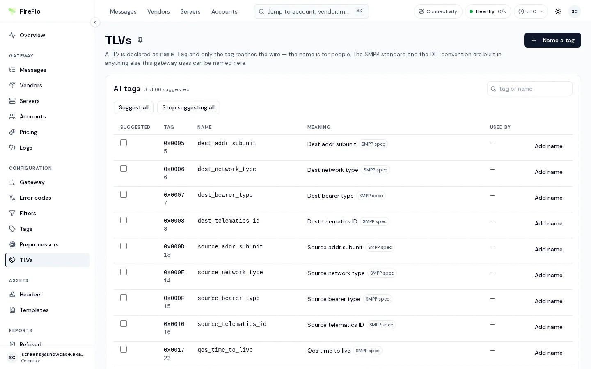
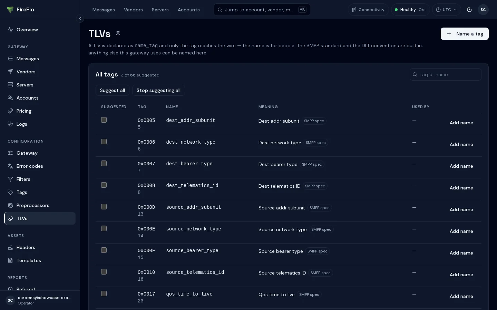
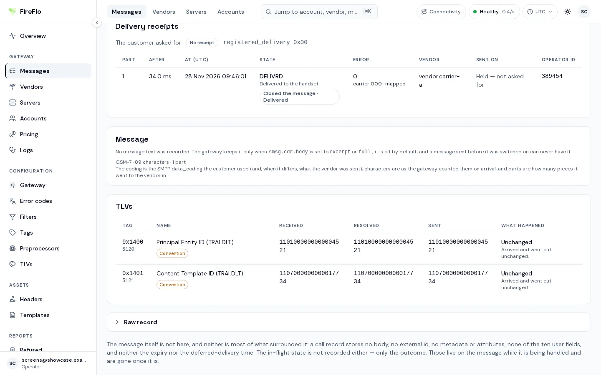
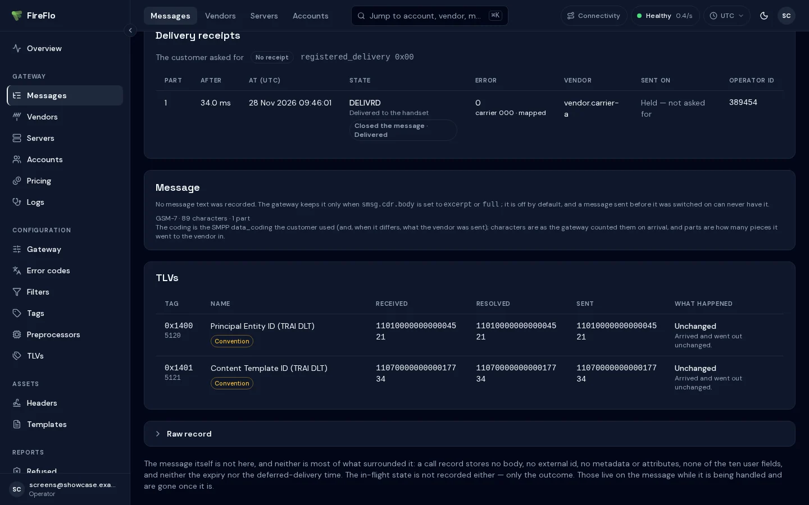

La gramática está en [Declaraciones TLV](/reference/smpp/tlvs). Lea eso primero si `1400` frente a
`0x1400` es nuevo para usted. Esta página trata de cómo se ejecutan.

## Dar nombre a un tag

**TLVs**, bajo Configuration en el panel de control, lista cada tag con su nombre, su significado y lo
que lo usa. Los tags del estándar SMPP y de la convención DLT india vienen incorporados. **Name a
tag** da a cualquier otro tag un nombre y un significado de una línea para que el panel lo muestre.
Los nombres son para las personas: solo el número del tag llega al cable, así que darle nombre a uno
no cambia nada de lo que envía la pasarela.

<Frame caption="La página TLVs: el número de cada tag, su nombre, su significado y lo que lo usa.">
  
  
</Frame>

## Un tag puede venir de cuatro sitios

<Steps>
  <Step title="El submit_sm del cliente">
    Se extrae solo si `registered.tlvs.submit` del listener lo declara. **Los tags no declarados se
    descartan**, no se pasan.
  </Step>
  <Step title="El defaultTlvs de su credencial">
    Rellena tags que el mensaje no llevaba.
  </Step>
  <Step title="El sello de whitelist">
    En modo `assign`, rellena un tag que al mensaje le falta. En modo `replace`, **sobrescribe** lo
    que el cliente envió. Y esa sobrescritura *es* la aprobación.
  </Step>
  <Step title="El default.tlvs.submit del vendor">
    Rellena cualquier cosa aún sin establecer en el momento del envío.
  </Step>
</Steps>

**La precedencia es mensaje > credencial > vendor.** Los defaults solo rellenan huecos. La única
excepción es el sello de whitelist en modo `replace`, que está pensado para ganar.

## Dos comprobaciones obligatorias, en puntos distintos

| Comprobación | Se ejecuta | Fallo |
| :--- | :--- | :--- |
| `mandatory.tlvs.submit` del listener | En la entrada, tras los defaults de credencial y cualquier sello | `0xC3` al cliente |
| **`mandatory.tlvs.submit`** del vendor | Contra lo que realmente va por el cable | Acuse FAILED, reembolso, `cdr_rejected`. **No se reenruta** |

<Warning>
La comprobación del vendor se ejecuta **después** de que `registered.tlvs.submit` haya filtrado.
Exigir un tag que no esté también registrado no puede satisfacerse jamás: la pasarela avisa sobre
ese emparejamiento en la carga, y vale la pena leer el log tras añadir un tag obligatorio.
</Warning>

## Averiguar qué faltará antes de que falte

El informe de cobertura de TLV del panel de control dice, **por fila aprobada**, qué tags
obligatorios no suministrará nada.

Ese informe es lo que hace descubrible en lugar de meramente silencioso el modo de sellado por
defecto (`off`). Poner `assign` por defecto empezaría a escribir TLVs en paquetes que cruzan
listeners que nunca han escrito ninguno: un cambio silencioso en lo que llega a un operador.

## El fallo que realmente ha ocurrido

<Warning>
No todos los ajustes se leen por listener. Uno que no lo hace conserva su forma desnuda y lee un
global que nadie establece, así que devuelve su valor por defecto codificado sea cual sea su
configuración.

`whitelist.tlvs.replace` se envió así una vez. Leía false en cada listener sea cual fuera su
configuración, así que los TLVs de una plantilla aprobada **nunca se sellaban sobre SMPP**.
Silenciosamente, porque no sellar se parece exactamente a no tener nada que sellar.

Si un ajuste de TLV por listener parece no hacer nada, esto es lo primero que hay que comprobar.
</Warning>

## El lado del cliente

Un cliente puede ver los TLVs **que envió** en sus propios mensajes, y puede proponer nuevas
definiciones de tag para que un operador apruebe. Nunca ven lo que un vendor añadió aguas abajo.

El registro de llamada guarda tres conjuntos (recibidos, enviados y lo que la whitelist selló) para
que una disputa sobre lo que llegó al operador sea respondible en lugar de argumentada. La página
de un mensaje en el panel de control muestra cada tag tal como se recibió, tal como se resolvió y tal
como se envió, con lo que le pasó.

<Frame caption="Los TLVs de un mensaje: los IDs DLT de entidad y de plantilla tal como se recibieron, se resolvieron y se enviaron. Ambos llegaron y salieron sin cambios.">
  
  
</Frame>

## Un caso trabajado: DLT indio

El id de entidad registrada va en la **credencial**, porque es una propiedad del cliente en lugar de
de cualquier mensaje concreto:

```yaml
defaultTlvs:
  peid_0x1400: "1101234567890123456"
```

El id de plantilla (`tmplid_0x1401`) varía por mensaje y normalmente lo sella la whitelist en la
aprobación, o lo suministra el cliente. El id de telemarketer (`tmid_0x1402`) es su propio registro
con el vendor, así que puede ser un valor por defecto del vendor:

```properties
outSms.default.default.tlvs.submit = tmid_0x1402=1102000000000012345
outSms.instance.smpp.mandatory.tlvs.submit = peid_0x1400,tmplid_0x1401
```

Con ambos obligatorios, un mensaje al que le falte cualquiera de los dos se rechaza en la entrada con `0xC3` en
lugar de ser rechazado por el operador más tarde, que es el sentido de comprobar en absoluto.
