Abra una cuenta y elija **Billing**. Arriba, una tarjeta responde a las dos preguntas con las que la
abre: a la izquierda, lo que la cuenta tiene y las acciones que lo cambian; a la derecha, cuántas
partes MT ha enviado. Debajo, **MT usage** a lo largo del tiempo junto a **Does the credit add up?**, y
el libro mayor completo al pie.

<Frame caption="La pestaña Billing de una cuenta. La izquierda de la tarjeta es el dinero y las acciones que lo cambian; la derecha es lo que la cuenta ha enviado.">
  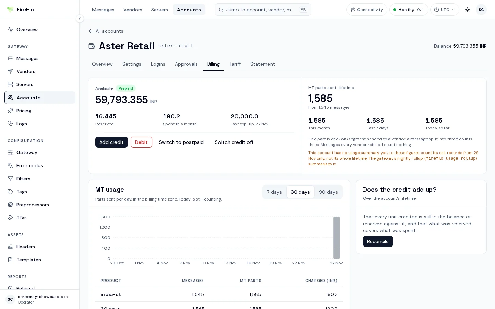
  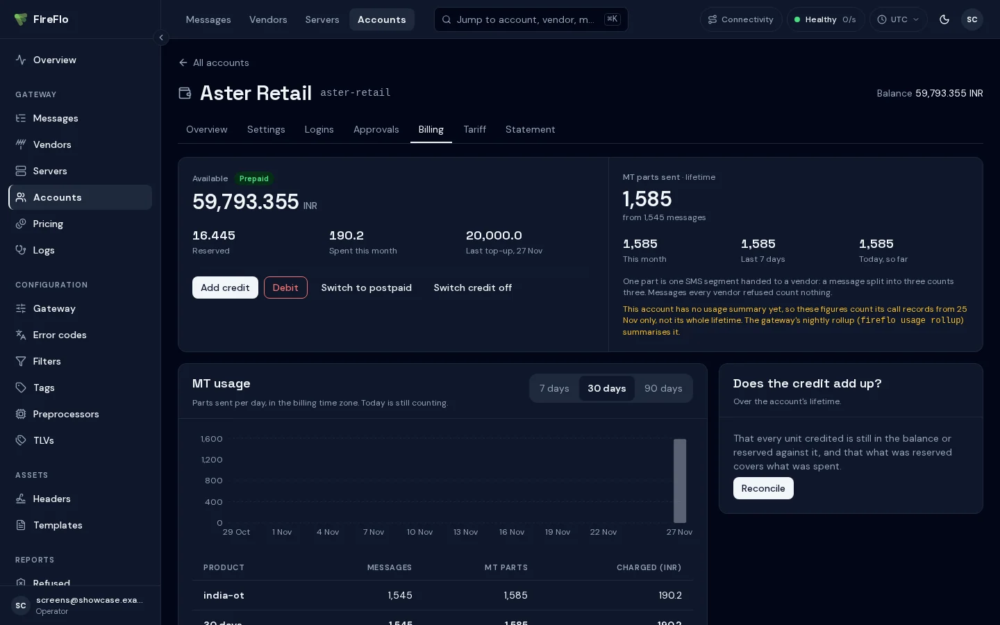
</Frame>

<Warning>
**Añadir crédito no se puede deshacer desde el panel.** Una recarga nunca se edita ni se revierte. Una
equivocada se retira con [**Debit**](#taking-credit-back), que escribe una entrada propia aparte.

El formulario le pide confirmar el importe y la referencia antes de escribir. Lea la confirmación
en lugar de pasar por ella: es el último punto en el que el número aún es suyo para cambiar.
</Warning>

<Note>
**Una cuenta de unidades no tiene dinero que mostrar.** Desde 0.16.0, una cuenta que tiene unidades de
mensaje en lugar de dinero muestra las unidades restantes y usadas por producto, la cuenta a la que se
cobra y su libro de unidades, y no ofrece recarga, débito ni cambio entre prepago y postpago. Consulte
[Cuentas de unidades](/platform/billing/units-accounts).
</Note>

## Lo que la cuenta tiene

Las cuentas prepago muestran **Available**, con **Reserved**, **Spent this month** y la **Last top-up**
debajo. Las cuentas postpago muestran un **Credit limit**: lo que pueden acumular antes de que la
pasarela las rechace, que es el mismo rechazo que recibe una cuenta prepago cuando se queda sin
crédito, con el gasto de toda la vida y el de este mes. A los dos nunca se les da el mismo nombre.

Los importes se muestran sin ceros finales, conservando al menos un decimal: `0.0000` se lee `0.0`,
`0.0100` se lee `0.01`. Es solo visualización: consulte
[Precisión](/platform/billing/how-pricing-works#precision).

<Note>
**Reserved es crédito que una pasarela en marcha tiene retenido y aún no ha gastado.** Lo que gasta se
liquida en **spent** cada pocos segundos, así que en una cuenta ocupada reserved se mantiene pequeño
(unos segundos de tráfico) y spent crece.

Verlo asentado en una cuenta inactiva significa que el crédito quedó varado por una parada no limpia.
La pasarela lo devuelve en su siguiente arranque, y liberar el crédito retenido lo devuelve en el
acto: nada se pierde de cualquier forma, porque saldo más reservado más gastado se conserva. (Antes de
0.12.23 reserved solo crecía, porque el gasto nunca se liquidaba fuera de él.)
</Note>

Una fila de saldo faltante se lee como **No balance row — not zero, absent**, que es un estado
distinto y más consecuente: una recarga contra una cuenta sin fila queda pendiente en lugar de
acreditada. **Open for credit** crea la fila a cero.

La moneda no se pregunta. Hay una moneda por plataforma, tomada de la pasarela, y FireFlo nunca
convierte: un saldo en cualquier otra cosa nunca podría gastarse contra un precio. El campo aparece
solo cuando el panel no puede leer en absoluto la moneda de la plataforma.

## Partes MT enviadas

Una **parte MT** es un segmento SMS entregado a un vendor. Un mensaje lo bastante largo como para
dividirse en tres partes cuenta tres; un mensaje que todos los vendors rechazaron no cuenta ninguna.
La tarjeta muestra el total de toda la vida, de cuántos mensajes procede, y las partes enviadas este
mes, en los últimos siete días y hoy hasta ahora. Los meses y los días se cortan en la zona horaria de
facturación, igual que los extractos.

**MT usage** dibuja las partes por día en 7, 30 o 90 días, con la barra de hoy más pálida porque aún
está contando, y una tabla por producto con mensajes, partes y lo cobrado en la misma ventana.

Los días pasados vienen del resumen diario de uso; hoy, y cualquier día aún no resumido, se cuentan
directamente desde los registros de mensajes, así que las cifras son en vivo.

<Note>
**Tras actualizar a 0.12.4, los días resumidos antes de la actualización no tienen recuento de
partes.** Se dejan fuera de los totales, no se cuentan como cero, y la tarjeta dice cuántos hay.
Ejecutar `fireflo usage rollup --catch-up` rellena cada uno de esos días cuyos registros de mensajes
aún se conservan: consulte [Uso y retención](/platform/billing/usage-and-retention#mt-parts). Los días
ya purgados siguen sin contarse.
</Note>

## Añadir crédito

Tres campos: **Amount**, **Reference** y una **Note** opcional.

<Frame caption="Add credit. La línea bajo los campos es la promesa honesta: la pasarela aplica la recarga en su siguiente sondeo, así que el saldo de arriba no se mueve en el acto.">
  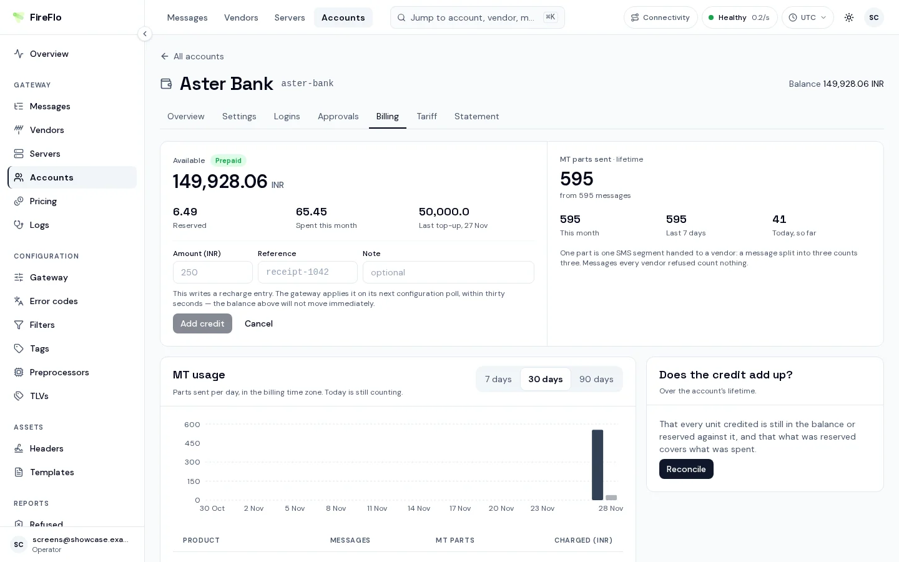
  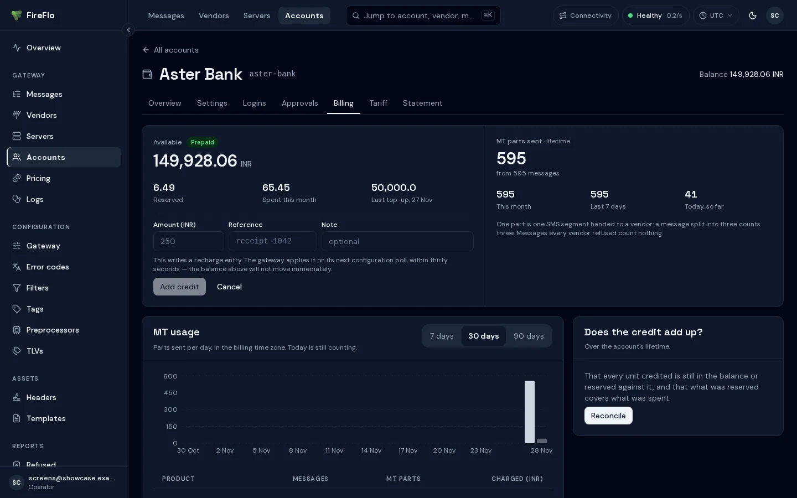
</Frame>

Una vez tecleado un importe válido el formulario devuelve exactamente lo que se almacenará, porque
el dinero se mantiene con cuatro decimales y un decimal mal colocado es el error caro aquí.

<Warning>
**La referencia es la guardia contra replays, no un memo.** Un id de recibo o de transacción es lo
que evita que el mismo pago se acredite dos veces, y la base de datos solo puede hacerlo cumplir
cuando está establecido.

Es obligatoria por exactamente esa razón. No ponga una descripción ahí: ponga lo que identifique
unívocamente el pago.
</Warning>

Confirmar son dos pasos a propósito. Pulsar Enter en un campo no hace nada, y el botón se arma en
una confirmación que nombra el importe, la moneda y la referencia antes de escribir.

Después de que guarde, **el saldo no se mueve inmediatamente**. El panel escribe una entrada de
recarga y la pasarela la aplica en su próximo sondeo de configuración, en unos treinta segundos. Un
saldo que aún no ha cambiado no es un fallo.

## Retirar crédito

**Debit** retira crédito prepago de la cuenta: una recarga hecha por error, por ejemplo. Se ofrece solo
en cuentas prepago; una cuenta postpago se factura, no se debita. Tres campos, todos obligatorios:

- **Amount**: se toma del saldo en el acto. El crédito retenido por las pasarelas en marcha se libera
  primero y cuenta. Más que el saldo se rechaza.
- **Reference**: su propio id para este débito. Usarlo de nuevo responde "duplicate" y no debita nada.
- **Reason**: se muestra en el historial de la cuenta y en el log de auditoría, y a una plataforma que
  gestione la cuenta.

<Frame caption="Debit. Review muestra el saldo antes y después; no se retira nada hasta que pulse Debit ahí.">
  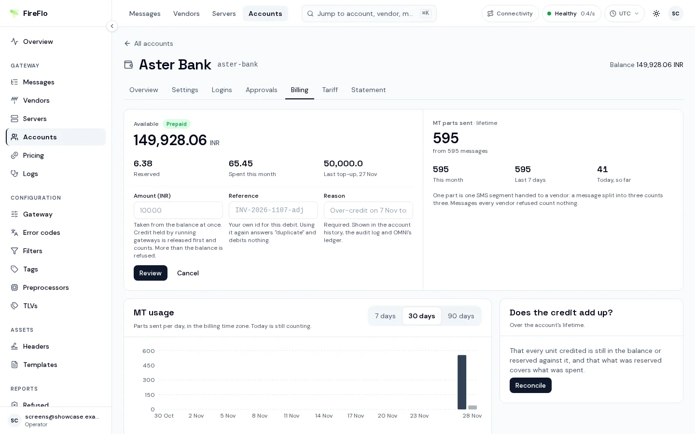
  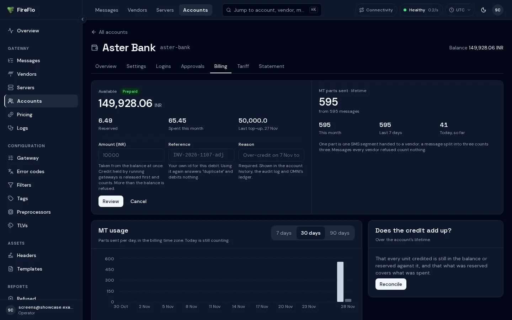
</Frame>

**Review** muestra lo que se va a retirar y el saldo que deja. Un débito tampoco se puede deshacer
desde el panel: un débito equivocado se corrige con una recarga.

## Cambiar entre prepago y postpago

**Switch to postpaid** abre las condiciones de facturación: **Prepaid — spends a balance** o
**Postpaid — billed in arrears**, y para postpago un **Credit limit**. En una cuenta postpago el mismo
botón dice **Change limit or go prepaid**. El formulario avisa antes de guardar de cualquier manera:

<Frame caption="Las condiciones de facturación de una cuenta, abiertas. Una cuenta postpago necesita un límite de crédito; cero significa sin crédito, no ilimitado.">
  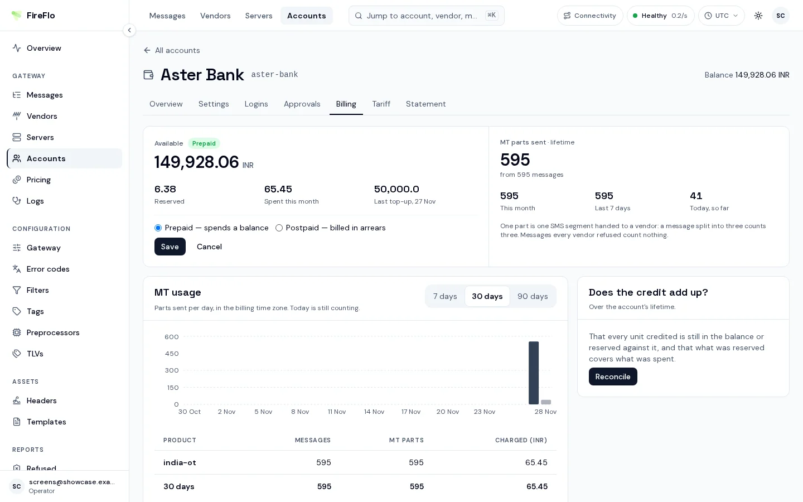
  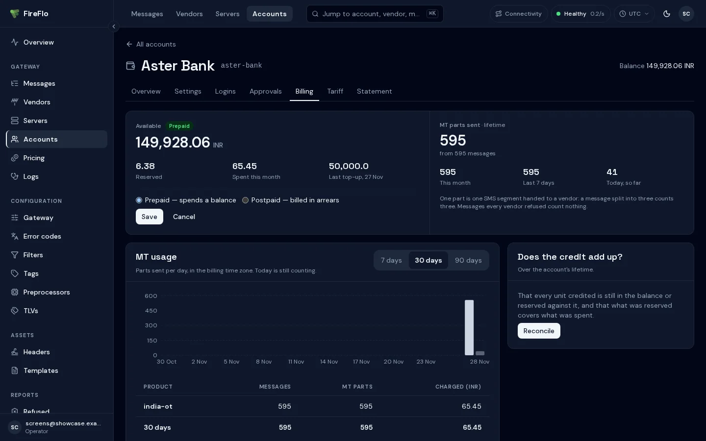
</Frame>

- **A postpago**: la cuenta deja de gastar su saldo. Cualquier cosa ya reservada se queda reservada
  hasta que se libere.
- **A prepago**: el límite se limpia y la cuenta vuelve a gastar su saldo. El uso desde la última
  factura sigue debido.

<Warning>
**Un límite de crédito postpago de cero no es ilimitado: es sin crédito**, y la cuenta no podría
enviar nada. El formulario lo rechaza en lugar de aceptar un ajuste que en silencio detiene a un
cliente.
</Warning>

**Switch credit off** deja a una cuenta enviando hasta que se acabe el bloque que ya tiene, y
después para. No es instantáneo.

## ¿Cuadra el crédito?

Dos identidades sobre toda la vida de la cuenta: cada unidad acreditada está aún en el saldo,
reservada contra él o gastada, y lo reservado y gastado cubre lo que los registros de llamada dicen
que se consumió.

No se ejecuta sola: pulse **Reconcile**. Vuelven dos cifras. **Unexplained** es el residual, y la
que vale la pena actuar sobre ella. **Reserved, not yet spent** es normal en una cuenta que envía.

<Frame caption="Tras Reconcile: nada sin explicar, un poco reservado y aún no gastado, y una nota en lenguaje llano sobre cada cosa que vale la pena saber.">
  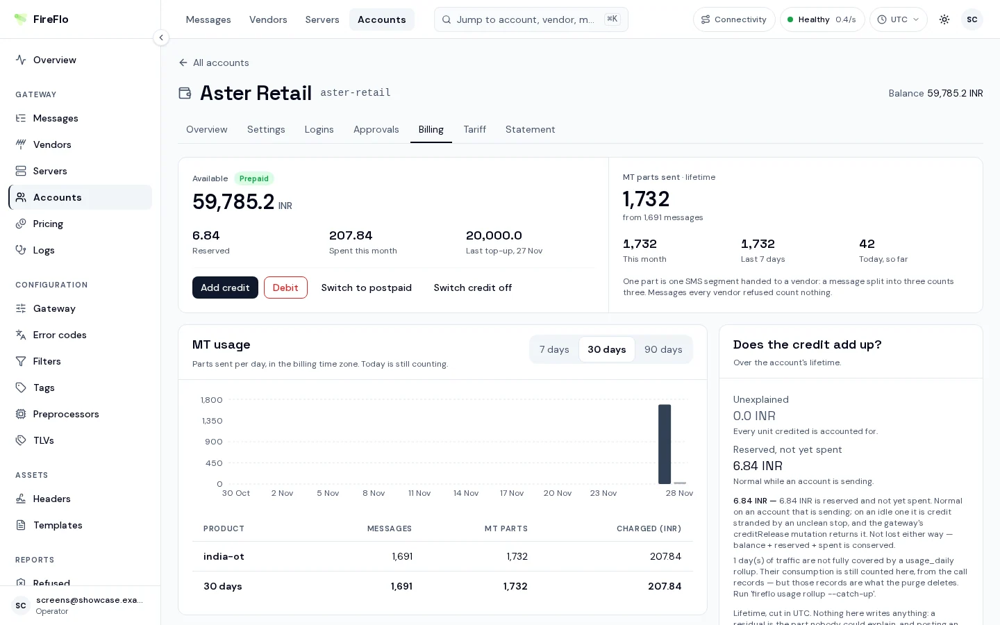
  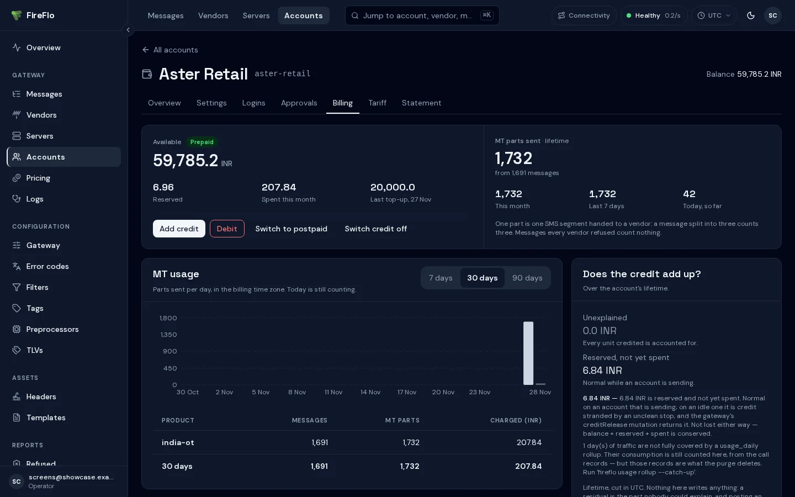
</Frame>

Debajo, un relato en lenguaje llano de todo lo que no cuadró. Las distinciones que importan:

| Veredicto | Significa |
| :--- | :--- |
| **Pending credit** | Recargas que la pasarela aún no ha aplicado. No es un problema: espere un sondeo |
| **Credit lost** | Acreditado, y ni en el saldo, ni en el reservado, ni en el gastado |
| **Credit minted** | Retenido, sin recarga o transferencia que lo justifique: la dirección más seria |
| **Charged without reserving** | El consumo es real, la reserva no |
| **Held unspent** | Varado por una parada no limpia. Liberado a mano, no perdido |
| **Missing rollup** | Días sin rollup de uso. Aún contados aquí, pero desde registros que la purga borra |
| **Unrated** | Mensajes enviados sin precio. En postpago, ingresos que nadie facturó |

<Note>
**No hay botón de "arreglarlo", deliberadamente.** La conciliación nunca escribe una entrada de
ajuste.

Un residual es la parte que nadie pudo explicar, y publicar un ajuste para él cuadraría los libros
ocultando la causa. También siempre está a escala de la vida de la cuenta, nunca de un periodo: una
identidad que se cumple sobre un mes pero no sobre la vida de la cuenta no se ha cumplido.
</Note>

## Dinero entrando y saliendo

Cada recarga, transferencia y débito, buscable por referencia, nota o tipo, ordenable y paginado. La
pasarela aplica una recarga o una transferencia en su siguiente sondeo, y un débito en el acto.

<Frame caption="Dinero entrando y saliendo. Cada recarga con su importe, referencia y estado; Applied significa que la pasarela la ha acreditado.">
  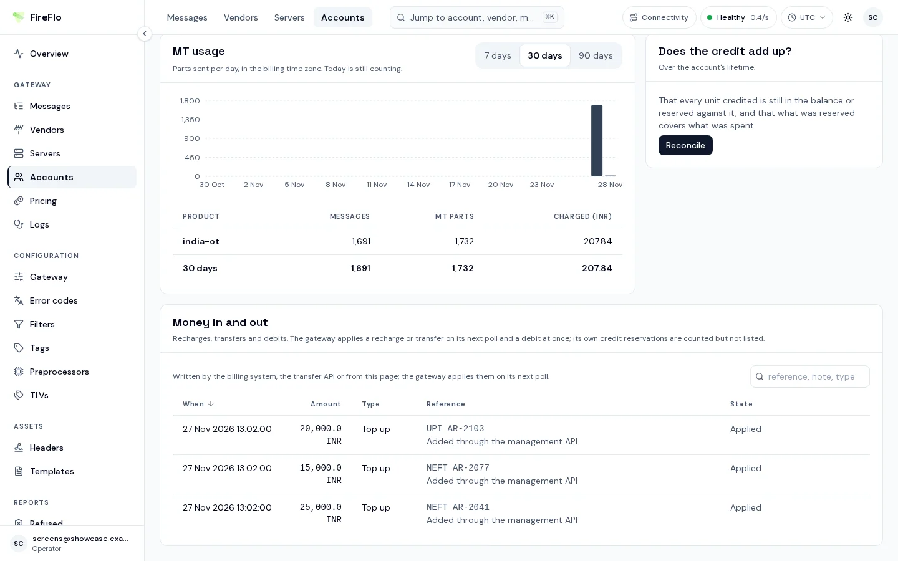
  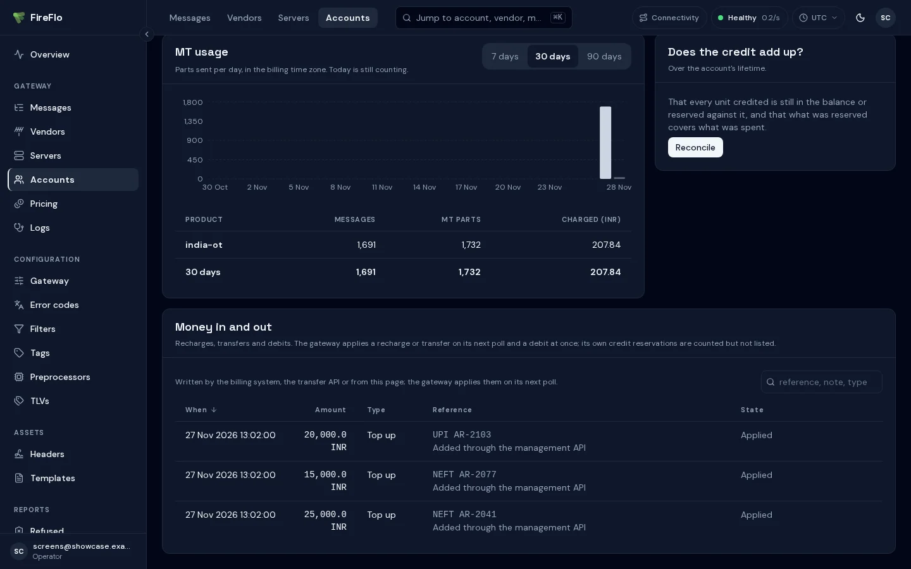
</Frame>

El libro mayor lista solo entradas que una persona o el sistema de facturación escribió. Las reservas
de crédito propias de la pasarela son contabilidad interna, no dinero (cada una mueve crédito entre
dos columnas de una fila y neta a cero) y se guardan en otro sitio.

La columna **State** lleva la parte que la gente se pierde: **Pending** significa que la pasarela
aún no lo ha aplicado. Donde una cuenta no tiene fila de saldo, una entrada positiva dice o bien
que está esperando la fila y se acreditará en el momento en que exista, o bien que se aplicó antes
de que la fila desapareciera y ya nada puede decir qué acreditó.

## Relacionado

<CardGroup cols={2}>
  <Card title="Cómo funciona el crédito prepago" icon="wallet" href="/platform/billing/prepaid-credit">
    Bloques, reservas y lo que la pasarela hace cuando se acaba el crédito.
  </Card>
  <Card title="Cuentas postpago" icon="file-invoice" href="/platform/billing/postpaid">
    Facturación a mes vencido contra un límite.
  </Card>
</CardGroup>
