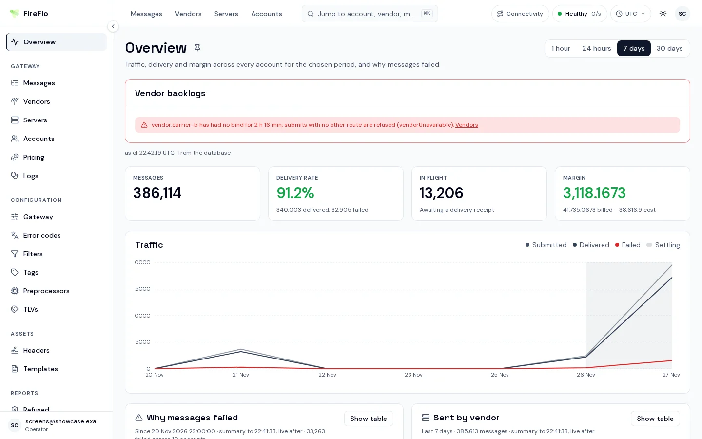
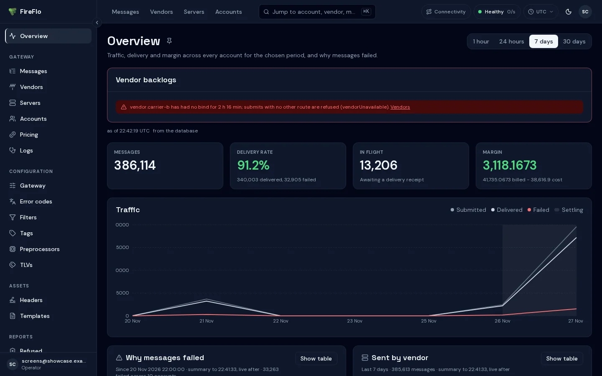

La pantalla Overview responde a una pregunta: **¿está la plataforma llevando lo que debe, y está
aterrizando?** Deliberadamente no es una pantalla de salud. Si el software tiene la memoria y las
conexiones para seguir funcionando es una pregunta distinta, hecha en
[Runtime](/platform/control-panel/runtime-metrics), y las dos se mantienen aparte porque un operador
mirando un problema de entrega no quiere estar leyendo sobre el tamaño del heap.

Todo en la página obedece a un control de rango: **1 hour**, **24 hours**, **7 days** o **30 days**.
La página se abre en la última hora y, a partir de ahí, en el rango que eligió por última vez en ese
navegador. Pide cifras nuevas cada treinta segundos, y deja de pedirlas mientras la pestaña del
navegador está en segundo plano.

<Frame caption="El Overview de 7 días. Un aviso de vendor aparece sobre las cifras solo mientras algo va mal; el final sombreado del gráfico aún se está asentando.">
  
  
</Frame>

**Vendor backlogs** aparece sobre las cifras cuando un vendor ha superado su límite de backlog, lleva
sin bind más tiempo que su margen de gracia, o tiene un mensaje en espera a mitad de la retención de
su topic. Cada línea dice adónde va en su lugar el tráfico de ese vendor, o que los submits sin otra
ruta se rechazan. En una plataforma sana la tarjeta no aparece en absoluto.

## Cuándo se leyeron las cifras

Desde 0.12.16 las cifras son una **instantánea que el panel construye en segundo plano**, no una
consulta ejecutada para su pestaña. Una línea sobre las cifras dice cuándo: **as of 10:42:17 UTC**
significa que el panel leyó la base de datos por última vez en ese segundo, en la zona horaria elegida
en la cabecera. A su lado, **from the database** o **live from the gateway** dice de dónde se leyeron
las cifras. Abra la página en tres pestañas, o que la abran tres operadores, y la base de datos hace el
mismo trabajo que para una.

La instantánea se reconstruye una vez por minuto. La mayor parte de la reconstrucción de un minuto es
pequeña: se vuelven a leer las tres últimas horas y la actual, y también el día de hoy; todo lo más
antiguo se conserva de una reconstrucción completa, que ocurre cada quince minutos. El desglose de
fallos se vuelve a leer cada cinco minutos. Así que un mensaje enviado ahora mismo aparece en un
minuto, y un acuse que cambia el resultado de un mensaje de hace seis horas se refleja en un cuarto de
hora. En una pasarela que mantiene el resumen horario de uso (0.12.16, véase más abajo) toda la vista
de 24 horas se vuelve a leer cada minuto, porque ahí sale barato.

Junto a la hora pueden aparecer dos palabras:

- **stale**: la última lectura de la sección indicada falló (la base de datos no era accesible, o una
  consulta superó el tiempo límite) y lo que ve es la lectura anterior. La hora sigue avanzando,
  porque dice cuándo el panel lo *intentó* por última vez. Un distintivo stale que persiste es un
  problema de base de datos, no de tráfico.
- **Settling**: en la leyenda del gráfico de tráfico, con la parte más reciente del gráfico sombreada.
  Los mensajes de las horas o días sombreados aún pueden recibir un acuse, así que sus recuentos de
  entregados y fallidos no son definitivos. El sombreado cubre el plazo de acuses de la pasarela
  (`smsg.cdr.deadline.hours`, 48 horas por defecto), así que en la vista de 24 horas es todo el
  gráfico, que es la verdad: nada en esa vista se ha asentado todavía.

La primera petición tras arrancar el panel no tiene nada que servir y construye la instantánea
mientras espera; si eso tarda más de ocho segundos, la página dice que se está calentando y vuelve a
preguntar en su siguiente sondeo.

La cadencia es un ajuste del panel, `OVERVIEW_REFRESH_SECONDS` en el entorno del panel: 60 por
defecto, nunca menos de 15, y `0` desactiva la instantánea y construye las cifras en cada petición. Es
lo que usa el banco de pruebas automatizado, y no es un ajuste para una plataforma ocupada.

### De dónde vienen las cifras

Las vistas de 7 y 30 días se construyen a partir del **resumen diario de uso** de la pasarela para cada
día completo que ha resumido, y solo el día de hoy se lee de los registros de llamada; consulte
[Uso y retención](/platform/billing/usage-and-retention#the-dashboards-read-it). Desde 0.12.16 la
pasarela mantiene también un **resumen horario de uso**, actualizado cada minuto a medida que fluye el
tráfico, y un panel sobre una pasarela así lee de él la vista de 24 horas y la parte de hoy de las
vistas más largas en lugar de leerla de los registros: 24 filas pequeñas más el último minuto o dos de
tráfico, sea cual sea el volumen. Ambos resúmenes son trabajo de la pasarela, activados por defecto y
ajustados en la página de ajustes de la pasarela bajo **Usage summaries**; el diario lo escribe ahora
la propia pasarela cada noche en lugar de un comando que alguien tenga que ejecutar.

Tres consecuencias que conviene conocer. En un día resumido **In flight** marca cero, porque el resumen
diario no registra lo que aún estaba pendiente; la cifra de hoy es la que está en vivo. Un mensaje que
la pasarela reintentó a caballo entre dos minutos puede contarse dos veces en el resumen horario hasta
que el recuento de las horas recientes que la pasarela hace cada cuarto de hora lo corrija: los
reintentos son una pequeña fracción del tráfico y el recuento es la verdad. Y una pasarela sin ninguno
de los dos resúmenes lo lee todo en vivo y se ralentiza a medida que crece el rango, como antes.

## Las cuatro cifras

| Tarjeta | Qué cuenta |
| :--- | :--- |
| **Messages** | Todo lo enviado en el periodo |
| **Delivery rate** | Entregado frente a fallado, con ambos conteos debajo |
| **In flight** | Enviado, aún sin acuse |
| **Margin** | Facturado menos coste del vendor, en rojo cuando es negativo |

<Note>
**Una tarjeta en blanco sigue cargando, no es cero.** Las tarjetas muestran un placeholder hasta que
llega la cifra, y luego muestran o bien el número o bien el error. Nunca inventarán un `0` para
llenar el hueco, porque "sin tráfico" y "no pudimos preguntar" son respuestas distintas y solo una
de ellas es su problema.
</Note>

**In flight no es un backlog.** Es tráfico que se ha enviado y facturado y sencillamente no se ha
informado sobre él aún. Un mensaje que nunca recibe un acuse se cierra en su fecha límite de
expiración; hasta entonces se queda aquí, y en una plataforma ocupada siempre lo hará.

## Traffic

Tres series (enviados, entregados, fallados) sobre el rango elegido. Sin nada en la ventana el
gráfico se reemplaza por **No traffic in this period**, que es una afirmación tanto sobre el rango
que eligió como sobre la plataforma. Las horas de la vista de 24 horas son horas de reloj en UTC; los
días de las vistas más largas son días de facturación, cortados en la zona de facturación de la
plataforma. La parte sombreada del gráfico aún se está asentando (véase arriba).

## Por qué fallaron los mensajes

Dos tarjetas, una junto a otra, bajo el gráfico. **Why messages failed** dibuja los fallos del periodo
como anillos: cuenta, luego vendor, resultado, código de error y el propio código del operador.
**Sent by vendor** dibuja de la misma forma lo que llevó cada vendor: vendor, luego cuenta, resultado
y código de error. Elija un anillo para ampliarlo; el centro nombra lo que hay bajo el puntero, con su
recuento y su proporción.

**Show table** en cualquiera de las dos tarjetas lista las mismas cifras como filas. En **Why messages
failed** abre además la lista de tipos de fallo, cada resultado que no fue una entrega, cada uno
nombrado en lenguaje llano en lugar de por su código de acuse:

- Failed at the vendor
- Rejected on submission
- Dropped before sending
- No receipt within the deadline

Junto a cada nombre, en tipo más pequeño, se sitúan el estado numérico del acuse y el código de
error propio del vendor. Eso parece duplicación y no lo es. `EXPIRED`, `REJECTD` y `UNDELIV`
facturan idénticamente y significan cosas completamente distintas, y cuando va a un vendor a
preguntar por un pico, **el número es por el que su documentación está indexada**. El nombre es
para usted; el número es para ellos.

### Descartar un fallo

Cada fila se puede descartar, lo que la oculta de la lista sin borrar nada. Un pie cuenta lo que ha
ocultado y puede volver a mostrarlo.

<Tip>
**Un fallo descartado vuelve por su cuenta la próxima vez que ocurra.** Descartar oculta lo que ya
ha tratado, no lo que empieza de nuevo.
</Tip>

Los descartes viven en el navegador en el que los hizo. Otro operador, o el mismo operador en otra
máquina, ve la lista completa: lo cual es deliberado, ya que la clasificación de una persona no es
una afirmación de hecho a escala de plataforma.

Esa distinción aparece en los dos estados vacíos. **No failures in this period** significa que nada
falló. **Every failure in this period has been dismissed** significa que algo sí falló y usted
decidió no mirarlo. La pantalla no informará de un periodo limpio a partir de sus propios archivos.

## Gateway health

Una franja de seis tiles al pie de la página (memoria, procesador, tareas ejecutándose, peticiones
API, tareas internas, uptime), cada uno con un sparkline y un enlace al detalle. Es un vistazo, no
una investigación.

<Warning>
**"Internal tasks" no son las conexiones de vendor.** Es el trabajo de fondo propio de la pasarela:
escrituras a base de datos, manejo de acuses. En todo el resto del panel un *worker* significa una
conexión SMPP, así que este tile evita la palabra por completo. Leerlo como un vendor atascado le
manda a buscar un problema de operador que no existe.
</Warning>

El tile **API requests** informa una media desde que el proceso arrancó. Responde a "¿es este
endpoint lento en general?" y no puede responder "¿era lento hace cinco minutos?".

Si un refresco falla mientras cifras más antiguas siguen en pantalla, una nota al pie dice que el
sondeo falló y los números se quedan puestos. La pantalla prefiere una lectura obsoleta de la que
se le avisa a una en blanco de la que no.
