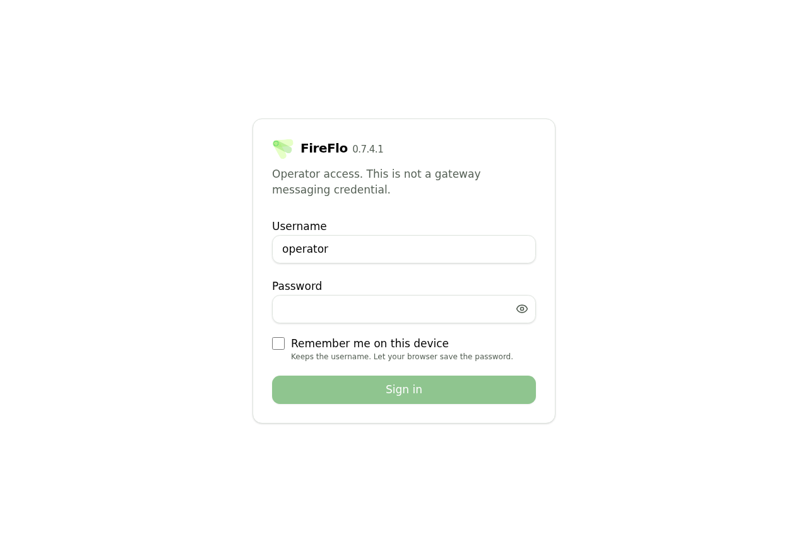

El panel de control es la mitad del operador en FireFlo. Sus clientes nunca lo ven: ellos obtienen
[el portal](/developers/portal/signing-in), que les muestra su propio tráfico y nada del suyo.

Nada aquí es obligatorio para hacer funcionar la pasarela. La pasarela lee su configuración desde
una base de datos o desde archivos y seguiría llevando tráfico si el panel se apagara por completo.
Lo que el panel le da es una forma de cambiar esa configuración sin editar a mano, y una forma de
ver lo que ocurrió sin escribir SQL.

## La barra lateral

<AccordionGroup>

<Accordion title="Overview — la primera pantalla">
Tráfico, entrega y fallos a lo largo de toda la pasarela, sobre 1 hora, 24 horas, 7 días o 30 días. Empiece
aquí en un incidente; es la única pantalla que responde a "¿va algo mal?" sin que tenga que nombrar
la cosa que sospecha.

Consulte [el dashboard](/platform/control-panel/dashboard).
</Accordion>

<Accordion title="Gateway — las cosas que llevan tráfico">
| Elemento del menú | Para |
| :--- | :--- |
| **Messages** | Cada mensaje, buscable, con una vista de detalle por mensaje |
| **Vendors** | Conexiones salientes: a quién compra |
| **Servers** | Listeners entrantes: cómo se le conectan los clientes |
| **Accounts** | Sus clientes, y todo lo que cuelga de ellos |
| **Pricing** | Tarifas, tanto lo que cobra como lo que le cobran |
| **Logs** | Logs y configuración leídos de la máquina propia de la pasarela. Consulte [Diagnósticos](/platform/control-panel/diagnostics) |

**Vendor** y **server** son las dos mitades de la misma idea, y confundirlas es el error temprano
más común. Consulte [conexiones](/platform/connections/vendors).
</Accordion>

<Accordion title="Configuration — reglas que la pasarela aplica">
**Gateway** contiene los ajustes que hereda cada vendor y cada listener salvo que establezca los
suyos. **Error codes** asigna los códigos de acuse de cada vendor a los que reciben sus clientes.
**Filters** son condiciones reutilizables sobre las que se apoyan tanto las reglas de enrutamiento
como las tarifas; **Tags** son lo que un filtro, una regla de enrutamiento o un precio pueden comprobar
sobre una cuenta; **Preprocessors** son programas a los que una regla de enrutamiento puede pasar
mensajes. **TLVs** es el catálogo de parámetros opcionales SMPP, incluyendo los que sus clientes han
propuesto y usted aún no ha aprobado.
</Accordion>

<Accordion title="Assets — lo que los clientes pueden enviar">
**Headers** son sender IDs; **Templates** son textos aprobados. Ambos son el lado del operador de lo
que los clientes solicitan en su portal, y ambos solo se hacen cumplir donde ha activado la
aplicación.
</Accordion>

<Accordion title="Reports — qué ocurrió y qué valía">
| Elemento del menú | Responde |
| :--- | :--- |
| **Refused** | Qué se rechazó antes de convertirse en tráfico |
| **Access log** | Quién inició sesión en el portal o en el panel, a quién se rechazó y qué cambiaron |
| **Security** | Binds e inicios de sesión rechazados por dirección, quién está bloqueado, y Force disconnect |
| **Queues** | Qué está esperando ahora mismo, y limpiar lo que nunca se enviará |
| **Archives** | Dónde viven los registros de llamada y lo que archivó una limpieza de colas, con cada ejecución |
| **Receipts** | Cómo de bien informa cada vendor los resultados |
| **Usage** | Volumen y entrega, por cuenta |
| **Revenue** | Facturado, coste y margen |
</Accordion>

</AccordionGroup>

## Las pantallas sin entrada en el menú

Existen ocho pantallas que la barra lateral no lista nunca. Se alcanzan desde otras pantallas, lo
cual está bien una vez lo sabe y es desconcertante hasta que lo sabe.

| Pantalla | Alcanzada desde | Qué es |
| :--- | :--- | :--- |
| **Live health** | La píldora de salud en la cabecera: un punto, una palabra como **Healthy** y la tasa saliente | Binds, profundidad de cola y acuses en vuelo, ahora mismo |
| **Connectivity** | **Connectivity**, junto a la píldora de salud | Un mapa en vivo de quién está conectado, por qué puerto y a qué vendor |
| **Kafka** | **Open Kafka topics** en la tarjeta Kafka backbone de la página Queues | Cada topic del broker, su grupo de consumidores, su lag y su retención |
| **Runtime** | "Runtime detail" en la franja de salud del Overview | Memoria, procesador y capacidad de conexión |
| **Routing** | La pantalla Vendors | Tablas de enrutamiento, reglas y grupos de vendor |
| **Products** | La pantalla Servers | El catálogo de productos: cada producto, un resumen de sus precios y los logins que lo seleccionan. Sus precios se abren en **Pricing**, acotados a ese producto |
| **Message detail** | Cualquier fila en Messages | Un mensaje de extremo a extremo, incluidos sus TLVs |
| **Sign-in** | Cerrar sesión, o una sesión expirada | El formulario de inicio de sesión de operador |

<Note>
**Runtime y Live health responden a preguntas distintas y es fácil confundirlas.** Live health es
*lo que es cierto ahora mismo*: qué vendors están bound, cómo de profundas son las colas. Runtime
es *si el software tiene sitio para seguir funcionando*: memoria, procesador, descriptores de
archivo. Una pasarela puede estar perfectamente sana en uno y en apuros en el otro.
</Note>

## Dentro de una cuenta

Abrir una cuenta le da siete pestañas, y son sujetos genuinamente distintos en lugar de secciones de
una página:

| Pestaña | Contiene |
| :--- | :--- |
| **Overview** | Tráfico y entrega solo para este cliente |
| **Settings** | Quién es, si aparece listado y dónde se sitúa en un árbol de reseller |
| **Logins** | Sus credenciales SMPP y HTTP |
| **Approvals** | Sender IDs y plantillas que ha solicitado |
| **Billing** | Crédito, el libro mayor y conciliación |
| **Tariff** | Lo que se le cobra a este cliente |
| **Statement** | Lo que debe por un periodo |

La cabecera sobre las pestañas muestra o **Balance** o **Limit**, nunca ambas: las cuentas prepago
tienen un saldo, las postpago tienen un límite de crédito, y leer una como la otra es la lectura
equivocada que cuesta dinero.

<Warning>
**La pestaña Billing es el único sitio en FireFlo donde se crea crédito, y una recarga no se puede
deshacer.** Lea [la pestaña Billing](/platform/control-panel/accounts-billing) antes de usarla.
</Warning>

## Iniciar sesión

<Frame caption="Sign-in de operador. La versión junto al wordmark es la del panel, y sus tres primeros números son la release de pasarela con la que se empareja.">
  
</Frame>

Los operadores y administradores son usuarios guardados en la base de datos de la pasarela; un
administrador los añade y restablece desde la página **Users**, y el primero se crea en la pasarela con
`fireflo user add`. Consulte
[Instalar el panel de control](/platform/install/control-panel#operators-and-admins).

Las sesiones son por navegador. Iniciar sesión en un portátil no le inicia sesión en un móvil, y
cerrar sesión termina solo la sesión que está usando. Cambiar su contraseña es la excepción, desde
0.12.15: el navegador en el que la cambió sigue con la sesión iniciada y todos los demás se cierran en
su siguiente petición.
