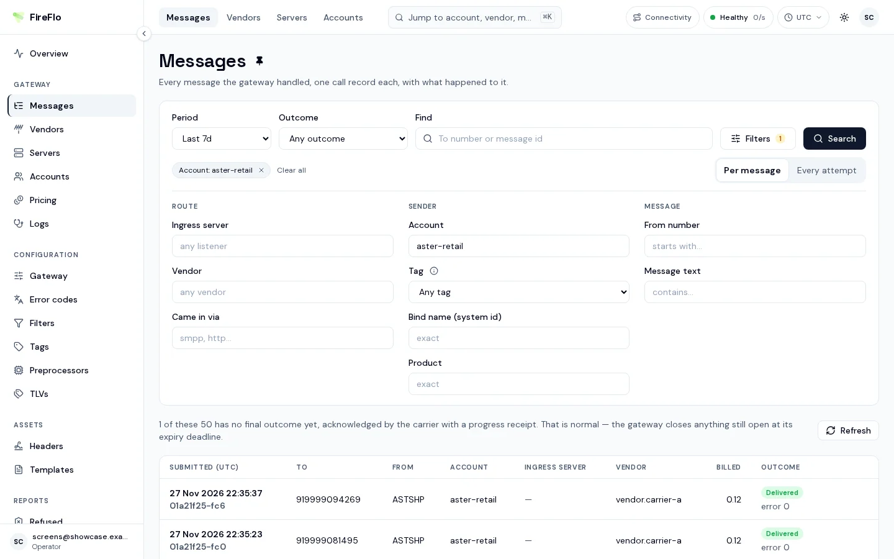
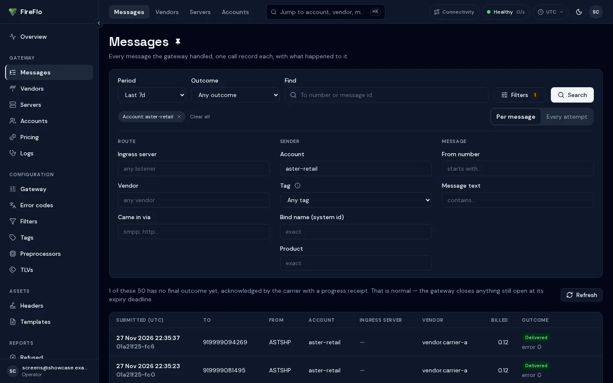
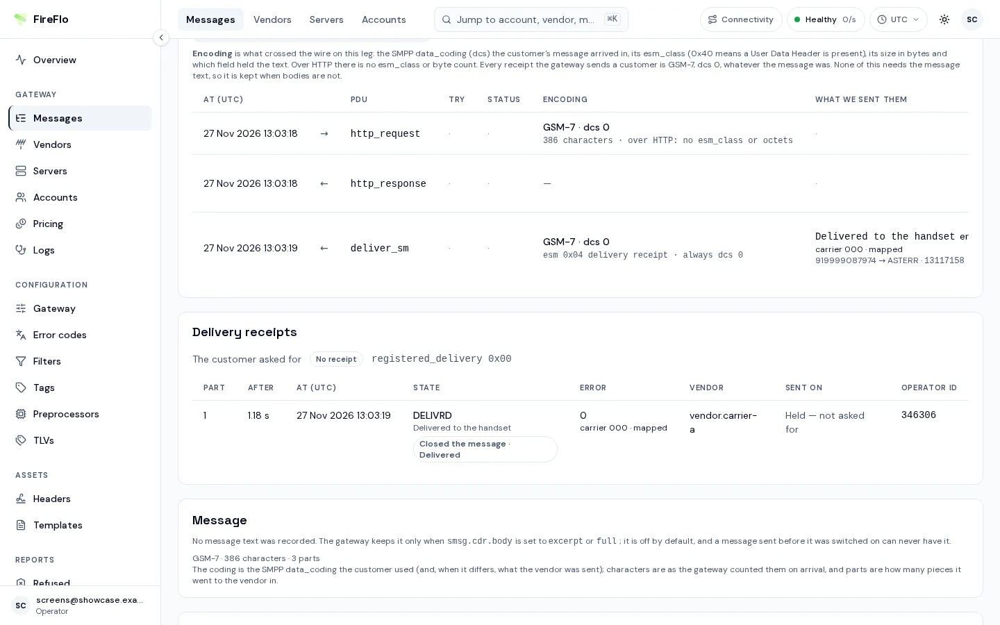
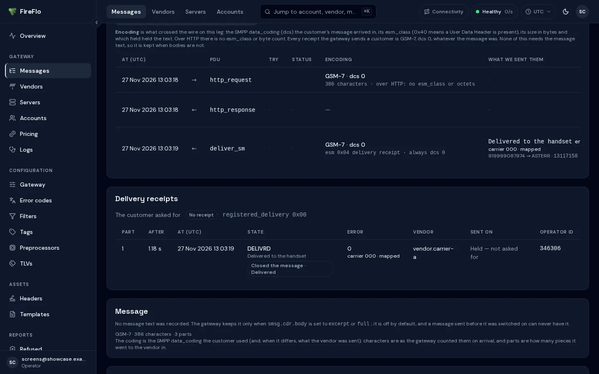

La pantalla que más abrirá. Cada mensaje, buscable, con una vista de detalle que reconstruye un
mensaje de extremo a extremo.

## Encontrar uno

Los filtros se aplican cuando pulsa **Search**, no a medida que teclea, y viajan en la barra de
dirección, así que una vista filtrada se puede marcar o pegar a un compañero y verá lo que usted
vio.

La fila siempre visible: **Period** (un preajuste o un rango de fechas), **Outcome** y **Find**, una
única casilla que acepta un número de destino (coincide desde el inicio) o un message id (exacto) y
los distingue por sí sola. **Filters** abre el resto en tres grupos, y su distintivo cuenta cuántos
están establecidos:

| Grupo | Filtros |
| :--- | :--- |
| **Route** | Ingress server, Vendor, Came in via |
| **Sender** | Account, Tag, Bind name (system id), Product |
| **Message** | From number (starts with), Message text (contains) |

**Tag** (desde 0.17.0) encuentra mensajes de cuentas que llevan esa
[etiqueta de cuenta](/platform/routing/account-tags) ellas mismas ahora. Un mensaje no guarda las
etiquetas de su cuenta, y el filtro necesita un periodo distinto de todo el historial.

Cada filtro aplicado aparece como una etiqueta bajo la barra; quite uno con su aspa, o todos con
**Clear all**.

<Frame caption="Messages de una cuenta durante 7 días, con Filters abierto. La etiqueta de cuenta bajo la barra es el filtro aplicado.">
  
  
</Frame>

**Awaiting a receipt** se lista primero entre los resultados en lugar de alfabéticamente. En una
pasarela ocupada y sana es el grupo más grande, y es lo que la gente suele estar buscando.

**Un filtro de texto, de número o de resultado necesita un periodo**, de 92 días como máximo. Esos
tres son búsquedas entre filas en lugar de un recorrido desde lo más nuevo, y sobre todos los mensajes
enviados alguna vez tardarían minutos; desde 0.12.14 la página le pide que elija un periodo en lugar
de intentarlo. Un message id exacto, o una cuenta sola, sigue funcionando sobre todo el historial.

### Un acuse que no es un resultado

Los operadores suelen responder dos veces: primero un **acuse de progreso** (*Accepted by the carrier*,
`ACCEPTD`, o *Held, still being attempted*, `BUFFRED`) y más tarde el resultado. Un acuse de progreso
no cierra el mensaje, así que hasta que llega el resultado la fila no tiene resultado, y su distintivo
nombra en su lugar el acuse de progreso: **Accepted by the carrier** en lugar de **Awaiting receipt**.
Solo un mensaje al que el operador no ha respondido en absoluto muestra **Awaiting receipt**.

El filtro **Awaiting a receipt** cubre ambos, y la línea sobre la tabla dice cuántos de los mensajes
abiertos ha confirmado el operador. La lista no se refresca sola; **Refresh** vuelve a leer la misma
página, que es como aparece un acuse que llegó después de cargar la página.

<Note>
**La búsqueda por texto del mensaje no encuentra nada a menos que la pasarela esté grabando el
contenido del mensaje**, que está desactivado por defecto. Un resultado vacío puede significar que
el texto no se conserva más que nada haya coincidido. Actívelo en **Gateway settings → Call records →
Keep message text** (desde 0.12.17; la clave es `smsg.cdr.body`, consulte
[la referencia de configuración](/reference/config/paths)).
</Note>

### Una fila por mensaje, o una por intento

El selector **Per message** / **Every attempt** junto a los filtros decide el grano, y cambia lo que
significan los números:

| Ajuste | Una fila es |
| :--- | :--- |
| **Per message** *(por defecto)* | Lo que el cliente envió |
| **Every attempt** | Lo que la pasarela hizo: una fila por intento con un vendor, incluyendo reintentos y segmentos de mensajes largos |

Un mensaje largo que se dividió en tres, reintentado dos veces en el vendor, es una fila en el
primer ajuste y varias en el segundo. Si un conteo parece demasiado alto, compruebe este control
antes de concluir nada.

## Columnas

Ocho por defecto: submitted, to, from, account, ingress server, vendor, billed, outcome. El selector agrupa
aproximadamente treinta más bajo **Message**, **Route**, **Money** y **Outcome**: incluyendo coste,
margen, ambas reglas de tasa, estado de acuse y código de error.

<Warning>
**Una celda vacía y una celda en blanco son distintas, y la distinción importa en las columnas de
TLV.**

*Nothing recorded* significa que el mensaje nunca llegó a un vendor, o fue a uno no SMPP. *Recorded
as empty* significa que se preguntó al vendor y no llevó ninguno. Leer el primero como el segundo
le manda a buscar un fallo de sellado que nunca ocurrió.
</Warning>

**Ingress server** nombra el listener por el que entró un mensaje, con su puerto: `smppserver.smpp :2790`.
El puerto es el del listener tal como está configurado ahora, no uno registrado con el mensaje, así
que tras cambiar el puerto de un listener sus mensajes más antiguos muestran el nuevo. El tráfico REST
no tiene listener y no muestra ninguno.

Las elecciones de columna se guardan en su navegador. Un enlace que comparta lleva sus filtros,
nunca sus columnas.

## Exportar

**Export these results** prepara un CSV en segundo plano, guardado durante siete días.

La exportación deliberadamente **lleva cada columna sea cual sea lo que eligiera en pantalla**. Dos
personas exportando los mismos filtros deben obtener el mismo archivo, porque las hojas de cálculo
direccionan columnas por letra y una elección personal de columna cambiaría silenciosamente lo que
`H` significa.

## Un mensaje, de extremo a extremo

Abrir una fila reconstruye todo lo registrado sobre ese mensaje: ruta, dinero, una línea de tiempo
de cada intento, cada acuse de entrega, el texto si se conservó y los TLVs.

Una línea de resumen da partes, intentos y acuses. Lea las notas debajo: explican resultados que de
otro modo parecen fallos:

- **Pidió un id de segmento.** Un mensaje largo se envía como varios mensajes SMPP y se acusa una
  vez cada uno, así que la pasarela emitió un id por parte. Todos ellos encuentran este registro.
- **Más de un acuse para la parte uno.** Permitido. Todas las demás vistas muestran el más
  temprano; la línea de tiempo los muestra todos.
- **Solo la parte uno lleva dinero.** Los segmentos posteriores se escriben sin tarifar y sin
  importes, así que las celdas de dinero en blanco a su lado son correctas en lugar de estar
  faltando.

### Qué dijo realmente un acuse

Cada acuse muestra el mnemónico SMPP con su significado en inglés llano, y luego la parte que la
gente necesita: si **cerró el mensaje**, fue **un resultado posterior, no el que se facturó**, o
fue **progreso** que dejó el mensaje abierto.

<Frame caption="Los acuses de un mensaje largo. La línea sobre la tabla dice lo que pidió el cliente; Sent on dice si cada acuse se le pasó.">
  
  
</Frame>

Bajo el error se muestra el código propio del operador, marcado **mapped** donde sus códigos de error
lo tradujeron. **Sent on** muestra **Held — not asked for** cuando el cliente no pidió acuses, así que
no se le envió nada.

Donde la pasarela registró lo que el cliente pidió, se muestra al lado. Donde no, la página lo dice
explícitamente: eso no es lo mismo que el cliente no pidiendo nada.

### La historia del TLV

La parte más útil de la página, y la razón para venir aquí en lugar de a la lista de mensajes.

Una fila por tag visto en cualquier etapa, con tres columnas de valor (**Received**, **Resolved**,
**Sent**) y un veredicto:

| Veredicto | Significa |
| :--- | :--- |
| **Unchanged** | Llegó y salió tal como vino |
| **Replaced** | Un default de cuenta, sender ID aprobado o plantilla reemplazó lo enviado |
| **Added** | No enviado por el cliente: añadido por un default, sender ID o plantilla |
| **Dropped** | El vendor no lista este tag como uno que envía, así que nunca fue |
| **Vendor default** | El vendor lo suministró; el mensaje no llevaba valor |
| **Vendor overrode** | El vendor envió algo distinto de lo que el mensaje llevaba |

**Dropped** y **Vendor overrode** son los dos que le cuestan una entrega, y son los dos que la
página colorea. Donde uno ocurra le dice dónde mirar: solo los tags de la lista de envío de un
vendor llegan al operador.

<Note>
Un guion significa *no presente en esa etapa*. Un punto centrado significa *no registrado*. Y donde
el cable es desconocido, **ningún veredicto afirma nada sobre él**. Ese es el estado honesto para
un mensaje que nunca llegó a un vendor, fue a un vendor no SMPP, o precede al registro por la
pasarela.
</Note>

## Qué no está aquí

Un registro de llamada no almacena metadatos del mensaje, id externo, ninguno de los campos
definidos por el usuario, ni la expiración ni la hora de entrega diferida. El estado en vuelo
tampoco se registra: solo el resultado. Esos viven en el mensaje mientras se le está tratando y ya
no están una vez tratado.

Si necesita el cuerpo, solo se guarda cuando la pasarela está configurada para conservarlo.
