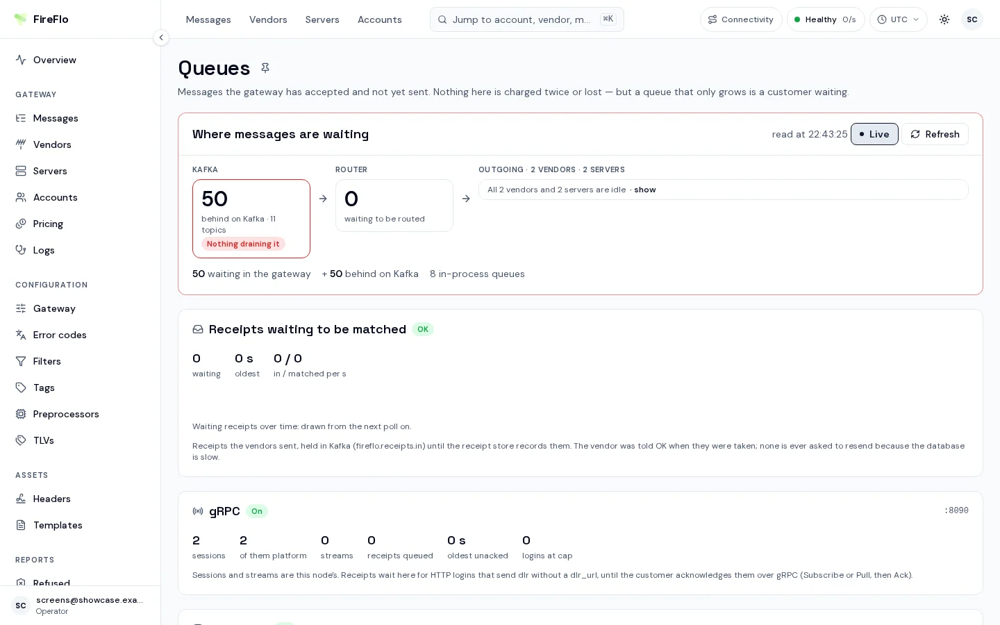
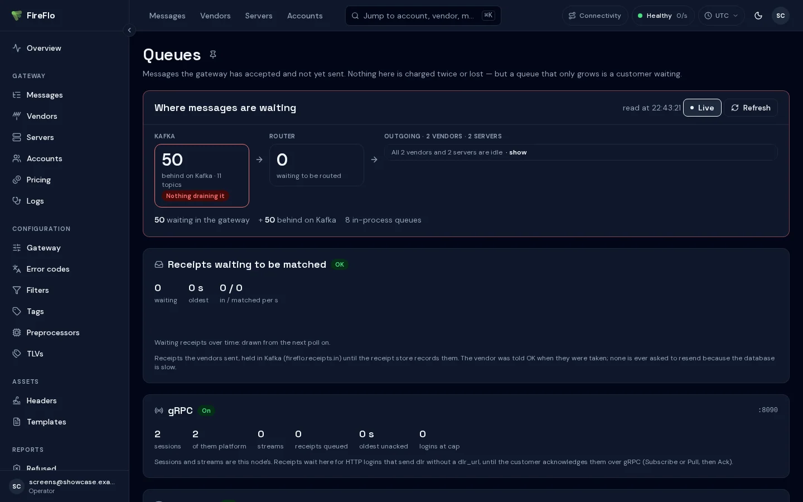
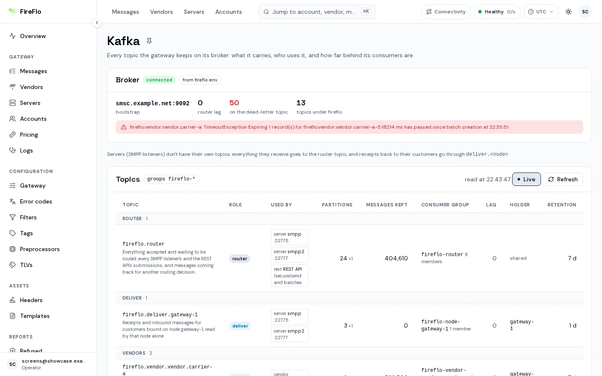
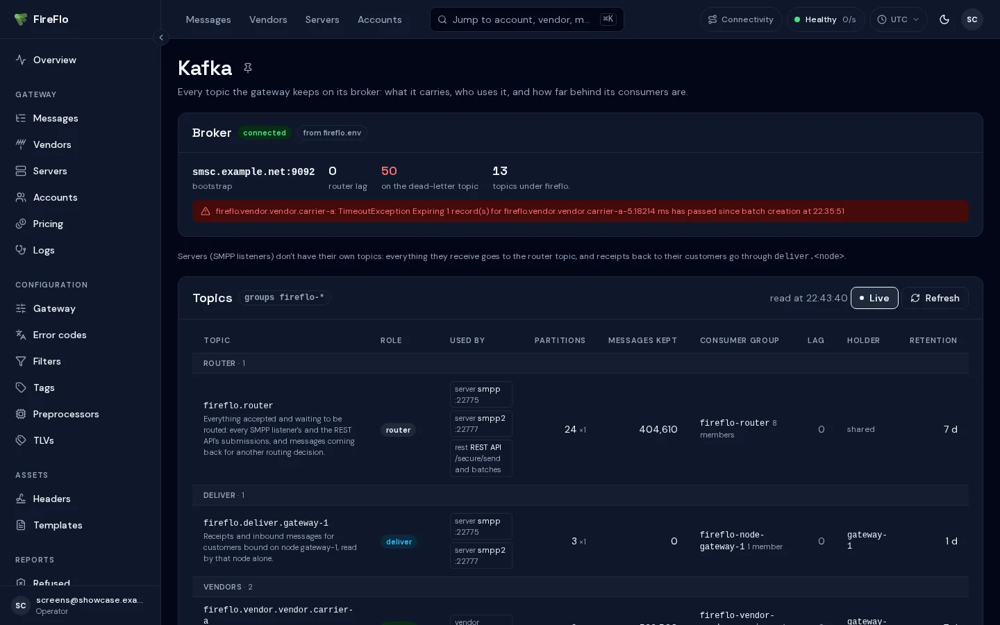
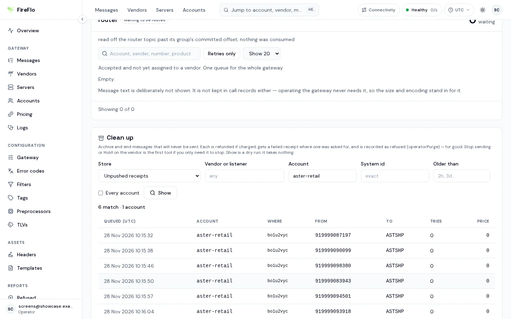
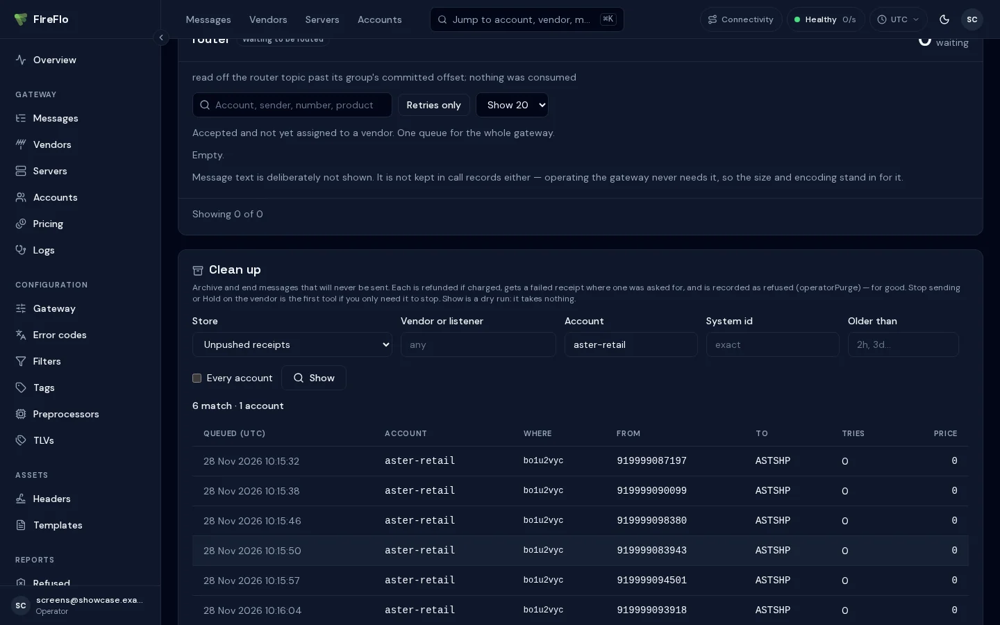

**Mensajes que la pasarela ha aceptado y aún no ha enviado. Nada aquí se cobra dos veces ni se
pierde. Pero una cola que solo crece es un cliente esperando.**

La pantalla lee en vivo, releyendo cada pocos segundos; **Live** la pausa y **Refresh** lee una vez.

## Dónde esperan los mensajes

La tarjeta de arriba dispone las colas como el camino que sigue un mensaje: **Kafka** (o **Broker**),
luego **Router**, luego **Outgoing**, una fila por vendor y por server. Los que están inactivos se
pliegan en una sola línea que **show** abre. Bajo el camino, una línea suma lo que espera en la
pasarela y lo que va atrasado en el broker. Elija cualquier etapa para abrir su propia tarjeta debajo.

<Frame caption="Nada espera en la pasarela, pero 50 mensajes van atrasados en Kafka sin nada que los drene, así que la franja aparece con borde rojo.">
  
  
</Frame>

Debajo del camino vienen tres tarjetas que no son colas de mensajes pero las explican: **Receipts
waiting to be matched** (acuses que envió un vendor, retenidos hasta que el almacén de acuses los
registra; desde 0.15.3), **gRPC** (sus sesiones, streams y los acuses que esperan a que los logins los
recojan; desde 0.15.9) y **Database** (la conexión, los escritores que registran los mensajes y la
latencia que admite o rechaza nuevos submits; desde 0.15.1). **Slow queries** se abre desde la
tarjeta Database.

## El broker y el enrutador son colas distintas

<Warning>
**Un backlog en el broker de mensajes aparece como una cola de enrutador *plana*.**

Una vez que la cola en proceso pasa su marca de agua alta, el consumidor deja de tirar, así que la
cola del enrutador deja de crecer y parece tranquila. Mientras que los mensajes se amontonan en el
broker detrás.

Si la cola del enrutador está sospechosamente estable y los clientes reportan retrasos, mire primero
la etapa Kafka (o Broker).
</Warning>

La primera etapa siempre se muestra, incluso donde no hay broker, porque *no configured* y
*configured and not answering* son hechos completamente distintos y ambos, si no, se renderizarían
como nada.

| Estado | Qué significa |
| :--- | :--- |
| **None** | Sin broker. REST va directo al enrutador |
| **Not connected** (Kafka) o **Not answering** | La pasarela no puede alcanzar el broker; lo que sea que esté en él está varado |
| **Nothing draining it** | Los mensajes se encolan y no hay consumidor conectado. No es lentitud: nada los lee |

En Kafka la etapa cuenta cuántos mensajes van atrasados en sus topics, y su tarjeta, **Kafka
backbone**, lista cada topic con cuánto va atrasado, sus particiones y sus miembros. **Open Kafka
topics** en esa tarjeta abre la página **Kafka**: cada topic que la pasarela mantiene en su broker, lo
que lleva, quién lo usa, su grupo de consumidores, su lag y su retención. Lee el broker sin consumir
nada.

<Frame caption="La página Kafka: una fila por topic, agrupadas por función, con los listeners y las APIs que lo usan, su grupo de consumidores, su lag y su retención.">
  
  
</Frame>

<Note>
Cuando el broker es inalcanzable su cifra se lee como **unknown**, nunca cero. Una cola
varada que mostrara "0 waiting" sería el número más peligroso en pantalla.
</Note>

## Las colas en proceso

Elegir el enrutador o una fila de salida abre la tarjeta de esa cola, que dice qué contiene:

| Tipo | Contiene |
| :--- | :--- |
| **Waiting to be routed** | Aceptados, aún no asignados a un vendor. Una cola para toda la pasarela |
| **Waiting for the vendor** | Enrutados, esperando a que la sesión de ese vendor los tome |
| **Scheduled retries** | Envío falló; encolado para volver a intentar |

Cada tarjeta ofrece una lectura de su propio contenido, y estas son las frases sobre las que
actuar:

- **Mostly retries**: el vendor está fallando, no meramente lento. Añadir capacidad no ayudará.
- **All first attempts, all from one account**: el volumen de un solo remitente, no un fallo de
  vendor.
- **All first attempts, spread across senders**: llegaron más de los que se drenan.

Esa lectura desaparece cuando filtra, deliberadamente: una vista solo-retries no puede pronunciarse
honestamente sobre la mezcla.

Encima de la lista, un cuadro de búsqueda la acota por cuenta, remitente, número o producto,
**Retries only** separa "llegaron más de los que pudimos enviar" de "el vendor está rechazando", y
**Show** fija cuántos listar por cola: 20, 50, 100 o 500.

La tabla muestra cuándo se encoló cada mensaje, su cuenta, producto, direcciones, tamaño y
codificación, si es un primer intento o un reintento, su objetivo y, en una cola de retries, cuándo
toca el próximo.

<Note>
**Filtrar nunca cambia la profundidad de una cola.** La profundidad se queda con el número real y
la lista debajo se estrecha. "3 matches" entre "412 waiting" significa que tres de la muestra
listada coincidieron, no que solo tres de los mensajes de ese cliente están encolados.
</Note>

## Por qué el texto del mensaje no se muestra

Deliberadamente ausente, y no se guarda en los registros de llamada tampoco. Operar la pasarela
nunca requiere leer el mensaje de un cliente, así que el tamaño y la codificación lo sustituyen:
suficiente para distinguir un mensaje Unicode de tres segmentos de un GSM corto sin leer el correo
de nadie.

## Clean up: archivar y terminar lo que nunca se enviará

Desde 0.12.19, debajo de las colas, una tarjeta **Clean up** termina los mensajes que nunca se
enviarán, y lo hace con honestidad: cada uno se archiva, se reembolsa si se cobró, recibe un acuse
fallido donde el cliente lo pidió y queda registrado como rechazado (`operatorPurge`). **Stop sending
o Hold en el vendor sigue siendo la primera herramienta** si solo necesita que el tráfico se detenga.

1. Elija el **Store** (los mensajes en espera, en reintento, retenidos o aparcados de un vendor o de un
   listener; la cola de enrutamiento, los reintentos de enrutamiento o el aparcamiento de enrutamiento
   fallido; los acuses sin entregar; o los reintentos de callback) y acótelo por **Vendor or
   listener**, **Account**, **System id** y **Older than** (`2h`, `3d`). Limpiar un store entero sin
   nombrar nada requiere marcar **Every account**.
2. **Show** es una simulación: no toma nada, e indica cuántos coinciden, en cuántas cuentas y el
   reembolso que recibirían, encima de una muestra de los mensajes que coinciden. Cualquiera que pueda
   leer las colas puede ejecutarla.
3. **Archive & clean…** se muestra **solo a administradores**. El diálogo repite lo que va a pasar,
   pide una **nota** (registrada en cada entrada archivada) y la confirmación exacta `CLEAN <n>`.
4. Justo antes de empezar, se vuelve a leer el recuento. Si ha cambiado, el diálogo muestra el número
   nuevo y le pide que confirme ese: nunca archiva más de lo que usted aceptó. Después trabaja en lotes
   de hasta 10 000, mostrando los totales acumulados, con **Stop** (el lote en curso termina primero),
   y acaba con enlaces a las ejecuciones en [Reports → Archives](/platform/control-panel/archives).

<Frame caption="Clean up tras Show, sobre los acuses sin entregar de una cuenta: seis coinciden, con la muestra listada. Todavía no se ha tomado nada.">
  
  
</Frame>

En la página de un vendor o de un listener, el mismo diálogo se abre desde **Clean queue…** en el pie,
junto a Stop sending, Hold y Restart, mientras haya algo esperando ahí. Ya viene acotado a ese worker y
muestra el recuento de cada una de sus colas (retenidos, en espera, reintentos y, en un listener,
aparcados), con una cuenta y una antigüedad opcionales.

El log de operador registra cada limpieza a nombre de la persona que la ejecutó, y el archivo de la
pasarela lleva el mismo nombre. La línea de comandos hace lo mismo con `fireflo queue archive`;
consulte [Inspeccionar una cola](/platform/operations/queues#cleaning-a-queue-archive-then-end).

<Note>
Una cola retenida en el broker de mensajes no se puede limpiar: el broker no puede mostrar un mensaje
sin tomarlo. La pasarela lo rechaza con `broker-backed`, y el diálogo lo muestra.
</Note>

## Una pantalla vacía es el resultado bueno

**No in-process queues** significa que cada mensaje que llegó ya se ha entregado a un vendor. Así
es como se ve una pasarela sana en reposo, y por eso esta pantalla no es un dashboard: viene aquí
cuando algo más ya le ha dicho que lo haga.

## Relacionado

<CardGroup cols={2}>
  <Card title="Colas y reintentos" icon="rotate" href="/platform/routing/queues-and-retries">
    Cómo funcionan la planificación de reintentos y el techo de intentos.
  </Card>
  <Card title="Live health" icon="heart-pulse" href="/platform/operations/live-health">
    Estado de bind y profundidad de cola desde la propia pasarela.
  </Card>
  <Card title="Archives" icon="box-archive" href="/platform/control-panel/archives">
    Lo que una limpieza sacó de las colas, y quién la ejecutó.
  </Card>
</CardGroup>
