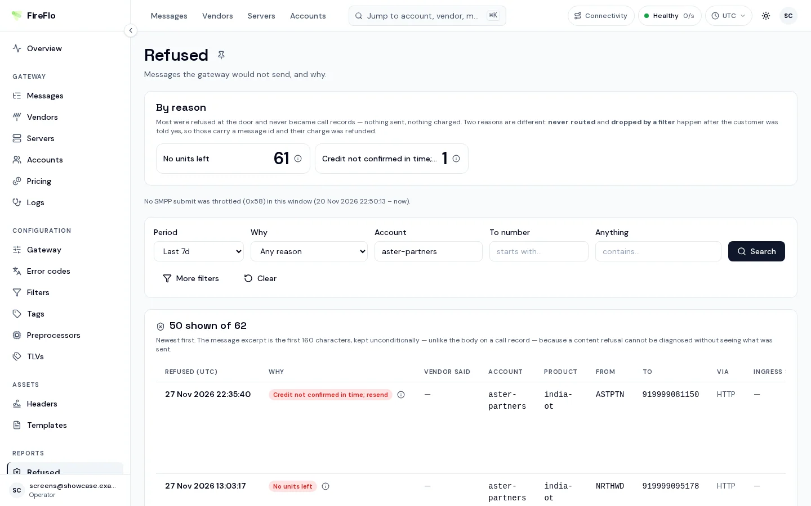
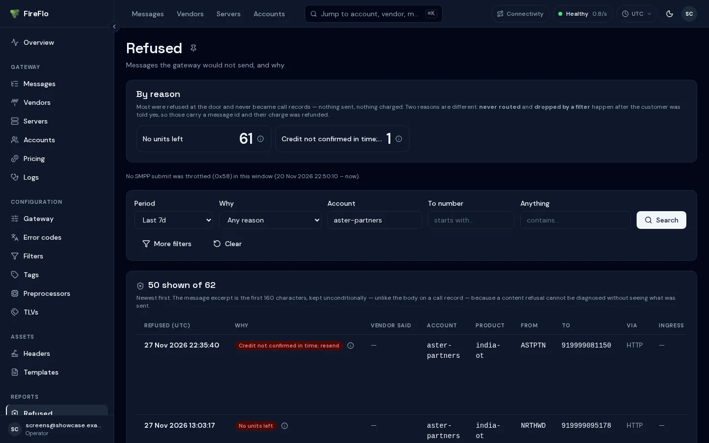
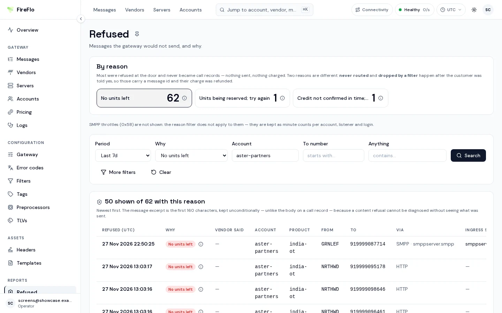
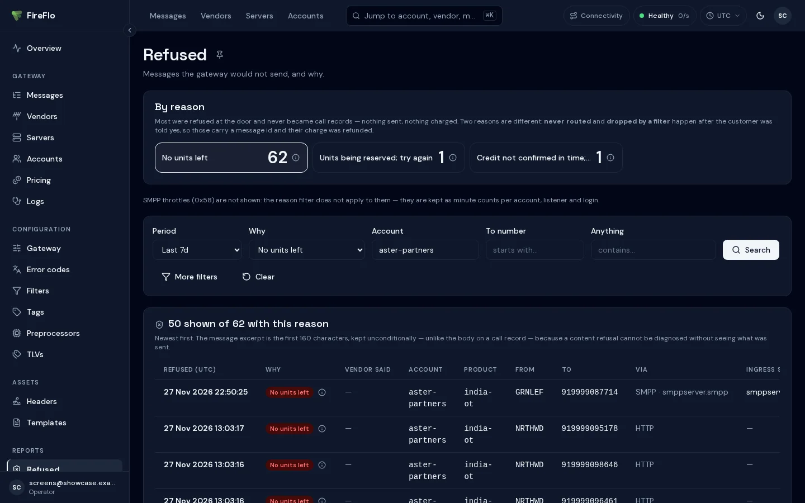

**Mensajes que la pasarela no envió, y por qué.** La primera pantalla a abrir cuando un cliente
dice que no llega nada.

La mayoría de rechazos ocurrieron en la puerta: no se envió nada y no se cobró nada. Unos pocos no, y la
diferencia es lo más importante en esta página.

## Rechazados en la puerta, o rechazados tras la aceptación

<Warning>
**Cuatro motivos ocurren después de haberle dicho sí al cliente**: *never routed*, *vendor refused
it*, *dropped by a filter* y *expired waiting for its vendor*.

Esos mensajes fueron aceptados y cargados, y en *vendor refused it* realmente enviados. Llevan un **message
id**, aparecen en los registros de llamada, y **su cargo se reembolsó**. Todo lo demás en esta
página se rechazó antes de convertirse en tráfico en absoluto.

El filtro **Stage** separa los dos, y es el filtro al que echar mano al conciliar el conteo de un
cliente contra el suyo.
</Warning>

## Los motivos

**By reason** encabeza la página: una tarjeta por motivo, con un conteo para toda la ventana y un botón
de información que lo explica. Las tarjetas no se desplazan al paginar, y elegir una filtra a ella;
elíjala de nuevo para quitar el filtro. Desde 0.12.14 el resumen se toma sobre los **últimos 50 000
rechazos** y la página lo dice: en una pasarela que rechaza más que eso en la ventana, las tarjetas
describen la forma reciente en lugar de un total exacto, y la tabla de debajo sigue completa.

<Frame caption="Rechazos de una cuenta durante 7 días: una tarjeta por motivo encima de los filtros y los rechazos más recientes.">
  
  
</Frame>

<Frame caption="La misma página tras elegir la tarjeta No units left: la tarjeta queda resaltada, Why se fija en ella y el conteo sobre la tabla es solo de ese motivo.">
  
  
</Frame>

Los submits SMPP respondidos con un throttle (`0x58`) no son filas aquí. Se guardan como recuentos por
minuto por cuenta, listener y login, y una línea bajo las tarjetas dice cuántos hubo en la ventana, o
que no hubo ninguno.

| Motivo | Normalmente significa |
| :--- | :--- |
| **Sender ID not approved** | El remitente no está en la lista aprobada de la cuenta para ese producto |
| **Content not approved** | El cuerpo no coincidió con ninguna plantilla aprobada: una palabra cambiada basta |
| **Out of credit** | El crédito prepago no lo cubriría |
| **No units left** | Desde 0.16.0. A un login de una [cuenta de unidades](/platform/billing/units-accounts) no le quedan unidades de su producto. La cuenta que se muestra es la cuenta padre, que paga |
| **Units being reserved; try again** | Las unidades de una cuenta de unidades estuvieron retenidas por otro nodo por un momento. Un reintento pasa |
| **Required parameter missing** | Un TLV que la entrada requiere estaba ausente, y nada lo suministró |
| **Rate limit exceeded** | Por encima de los mensajes por segundo de la cuenta |
| **Product not sold** | El login nombró un producto sin fila activada en el catálogo |
| **No price configured** | Ninguna tasa del lado de venta coincidió, y la pasarela rechaza en lugar de enviar sin facturar |
| **Product not allowed for this login** | El login no puede nombrar ese producto |
| **Credit not confirmed in time; resend** | Desde 0.17.2 (`creditPending`). El crédito de una cuenta con fondos no se confirmó dentro de `smsg.balance.park.seconds`, normalmente porque la base de datos iba lenta o no respondía. Nada cobrado; un reenvío pasa. Véase [Rechazos](/platform/troubleshooting/refusals#crédito-no-confirmado-a-tiempo) |
| **Too many waiting for credit; resend** | Desde 0.17.2 (`creditQueueFull`). Ya esperaban crédito 10 000 mensajes de la cuenta, o 100 000 en la pasarela. La misma causa que el anterior, a volumen |
| **Queue full** | La cola del enrutador estaba a capacidad y rechazó en lugar de crecer el heap. Antes de 0.17.2, los envíos REST y gRPC rechazados por crédito no confirmado a tiempo también se contaban aquí |
| **Could not be queued** | Aceptado por las comprobaciones, pero no se pudo entregar: normalmente el broker |
| **Vendor backlog full** | Desde 0.15.1. Cada vendor al que podía ir el mensaje había superado su límite de backlog, y ninguna otra ruta era utilizable. Nada cobrado |
| **Vendor unavailable** | Desde 0.15.1. El vendor al que iría lleva sin bind más tiempo que `smsg.vendor.unbound.refuse.after.seconds`, y ninguna otra ruta era utilizable. Nada cobrado |
| **Database not answering; try again** | Desde 0.15.1. La base de datos iba demasiado lenta para aceptar mensajes nuevos, así que los submits nuevos se rechazaron antes de cobrar nada. Los mensajes ya aceptados siguen adelante |
| **Gateway stopping** | La pasarela se estaba apagando y no aceptó mensajes nuevos. Nada cobrado; un reintento pasa en cuanto otro nodo o la pasarela reiniciada lo toma |
| **Hand-off outcome unknown** | Aceptado y entregado al broker, y la entrega terminó sin una respuesta definitiva: puede que se haya enviado. No se reembolsa, para que no pueda facturarse dos veces; la pasarela lo liquida en cuanto se conoce la respuesta |
| **Never routed** | *Tras aceptación.* Ninguna regla activada coincidió; reembolsado |
| **Vendor refused it** | *Tras aceptación.* El operador rechazó el submit; reembolsado |
| **Dropped by a filter** | *Tras aceptación.* Un filtro de enrutamiento lo detuvo; reembolsado |
| **Expired waiting for its vendor** | *Tras aceptación.* Encolado para un vendor, esperó más de `smsg.vendor.backlog.expire.seconds` (o su propia validez) y no se envió; reembolsado, con un acuse fallido donde se pidió |

<Note>
**Los mensajes de una cuenta con fondos esperan a su crédito** tras un reinicio, o siempre que se
agota su bloque, en lugar de rechazarse. Muchos rechazos **Credit not confirmed in time** en varias
cuentas en los mismos minutos apuntan a la base de datos. **Out of credit** en una cuenta con fondos
que persiste es una escasez real, o crédito retenido en `reserved`.
</Note>

Dos motivos merecen su propia nota. **Content not approved** es una comparación exacta fuera de los
placeholders: una sola palabra cambiada rechaza. Y en **vendor refused it**, el estado numérico del
propio operador se sitúa junto a la fila; la familia 192–196 siempre trata de TLVs, lo cual en un
lane DLT indio normalmente significa un id de entidad o plantilla faltante o sin sellar.

Un resumen vacío lo dice claramente, y añade la comprobación que vale la pena hacer primero: si
esperaba rechazos y no ve ninguno, confirme que la aplicación esté activada en absoluto: **una
whitelist no cargada permite todo por diseño**.

## Encontrar uno

La fila siempre visible es **Period**, **Why** (el motivo), **Account** (exacto), **To number**
(empieza por) y **Anything**. **Anything** es la red amplia: busca dentro de cuenta, remitente,
destino, producto, login, detalle del rechazo y extracto del mensaje a la vez. **More filters** añade
**Bind name (system id)**, **Product**, **Came in via**, **Listener**, **From number**, **Message id**,
**Carrier status** y **Stage**. **Clear** los vacía todos.

**Carrier status** toma el número del operador en decimal. 69 es el genérico "rechazado y no dirá
por qué", y solo los rechazos de vendor llevan uno.

**La página siempre necesita un periodo, de 92 días como máximo.** Los rechazos no se pueden listar
sobre todo el historial: versiones anteriores mostraban en silencio los rechazos de un día bajo un
encabezado **All time**, que es el tipo de error que la gente se cree, así que desde 0.12.14 la página
pide un periodo en su lugar.

## La tabla

Diez columnas por defecto: refused, why, vendor said, account, product, from, to, via, ingress
server, message. El selector añade el motivo en inglés, el detalle del rechazo, si se cobró y
reembolsó, lo que se le dijo al cliente, el nombre en código del vendor y los ids de fila y mensaje.

El **extracto del mensaje** (los primeros 160 caracteres) se guarda **incondicionalmente**, a
diferencia del cuerpo en un registro de llamada. Un rechazo de contenido no se puede diagnosticar
sin ver lo que se envió, así que este es el único sitio donde el texto del mensaje siempre está
disponible.

<Note>
Un guion bajo **Parts** significa que el mensaje se rechazó antes de contar sus segmentos, no cero
partes. **Data coding** sí muestra `0`, que es real: eso es GSM 7-bit.
</Note>

## Exportar

Preparado en segundo plano, guardado siete días, y (como en Messages) **lleva cada columna más el
motivo en inglés llano y el código del operador**, sea lo que sea lo que eligiera en pantalla. Estos
archivos los leen personas sin panel abierto.

## Relacionado

<CardGroup cols={2}>
  <Card title="Por qué se rechazó un mensaje" icon="circle-question" href="/platform/troubleshooting/refusals">
    Retroceder desde un rechazo hasta su causa.
  </Card>
  <Card title="Rechazos de vendor" icon="triangle-exclamation" href="/platform/troubleshooting/vendor-rejections">
    Qué significa cada código de estado del operador.
  </Card>
</CardGroup>
