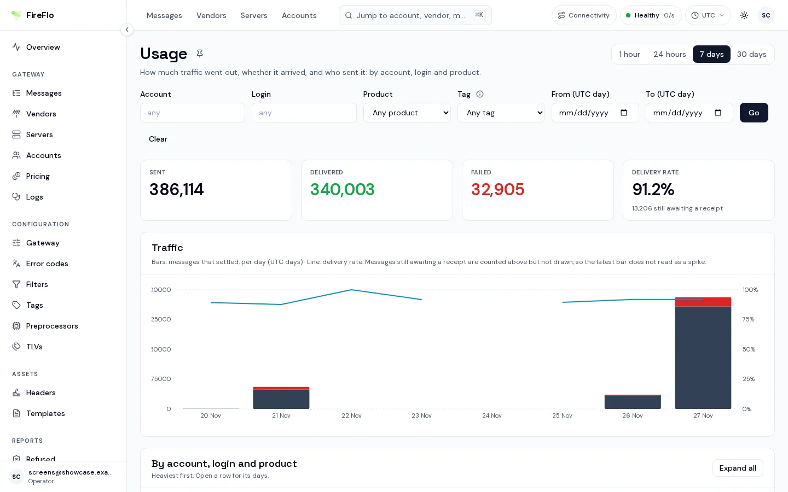
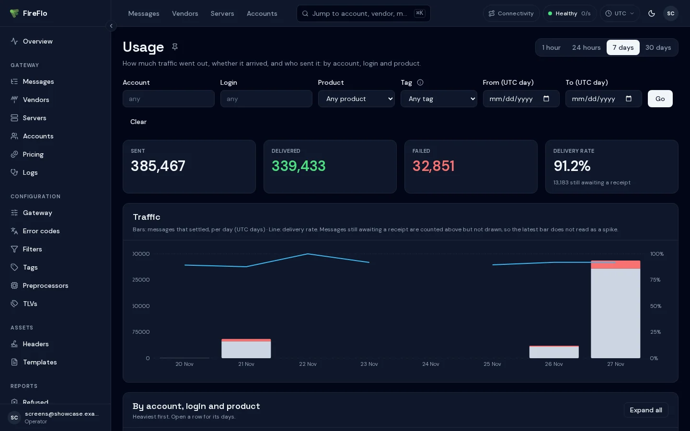
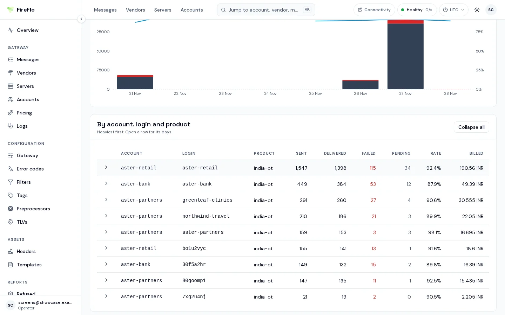
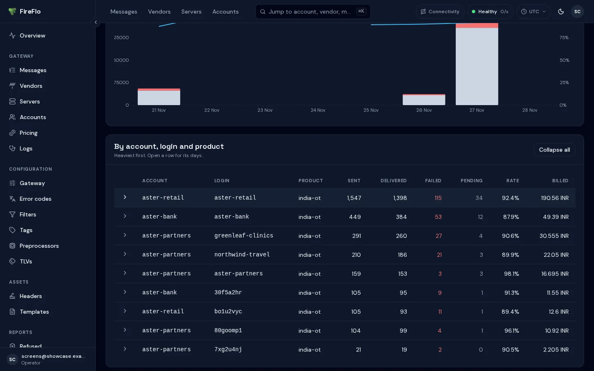

Cuánto tráfico salió, si llegó, y quién lo envió: por cuenta, login y producto. Volumen y entrega
encabezan; el dinero es la última columna en lugar del titular: la pregunta comercial se responde en
[Ingresos](/platform/control-panel/revenue).

El selector de rango ofrece **1 hour**, **24 hours**, **7 days** o **30 days**. Como todas las páginas
de tráfico, se abre en la última hora y, a partir de ahí, en el rango que eligió por última vez en ese
navegador. Un día es la unidad en la que se suele hacer una pregunta de uso, así que para ver la forma
de día laborable a fin de semana elija 7 o 30 días.

<Frame caption="Usage durante 7 días. Las barras cuentan solo los mensajes que se liquidaron; la línea es la tasa de entrega contra su propio eje de 0–100%.">
  
  
</Frame>

## Filtros

Bajo el título: **Account** y **Login** (cada uno sugiere nombres mientras escribe), **Product**,
**Tag**, y los días **From** y **To** en la zona de facturación. No se lee nada hasta que pulse **Go**;
**Clear** los quita todos. Un rango de fechas sustituye al selector de rango mientras está
establecido. Los filtros que aplicó se recuerdan en ese navegador.

## Las cifras

Cuatro tarjetas (**Sent**, **Delivered**, **Failed**, **Delivery rate**), con la tarjeta de tasa
señalando cuántos mensajes aún están esperando un acuse.

<Warning>
**La tasa de entrega es entregado sobre lo que se ha liquidado, no sobre lo enviado.**

Dividir por enviado contaría cada mensaje aún en vuelo como un fallo. La tasa colapsaría cada tarde
ocupada y se recuperaría sola durante la noche, y nadie podría distinguir un problema de entrega
real del tráfico ordinario.

Así que una tasa del 98% significa 98% *de los mensajes que tienen un resultado*. Los mensajes que
aún esperan se cuentan en **Sent**, y en **Pending** en la tabla, y no están en ninguna mitad de la
tasa.
</Warning>

Desde 0.15.1 la página lee solo los resúmenes de uso de la pasarela, y los registros de llamada de los
últimos minutos y nada más, sea lo que sea lo que se filtre o se abra: eso es lo que mantiene rápida
una vista de 30 días con mucho volumen. El **Pending** de una hora o un día resumidos es lo que aún
esperaba un acuse cuando la pasarela lo resumió por última vez.

## Tráfico

Delivered y failed apilados por día (por hora en los rangos más cortos) contra volumen a la izquierda,
y la tasa de entrega como una línea contra un eje fijo 0–100% a la derecha.

Dos elecciones deliberadas que vale la pena conocer:

- **Los mensajes aún esperando un acuse se cuentan en los totales pero no se dibujan.** De lo
  contrario, hoy siempre se leería como un pico de desconocidos.
- **Un día sin nada liquidado no tiene tasa en absoluto**, y la línea se rompe en lugar de bajar a
  cero. Un hueco es "sin evidencia"; un cero sería "todo falló".

## Por cuenta, login y producto

Lo más pesado primero, una fila por cuenta, login y producto:
**Account · Login · Product · Sent · Delivered · Failed · Pending · Rate · Billed**. Cincuenta filas por
página.

Abra una fila con su flecha para ver sus días, o sus horas en la vista de 24 horas; **Expand all** abre
las 25 primeras filas a la vez. La vista de 1 hora no tiene nada que abrir.

<Frame caption="La tabla por cuenta, login y producto durante 7 días. La flecha de cada fila abre sus días.">
  
  
</Frame>

Cada cuenta enlaza a ese cliente, donde la misma pregunta se responde solo para él.

Desde 0.17.0 el filtro **Tag** limita la página a las cuentas que llevan una
[etiqueta de cuenta](/platform/routing/account-tags) ellas mismas. Lee las etiquetas que las cuentas
tienen ahora: un mensaje no guarda las etiquetas de su cuenta, así que un periodo pasado se lee con las
de hoy.

El tráfico que no nombró ninguna cuenta muestra un guion en la columna **Account**: no es un error, y
no es una cuenta con nombre vacío. Es tráfico que llegó sin una, que normalmente significa un login
sin cuenta adjuntada, y vale la pena perseguirlo porque tarifica y factura de forma distinta. Los días
que la pasarela resumió antes de registrar los logins (antes de 0.15.1) muestran todos los logins
juntos en una fila, y la página lo dice.

## Uso frente al extracto

Esta pantalla cuenta mensajes. El [extracto](/platform/billing/statements) de un cliente cuenta
dinero, y se factura sobre el envío en lugar de la entrega. Así que la cifra de entregado aquí
sigue moviéndose después de cortar un extracto mientras el importe facturado no lo hace.

No se pretende que coincidan en entrega. Se pretende que coincidan en **sent**.

## Relacionado

<CardGroup cols={2}>
  <Card title="Ingresos" icon="coins" href="/platform/control-panel/revenue">
    El mismo tráfico, valorado.
  </Card>
  <Card title="Rollups de uso y retención" icon="database" href="/platform/billing/usage-and-retention">
    El rollup diario en el que se apoya esta pantalla, y lo que la purga borra.
  </Card>
</CardGroup>
