Una **cuenta** es un id sobre el que coinciden un login, un ámbito de tasa, una fila de saldo y un
registro de llamada. Nada tiene que crearla: una cuenta existe en el momento en que un login la
nombra o llega un mensaje llevándola, y la fila `app_account` es una etiqueta atornillada después.

<Frame caption="La lista Accounts, una fila por login. Not named yet cuenta los ids de cuenta en uso que no tienen nombre propio.">
  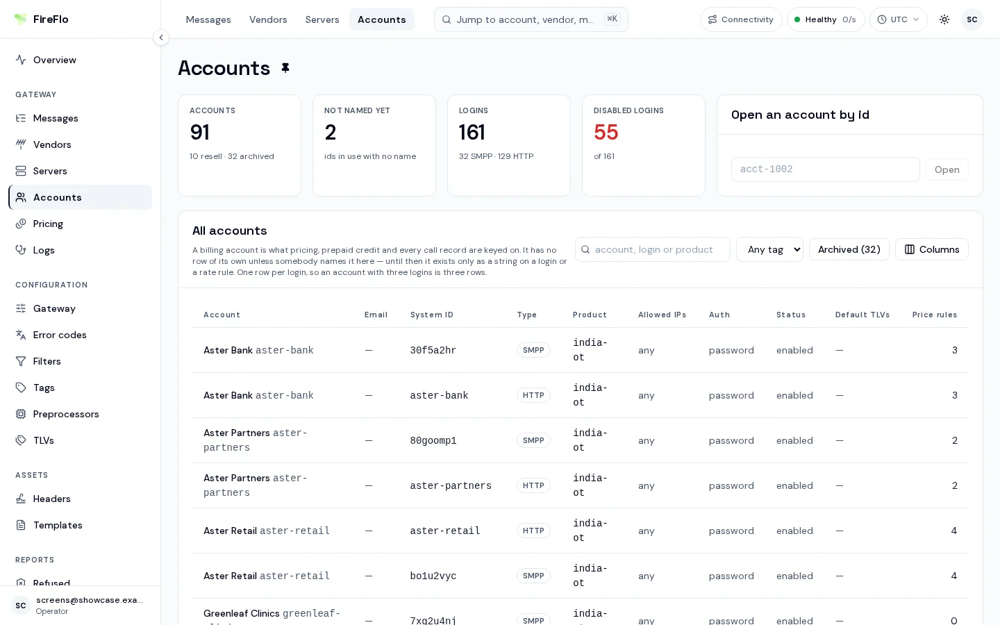
  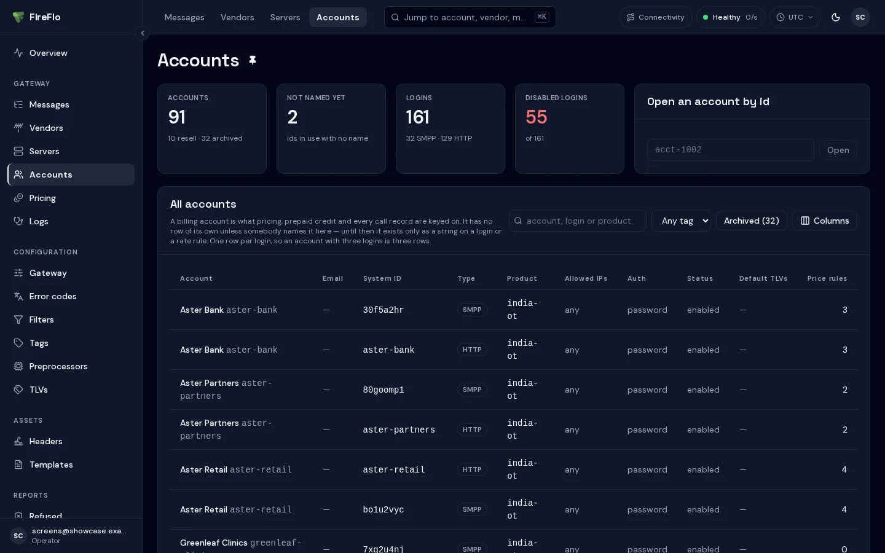
</Frame>

## Deje `accountId` en blanco y otra cosa se convierte en la cuenta

`accountId` es opcional en una credencial, y lo que llena el hueco **difiere por protocolo**.

| Protocolo | Recurre a |
| :--- | :--- |
| SMPP | el `systemId` |
| HTTP | la *clave de lookup*, que es el `apiKey` cuando hay uno |

<Warning>
**Un login HTTP con un `apiKey` y sin `accountId` factura a la propia clave API.** El secreto
aterriza en `cdr_submit.account_id`, en las cifras de ingresos del panel y en cada exportación CSV:
copiado en registros que viven tanto como la historia de facturación, y que dejan la plataforma en
hojas de cálculo. Rotar la clave después divide la historia de ese cliente entre dos ids.

Establezca `accountId` explícitamente en cada credencial y ninguno de los fallbacks importa.
</Warning>

<Frame caption="Un login abierto para editar. Account está bajo Billing and tariff: los ámbitos de tasa y los saldos prepago se asocian a ella, y queda fija una vez creado el login.">
  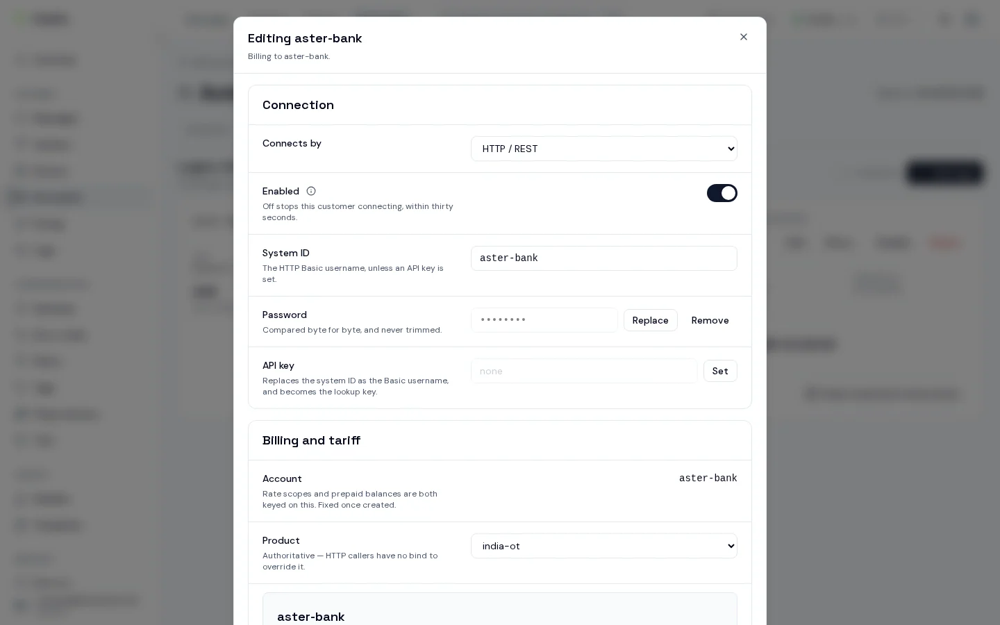
  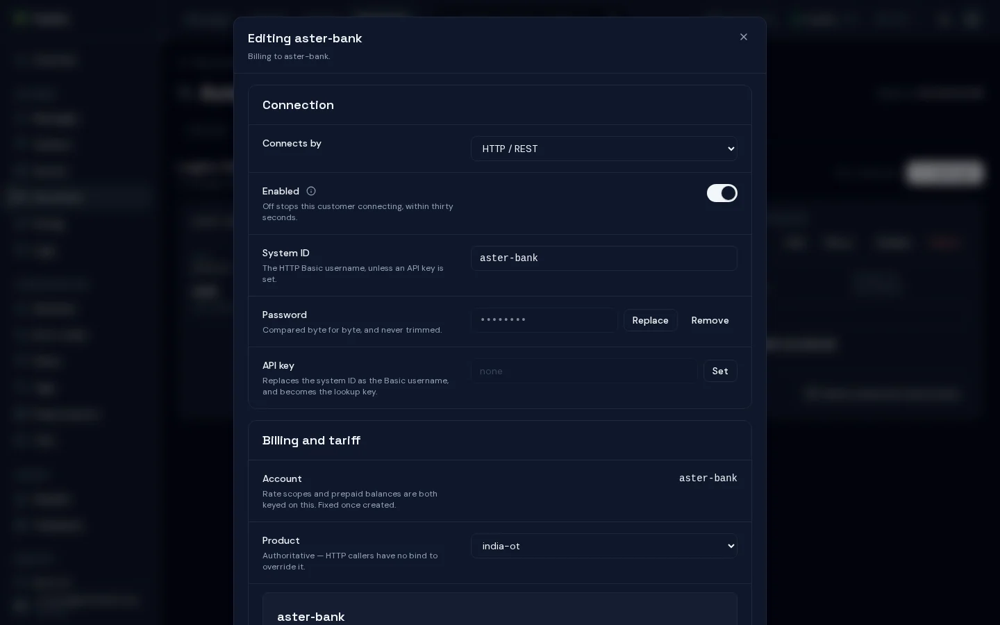
</Frame>

## Por qué la cuenta y no el login

Una cuenta puede tener varios logins, y todo lo que lleva dinero o un techo está asociado a la
cuenta:

| Asociado a la cuenta | Dónde vive |
| :--- | :--- |
| Saldo prepago y crédito reservado | `account_balance` |
| Límite de crédito y modo de facturación | `account_balance.billing_mode`, `credit_limit` |
| Tarifa: lo que este cliente paga | un ámbito de tasa nombrado tras el id de la cuenta |
| Extracto y uso diario | `cdr_submit`, `usage_daily` |
| Techos de tasa | la cuenta, no el bind |

<Note>
Un límite por login permitiría a un cliente subirse su propio techo creando otro login. Asociar a
la cuenta es lo que hace que cualquiera de estos signifique algo.
</Note>

Las aprobaciones son lo único que puede ir en cualquier dirección: una fila de sender ID o
plantilla puede nombrar un `system_id` para atarla a un login, o dejarlo null para todos los
logins de la cuenta. Consulte [Sender IDs](/platform/customers/sender-ids).

## Qué contiene realmente la fila del catálogo

`app_account` es nombre, contacto y jerarquía. Cuando la pasarela carga los logins solo lee dos cosas
de ella: si la cuenta está activada y si está archivada.

| Columna | Significado |
| :--- | :--- |
| `id` | La clave de facturación. Recortada y no vacía, y la clave primaria. |
| `label`, `description` | Para las personas que leen el panel (**Name** y **Notes**). |
| `email` | La dirección de contacto de la cuenta y un login del portal. Una cuenta por dirección, ignorando mayúsculas y minúsculas. |
| `enabled` | **Enabled**, bajo Settings → Advanced. Desactivado, pausa la cuenta: sus logins se detienen y nadie puede iniciar sesión en el portal por ella. |
| `resells` | **Resells services**: esta cuenta puede tener otras y moverles saldo. |
| `parent_account_id` | **Belongs to**: el reseller bajo el que se sitúa. |

El árbol tiene exactamente dos niveles de profundidad, y la base de datos lo hace cumplir:
`app_account_two_levels` rechaza una fila que a la vez nombra un padre y revende, por lo que una
cuenta o bien tiene otras o pertenece a una.

<Frame caption="La pestaña Settings de una cuenta. Organisation contiene el nombre, el email, las notas y las etiquetas; Advanced contiene Enabled, la reventa y el padre; Archive está debajo.">
  
  
</Frame>

<Warning>
**Desactivar una cuenta detiene su tráfico.** La pasarela deja de servir los logins de la cuenta en un
sondeo de configuración (30 segundos por defecto), y nadie puede iniciar sesión en el portal por ella.
Los binds ya abiertos siguen activos hasta que se caen.

Para detener un login en lugar de toda la cuenta, desactive ese **login**. Para detener el gasto, use
el saldo.
</Warning>

Para retirar una cuenta para siempre, use **Archive** al pie de la pestaña Settings. Sus logins se
desactivan, los binds vivos se cortan y el inicio de sesión en el portal se cierra; su saldo y su
historial se conservan, y sale de la lista de cuentas. **Unarchive** vuelve a activar exactamente lo
que el archivo desactivó, y los clientes vuelven a hacer bind por su cuenta.

## Resellers y subcuentas

Active **Resells services** y la cuenta se convierte en reseller. Su gente gestiona entonces sus
propios clientes desde el portal, en **Customers → Sub-accounts**. Hay dos niveles, nunca más: una
subcuenta no puede revender.

<Frame caption="La lista Sub-accounts de un reseller en el portal. El crédito de cada subcuenta sale del propio saldo del reseller.">
  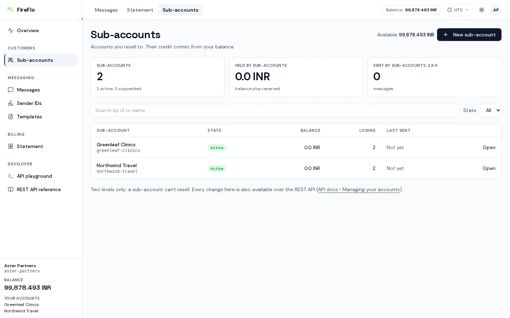
  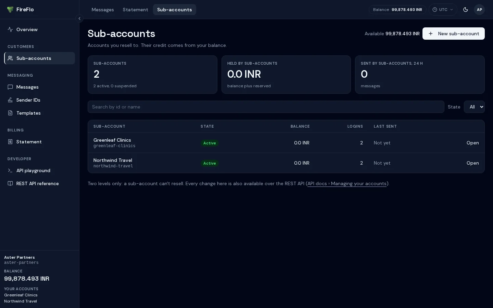
</Frame>

**New sub-account** pide un id de cuenta (fijo una vez creado), un nombre y un crédito inicial, movido
desde el saldo del reseller en el acto; déjelo en 0 para recargar más tarde. La subcuenta recibe un
login HTTP de inmediato, y los logins SMPP se añaden en su pestaña Logins.

<Frame caption="New sub-account. El crédito inicial muestra el saldo del reseller tras el movimiento antes de crear nada.">
  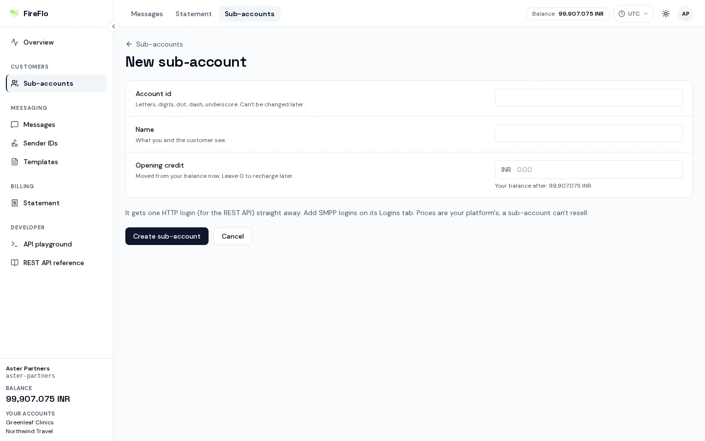
  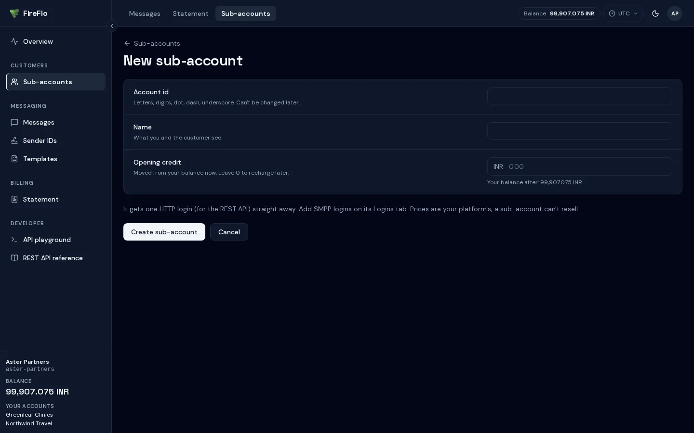
</Frame>

La página de una subcuenta muestra su saldo, **Recharge** y **Withdraw** para mover crédito entre ella
y el reseller, y sus transferencias, con pestañas para sus logins, mensajes, aprobaciones, extracto,
condiciones de crédito y ajustes.

<Frame caption="Una subcuenta en el portal del reseller. Withdraw libera el crédito reservado para mensajes que se están enviando antes de devolverlo.">
  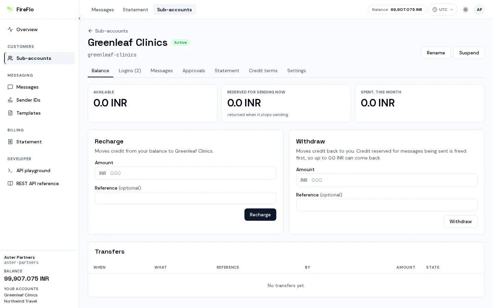
  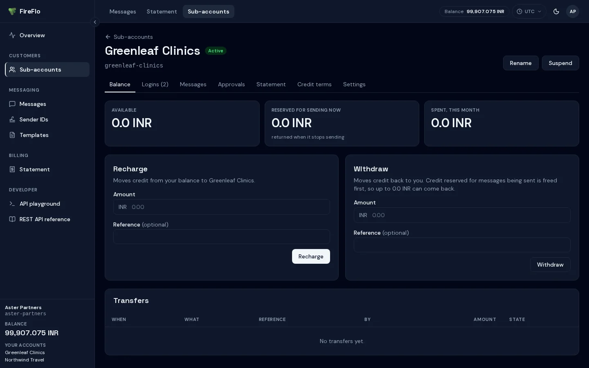
</Frame>

## Crear un login no crea un saldo

Una cuenta sin fila `account_balance` **no está en cero**: no tiene saldo, que es un estado
distinto y el que en silencio se traga una recarga.

<Warning>
**Un `RECHARGE` escrito para una cuenta sin fila de saldo no acredita nada.** Se queda pendiente y
registra, y se aplica en el momento en que aparece la fila. Pero hasta entonces el cliente ha
pagado y no puede enviar. Abra la cuenta para crédito primero (*Open for credit* en la página de
la cuenta), luego recargue.
</Warning>

El panel distingue las dos deliberadamente: "no balance row" y "credit switched off" se muestran
como respuestas distintas en lugar de colapsarse en una única cifra vacía. Consulte
[Crédito prepago](/platform/billing/prepaid-credit).

## Un id de cuenta que también es un nombre de vendor

La tarificación empareja un ámbito de tasa solo por nombre, y la misma tabla contiene ambos lados
del trato. Un id que también es un nombre de instancia de vendor tiene sus reglas leídas como
**nuestro coste para ese vendor** así como lo que este cliente paga.

La página de la cuenta lo pinta en rojo en lugar de dejar que se descubra en un informe de
márgenes. Renombre uno antes de tarificar cualquiera. `*` está reservado directamente y no puede
usarse como nombre de cuenta o de vendor.

## Qué hay en la página de la cuenta

Una pestaña a la vez: **Overview**, **Settings**, **Logins**, **Approvals**, **Billing**, **Tariff** y
**Statement**. Una cuenta de unidades no tiene pestañas Tariff ni Statement; sus precios y su extracto
son los de su cuenta padre.

<Frame caption="La pestaña Overview de una cuenta: su tráfico por login y producto, su techo SMPP, una comprobación de entrega y adónde fueron sus mensajes.">
  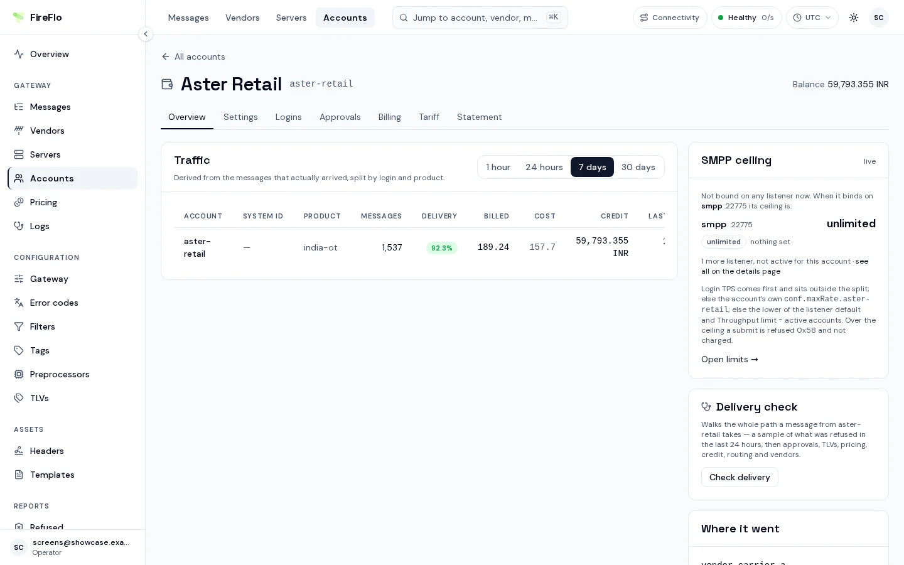
  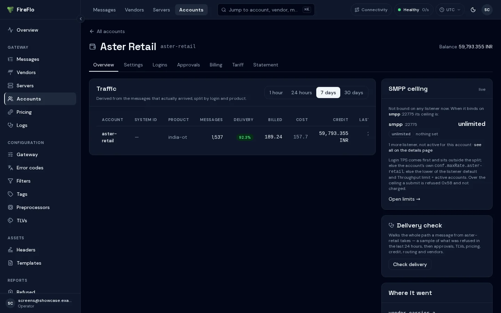
</Frame>

<CardGroup cols={2}>
<Card title="Logins" href="/platform/connections/credentials">
Quién puede conectarse como esta cuenta, qué producto lleva cada uno y rotar un secreto.
</Card>
<Card title="Tarifa personalizada" href="/platform/billing/tariffs">
Lo que esta cuenta paga. Sin reglas propias significa que se tarifica por el catch-all que la cubra.
</Card>
<Card title="Extracto" href="/platform/billing/statements">
Lo que se debe por un periodo, facturado en el envío, así que el importe deja de moverse cuando lo hace el periodo.
</Card>
<Card title="Sender IDs y contenido" href="/platform/customers/whitelisting-rollout">
Las dos listas de aprobación y el interruptor de aplicación a su lado.
</Card>
</CardGroup>

El tráfico en la página se deriva de los mensajes que realmente llegaron, dividido por login y
producto: así que muestra tráfico que entró bajo esta cuenta desde un login que este panel nunca ha
visto.
