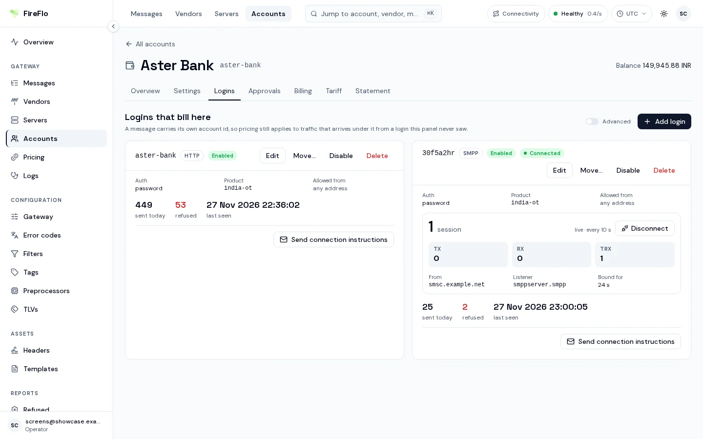
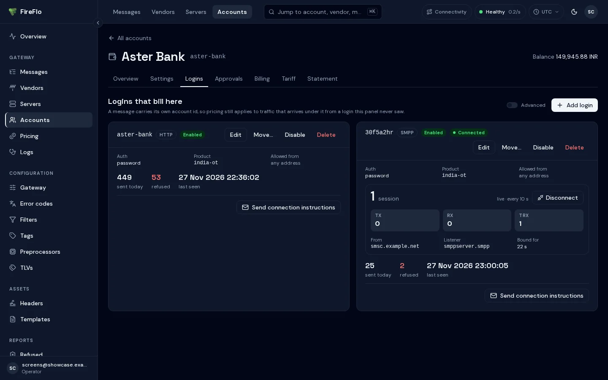

Los clientes inician sesión en el portal con un **login del portal**: una dirección de correo que
inicia sesión con un enlace de un solo uso enviado por correo, o con una contraseña una vez
establecida. Los logins del portal de una cuenta están en su pestaña **Settings**, en la tarjeta
**Portal access**.

## Lo que configura un operador

<Steps>
<Step title="Establecer la dirección de correo">
El campo **Email** en la tarjeta **Organisation**. Una cuenta por dirección, sin distinguir
mayúsculas. Una segunda cuenta que reclame la misma dirección es rechazada en lugar de ocultar
silenciosamente la primera.

Una dirección mal formada se rechaza mientras la escribes, así que una dirección que se guardó es una
dirección que el portal puede emparejar. Guardarla da a la cuenta un login del portal para esa
dirección. Si ese login falta, la tarjeta Portal access ofrece **Create a login for** la dirección.
</Step>

<Step title="Elegir cómo inicia sesión">
Cada login de la tarjeta Portal access dice cómo inicia sesión: **Emailed link only** o **Password, or
emailed link**. **Set password** o **Change password** establece una; **Remove password** vuelve a
solo enlaces. Sin contraseña, el cliente inicia sesión con un enlace por correo y puede establecer una
contraseña desde el portal.
</Step>

<Step title="Dejar la cuenta activada">
El interruptor **Enabled**, en **Advanced**. Nadie puede iniciar sesión en el portal por una cuenta
desactivada o archivada.
</Step>
</Steps>

<Frame caption="La pestaña Settings de una cuenta. El login del portal está a la derecha, con cómo inicia sesión y cuándo lo hizo por última vez.">
  
  
</Frame>

Para que una persona deje de iniciar sesión, pulsa **Turn off** en su login; **Turn on** le deja
entrar de nuevo. Desactivar toda la cuenta también detiene su tráfico: consulta
[Cuentas](/platform/customers/accounts#what-the-catalogue-row-actually-holds).

## Lo que necesita el despliegue

El panel debe poder enviar correo y debe conocer su propia dirección pública, o no se podrá emitir ningún enlace
en absoluto. Cuando falta cualquiera de las dos, se le dice al cliente claramente que el inicio de sesión por correo no está disponible
en este panel y que consulte con su gestor de cuenta. Un rechazo honesto en lugar de un enlace que nunca
llega. Consulta [la configuración del panel de control](/reference/config/control-panel).

## Lo que ve el cliente, y lo que a ti no se te dirá

Después de enviar una dirección, el cliente siempre obtiene la misma respuesta:

> If that address is on an account, a sign-in link is on its way. It expires in 15 minutes.

<Note>
**Esa respuesta es idéntica exista o no la dirección, pertenezca a una cuenta deshabilitada o no se haya visto
nunca.** Un formulario que dijera "no existe tal cuenta" permitiría a cualquiera probar una lista de direcciones contra
tu base de clientes y averiguar cuáles de los clientes de tus competidores también son tuyos.

La consecuencia para el soporte merece la pena conocerse: **el panel no puede confirmarte que se haya reconocido la
dirección de un cliente.** Si un cliente informa de que no le llega ningún enlace, comprueba la dirección en la cuenta
en lugar de buscar un rechazo que nunca se mostró.
</Note>

Los enlaces funcionan una vez y caducan a los quince minutos. Un enlace usado o caducado lo indica y ofrece uno
nuevo. Las solicitudes se limitan por tasa por cuenta y por red, y alcanzar el límite por cuenta se
responde con la misma frase neutral. No se le dice al cliente que se le ha limitado.

## Lo que no es el acceso al portal

**La pestaña Logins no es acceso al portal.** Contiene credenciales SMPP y HTTP, que son la forma en que se conecta el
*software* de un cliente. Nada en ella otorga ni revoca el inicio de sesión de una persona. Una cuenta puede
tener una docena de logins y ningún acceso al portal, o acceso al portal y ningún login en absoluto.

<Frame caption="La pestaña Logins: los logins SMPP y HTTP que facturan a la cuenta, si cada uno está conectado y sus sesiones vivas. Ninguno de ellos es un inicio de sesión en el portal.">
  
  
</Frame>

Una vez dentro, un cliente ve su propio tráfico, extracto, sender IDs, plantillas y API playground. Y
nunca tu coste, tu margen o qué proveedor cursó nada. Lo que puede hacer allí se describe
para ellos en [el portal](/developers/portal/signing-in).
