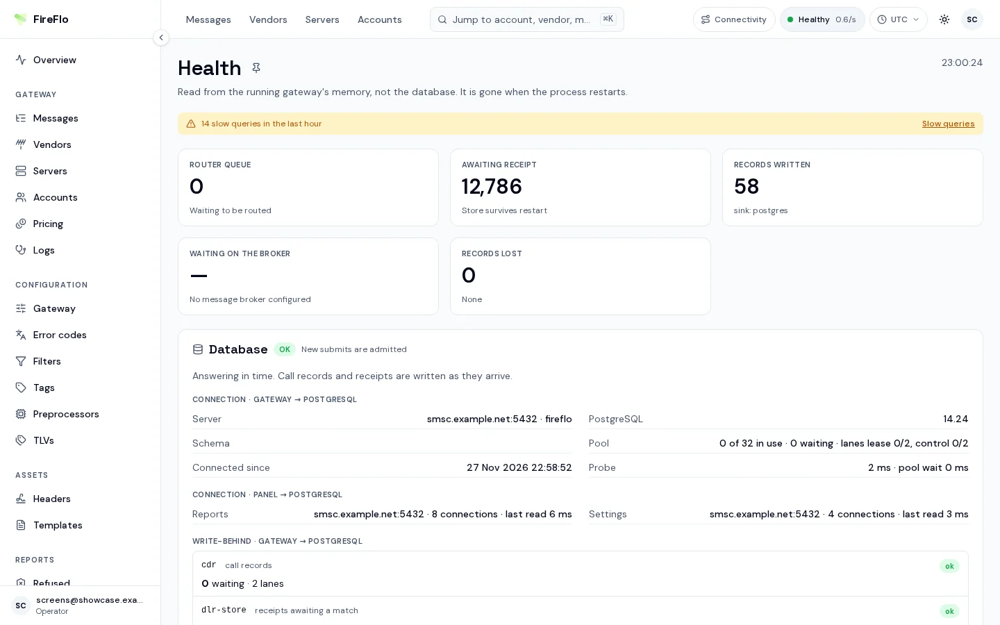
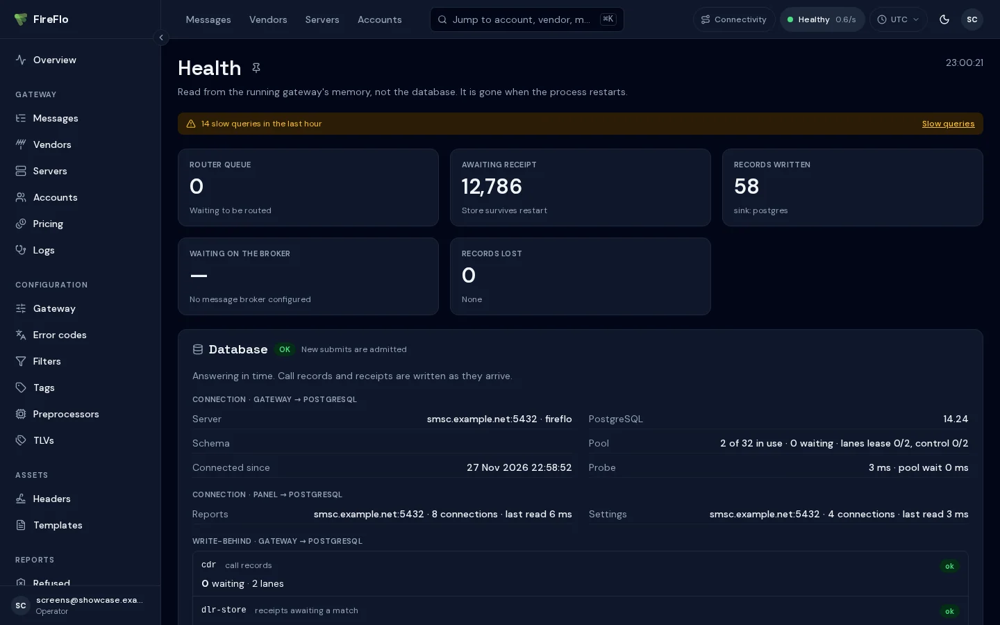
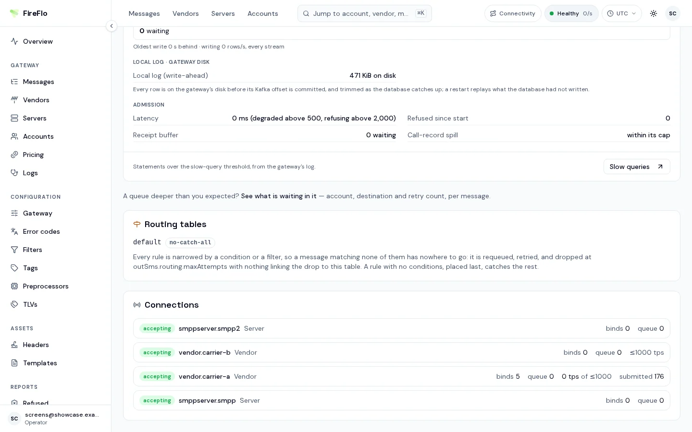
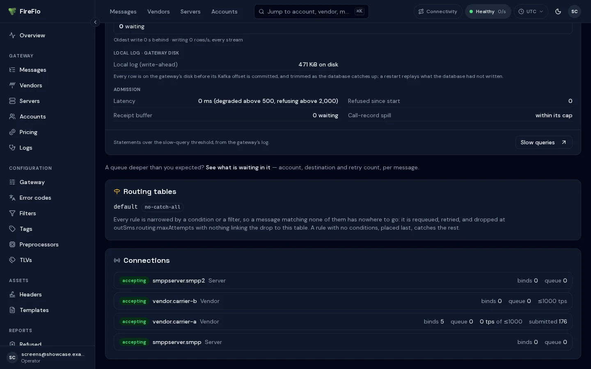
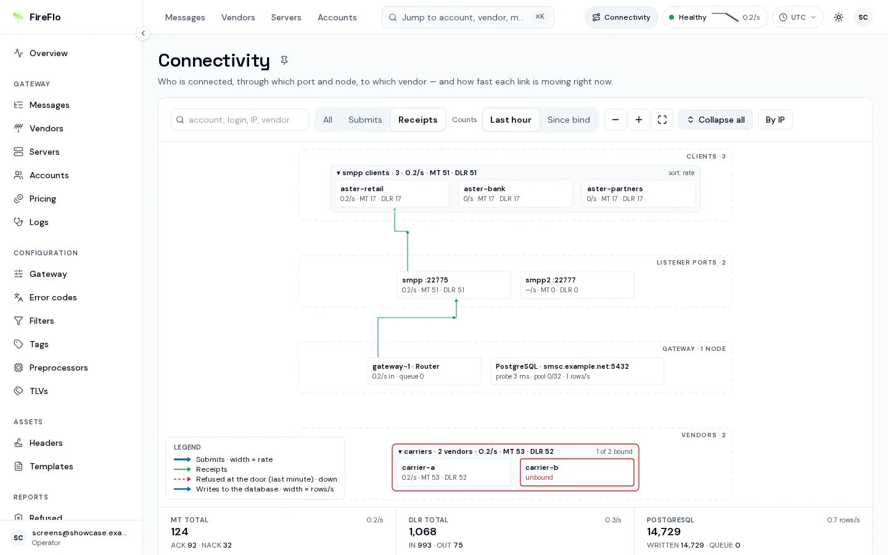
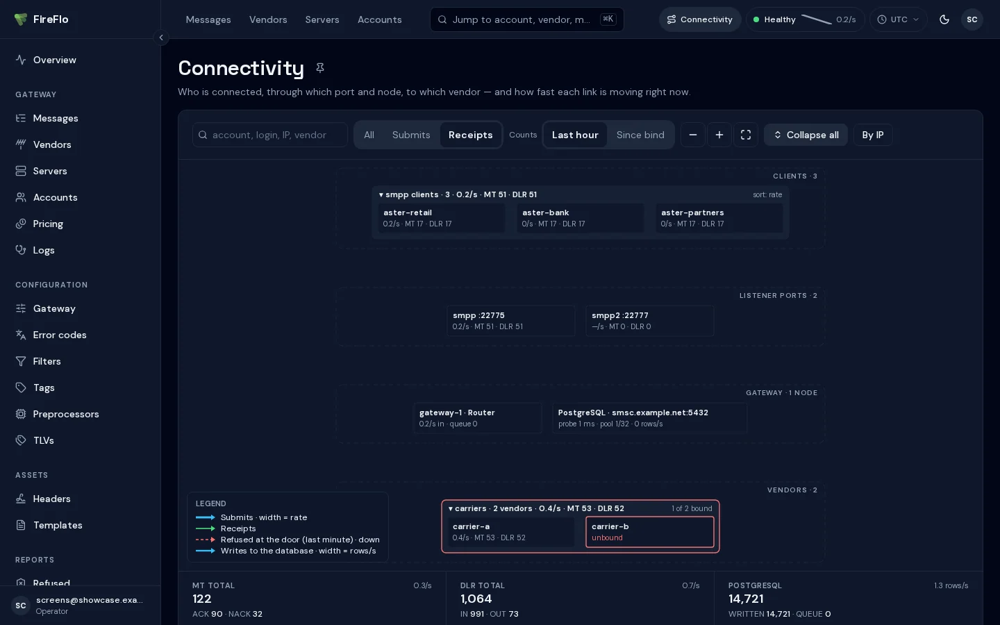

Tres superficies responden tres preguntas diferentes, y alcanzar la equivocada desperdicia un incidente:

| Superficie | Responde |
| :--- | :--- |
| `/q/metrics` | **Cuánto, a lo largo del tiempo** |
| Tablas de call-record | **Qué pasó** con un mensaje específico |
| `/ops/health` | **Qué es cierto ahora mismo**. Binds, profundidad de cola, recibos en vuelo |

La tercera existe porque ese estado vive solo en la JVM en ejecución. Nada más puede reportarlo.

```bash
curl -H "Authorization: Bearer $TOKEN" http://localhost:9000/ops/health
```

```json
{
  "data": {
    "observed_at": "2026-08-05T11:28:50Z",
    "router_queue": 0,
    "router_queue_capacity": 50000,
    "awaiting_receipt": 5139,
    "dlr_store_persistent": true,
    "config_sources": {
      "properties": "database", "credentials": "file",
      "routing": "database", "rates": "database"
    },
    "tps_window_seconds": 5,
    "cdr": { "enabled": true, "sink": "postgres", "written": 1, "failed": 0 },
    "workers": [
      { "name": "smppclient.vendor1", "type": "smppclient", "accepting": true,
        "bound": 1, "bound_transmittable": 1,
        "queue_depth": 0, "queue_capacity": 50000, "submitted": 1,
        "tps_limit": 200, "tps_measured": 12.4,
        "sessions_total": 1,
        "sessions": [ "…" ] },
      { "name": "smppclient.vendor2", "type": "smppclient", "accepting": false,
        "bound": 0, "queue_depth": 0,
        "last_error": "Bind failed: ESME_RINVPASWD (Invalid password)",
        "last_error_at": "2026-08-06T09:12:04Z" }
    ]
  }
}
```

## `sessions` es una muestra, no el conjunto

<Warning>
**Como máximo 20 sesiones por worker aparecen en esta respuesta, diga lo que diga `sessions_total`.**

Health se sondea cada pocos segundos por cada dashboard abierto, y un listener que lleva quinientos
binds enviaba quinientas filas cada vez.

**Contar el array para responder "cuántos están conectados" da un número equivocado que parece plausible.** Usa
`bound`, o `sessions_total` para el conteo de filas.
</Warning>

Para ver o buscar el conjunto entero, paginalo:

```bash
curl -H "Authorization: Bearer $TOKEN" \
  'http://localhost:9000/ops/workers/smppserver.smpp/sessions?q=acme&offset=0&limit=50'
```

```json
{ "data": { "rows": [ "…" ], "total": 412, "matched": 3, "offset": 0, "limit": 50 } }
```

`q` empareja sin distinguir mayúsculas por subcadena en `account`, `system_id`, `host`, `system_type` y
`bind_type`. **Las columnas numéricas deliberadamente no se buscan**. `50` de otro modo coincidiría con un
throughput de 50, un puerto de 2750 y una sesión de 50 segundos a la vez.

`total` cuenta cada sesión; `matched` cuenta las que pasan `q`. Ambas se reportan porque un
operador que ha filtrado a un cliente aún necesita saber que el listener está llevando cuatrocientos
binds.

`limit` por defecto es 50, tope 200, y **la respuesta hace eco del tamaño realmente aplicado**. Así que un
llamador que pida 10 000 puede ver que obtuvo 200 en lugar de concluir que solo había 200 sesiones.

## Los campos que merecen una alerta

| Campo | Vigila |
| :--- | :--- |
| `bound_transmittable` | Cero mientras `bound` no lo es. Una sesión solo receptora no lleva nada |
| `last_error` | **Presente** significa que un bind fue rechazado; **vacío** significa que el socket nunca se abrió |
| `router_queue` contra `router_queue_capacity` | Crecimiento sostenido es enrutamiento más lento que ingreso |
| `awaiting_receipt` | Crecimiento significa que los recibos no están volviendo |
| `queue_depth` por worker | Un único proveedor haciendo cola |
| `cdr.failed` | Distinto de cero significa que registros se están perdiendo |

<Tip>
**`last_error` es el campo que separa los dos fallos que un badge no puede.** Un valor significa que el socket
se abrió y el bind fue rechazado: credenciales, system type, IP, un límite de bind. Vacío significa que el socket
nunca se abrió en absoluto: firewall, DNS, o el extremo lejano caído.

Se limpia en el momento en que un bind tiene éxito.
</Tip>

## `config_sources` responde una pregunta que la gente hace al revés

Dice, por dominio, si el gateway está leyendo archivos o la base de datos.

Eso importa porque **un cambio hecho en el panel no hace nada si el gateway está leyendo un archivo para
ese dominio**. Y el síntoma es "mi edición no se aplicó", que manda a la gente a mirar la edición.

## `bound: 0` en un listener suele estar bien

En un **proveedor** significa que nada está conectado y nada puede enviarse.

En un **listener** normalmente significa que ningún cliente está conectado ahora mismo. Lo cual es tranquilo en lugar de
roto. Por eso un listener sin nadie conectado no se pinta en rojo como un proveedor sin sesión.

## En el panel de control

La **píldora de salud** en la cabecera de cada página del panel lee este endpoint: un punto, una
palabra como **Healthy** y la tasa saliente. Elígela para abrir **Health**, que es la misma respuesta
dispuesta para leerse. Se lee de la memoria de la pasarela en ejecución, no de la base de datos, y
desaparece cuando el proceso se reinicia.

<Frame caption="Health: la cola del enrutador, los recibos pendientes de emparejar y los registros escritos o perdidos arriba, y después la base de datos en la que escribe la pasarela.">
  
  
</Frame>

| Tile | Campo |
| :--- | :--- |
| **Router queue** | `router_queue` |
| **Awaiting receipt** | `awaiting_receipt`; la línea de debajo dice si el almacén sobrevive a un reinicio |
| **Records written** | `cdr.written`, con el sink |
| **Waiting on the broker** | la profundidad del broker, o que no hay ninguno configurado |
| **Records lost** | `cdr.failed`; las escrituras fallidas no se reintentan |

Bajo los tiles, la tarjeta **Database** muestra la conexión de la pasarela, sus escritores y la
latencia que admite o rechaza nuevos submits. Una tarjeta **Routing tables** aparece solo cuando una
tabla tiene un problema que merece decirse, como no tener ninguna regla que recoja todo lo demás.
**Connections** lista cada listener y cada proveedor con su estado, sus sesiones conectadas (y cuántas
pueden transmitir, cuando difiere), su cola, su tasa frente a su techo y los mensajes enviados; una
fila con sesiones se despliega para listarlas.

<Frame caption="Connections en Health: un proveedor conectado cinco veces y enviando, el otro aceptando sin bind; los listeners sin nadie conectado están tranquilos, no rotos.">
  
  
</Frame>

### El mapa Connectivity

**Connectivity**, junto a la píldora de salud, dibuja el mismo estado en vivo como un solo mapa: los
clientes conectados arriba, después los puertos de listener por los que entraron, el nodo de la
pasarela y su base de datos, y los proveedores abajo, con el tráfico moviéndose por cada enlace. El
grosor de un enlace es su tasa; un enlace rojo discontinuo son rechazos en la puerta en el último
minuto, o un enlace caído.

- **All**, **Submits** y **Receipts** eligen qué flujos se dibujan.
- **Counts** lee MT y DLR sobre la **Last hour**, o **Since bind** a partir de los contadores de cada
  sesión.
- La búsqueda encuentra una cuenta, login, IP o proveedor en el mapa; el zoom y **Fit** lo mueven;
  **Expand all** abre todos los grupos; **By IP** divide cada cliente en una caja por cada dirección
  desde la que se conecta.
- Elige una caja para ver lo que puedes hacer con ella: abrir su cuenta, listener o proveedor, su
  salud, sus colas o su tabla de enrutamiento, o actuar sobre ella desde el mismo menú.

Los totales de MT, DLR y escrituras en base de datos están bajo el mapa.

<Frame caption="El mapa con Receipts elegido y todos los grupos abiertos: tres clientes conectados en un puerto, con recibos subiendo hacia ellos desde un proveedor mientras el otro está sin bind.">
  
  
</Frame>

## Relacionado

<CardGroup cols={2}>
  <Card title="El puerto de gestión" icon="server" href="/reference/management/endpoints">
    Cada endpoint, y qué token necesita cada uno.
  </Card>
  <Card title="Binds y listeners" icon="triangle-exclamation" href="/platform/troubleshooting/binds-and-listeners">
    Tres fallos que parecen todos "nadie está conectado".
  </Card>
</CardGroup>
