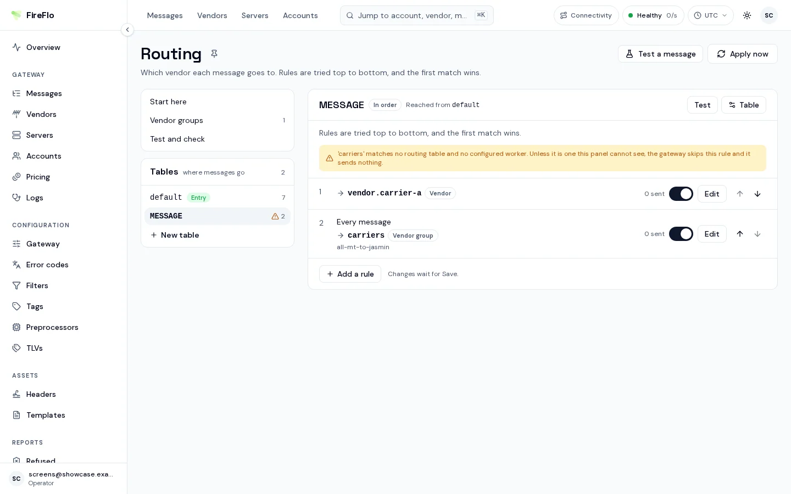
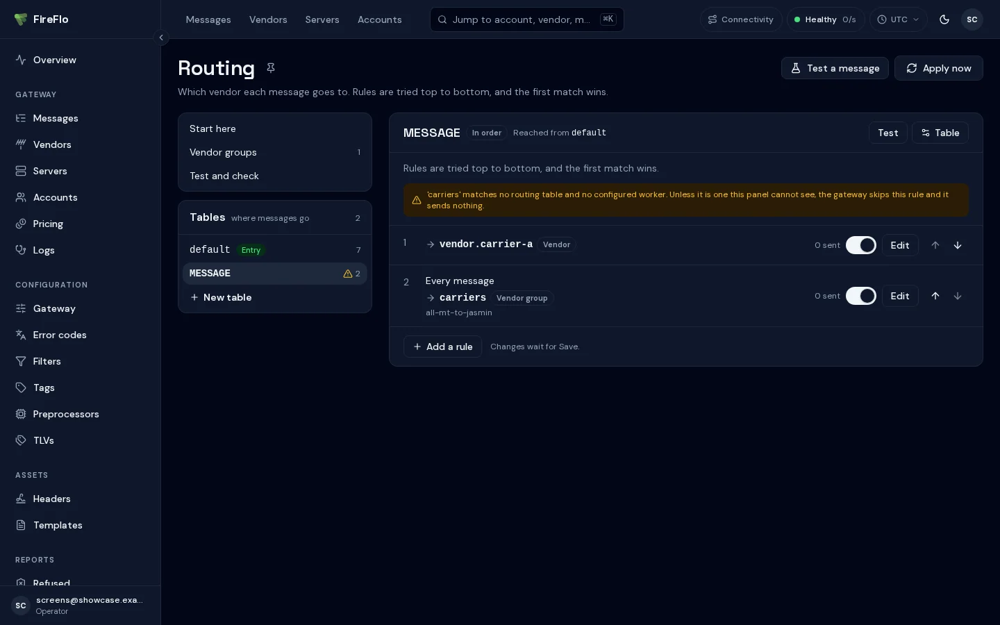
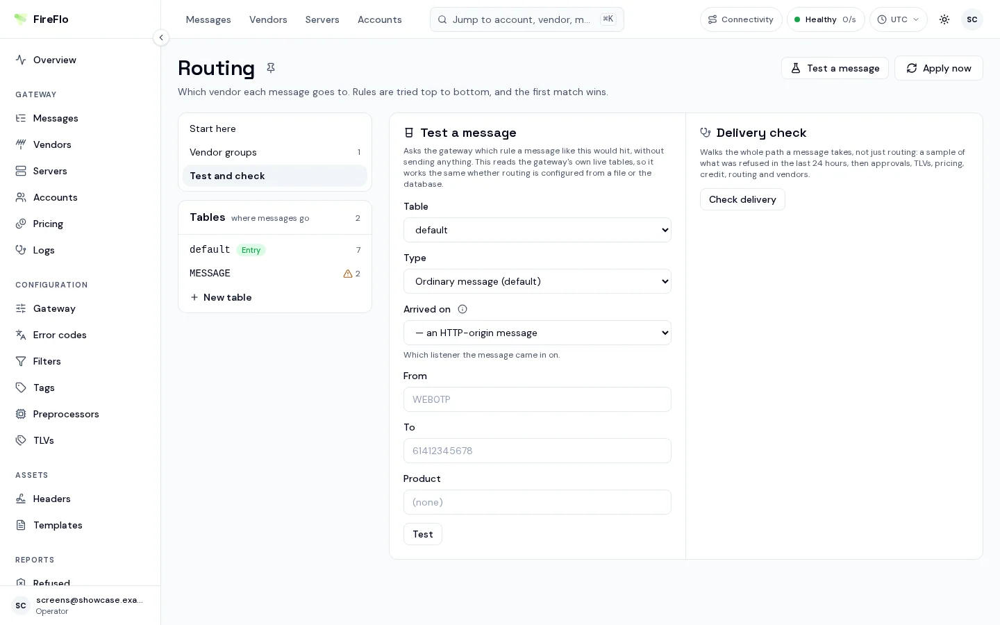
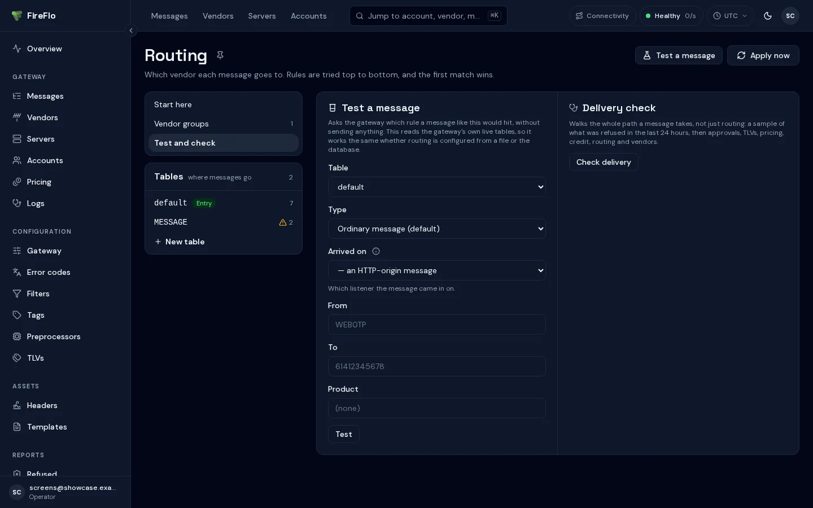
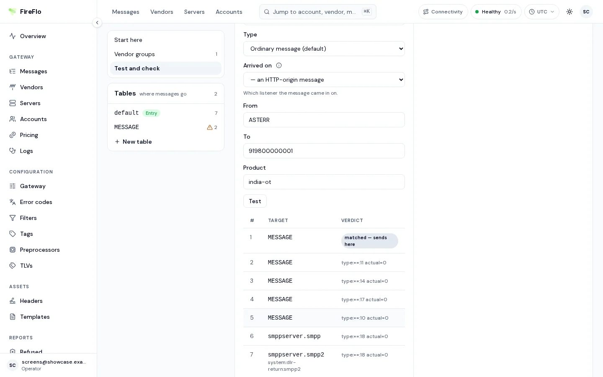
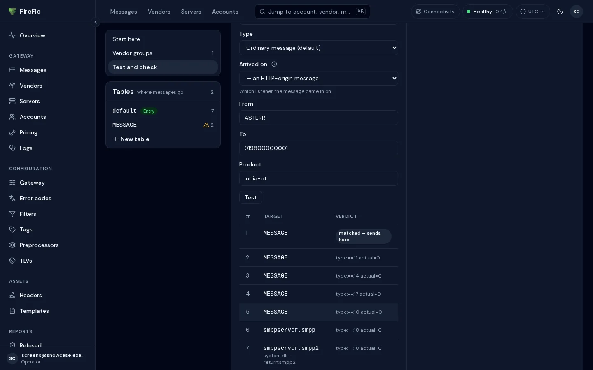
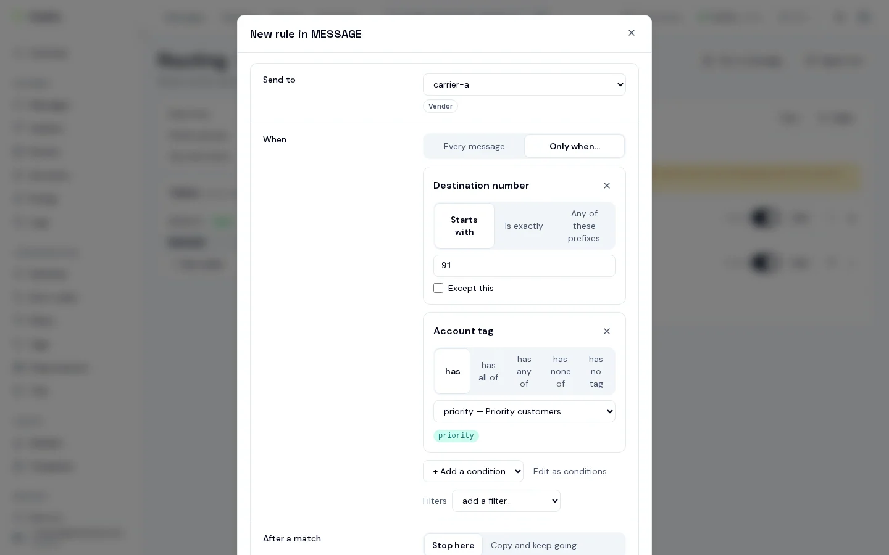
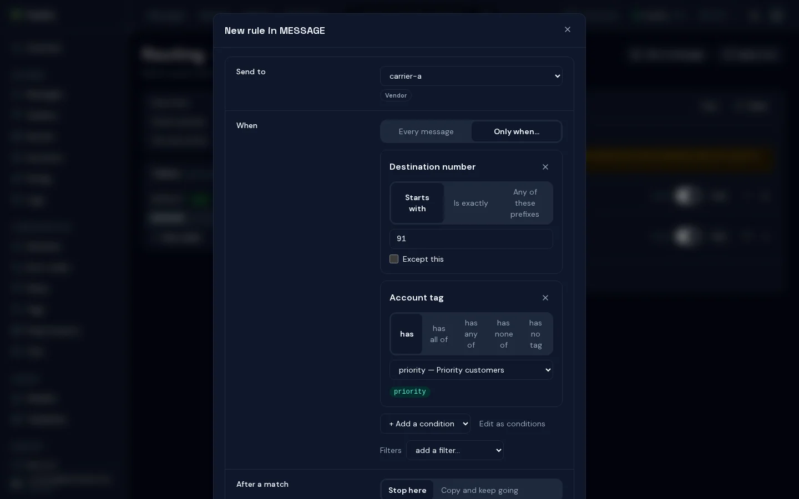

## Tres formas de escribir una regla que nunca puede ser verdadera

Cada una de estas carga sin quejarse, no coincide con nada y cuesta una tarde.

<Warning>
**`==` es un operador numérico.** `vendor1:from:==:MyBrand` no falla silenciosamente en coincidir. Falla al
*parsear*, lo que hace fallar toda la recarga y deja la tabla anterior en servicio. Usa `equals` para texto.

```
vendor1:from:equals:MyBrand      correcto
vendor1:from:==:MyBrand          falla al parsear
```
</Warning>

<Warning>
**`matches` es una expresión regular y está anclada**, porque la pasarela llama a `Pattern.matches`
en lugar de `find`. `^61.*` coincide con un destino completo; un simple `61` coincide solo con la cadena de dos
caracteres `61`.

**`startsWith` compara texto literal.** Una expresión regular pasada a él pregunta si un destino
literalmente comienza con los caracteres `^(?:\+61`. Nada lo hace, así que la regla se guarda, carga, muestra
y nunca se dispara. El panel de control avisa sobre esto; un archivo editado a mano no.
</Warning>

<Warning>
**Un campo sin valor no coincide con ningún operador positivo.** `product:equals:premium` no coincide con un mensaje
que no lleva producto en absoluto, y tampoco lo hace `product:startsWith:prem`. Solo `isNull` lo hace.

Lo inverso hace tropezar a la gente en la otra dirección: `product:!equals:premium` **sí** se dispara para un mensaje sin
producto, porque la negación invierte la coincidencia fallida.
</Warning>

## La gramática

```
Target:Attribute:Operator:Value
```

Las reglas se evalúan de arriba a abajo dentro de una tabla y la primera coincidencia gana. `Target` es una instancia
de worker (`vendor1`, `smppserver.smpp`), un **grupo**, u otra tabla en la que encadenar (`MESSAGE`).

<Tabs>
  <Tab title="Panel de control">
    **Routing** lista cada tabla con sus reglas en orden, cada una con su objetivo, un interruptor de
    encendido y apagado, y cuántos mensajes ha emparejado desde el último arranque del gateway. **Add a
    rule** abre el editor; los cambios a una tabla esperan a **Save**. El editor valida el operador
    contra el campo antes de guardar, rechaza un operador numérico en un campo de texto, y avisa sobre
    una expresión regular escrita en un operador literal.
  </Tab>
  <Tab title="routingTable.conf">
```ini
[MESSAGE]
vendor2:to:startsWith:614          # móvil AU
vendor2:from:equals:MyBrand        # un solo sender ID
vendor3:systemId:equals:acme-smpp  # un solo cliente conectado
vendor1::default:                  # el catch-all, ÚLTIMO
```
  </Tab>
</Tabs>

<Frame caption="Una tabla de enrutamiento: sus reglas en orden, cada una con su objetivo, su interruptor y su conteo de coincidencias. El aviso dice que una regla nombra un objetivo que el gateway no conoce.">
  
  
</Frame>

<Warning>
**El catch-all va al final.** Por encima de otras reglas hace que toda regla debajo sea inalcanzable, y
nada te avisa en el archivo. Parsean bien, simplemente nunca se ejecutan. El panel lo reporta; la
pasarela lo registra como `unreachable-rules` en `/ops/health` y continúa.
</Warning>

## Operadores

Cualquier operador puede negarse con un `!` inicial. En el editor de reglas, eso es **Except this**
(**Except these** para una lista de prefijos) bajo una condición.

| Tipo | Operadores |
| :--- | :--- |
| Siempre verdadero | `default`: atributo y valor dejados en blanco |
| Texto | `equals`, `equalsIgnoreCase`, `matches`, `startsWith`, `startsWithAny`, `endsWith`, `greaterThan`, `greaterEqual`, `lessThan`, `lessEqual`, `isNull` |
| Booleano | `isTrue`, `isFalse` |
| Numérico | `==`, `>`, `>=`, `<`, `<=` |

`startsWithAny` toma una lista de prefijos literales separados por comas, sin espacios: `91,+91,0091`.
Cada uno se compara exactamente como está escrito (`91` no coincide con `+919812345678`) y una lista
larga no cuesta más por mensaje que una corta. Una lista vacía, o una entrada con un espacio, se
rechaza cuando la regla se carga.

## Cuándo surte efecto un cambio

El gateway recoge una tabla guardada en treinta segundos. **Apply now**, en las páginas Routing,
Pricing y Filters y bajo una tabla que acabas de guardar, hace que lea el cambio en el acto. En un
gateway cuya licencia no está al día el botón lo dice: los cambios de configuración quedan congelados
hasta que lo esté, y nada de lo que guardes llega al gateway en ejecución.

## Probar un mensaje antes de enviarlo

**Test a message**, en las páginas Routing, Pricing y Filters, toma un destino, un sender ID, un
producto y una cuenta, y pregunta al gateway en ejecución qué haría con ellos: no se envía ni se cobra
nada. Deja el producto vacío y la prueba se ejecuta como lo enviaría el login de la cuenta: un mensaje
real siempre lleva el producto de su login (o el `system_type` con el que hizo bind), y una regla de
precio guardada bajo un producto solo tarifica los mensajes que lo llevan. El probador dice en cada
pestaña con qué producto se ejecutó. Tres pestañas responden con los mismos comparadores que usa la
ruta del mensaje:

- **Routing** recorre las tablas desde `default` hasta el proveedor, y muestra cada regla que probó con
  la condición que falló, frente al texto exacto comparado.
- **Pricing** muestra la regla que fija el precio de la cuenta, el coste del proveedor y el margen.
- **Filters** muestra cada filtro con nombre, coincida o no, y las reglas que lo usan.

Cuando nada coincide, ofrece crear la regla, abierta en el editor con el código de país del destino
rellenado para que lo corrijas.

**Test and check**, en el carril de la página Routing, pone un probador solo de enrutamiento junto a
**Delivery check**. El probador toma la tabla desde la que empezar, el tipo de mensaje, el listener por
el que llegó, un remitente, un destino y un producto, y lee las tablas en vivo del gateway tanto si el
enrutamiento se configura desde un archivo como desde la base de datos. **Delivery check** recorre todo
el camino que sigue un mensaje, no solo el enrutamiento: una muestra de lo rechazado en las últimas 24
horas, y después aprobaciones, TLVs, precios, crédito, enrutamiento y proveedores. Donde encuentra un
fallo, dice cómo arreglarlo.

<Frame caption="Test and check: el probador de mensajes a la izquierda, la comprobación de entrega a la derecha. Ninguno envía nada.">
  
  
</Frame>

La respuesta del probador lista las reglas de la tabla en orden: la que el mensaje alcanza y, para cada
regla que no coincidió, la condición que falló y lo que llevaba el mensaje.

<Frame caption="El veredicto de una prueba: la regla 1 coincidió y envía aquí; para las demás, el tipo que pedía cada una y el tipo que tenía el mensaje.">
  
  
</Frame>

Las cuatro comparaciones de texto son lexicográficas, no numéricas. `greaterThan` sobre un número de teléfono compara
cadenas.

## Quién lo envió

| Atributo | Fuente |
| :--- | :--- |
| `owner_id` | El `accountId` de la credencial, recurriendo a su `systemId`. En la API HTTP un parámetro `account` explícito lo sobrescribe. |
| `systemId` | El `systemId` de la credencial: el cliente específico conectado, donde varios comparten una cuenta. |
| `product` | El `system_type` en la conexión SMPP del cliente, recurriendo al `product` de la credencial. Los llamantes HTTP no tienen conexión, así que siempre usan el valor de la credencial. |
| `tag` | Desde 0.17.0, las etiquetas de la cuenta: las suyas y, para una cuenta de unidades, las de su cuenta padre. Solo `equals` (tiene la etiqueta; una lista separada por comas exige todas), `startsWithAny` (tiene alguna de una lista) e `isNull` (no tiene ninguna), cada uno negable. Solo con la configuración en la base de datos. Consulta [Etiquetas de cuenta](/platform/routing/account-tags). |

`product` es como un cliente selecciona el enrutamiento por sesión: la misma credencial conectándose con
`system_type=premium` y `system_type=bulk` produce dos sesiones que se enrutan de forma diferente. Consulta
[Conceptos](/platform/concepts).

Tipos de mensaje para reglas `type`: `0` texto, `10` binario, `11` UCS-2, `14` flash, `17` push, `18` acuse de
recibo.

## Condiciones sobre el objetivo, no sobre el mensaje

Prefijar un campo con `target.` lee un campo del worker de destino en su lugar, que es como una regla
esquiva un proveedor que se está atascando:

```
vendor2:target.queueSize:>i:5000
```

Hay exactamente cuatro: `queueSize`, `sentPendingRate`, `sentDeliveredRate`, `sentFailRate`. Coincidencia
insensible a mayúsculas, y uno no reconocido es rechazado en tiempo de parseo con los cuatro listados.

<Note>
`marginPercentage` y `marginStatus` son campos del **mensaje**, así que quita el prefijo `target.` y se
resuelven. Ten en cuenta lo que contienen: ambos se establecen en la respuesta de envío, después de que el mensaje se ha ido,
así que una condición de enrutamiento en cualquiera de ellos lee `NOT_CALCULATED` en cada primer intento.
</Note>

## Copiar y continuar

Un `+` en el objetivo copia el mensaje a ese objetivo y **sigue escaneando**, en lugar de enrutar
y detenerse. En la base de datos es la columna `copied`. En el editor de reglas es **After a match →
Copy and keep going**; **Stop here** es la regla ordinaria.

<Frame caption="Una regla nueva: adónde envía, sus condiciones (destino que empieza por 91, etiqueta de cuenta priority), sus filtros y si se detiene ahí.">
  
  
</Frame>

## Grupos de proveedores

Una regla puede apuntar a un grupo en lugar de a un solo proveedor. El grupo elige un miembro, **saltándose cualquiera que esté
suspendido o no aceptando**. Ese salto es el failover que una regla de objetivo único no puede hacer.

```ini
[group:asia->policy(weighted)]
vendor1 = 70
vendor2 = 30

[group:primary-then-backup->policy(failover)]
vendor1
vendor2
```

| Política | Elige |
| :--- | :--- |
| `round-robin` *(predeterminado)* | El siguiente miembro por turno |
| `weighted` | En proporción a los pesos, de forma determinista. 70/30 es exactamente 70/30 sobre cien mensajes, intercalado en lugar de en bloques |
| `failover` | Siempre el primer miembro que esté activo, en el orden declarado |

<Warning>
**Los bloques de grupo deben ir antes de la primera cabecera `[table]`.** Dentro de un bloque de tabla, una línea
de miembro no coincide con nada y se descarta silenciosamente, así que el grupo acaba con menos miembros de los que parece
tener, o con ninguno.

Un peso solo lo lee `weighted`. Establecer uno en los otros dos no cambia nada, y la pasarela
lo dice en WARN en lugar de dejarte creer que está ocurriendo un reparto.
</Warning>

<Note>
**Un mensaje, un cobro, un destino.** Un grupo siempre selecciona exactamente un miembro, y `+copied`
en una regla de grupo aún copia a un miembro. Abanicar sería N envíos contra un solo cobro.

Si todo miembro está caído, la regla no envía nada, registra `cause=group-all-dead` nombrando a todos los que intentó,
y el escaneo **continúa a la siguiente regla**, lo que es lo que mantiene alcanzable una regla de respaldo escrita bajo una
regla de grupo.
</Note>

Referencia completa de gramática: [routingTable.conf](/reference/files/routing-table).
