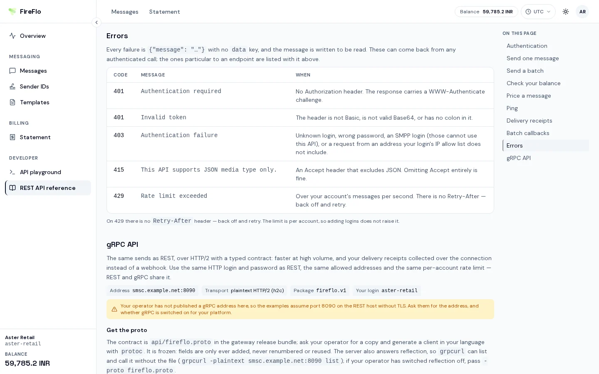
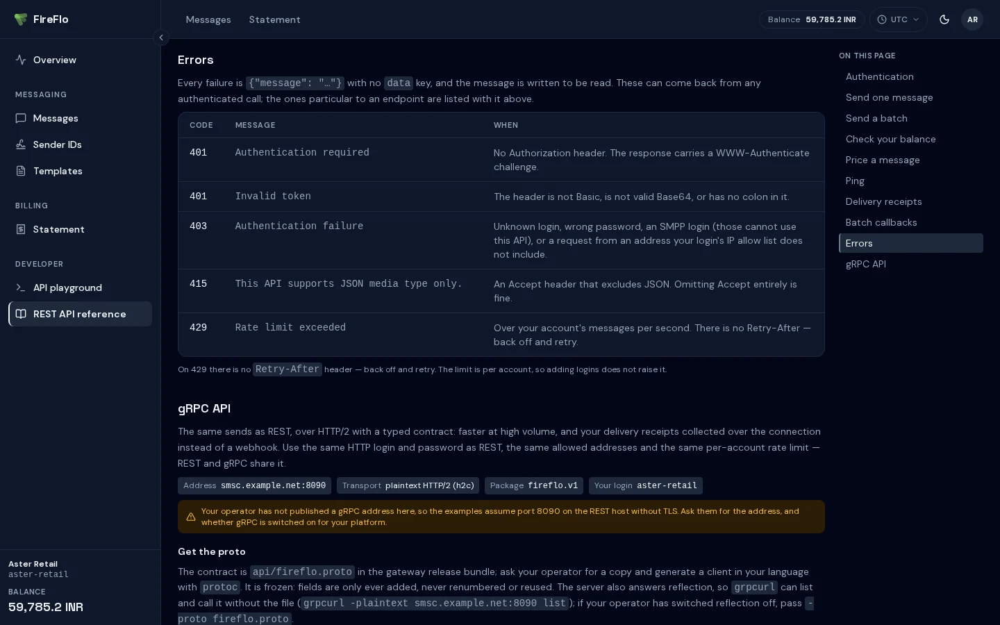

Chaque échec est un objet JSON avec un `message`. Le statut est la partie lisible par la
machine ; certains refus portent aussi un `code` qui en nomme la cause, et ceux qui se résolvent
d'eux-mêmes un en-tête `Retry-After`.

```json
{"message":"Insufficient credit"}
```

Le catalogue complet se trouve dans [Erreurs de l'API](/reference/api/errors). Cette page explique
ce que votre client doit *faire*.

<Frame caption="Les mêmes erreurs dans la référence de l'API REST de votre portail client. Celles que tout appel authentifié peut rencontrer sont regroupées ; celles propres à un endpoint figurent avec cet endpoint.">
  
  
</Frame>

## Le tableau des retries

| Statut | Réessayer | Pourquoi |
| :--- | :--- | :--- |
| `400`, `412` | **Jamais** | Votre charge utile est incorrecte. Elle le restera. |
| `401`, `403` | **Jamais** | Identifiants ou autorisation. Alertez un humain. |
| `402` | **Jamais** | Réessayer n'ajoutera pas de crédit. Alertez et arrêtez d'envoyer. |
| `415` | **Jamais** | Corrigez l'en-tête `Accept`. |
| `429` | **Oui**, avec backoff | Transitoire par définition. |
| `500` | **Oui**, une ou deux fois | Le débit a été inversé. Voir ci-dessous. |
| `503` avec un `code` | **Oui**, après `Retry-After` | Celui de la passerelle elle-même : `CREDIT_PENDING` (à partir de 0.17.2, `Retry-After: 2`), `UNITS_PENDING`, `SHUTTING_DOWN` et d'autres. Rien n'a été débité. |
| `503` avec seulement un `message` | **Oui**, avec backoff | Celui de la passerelle aussi : une file pleine, ou (à partir de 0.17.2) trop de vos messages qui attendent déjà leur crédit. Rien n'a été débité. |
| `502`, `504`, ou un `503` sans corps JSON FireFlo | **Oui** | Pas depuis la passerelle. C'est un proxy en amont. |

<Warning>
**Il n'y a pas de `Retry-After` sur un `429`.** Faites votre propre backoff, exponentiel avec du
jitter. Un intervalle fixe partagé entre plusieurs workers les resynchronise sur la prochaine
rafale, ce qui transforme une limite momentanée en limite prolongée.
</Warning>

## Pourquoi un 500 est sûr à réessayer

`500 Cannot send message` signifie que la passerelle a accepté votre requête et n'a pas pu la mettre
en file d'attente. **Tout débit est inversé.**

C'est une propriété délibérée de l'ingress, pas un hasard : le crédit est prélevé avant la mise en
file d'attente et restitué lorsque celle-ci échoue. Un retry coûte donc un message, pas deux. C'est
exactement la garantie qui rend un retry automatique défendable ici, et pas sur un `402`.

## Construisez pour l'accusé, pas pour la réponse

L'erreur d'intégration la plus fréquente consiste à traiter un `200` comme une livraison.

La réponse de soumission est envoyée **avant l'exécution du routage**, donc l'acceptation et la
livraison sont des affirmations sans lien entre elles. Un message peut être accepté puis refusé
pour un expéditeur non approuvé, abandonné faute de route ou rejeté par l'opérateur, et rien de tout
cela ne peut apparaître sur l'appel initial.

<Steps>
  <Step title="Stockez le messageId">
    C'est la seule chose qui corrèle votre enregistrement avec tout ce qui suit.
  </Step>
  <Step title='Traitez l&apos;envoi comme "soumis", pas "envoyé"'>
    Un état distinct dans votre propre modèle, pour que la différence reste visible.
  </Step>
  <Step title="Ne passez à un état final que sur un accusé de niveau 2">
    `ACCEPTD` et `BUFFRED` arrivent en niveau 1 et un autre accusé suit.
  </Step>
  <Step title="Fixez votre propre horloge d'expiration">
    Un message qui ne reçoit jamais d'accusé final doit expirer dans votre système aussi, sinon il
    reste "soumis" pour toujours.
  </Step>
</Steps>

## Erreurs que vous rencontrerez en production, pas en test

<AccordionGroup>

<Accordion title="403 — not an approved sender ID">
Votre compte a l'approbation de sender ID activée. Le `from` que vous avez utilisé n'a pas été
approuvé, ou vous l'avez omis et le nom de votre login n'est pas non plus approuvé.

Non retryable, et non corrigeable dans le code. Il faut une approbation de votre fournisseur.
</Accordion>

<Accordion title="403 — content does not match any approved template">
Votre compte n'envoie que des libellés approuvés. Un message qui fonctionne en staging et échoue en
production est habituellement dû à cela.

**Les espaces sont normalisés avant le matching**, donc les espaces et sauts de ligne
supplémentaires n'en sont pas la cause. Un mot changé, un point ajouté ou une variable placée
différemment le sont.
</Accordion>

<Accordion title="503 CREDIT_PENDING avec de l'argent encore sur le compte">
Le crédit est réservé par blocs, pas par message, et un envoi qui n'en trouve aucun en main attend le
bloc suivant, jusqu'à 5 secondes sur l'API. À partir de 0.17.2, un envoi dont le crédit n'est
toujours pas confirmé après cela est refusé en `503` avec le code `CREDIT_PENDING` et
`Retry-After: 2`. Rien n'a été débité. Le plus souvent, la base de la passerelle était lente ou ne
répondait pas pendant un instant.

**Ce cas est transitoire : réessayez après le délai.** Un `402` est différent : le solde ne couvre
pas le message, et réessayer n'y changera rien.
</Accordion>

<Accordion title="400 — Unknown argument: custom-tlvs">
Tous les autres champs traitent `_` et `-` comme le même caractère. `custom_tlvs` est la seule
exception et conserve son underscore.
</Accordion>

</AccordionGroup>

## Voir aussi

<CardGroup cols={2}>
  <Card title="Chaque statut" icon="table-list" href="/reference/api/errors">
    Le catalogue complet avec ce qui provoque chacun.
  </Card>
  <Card title="Accusés de livraison" icon="receipt" href="/developers/receive/delivery-receipts">
    La moitié de l'histoire que la réponse ne peut pas vous raconter.
  </Card>
</CardGroup>
