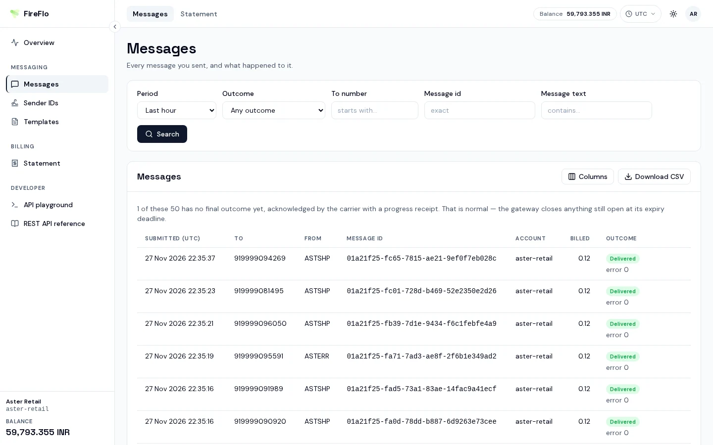
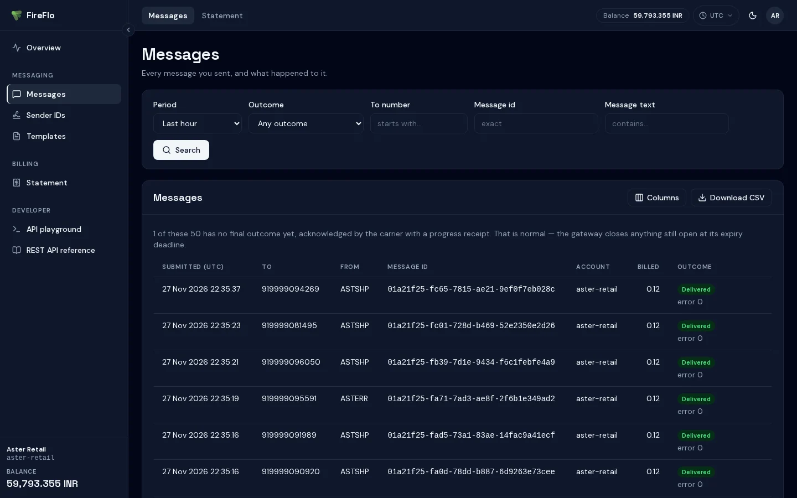
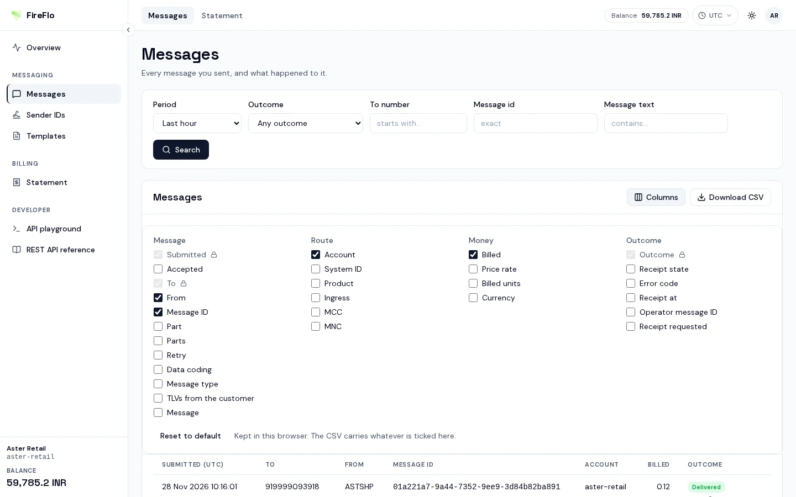
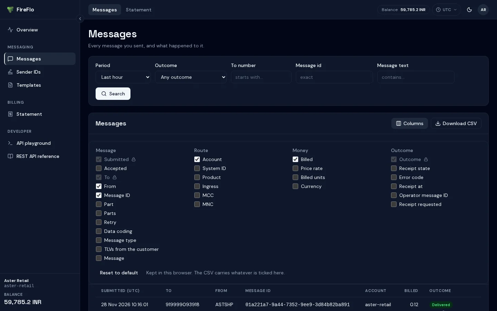
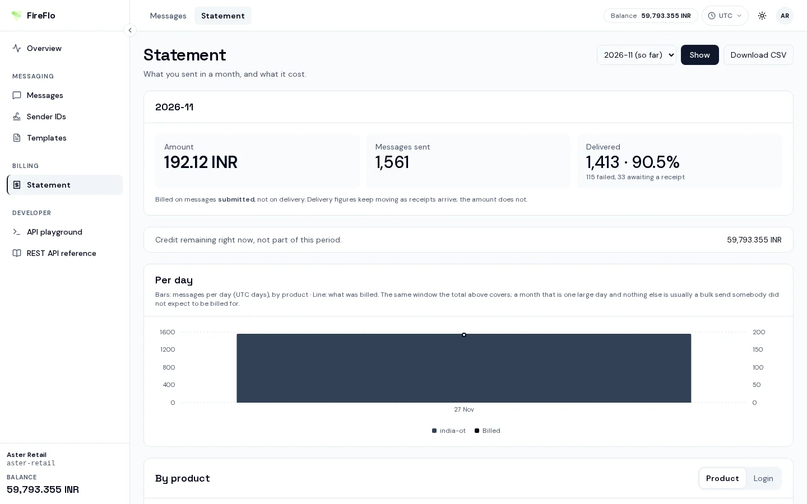
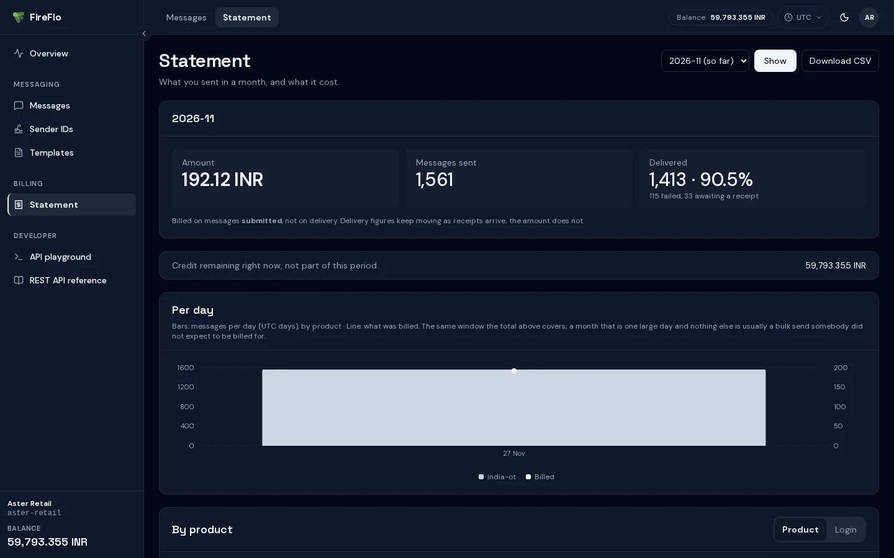
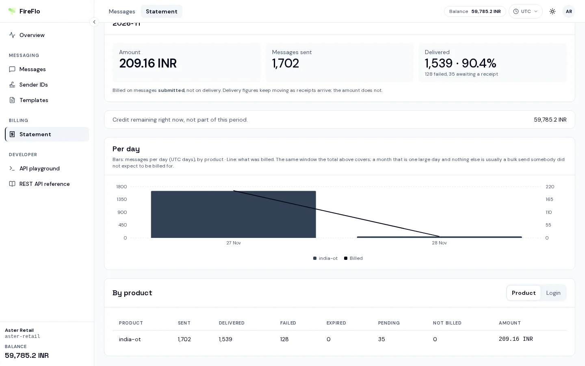
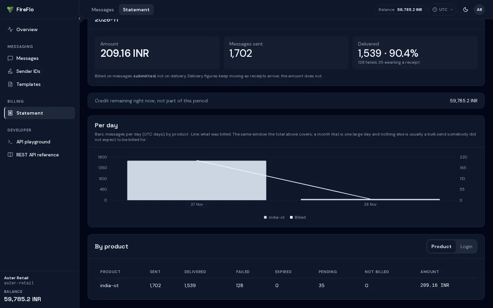

Deux écrans répondent à deux questions différentes. **Messages** répond à "qu'est-il arrivé à
celui-ci". **Statement** répond à "qu'est-ce que je paie". Ils divergent légèrement à dessein, et la
raison figure au bas de cette page.

## Messages

Une barre de filtres au-dessus d'un tableau. Les filtres s'appliquent quand vous pressez
**Search**, pas au fur et à mesure que vous tapez, et ils sont portés dans la barre d'adresse.
Une vue filtrée peut donc être mise en favori, ou collée dans une demande de support pour que celui
qui la lit voie exactement ce que vous avez vu.

<Frame caption="Messages : la barre de filtres, puis le tableau avec Columns et Download CSV au-dessus. La ligne au-dessus des lignes du tableau indique combien n'ont pas encore d'issue finale, pour qu'une colonne vide ne passe pas pour une panne.">
  
  
</Frame>

| Filtre | Notes |
| :--- | :--- |
| **Period** | Dernière heure, 24 heures, 7 jours, 30 jours, ou une plage personnalisée. S'ouvre sur la dernière heure, ou sur la période que vous avez choisie en dernier dans ce navigateur |
| **Outcome** | N'importe laquelle, ou une issue précise |
| **To number** | Correspondance depuis le début du numéro |
| **Message id** | Exact |
| **Message text** | Recherche à l'intérieur des corps de message |

**Awaiting a receipt** est listé en premier parmi les issues plutôt qu'alphabétiquement, parce
que c'est celle que les gens viennent chercher.

<Note>
**La recherche par texte de message ne trouve rien à moins que votre fournisseur n'enregistre le
contenu.** Stocker les corps est un choix de déploiement avec des conséquences évidentes sur la
vie privée, et beaucoup d'opérateurs le désactivent. Un résultat vide ici peut vouloir dire que le
contenu n'est pas conservé, pas qu'aucun message ne correspondait.
</Note>

Les revendeurs disposent d'un filtre supplémentaire pour se limiter à un seul compte ou chercher
parmi tous.

### Colonnes

Sept sont affichées par défaut : soumis, à, de, message id, compte, facturé et issue. **Columns**
ouvre un sélecteur regroupé sous Message, Route, Money et Outcome — environ trente au total, y
compris comptes de parts et de retries, data coding, les TLVs que vous avez envoyés, type de
message, MCC et MNC, tarif au prix, unités facturées, état d'accusé, code d'erreur et heure
d'accusé.

<Frame caption="Le sélecteur de colonnes. Les cadenas marquent les trois qui ne peuvent pas être désactivées, et la ligne du bas est la règle à retenir : le CSV emporte ce qui est coché ici.">
  
  
</Frame>

Trois ne peuvent pas être désactivées — **Submitted**, **To** et **Outcome** — puisqu'une ligne sans
elles n'est pas identifiable.

Votre choix est conservé dans ce navigateur, et **le CSV emporte ce qui est coché**. Réglez les
colonnes que vous voulez avant d'exporter.

<Warning>
**Coût, marge et vendor ne sont pas dans le sélecteur ni dans les données.** Vous voyez ce qui vous
a été facturé. Ce que votre fournisseur a payé pour le transporter, et qui l'a transporté, lui
appartient. Pas de colonne, pas d'export, pas de champ d'API.
</Warning>

**Download CSV** respecte les filtres et les colonnes courants.

Les heures sont affichées dans le fuseau choisi dans la barre supérieure : le fuseau de la plateforme
de votre fournisseur, sauf si vous choisissez celui de votre navigateur ou UTC. Chaque colonne d'heure
nomme le fuseau dans son en-tête, et le pied de page le répète, pour qu'une ligne discutée entre
fuseaux puisse être fixée. Le CSV garde ses colonnes d'heure en UTC et ajoute une copie locale de
chacune dans le fuseau dans lequel vous lisiez le tableau.

Là où certaines lignes n'ont pas encore d'issue, une ligne au-dessus du tableau le signale :

> *n* de ces *total* n'ont pas encore d'issue finale. C'est normal. Le gateway clôt tout ce qui est
> encore ouvert à sa date limite d'expiration.

Là où le réseau en a déjà accusé certains par un accusé de progression, la ligne le dit aussi.

## Relevé

Choisissez un mois et pressez **Show**. Les treize derniers sont proposés, le courant marqué
**(so far)**. Choisir un mois le marque seulement comme modifié ; les chiffres et le CSV restent ceux
du mois indiqué jusqu'à ce que vous pressiez Show. Il s'ouvre sur le mois *précédent* complet, parce
que c'est celui qu'on vous demande de payer.

<Frame caption="Le relevé d'un mois : le montant, les messages envoyés et livrés avec ce qu'il est advenu des autres, puis, sur une ligne à part parce que ce n'est pas une partie du mois, ce qu'il y a sur le compte en ce moment.">
  
  
</Frame>

La carte principale montre le montant, les messages envoyés, et les livrés avec leur taux. Sous les
livrés, le reste est expliqué — combien ont échoué, expiré ou attendent encore un accusé — de sorte
que chaque message envoyé figure dans l'un de ces chiffres.

En dessous, sur sa propre ligne et étiqueté **right now** plutôt que comme une partie du mois, l'un des
deux chiffres, jamais les deux : une **limite de crédit** pour les comptes facturés en post-payé, ou le
**crédit restant** pour les comptes en crédit prépayé. Lire une limite de crédit comme un solde est le
contresens qui coûte de l'argent, ils ne portent donc jamais le même nom.

Si du trafic est sorti sans être tarifé, une note indique combien de messages et confirme qu'ils ne
sont pas dans le montant.

En dessous : un graphique **par jour** — les messages par jour et par produit, avec ce qui a été
facturé en ligne — puis une ventilation **par produit**, ou **par login** si vous basculez. Chaque
ligne a envoyé, livré, échec, expiré, en attente, non facturé et montant ; **Not billed** est ce qui
réconcilie le nombre d'envoyés d'une ligne avec son montant. Quand elles existent, une liste des
**périodes facturées** suit.

<Frame caption="La ventilation par produit. Livrés, échecs, expirés, en attente et non facturés sont comptés à part ; le sélecteur Product et Login en haut à droite change ce que sont les lignes.">
  
  
</Frame>

> Une période close est définitive. Ce qui atterrit dessus après coup apparaît en ajustement sur la
> période qui suit.

Chaque mois s'exporte en CSV avec **Download CSV**, à côté de Show.

Les jours du graphique et du relevé vont de minuit à minuit dans le fuseau de la plateforme de votre
fournisseur, quel que soit le fuseau que vous avez choisi pour les heures.

## Pourquoi les deux écrans divergent

> Facturé sur les messages **soumis**, pas sur la livraison. Les chiffres de livraison continuent
> de bouger à mesure que les accusés arrivent ; le montant, non.

Un message accepté le 31 et rapporté le 1er est facturé sur le mois précédent et livré sur le mois
suivant. Le compte livré sur Messages dérive donc après la clôture d'un relevé, et le montant du
relevé ne bouge pas.

C'est l'alternative à une facture qui change pendant des semaines après réception. Les prix sont
fixés à la soumission, ce qui explique aussi qu'un changement de tarif ne rejoue pas l'historique.
