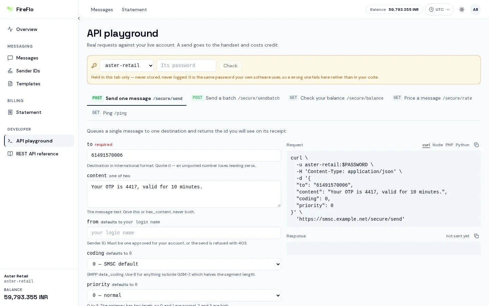
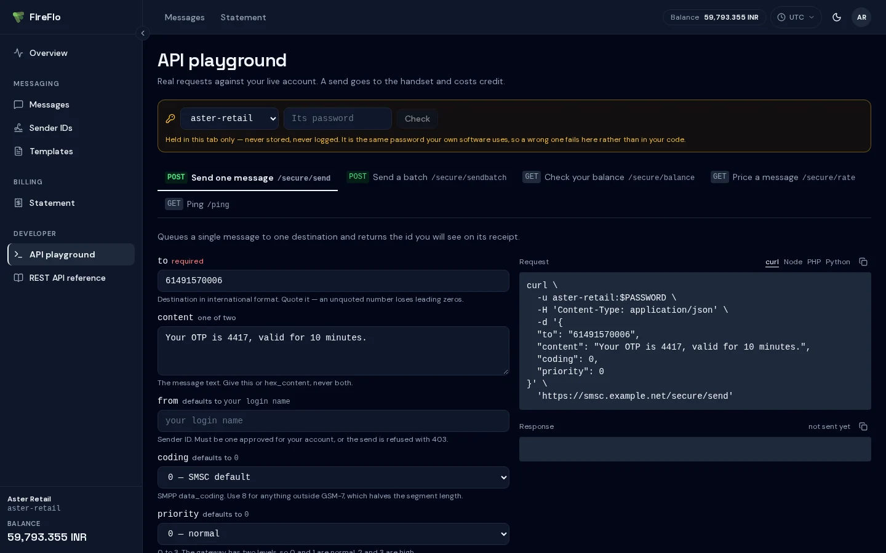
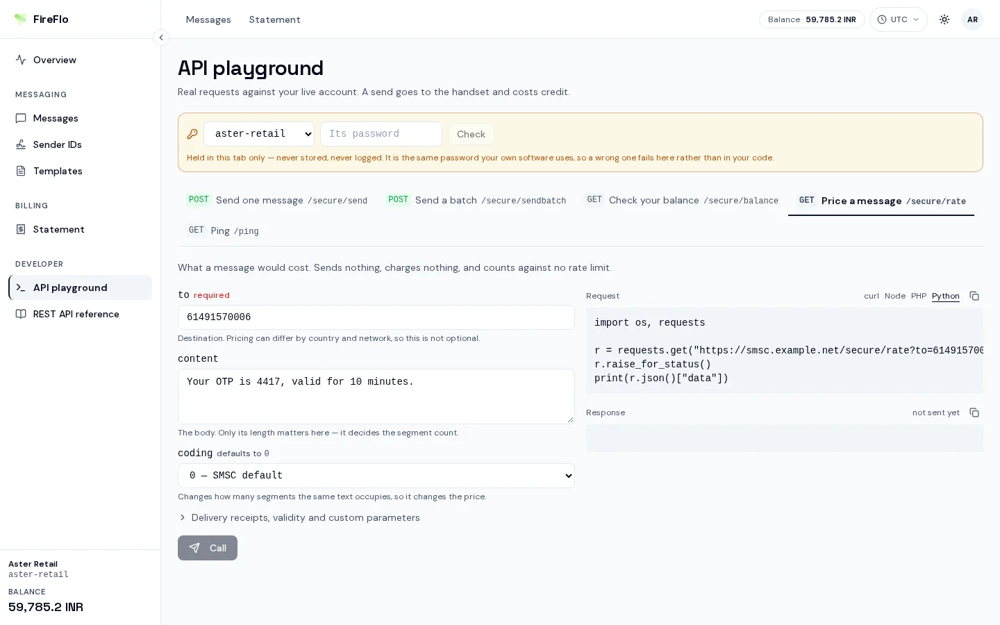
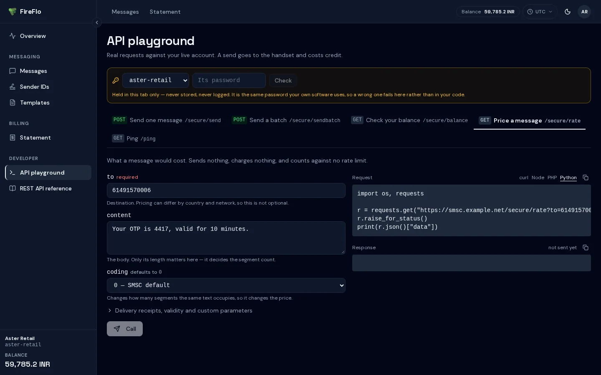
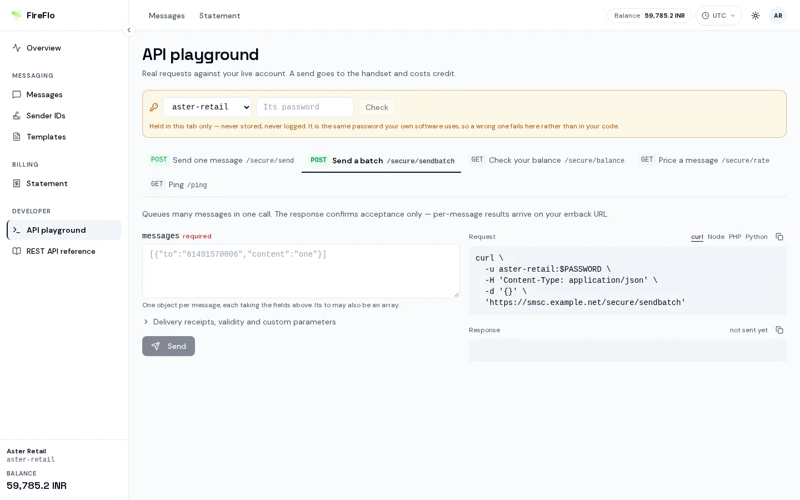
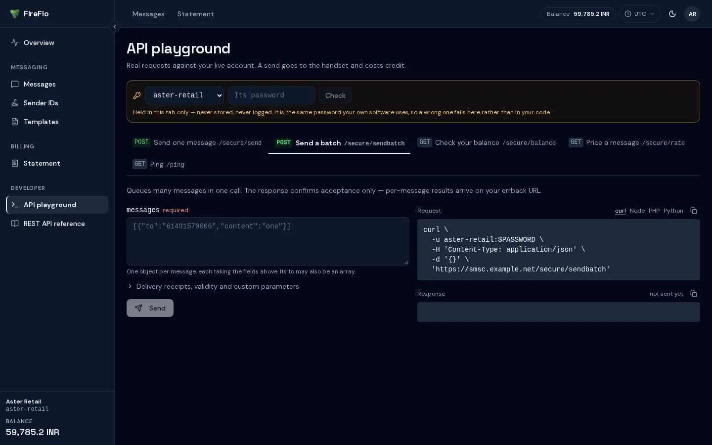
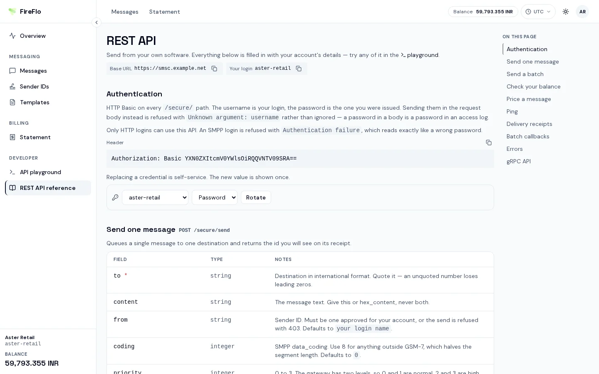
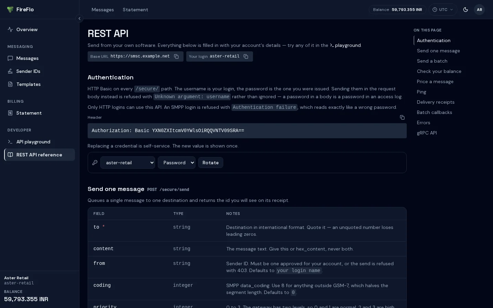

**De vraies requêtes contre votre compte en production. Un envoi part vers le combiné et coûte du
crédit.**

Il n'y a pas de sandbox. Le playground existe parce que l'écart entre un exemple documenté et un
appel qui fonctionne est là où les intégrations se perdent : un numéro entre guillemets qui a perdu
ses zéros initiaux, un `custom_tlvs` envoyé comme une liste au lieu d'un objet, un sender ID qui n'a
jamais été approuvé. Tous ceux-là échouent ici, où vous pouvez voir les propres mots de la
passerelle, plutôt que dans votre code à trois heures du matin.

<Warning>
**Un envoi est un envoi.** Il n'y a pas de dialogue de confirmation avant, délibérément — le coût
est indiqué dans la description de la page et à nouveau à côté du bouton — et pas de moyen de
l'annuler. Pointez-le sur un combiné qui vous appartient.

Tarifer un message est le seul appel qui n'envoie rien, ne débite rien et ne compte contre aucune
limite de débit. Utilisez-le librement.
</Warning>

<Frame caption="Le playground sur Send one message : choisissez un login et vérifiez son mot de passe en haut, remplissez le formulaire, et la requête se construit à côté à partir de vos propres URL de base et login. Le mot de passe vit dans l'onglet et nulle part ailleurs.">
  
  
</Frame>

## Se connecter

Choisissez un login API et entrez son mot de passe. Il est vérifié contre la passerelle avant que
quoi que ce soit d'autre ne soit activé, et un mot de passe incorrect est refusé dans les propres
mots de la passerelle plutôt que d'après une supposition du panneau.

> Conservé dans cet onglet uniquement — jamais stocké, jamais journalisé. C'est le même mot de
> passe que celui utilisé par votre propre logiciel, donc un mot de passe erroné échoue ici plutôt
> que dans votre code.

Seuls les logins HTTP peuvent utiliser cette API. Un login SMPP est refusé avec un échec
d'authentification qui se lit exactement comme un mauvais mot de passe.

## Les cinq endpoints

| Endpoint | Rôle |
| :--- | :--- |
| **Envoyer un message** | Met un seul message en file d'attente et renvoie l'id que vous verrez sur son accusé |
| **Envoyer un batch** | Met plusieurs messages en file en un appel. La réponse ne confirme que l'acceptation |
| **Vérifier votre solde** | Ce qu'il reste sur le compte que ce login facture |
| **Tarifer un message** | Ce que coûterait un message. N'envoie rien, ne débite rien |
| **Ping** | Liveness. Le seul endpoint sans identifiants, utile pour un moniteur |

Chaque champ est étiqueté avec son nom sur le fil, marqué requis ou optionnel avec sa valeur par
défaut, et porte une note d'une ligne. Plusieurs de ces notes existent à cause d'une erreur
précise :

- `to` — **entre guillemets.** Un numéro non entre guillemets perd ses zéros initiaux.
- `content` — donnez celui-ci ou `hex_content`, jamais les deux.
- `from` — doit être approuvé pour votre compte, sinon l'envoi est refusé avec `403`. Laissé vide, il
  prend par défaut le nom de votre login. Le champ ne suggère que des sender IDs **approuvés** ; ceux
  en attente sont délibérément absents, car en proposer un que vous ne pouvez pas encore utiliser
  produirait un refus que le formulaire aurait pu prédire. Vous pouvez quand même en taper un, car une
  approbation peut arriver après le chargement de la page.
- `coding` — utilisez 8 pour tout ce qui sort du GSM-7, ce qui divise par deux la longueur des
  segments.
- `validity_period` — des minutes entières, pas une chaîne de durée.

`custom_tlvs` dispose d'un éditeur en lignes, car la forme JSON est l'erreur d'intégration la plus
courante :

> Paramètres SMPP supplémentaires sous forme d'objet JSON — `{"0x1401": "…"}` — pas une liste de
> paires et pas une chaîne entre guillemets.

L'éditeur alerte aussi lorsque deux lignes nomment le même tag : la passerelle refuse la requête
entière plutôt que d'en choisir un pour vous.

## Lire la réponse

Le panneau de réponse vous donne le statut HTTP, le temps aller-retour et — la partie utile — une
explication en langage clair de ce que signifie le statut. *"Votre solde prépayé ne couvrira pas le
message. Rien n'a été envoyé ni débité."* est plus exploitable qu'un simple 402.

Là où un envoi a réussi, l'id du message est proposé avec un bouton de copie. Cet id est ce qui
apparaîtra sur l'accusé de livraison et dans votre [liste de messages](/developers/portal/messages-and-statement).

À côté, un panneau **Requête** affiche le même appel en curl, Node, PHP ou Python, pré-rempli avec
vos propres URL de base et login. Copiez-le directement dans votre code.

<Frame caption="Price a message, avec sa requête affichée en Python. Tarifer n'envoie rien et ne débite rien : c'est l'onglet à essayer en premier.">
  
  
</Frame>

Les derniers appels sont conservés dans un petit historique que vous pouvez recharger dans le
formulaire. Il vit dans l'onglet et meurt avec lui.

## Batches

L'endpoint batch prend une liste JSON : un objet par message, chacun prenant les mêmes champs qu'un
envoi unique, avec un `to` qui peut lui-même être une liste. La zone de texte refuse d'envoyer un JSON
malformé plutôt que de laisser la passerelle le rejeter.

<Frame caption="Send a batch. La ligne sous les onglets le dit avant que vous n'envoyiez : la réponse ne confirme que l'acceptation, et les résultats par message arrivent sur votre URL d'errback.">
  
  
</Frame>

<Warning>
**Une réponse de batch confirme l'acceptation, pas la livraison, ni même l'acceptation
par-message.** Un message refusé à l'intérieur d'un batch — un expéditeur non approuvé, un solde
vide, une limite de débit — ne change jamais la réponse HTTP, et il n'y a pas d'endpoint pour
demander ensuite comment un batch s'est passé.

Les refus par-message apparaissent **à un seul endroit** : votre URL d'errback. Si vous envoyez des
batches et n'en avez pas configuré, ces refus vous sont invisibles.
</Warning>

## La référence à côté

La **référence REST API** dans la même section documente chaque endpoint, pré-rempli avec les
propres valeurs de votre compte, plus les accusés de livraison, les callbacks de batch, le tableau
d'erreurs partagé, la grammaire des TLVs personnalisés et l'API gRPC. Si vous êtes revendeur, elle
ajoute les appels pour gérer vos propres comptes. Elle gère aussi la **rotation des identifiants** —
remplacer un mot de passe ou une clé d'API vous-même, avec la nouvelle valeur affichée une seule fois.

<Frame caption="La référence REST API, écrite avec vos propres URL de base et login — même l'en-tête Authorization est pré-rempli. La commande de rotation se trouve sous Authentication ; la table des matières court sur la droite.">
  
  
</Frame>

<Note>
Après rotation, la passerelle recharge les identifiants sur une horloge. Pendant environ la
demi-minute qui suit, votre **ancien** identifiant fonctionne encore et le nouveau pas encore. La
page vous dit combien de temps attendre.

Là où une clé d'API sert aussi de nom d'utilisateur, la rotation change aussi le nom
d'utilisateur, donc les deux moitiés de votre configuration doivent changer ensemble, et il n'y a
pas de période de grâce.
</Note>
