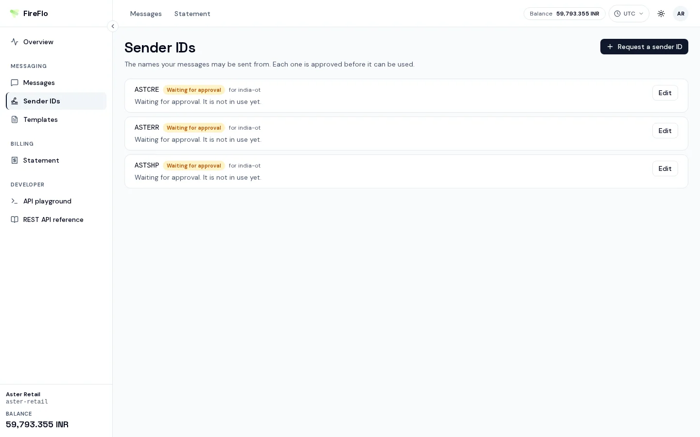
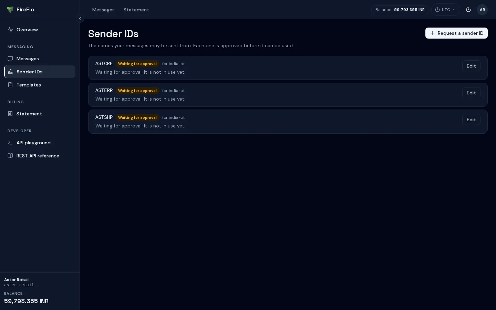
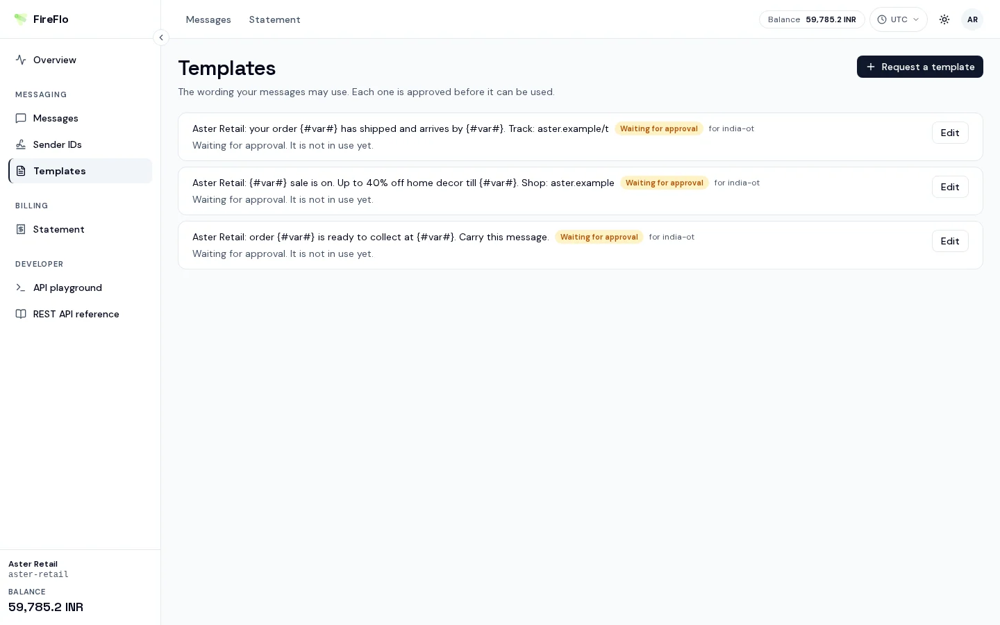
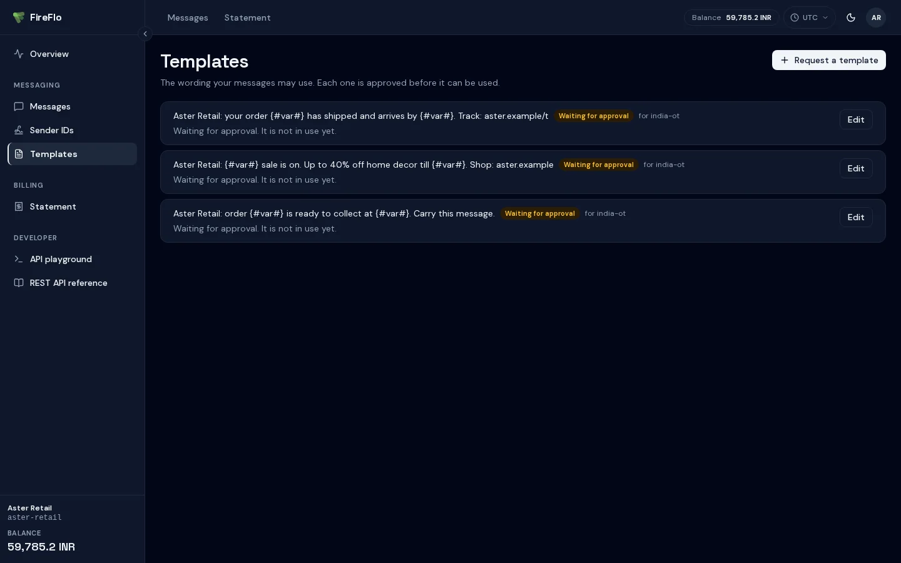
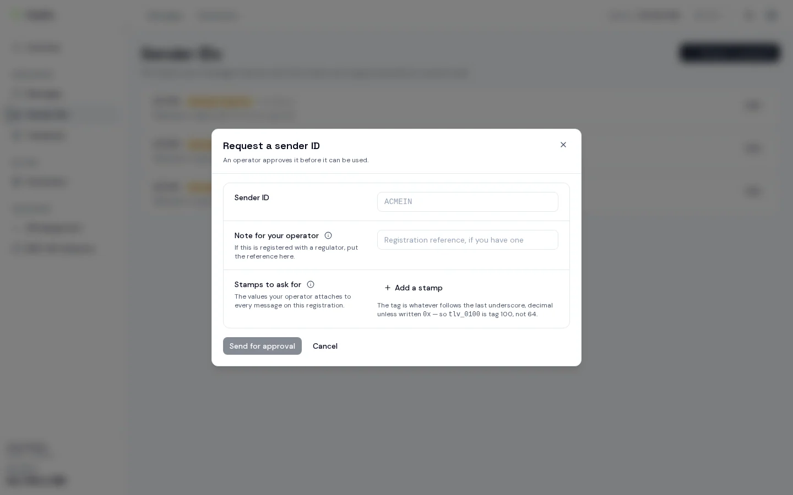
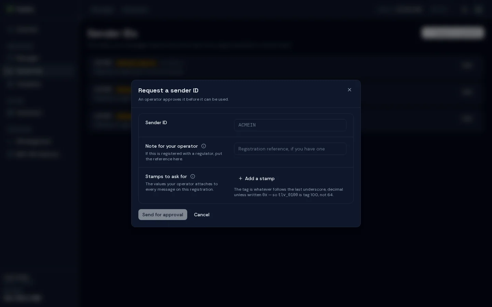

Deux écrans, une même forme. Les **Sender IDs** sont les noms depuis lesquels vos messages peuvent
être envoyés. Les **Templates** sont le libellé qu'ils peuvent utiliser. Chacun est approuvé par
votre fournisseur avant de pouvoir être utilisé.

<Note>
**Rien sur ces écrans n'approuve quoi que ce soit.** Chaque enregistrement est une demande. C'est
la partie qui surprend le plus souvent les clients : un enregistrement que vous venez de créer et
que vous voyez dans la liste n'est pas encore utilisable.
</Note>

Que l'un ou l'autre soit imposé du tout dépend de votre fournisseur. Là où il l'est — le régime
DLT indien étant le cas le plus évident — un expéditeur non enregistré ou un libellé non approuvé
est refusé à la soumission.

## Les quatre états

| Badge | Sur l'API | Signification |
| :--- | :--- | :--- |
| **En attente d'approbation** | `PENDING` | Soumis, pas encore examiné. Non utilisable |
| **En usage** | `APPROVED` | Approuvé et en production |
| **Non approuvé** | `REJECTED` | Refusé, avec la raison de votre fournisseur affichée |
| **Retiré** | `WITHDRAWN` | A été approuvé, désactivé par votre fournisseur. Non utilisable |

La colonne du milieu est ce que [`/secure/senders`](/reference/api/senders) et
[`/secure/templates`](/reference/api/templates) renvoient, donc les deux surfaces décrivent les
quatre mêmes états plutôt que huit. **Seul `APPROVED` est utilisable** — les trois autres signifient
tous qu'un message sera refusé, pour des raisons différentes.

Chaque ligne indique aussi le produit auquel elle s'applique. Dès que l'un de vos enregistrements est
lié à un login, chaque ligne indique aussi le login qu'elle couvre, soit un login nommé, soit **tous
vos logins**.

<Frame caption="Sender IDs, chacun avec son état et le produit auquel il est destiné. Ces trois-là attendent encore une approbation, et chacun le dit en toutes lettres : il n'est pas encore en usage.">
  
  
</Frame>

<Frame caption="Templates, sur le même modèle. Les blancs {#var#} sont ce qui peut varier ; tout ce qui les entoure est mis en correspondance à l'identique.">
  
  
</Frame>

## Demander un sender ID

**Request a sender ID** ouvre un court formulaire : le sender ID lui-même, une **note pour votre
opérateur** et les [stamps à demander](#stamps).

<Frame caption="Le formulaire de demande. Seul le sender ID est nécessaire ; la note est l'endroit où mettre la référence d'enregistrement d'un régulateur, et rien n'est utilisable tant que votre opérateur ne l'a pas approuvé.">
  
  
</Frame>

> **Note for your operator** — si celui-ci est enregistré auprès d'un régulateur, mettez la référence
> ici. Votre opérateur définit la valeur que le gateway envoie ; vous n'avez pas à le faire.

C'est le sender ID qui est vérifié. Les refus valent la peine d'être connus avant de les rencontrer :

- Un sender ID fait au plus 64 caractères, **mais SMPP en autorise 21**. Tout ce qui approche la
  borne supérieure pourrait être stocké ici et jamais livré.
- Les espaces en début ou en fin sont refusés purement et simplement. Un sender ID est comparé à
  l'identique, et un espace de fin est invisible partout où il est affiché.
- Il doit être en ASCII imprimable.

## Demander un template

Un **nom**, pour que vous et votre fournisseur le reconnaissiez, comparé contre rien. Puis le
**libellé**, qui est comparé, à l'identique, en dehors des blancs que vous marquez. La note pour votre
opérateur et les stamps suivent, comme pour un sender ID.

> Placez `{#var#}` là où le message change — un nom, un code, un numéro de commande. Tout le reste
> doit correspondre à l'identique.

Trois placeholders existent :

| Placeholder | Accepte |
| :--- | :--- |
| `{#var#}` | N'importe quoi |
| `{#num#}` | Chiffres 0–9 |
| `{#alp#}` | Lettres, espaces et ponctuation de noms |

Un aperçu en direct montre un exemple de message que votre template accepterait, c'est le moyen le
plus rapide d'attraper un template plus étroit ou plus large que ce que vous vouliez.

### Là où les templates tournent mal

Le formulaire refuse chacun de ces cas avec une phrase plutôt qu'un code :

**Un token mal orthographié.** `{#VAR#}` ou `{#Var#}` n'est pas un placeholder. Écrivez le token en
minuscules et sans espace à l'intérieur. C'est son orthographe, pas une affirmation sur ce qu'il
accepte.

**Quelque chose qui ressemble à un placeholder et n'en est pas**, comme `{#VAR}` ou `{{#var#}}`.
Les caractères autour d'un vrai placeholder sont comparés littéralement, donc cela n'approuverait
qu'un message portant ces caractères exactement comme écrits.

**Deux placeholders qui se touchent.** Deux variables sans rien entre elles ne peuvent être
distinguées, donc elles agissent comme une seule variable deux fois plus longue. Mettez entre elles
le libellé qui les sépare.

**Un template constitué de rien d'autre qu'un placeholder**, qui accepte tout message. Comme n'en
avoir aucun.

Vous pouvez aussi obtenir un avertissement plutôt qu'un refus, là où le libellé se répète autour de
la partie changeante. Cela peut faire correspondre un template à moins de messages que vous ne le
pensiez, et cela vaut la peine d'être vérifié avec votre fournisseur.

## Stamps

Sous **Stamps to ask for**, vous pouvez proposer les valeurs que votre fournisseur attache à chaque
message sur cet enregistrement — sous DLT, vos identifiants d'entité et de template. **Add a stamp**
vous donne un tag et une valeur par ligne.

> Le tag est ce qui suit le dernier tiret bas, en décimal sauf s'il est écrit `0x` — donc `tlv_0100`
> est le tag 100, pas 64.

> **Demander est gratuit :** rien ici n'atteint un message tant que votre opérateur ne l'accepte
> pas, donc un enregistrement approuvé continue de fonctionner en attendant.

Si vous avez déjà demandé et n'avez pas eu de réponse, sauvegarder remplace ce que votre
fournisseur verra plutôt que d'empiler une seconde demande.

## Quel login

Là où votre compte a plus d'un login API, le formulaire propose aussi **Which login**, pour lier un
enregistrement à l'un d'eux. Avec un seul login, ce choix n'est pas affiché.

<Warning>
**Laissez ceci sur "Tous mes logins" sauf si vous savez que vous voulez autrement.** Lié à un
login, un enregistrement ne fait rien pour les autres, et un login sans rien d'approuvé pour lui ne
peut rien envoyer du tout.
</Warning>

## Demander pour l'un de vos clients

Si vous êtes revendeur, le formulaire demande aussi **Who this is for** : votre propre compte, ou l'un
de vos clients. Choisissez un client et l'enregistrement est demandé sur son compte ; votre opérateur
l'approuve avant que le client puisse envoyer avec. Un enregistrement demandé pour un client couvre
tous ses logins.

## Éditer quelque chose qui est en usage

Changer le libellé, le sender ID, le nom, la note ou le login sur un enregistrement en production
le renvoie en approbation, et le bouton de sauvegarde demande confirmation :

> Ceci cesse d'être utilisable jusqu'à ce qu'un opérateur approuve la modification.

Si c'est votre seul enregistrement en usage, il le dit, parce que la conséquence est plus large :

> Ceci cesse d'être utilisable jusqu'à ce qu'un opérateur approuve la modification, et c'est le
> seul en usage, donc rien ne sera accepté depuis ce compte d'ici là.

**Changer uniquement les stamps proposés ne suspend rien** et sauvegarde sans confirmation, puisque
ceux-ci ne prennent effet que lorsqu'ils sont acceptés.

Si vous avez besoin qu'un libellé modifié soit en production avant que l'ancien puisse partir,
demandez le nouveau comme template distinct et laissez votre fournisseur retirer l'ancien après.

## Faire cela depuis votre propre code

Tout ce qui est sur ces deux écrans est aussi sur l'API REST, donc un client avec beaucoup
d'enregistrements n'a pas à les passer un par un dans le portail :

<CardGroup cols={2}>
  <Card title="/secure/senders" icon="id-card" href="/reference/api/senders">
    Lister, demander, modifier et retirer des sender IDs.
  </Card>
  <Card title="/secure/templates" icon="align-left" href="/reference/api/templates">
    Les mêmes quatre appels pour le libellé.
  </Card>
</CardGroup>

Les mêmes identifiants qu'à l'envoi, et les mêmes règles — ce que vous écrivez est une **demande**,
et l'API dit dans quel état est chaque enregistrement et si les enregistrements sont appliqués sur
votre compte tout court.

<Note>
**Disponible à partir de la passerelle 0.9.7.** Si ces endpoints répondent `404`, votre fournisseur
fait tourner une passerelle plus ancienne et ces écrans sont le moyen de demander.
</Note>
