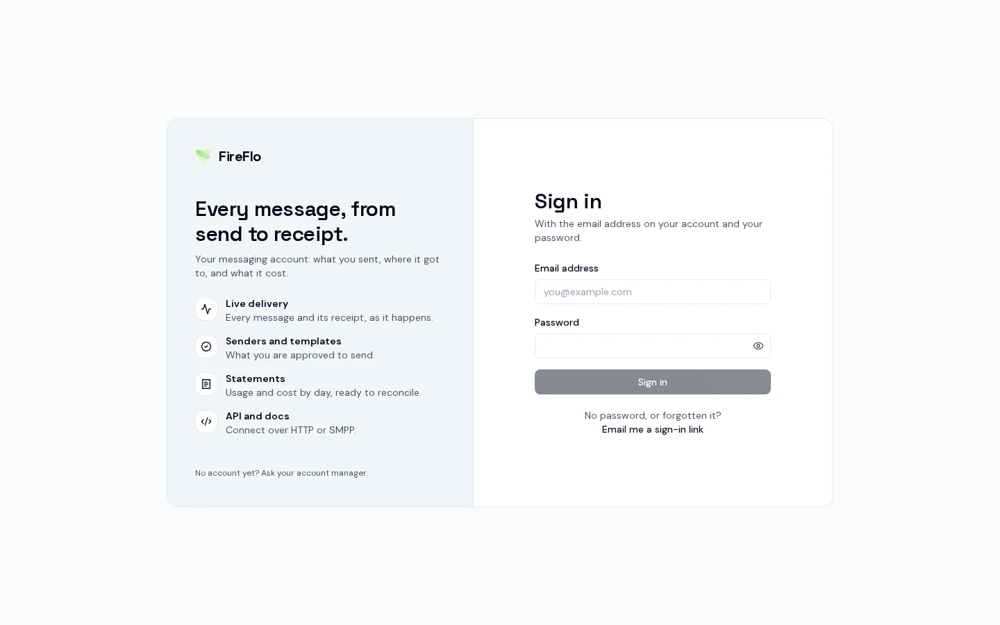
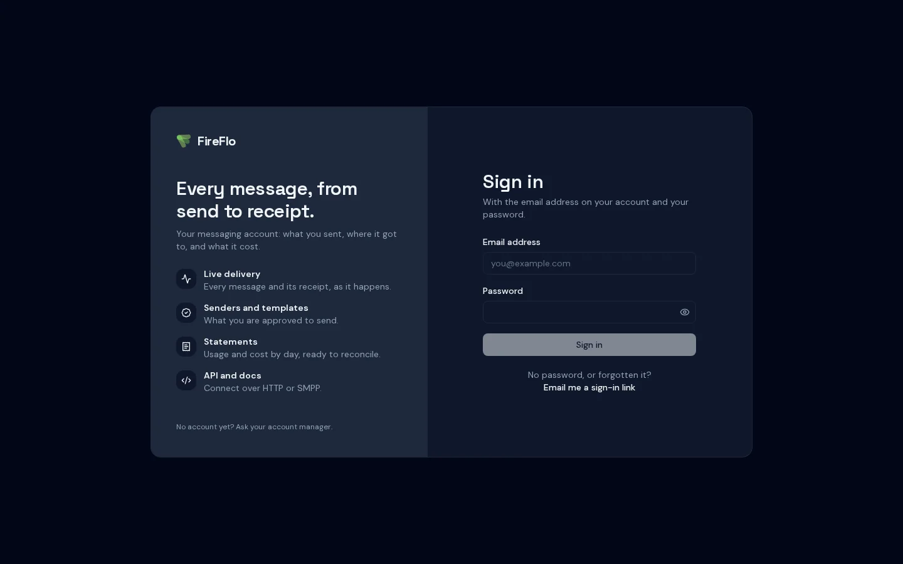
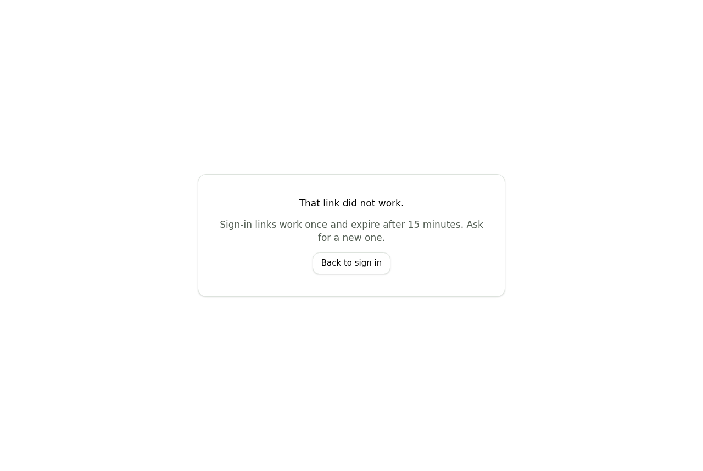
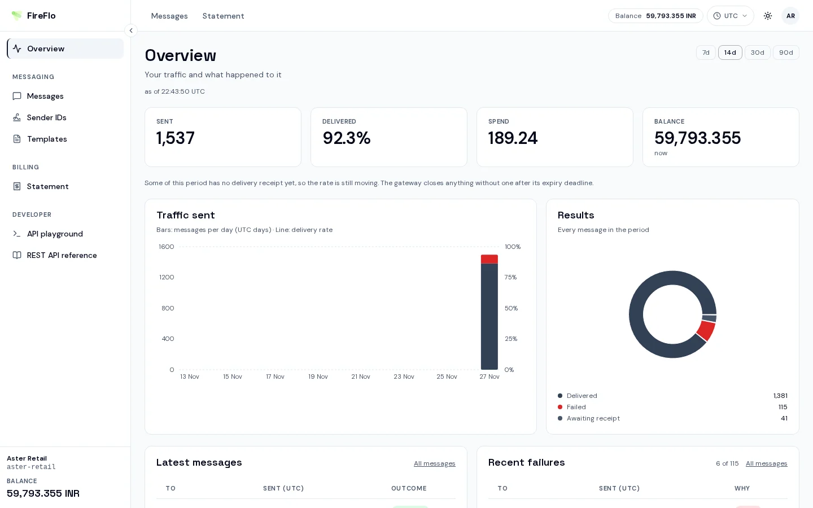
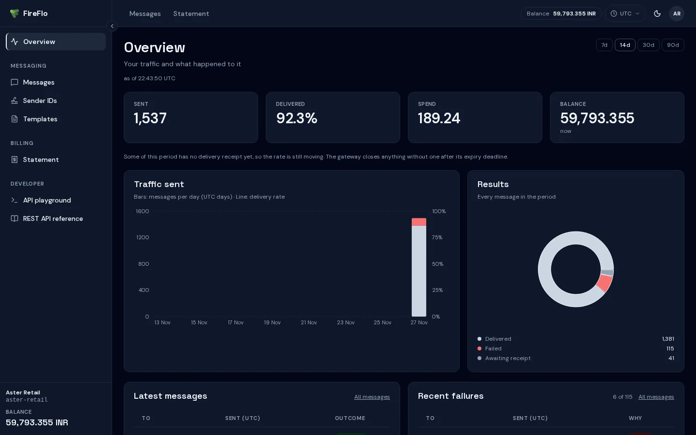

Vous vous connectez au portail avec l'adresse email que votre opérateur détient pour votre login, et
l'une de deux choses : **votre mot de passe**, ou **un lien à usage unique** envoyé à cette adresse.
Les deux vous mènent au même endroit, et vous pouvez utiliser l'un ou l'autre n'importe quel jour :
avoir un mot de passe ne désactive pas le lien.

<Frame caption="La page de connexion du portail. L'adresse email et le mot de passe d'abord ; en dessous, un lien de connexion par email pour qui n'a pas de mot de passe ou l'a oublié.">
  
  
</Frame>

## Avec un mot de passe

> Connectez-vous avec l'adresse email de votre compte et votre mot de passe.

Si l'une des deux moitiés est fausse, la réponse tient en une phrase :

> Cet email et ce mot de passe ne correspondent pas, ou ce login n'a pas encore de mot de passe. Vous
> pouvez vous connecter par lien envoyé par email à la place.

<Note>
**Cette phrase est la même quelle que soit l'erreur** : une adresse qui n'est sur aucun compte, un
mauvais mot de passe, un login sans mot de passe, ou un compte désactivé. Un formulaire qui dirait
quelle moitié était fausse indiquerait à quiconque possède une liste d'adresses lesquelles sont des
clients de votre fournisseur.
</Note>

### Trop de mauvais mots de passe

Après **dix** mauvais mots de passe pour une adresse depuis le même réseau en un quart d'heure, ou
**trente** pour cette adresse depuis n'importe où, la connexion par mot de passe est refusée pour
cette adresse jusqu'à la fin du quart d'heure, **même avec le bon mot de passe**. Le refus se lit
exactement comme un mauvais mot de passe, il ne vous dira donc pas que c'est arrivé.

Si un mot de passe dont vous êtes sûr continue d'échouer, attendez quinze minutes ou utilisez le lien
de connexion : le lien n'est pas concerné.

## Obtenir un mot de passe

Il y a deux façons d'en avoir un :

- **Votre opérateur le définit** quand il ajoute votre login, ou plus tard.
- **Vous le définissez vous-même.** Connectez-vous par lien, ouvrez le menu du compte en haut à droite
  et choisissez **Password**. Définir le premier ne demande rien de plus : la connexion par lien a déjà
  montré que l'adresse est la vôtre.

> Au moins 12 caractères. Une phrase fonctionne bien.

Le formulaire montre la solidité du mot de passe pendant que vous tapez, et refuse celui qui est trop
facile à deviner : l'un des mots de passe les plus courants, votre propre adresse email, un même
caractère répété, une suite le long du clavier ou de l'alphabet.

**Changer un mot de passe demande d'abord l'actuel**, pour qu'une session restée ouverte sur une
machine partagée ne puisse pas servir à prendre le contrôle de votre login. Les mauvaises tentatives
à cet endroit comptent dans la même limite d'un quart d'heure que la connexion :

> Trop de tentatives erronées. Réessayez dans un quart d'heure.

Définir ou changer votre mot de passe **vous déconnecte partout ailleurs**. Le navigateur dans lequel
vous l'avez changé reste connecté.

<Tip>
**Mot de passe oublié ?** Connectez-vous par lien : cela fonctionne toujours. La page Password ne
change pas un mot de passe sans l'actuel ; pour remplacer un mot de passe oublié, demandez donc à
votre opérateur de le réinitialiser ou de le supprimer. Sans mot de passe défini, vous vous connectez
par lien jusqu'à ce que vous en définissiez un nouveau.
</Tip>

## Avec un lien de connexion

**Email me a sign-in link**, sous le formulaire de mot de passe, bascule vers un champ unique :

> Recevoir un lien par email : nous enverrons un lien de connexion à usage unique à l'adresse de votre
> compte.

Quoi que vous tapiez, l'écran affiche ensuite la même chose :

> **Vérifiez votre boîte de réception.** Si cette adresse est sur un compte, un lien de connexion
> est en route vers *you@example.com*. Il fonctionne une fois et expire au bout de 15 minutes.

<Note>
**Cette réponse ne change pas si l'adresse est incorrecte.** Elle est identique pour une adresse
sur un compte, une adresse sur un compte désactivé et une adresse jamais vue.

C'est délibéré, pour la même raison que la réponse au mot de passe ci-dessus. Le coût de cette
protection est qu'une faute de frappe ressemble exactement à un succès. Donc si rien n'arrive,
vérifiez l'adresse avant de supposer une panne.
</Note>

Deux contrôles sont sous le formulaire. **Send it again** est désactivé pendant deux minutes et
décompte ; le minuteur survit à un rechargement de page et se corrige quand vous revenez de votre
client mail, plutôt que d'afficher un nombre périmé. **Use a different address** vous renvoie
à un formulaire vide.

> Rien après une minute ou deux ? Vérifiez le dossier spam, puis renvoyez-le. Le lien le plus
> récent est celui qui fonctionne.

Cette dernière phrase compte : demander un second lien ne laisse pas le premier valide. Suivez
l'email le plus récent.

**Have a password? Sign in with it** vous ramène au formulaire de mot de passe.

### Suivre le lien

Si le lien a déjà été utilisé, ou a plus de quinze minutes :

> **Ce lien n'a pas fonctionné.** Les liens de connexion fonctionnent une fois et expirent après
> 15 minutes. Demandez-en un nouveau.

<Frame caption="Ce qu'affiche un lien utilisé ou expiré. Les deux cas sont normaux. Un lien est consommé dès qu'il réussit, donc suivre le même email deux fois produit ceci.">
  
</Frame>

Les deux sont normaux. Un lien est consommé dès qu'il réussit, donc suivre le même email deux
fois, ou avoir un scanner de mail le suivre avant vous, produira ceci.

### Limites des liens

Les demandes de lien sont limitées par compte et par réseau. La limite par compte répond avec
la même phrase neutre qu'un succès, on ne vous dira donc pas que vous l'avez atteinte. La limite
par réseau, elle, le dit :

> Trop de demandes de connexion depuis cette adresse. Réessayez sous peu.

Si votre fournisseur n'a pas configuré le panneau pour envoyer du mail, vous obtenez une vraie
erreur plutôt qu'un lien qui n'arrive jamais :

> La connexion par email n'est pas disponible sur ce panneau. Demandez à votre account manager.

C'est un paramètre de déploiement de leur côté, pas quelque chose que vous pouvez contourner. Un mot
de passe, si vous en avez un, fonctionne toujours.

## Où vous arrivez

Dans les deux cas, vous arrivez sur **Overview**, pas sur vos messages, parce que la première question
après la connexion est habituellement "comment ça se passe", pas "montrez-moi la ligne 4 000".

<Frame caption="Overview, la première page après la connexion : envoyés, délivrés, dépense et solde pour la période, le graphique du trafic et les résultats, avec les derniers messages et les échecs récents en dessous.">
  
  
</Frame>

Le graphique, les tuiles et les résultats de cette page sont construits à partir de votre trafic une
fois par minute et servis depuis là ; une ligne sous le titre indique **as of** quelle heure. Votre
solde et les deux listes de messages récents sont lus en direct à chaque fois. Si la dernière
construction a échoué, la ligne indique que les chiffres sont les précédents plutôt que de vous
montrer une page d'erreur.

Les heures dans tout le portail sont affichées dans le fuseau choisi dans la barre supérieure : par
défaut le **fuseau de la plateforme** de votre fournisseur, pour que vous et lui vous citiez les mêmes
heures, ou le fuseau **de votre navigateur**, ou **UTC**. Le choix est conservé dans ce navigateur.
Les jours des graphiques et des relevés vont toujours de minuit à minuit dans le fuseau de la
plateforme, quel que soit votre choix.

## Rester connecté

Votre session est conservée dans un cookie dans le navigateur avec lequel vous vous êtes connecté.
Elle dure douze heures et se renouvelle tant que le portail est ouvert ; un portail laissé sans
activité plus longtemps vous demande donc de vous reconnecter. **Sign out** se trouve dans le menu du
compte en haut à droite. Vous connecter sur un téléphone ne vous déconnecte pas sur un poste de
travail. Si vous utilisez le portail depuis une machine partagée, déconnectez-vous plutôt que de
fermer l'onglet.
