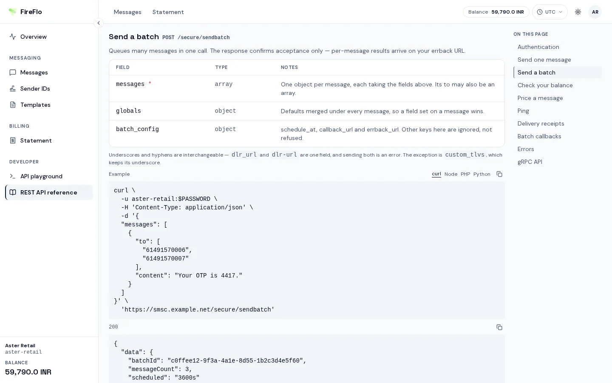
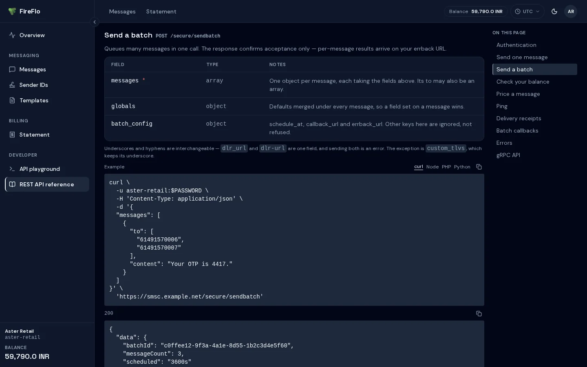

`/secure/sendbatch` met plusieurs messages en file en un seul appel.

```json
{
  "messages": [
    { "to": "61491570006", "content": "Your OTP is 4417." },
    { "to": "61491570007", "content": "Your OTP is 9921." }
  ]
}
```

Chaque élément prend les mêmes champs qu'un envoi unique. Le `to` d'un message peut lui-même être
un tableau, ce qui multiplie.

<Frame caption="Send a batch dans la référence de l'API REST de votre portail client, avec un exemple construit pour votre login. Deux numéros dans un même to donnent un messageCount de 3 — et la réponse confirme l'acceptation, rien de plus.">
  
  
</Frame>

## La réponse ne confirme que l'acceptation

```json
{
  "data": {
    "batchId": "c0ffee12-9f3a-4a1e-8d55-1b2c3d4e5f60",
    "messageCount": 3,
    "scheduled": "3600s"
  }
}
```

<Warning>
**Il n'y a pas d'id par-message dans cette réponse, et pas de résultat par-message.**
`messageCount` est le nombre après expansion, pas le nombre qui a réussi.

Les issues par-message arrivent sur votre **URL d'errback** en callbacks séparés. Un client qui
traite un `200` ici comme "les trois ont été envoyés" se trompe précisément dans les cas qui
comptent.
</Warning>

## Valeurs par défaut et configuration

```json
{
  "messages": [
    { "to": "61491570006", "content": "Your OTP is 4417." },
    { "to": "61491570007", "content": "Your OTP is 9921." }
  ],
  "globals": {
    "from": "SUNOTP",
    "dlr": "yes",
    "dlr_url": "https://yourapp.example.com/hooks/dlr"
  },
  "batch_config": {
    "schedule_at": "3600s",
    "callback_url": "https://yourapp.example.com/hooks/batch-done",
    "errback_url": "https://yourapp.example.com/hooks/batch-error"
  }
}
```

**`globals` est fusionné *sous* chaque message**, donc un champ défini sur un message individuel
l'emporte.

<Warning>
**Les clés inconnues dans `batch_config` sont ignorées, pas refusées.** Une faute de frappe dans
`errback_url` vous coûte chaque résultat par-message, silencieusement. Le batch est accepté et les
callbacks n'arrivent simplement jamais.

C'est le seul endroit de l'API où un champ mal orthographié ne produit pas de `400`, donc
vérifiez-le en envoyant un message délibérément en échec et en confirmant que le callback arrive.
</Warning>

## Planification

`schedule_at` prend exactement deux formes :

| Forme | Signification |
| :--- | :--- |
| `3600s` | Relative — dans une heure |
| `2026-08-20 09:30:00` | Absolue, `YYYY-MM-DD HH:MM:SS` |

Tout le reste est `412 Got unknown format`. **Une date dans le passé est aussi refusée**, plutôt
qu'envoyée immédiatement.

<Tip>
Les batches planifiés ne survivent à un redémarrage que si la passerelle fonctionne avec un broker
RabbitMQ, et pas même là quand la connexion au broker est dégradée. Si la planification durable
compte pour vous, demandez à votre fournisseur quel fournisseur de queue il exploite et s'il alerte
sur `amqp.bridge.degraded`.
</Tip>

## Limites

| Limite | Valeur |
| :--- | :--- |
| Messages par batch après expansion | **10 000** |
| Au-dessus | `400 a batch may expand to at most 10000 messages` |

Les destinations sous forme de tableau multiplient : 100 messages ayant chacun 200 destinataires
font 20 000, et sont refusés.

## Cadencement

Les batches se cadencent contre la profondeur de la queue du router, en pausant au-dessus d'un
seuil haut. Vous n'avez pas à limiter vous-même la soumission d'un batch. Mais vous **devez**
toujours respecter la limite messages-par-seconde de votre compte sur les envois ordinaires, qui
est un plafond distinct et renvoie `429`.

## Voir aussi

<CardGroup cols={2}>
  <Card title="Envoyer un batch" icon="layer-group" href="/reference/api/sendbatch">
    Chaque champ, avec les refus.
  </Card>
  <Card title="Callbacks de batch" icon="phone-arrow-down-left" href="/developers/receive/batch-callbacks">
    Ce qui arrive sur `callback_url` et `errback_url`.
  </Card>
</CardGroup>
