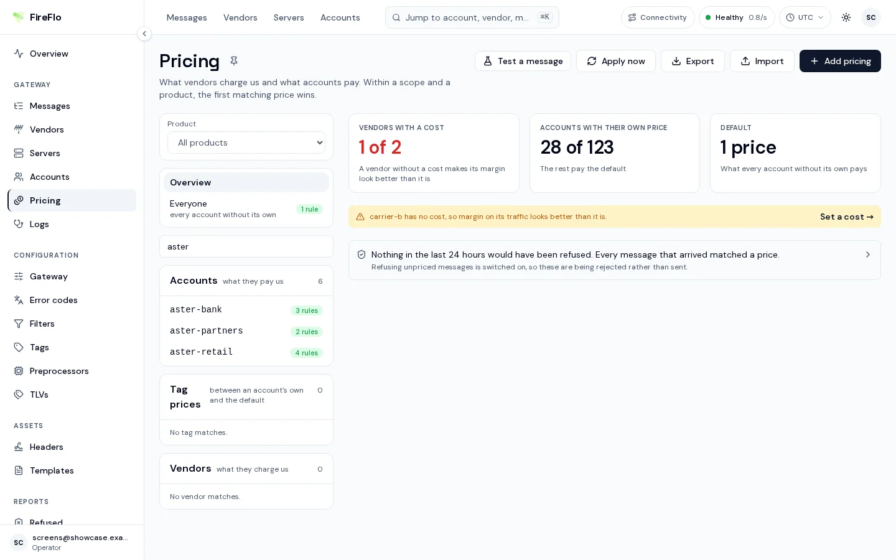
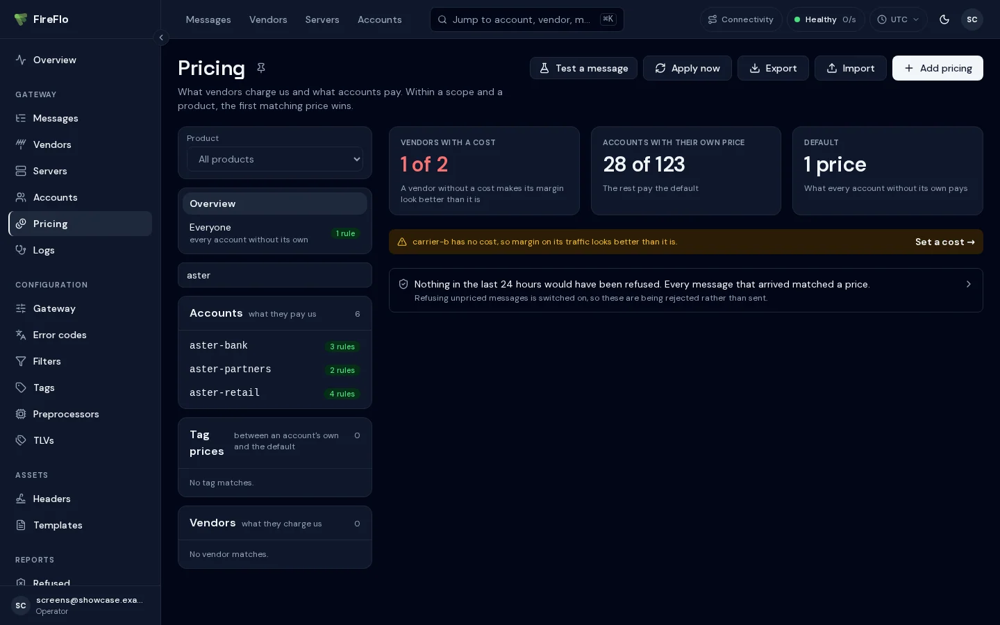
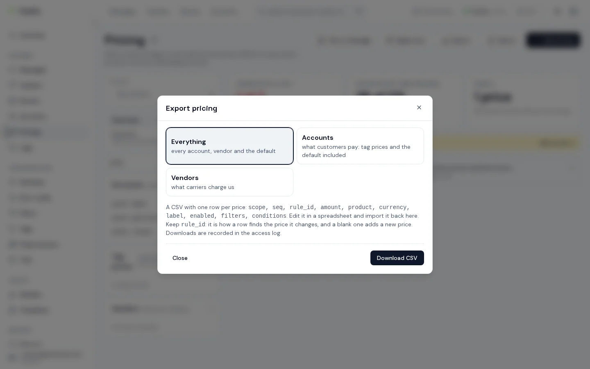
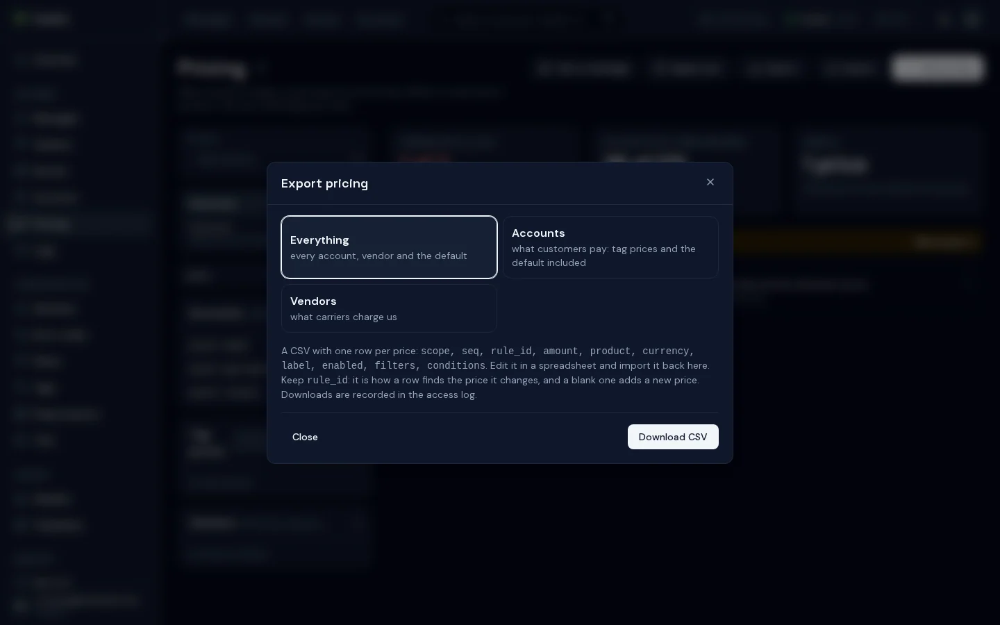

## Éditer les tarifs depuis le panneau

Les prix s'éditent sur la page **Pricing**. Sur la gauche figurent les scopes : **Everyone** (le
défaut `*`), **Accounts** (ce qu'ils nous paient), **Tag prices** et **Vendors** (ce qu'ils nous
facturent). Le sélecteur **Product** restreint la page à un seul product.

<Frame caption="La page Pricing. Les tuiles répondent aux questions qui coûtent de l'argent : quels vendors n'ont pas de coût, combien de comptes paient leur propre prix, et ce que paient tous les autres.">
  
  
</Frame>

Ouvrez un scope pour voir ses prix, regroupés par product. Les modifications, ajouts, déplacements et
l'activation ou la désactivation d'un prix sont mis en attente et enregistrés ensemble. **Add pricing**
demande de qui ajouter les prix — un compte, un vendor, une étiquette ou tout le monde — et ouvre ce
scope. Quand un product n'a pas de défaut, sa page et la vue d'ensemble Pricing proposent **Set what
everyone pays**.

À partir de 0.17.0, la page *Pricing* liste aussi **Tag prices** : une liste de prix par
[étiquette de compte](/platform/routing/account-tags), essayée après les prix propres d'un compte et
avant le défaut, dans l'ordre de la liste Tags.

L'onglet **Tariff** d'un compte montre les mêmes prix pour ce seul compte, et quel niveau le
tarifierait. Quand une plateforme gestionnaire a défini un tarif personnalisé pour le compte, l'onglet
l'affiche au-dessus des règles : il est appliqué avant elles, et il ne se change que sur cette
plateforme.

<Warning>
Les règles propres à un compte sont essayées en premier et **la première qui correspond gagne**,
donc tout ce que le compte porte bat le défaut — **y compris un attrape-tout nu**.

C'est ce qui fait qu'un tarif négocié est un override plutôt qu'une suggestion. Cela signifie
aussi qu'un attrape-tout au niveau du compte désactive silencieusement chaque défaut que vous
définissez ensuite.
Il en va de même pour les prix par étiquette : l'attrape-tout propre d'un compte les bat aussi.
</Warning>

## Exporter et importer les prix

**Export** sur la page Pricing télécharge les prix en CSV, une ligne par prix : **Everything**,
**Accounts** (ce que paient les clients, avec les prix par étiquette et le défaut) ou **Vendors** (ce
que les opérateurs nous facturent). Les téléchargements sont enregistrés dans le log d'accès.

<Frame caption="Export pricing. Gardez la colonne rule_id quand vous éditez le fichier : c'est ainsi qu'une ligne retrouve le prix qu'elle modifie.">
  
  
</Frame>

Éditez le fichier dans un tableur et ramenez-le avec **Import** (jusqu'à 2 MB). Une ligne avec un
`rule_id` vide ajoute un nouveau prix.

<Warning>
**Chaque compte ou vendor nommé dans le fichier est remplacé par les lignes du fichier.** Un prix que
le fichier ne liste pas pour ce scope est supprimé. Les scopes que le fichier ne nomme pas restent tels
quels.
</Warning>

Rien ne change tant que vous n'avez pas lu l'aperçu. Il liste, par scope, ce qui est ajouté, modifié
et supprimé. Les suppressions doivent être activées séparément avant que **Apply** soit proposé, et
appliquer demande confirmation une fois de plus. Chaque scope est enregistré séparément : si l'un
échoue, ceux d'avant sont déjà appliqués. Le gateway tarifie selon les nouvelles lignes dès son
prochain relevé de configuration.

## Deux identités, pas une

Si le crédit d'un compte s'additionne se vérifie contre **deux** équations. Se tromper à ce sujet
signale un faux écart sur chaque compte, donc cela vaut la peine de l'énoncer précisément.

```
MONEY:        Σ(RECHARGE + TRANSFER)  =  balance + reserved
CONSUMPTION:  reserved − consumed     =  credit reserved but not yet spent   (≥ 0)
```

<Warning>
**L'équation évidente est fausse.** `credited − consumed = balance + reserved` était écrite ainsi
dans la conception et les données l'ont réfutée immédiatement — elle était décalée d'exactement la
consommation sur chaque compte.

La consommation ne touche jamais les colonnes de solde. Le crédit est réservé par blocs
(`balance -= n, reserved += n`), dépensé depuis un compteur en mémoire, et **la partie dépensée
n'est jamais réécrite**. Donc `reserved` est un compteur consommé sur la vie du compte, pas un
blocage, et chaque mouvement que la base voit laisse `balance + reserved` inchangé.
</Warning>

L'identité de l'argent tient à l'unité près sur chaque compte, ce qui rend un vrai écart
significatif.

### Ce qui est exclu, et pourquoi

| Type d'entrée | Compté ? | Pourquoi |
| :--- | :--- | :--- |
| `RECHARGE`, `TRANSFER` | **Oui** | De l'argent entrant sur le compte |
| `RESERVE`, `RELEASE` | Non | Ils déplacent un montant entre deux colonnes de la même ligne, se compensant à zéro |
| `BILL` | Non | Une période clôturée enregistre ce qui a été facturé et ne bouge rien |

## Sur la vie du compte, jamais une période

Le crédit est un **total courant**. Toute fenêtre plus courte nécessite un solde d'ouverture que
rien n'enregistre — et un chiffre d'ouverture erroné invente un écart chaque fois qu'il est
exécuté.

<Tip>
Donc « réconcilier ce compte pour mars » n'est pas une question à laquelle les données peuvent
répondre. « Réconcilier ce compte » l'est, et l'a toujours été.
</Tip>

## D'où viennent les deux côtés

| Côté | Source |
| :--- | :--- |
| Crédité | `Σ RECHARGE + TRANSFER`, **appliqués uniquement** — les entrées pending n'ont pas bougé d'argent |
| Consommé | `usage_daily` pour les jours agrégés **plus** `cdr_submit` pour la queue vive |

Jamais les deux pour un même jour. C'est la jointure qui fait que la réconciliation survit à la
fenêtre de rétention : une fois qu'un jour est agrégé et purgé, sa consommation compte toujours.

## Quand les chiffres ne s'accordent pas

Procédez dans cet ordre :

<Steps>
  <Step title="Y a-t-il des rechargements pending ?">
    Un `RECHARGE` pour un compte sans ligne `account_balance` ne crédite rien et reste pending. Il
    est dans le grand livre et pas dans le solde — ce qui est exactement un écart côté argent.
  </Step>
  <Step title="Y a-t-il eu un arrêt non propre ?">
    Un `kill -9` bloque du crédit dans `reserved`. `balance + reserved` est toujours conservé,
    donc l'identité de l'argent tient — mais le compte a moins de dépensable qu'il ne devrait
    jusqu'à ce que `POST /ops/credit/release` s'exécute.
  </Step>
  <Step title="Le rollup est-il en retard ?">
    Un jour ni agrégé ni encore dans `cdr_submit` est de la consommation que personne ne compte.
    La purge est censée rendre cela impossible ; vérifiez qu'elle n'a pas été contournée.
  </Step>
  <Step title="Le panneau lit-il la même base de données ?">
    `METRICS_DATABASE_URL` contre le `FIREFLO_DB_URL` du gateway. Un décalage ici fait que chaque
    chiffre est en désaccord d'une manière qui ressemble à un bug comptable.
  </Step>
</Steps>

## En lien

<CardGroup cols={2}>
  <Card title="Comment fonctionne le pricing" icon="tag" href="/platform/billing/how-pricing-works">
    Scopes, le défaut `*`, et LCR.
  </Card>
  <Card title="Crédit prépayé" icon="wallet" href="/platform/billing/prepaid-credit">
    Blocs, réservations et le grand livre.
  </Card>
</CardGroup>
