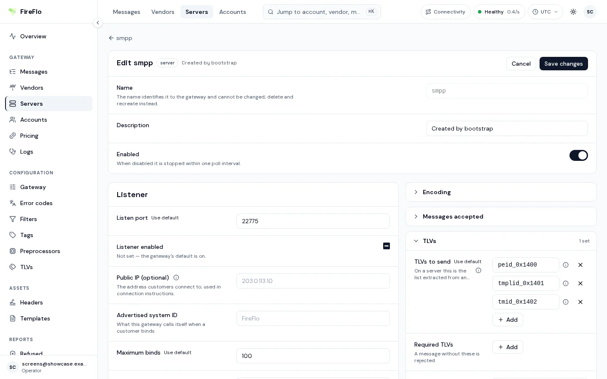
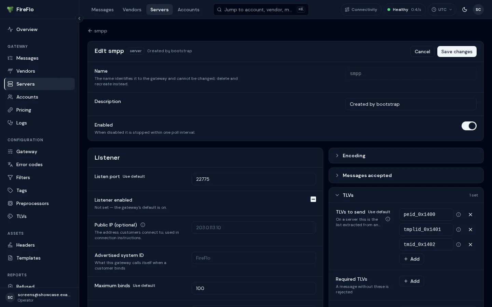
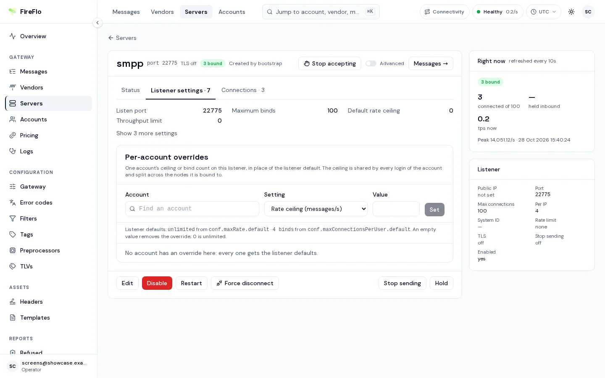
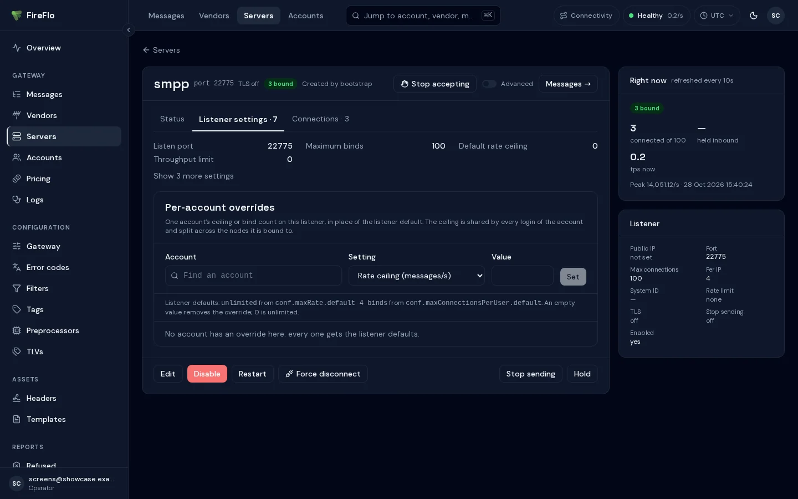
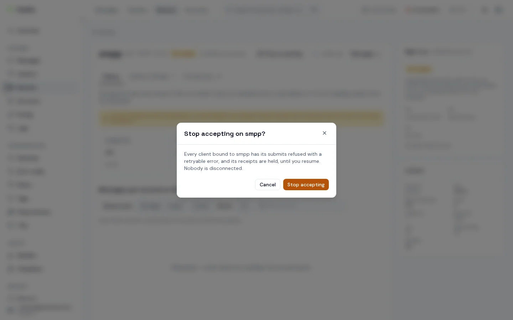
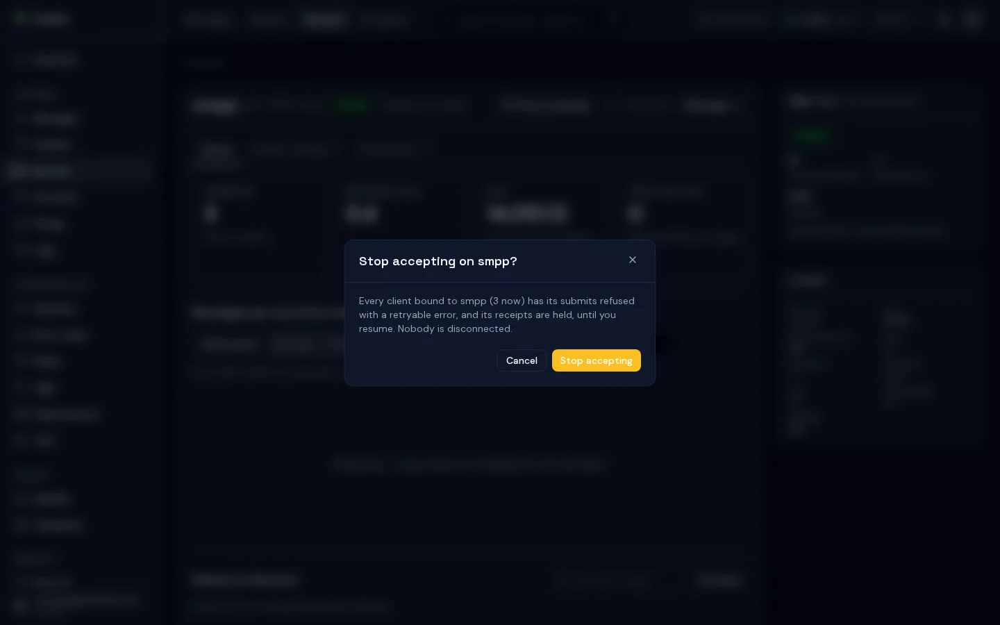
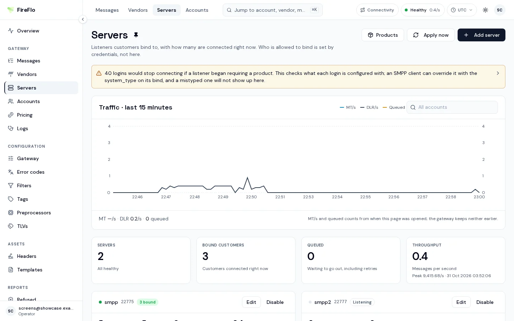
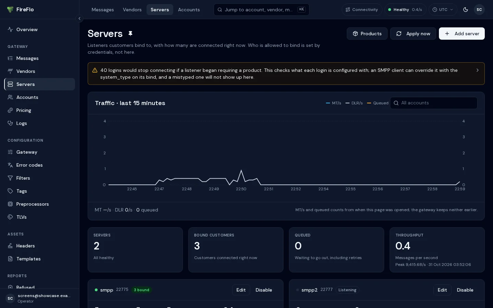
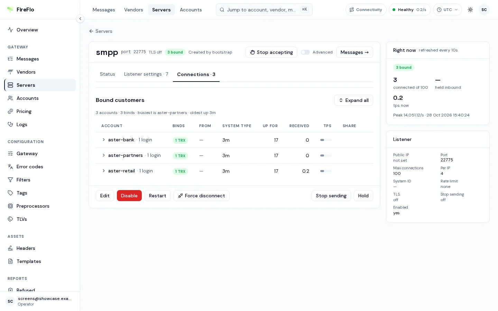
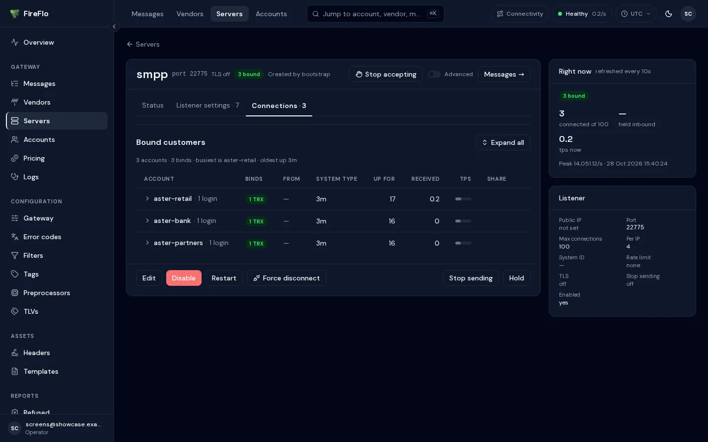

Un **server** est un listener auquel vos clients se connectent en entrée. En ajouter un est un
port, un nom, puis la politique que vous voulez appliquer à tous ceux qui s'y connectent.

## En ajouter un

<Tabs>
  <Tab title="Panneau de contrôle">
    **Servers → Add server.** Le nom et le port sont les seuls champs obligatoires ; tout le reste a
    un défaut qui fonctionne.
  </Tab>
  <Tab title="smsg.properties">
```properties
outSms.instance.smpp.type     = smppserver
outSms.instance.smpp.srv.port = 27777
outSms.instance.smpp.enable   = true
```
  </Tab>
</Tabs>

Chaque paramètre est à [Paramètres du listener](/reference/smpp/server).

<Frame caption="Le formulaire d'édition d'un listener. Le nom ne peut plus être changé une fois le listener ajouté ; supprimez-le et ajoutez-le à nouveau à la place.">
  
  
</Frame>

<Warning>
**Un listener qui ne peut pas prendre son port n'arrête pas le gateway.** Il journalise et tout le
reste continue de tourner — approprié pour un déploiement multi-listeners, et surprenant la
première fois.

Un démarrage propre n'est pas la preuve que chaque listener est en marche. Vérifiez `/ops/health`.
</Warning>

## Contre quoi un bind est vérifié, dans l'ordre

<Steps>
  <Step title="Le credential">
    `systemId` et `password` doivent correspondre à un credential `SMPP` activé. Voir
    [credentials.yml](/reference/files/credentials-yml).
  </Step>
  <Step title="allowedIps, si défini">
    Vide signifie **aucune restriction**.
  </Step>
  <Step title="Limites de connexions">
    `srv.maxConnections` globalement, `srv.maxConnectionsPerIP`, et
    `conf.maxConnectionsPerUser.default` par compte.
  </Step>
  <Step title="Le product, si conf.product.required est activé">
    Le product résolu doit nommer une ligne **activée** dans le catalogue de products. Vide ou
    inconnu est refusé avec `0x40F` — au bind, pas à la soumission, parce que le product vit sur
    le contexte de session.
  </Step>
</Steps>

## D'où vient le product

`system_type` sur la requête de bind, avec repli sur le champ `product` du credential.

<Warning>
`system_type` est du texte libre validé nulle part ailleurs. Un client qui se binde avec `prem` au
lieu de `premium` passe tout test de non-vide et atterrit dans l'état **non tarifé** où les
messages sont livrés et débités de rien.

C'est pourquoi `conf.product.required` vérifie l'**appartenance au catalogue** plutôt que la
présence d'une valeur. Et pourquoi, en mode fichier, où il n'y a pas de catalogue, seule la
moitié non-vide s'applique. C'est journalisé une fois par chargement de configuration en nommant
le listener.
</Warning>

## Ce qu'un listener applique à tous ceux qui y sont bindés

| Paramètre | Effet |
| :--- | :--- |
| `conf.maxRate.default` | Plafond de débit par compte |
| `conf.maxPending.default` | Taille de fenêtre — requêtes non acquittées en vol |
| `forward.dlrs` | **Désactivé supprime les accusés pour tout le monde ici**, quoi que chaque client ait demandé |
| `conf.whitelist.enabled` | Si sender ID et contenu sont vérifiés |
| `mandatory.tlvs.submit` | Tags qu'un message doit porter, sinon `0xC3` |
| `inQueue.capacity` | Messages retenus en attente du magasin de messages |

Les **overrides par compte**, sur l'onglet **Listener settings** du listener, donnent à un compte son
propre plafond de débit ou son propre nombre de binds sur ce listener, à la place du défaut du
listener. Le plafond est partagé par tous les logins du compte. Une valeur vide supprime l'override ;
`0` signifie illimité.

<Frame caption="Le plafond de débit ou le nombre de binds d'un compte à la place du défaut du listener. Les défauts qu'il remplace sont affichés sous le formulaire.">
  
  
</Frame>

## Les états dans lesquels un listener peut se trouver

| Verbe | Effet |
| :--- | :--- |
| `enable` / `disable` | Chargé, ou non |
| `suspend` / `resume` | Continue d'accepter, ne route rien : les submits sont mis de côté et routés à la reprise, les plus anciens d'abord ; une fois la réserve pleine, les submits sont refusés avec une erreur réessayable. Les accusés continuent d'aller aux clients |
| `hold` / `release` | Refuse chaque submit avec une erreur réessayable (`ESME_RMSGQFUL`) et **retient les accusés**. Personne n'est déconnecté |

Dans le panneau de contrôle, suspend est **Stop sending** et hold est **Stop accepting** (aussi
**Hold**, au bas de la page du listener). Chacun demande confirmation avant d'agir.

<Frame caption="Stop accepting demande d'abord : les clients bindés voient leurs submits refusés avec une erreur réessayable et leurs accusés retenus jusqu'à la reprise. Personne n'est déconnecté.">
  
  
</Frame>

Le panneau les montre comme un badge par carte. `Listening` sans personne de bindé n'est **pas** un
défaut. Un listener sans clients connectés est calme, pas cassé, c'est pourquoi il n'est pas peint
en rouge comme un vendor sans session.

<Frame caption="La page Servers. Un listener a trois clients bindés ; l'autre affiche Listening, ce qui veut seulement dire que personne n'est bindé.">
  
  
</Frame>

## Couper le bind d'un client

```bash
scripts/fireflo disconnect smpp 7
```

Les ids de session viennent de `fireflo health`. Ce sont les compteurs propres au listener, donc
ils entrent en collision entre listeners et redémarrent avec le gateway.

Dans le panneau de contrôle, ouvrez l'onglet **Connections** du listener, dépliez le compte et pressez
**Disconnect** sur la session. Cochez **Also disable this login** pour le tenir dehors aussi.
**Force disconnect**, au bas de la page du listener, coupe toutes les sessions d'une adresse, d'un
compte ou d'un login sur ce listener.

<Frame caption="L'onglet Connections : chaque compte bindé avec ses binds, son system type, sa durée de connexion et les messages reçus. Dépliez un compte pour atteindre ses sessions.">
  
  
</Frame>

<Note>
**Cela met fin à une connexion ; cela ne retire pas la permission.** Un client en bonne santé se
rebinde en quelques secondes à moins que vous ne désactiviez aussi son login.
</Note>

## Messages entrants

`mo.owner.map` décide quel compte possède quelle adresse entrante. `mo.owner.default` est où va un
message non apparié — et **vide signifie nulle part** : le listener journalise
`message.mo.unmapped` et consomme le message plutôt que de deviner un propriétaire.

Délibéré, parce que livrer le message d'un inconnu au mauvais client est pire. Mais le trafic non
mappé disparaît tranquillement à moins que vous ne surveilliez cette ligne.
