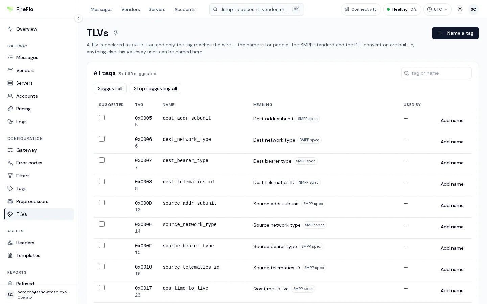
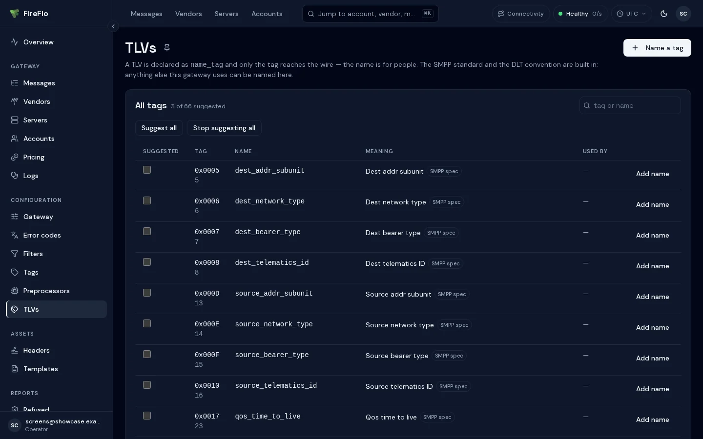
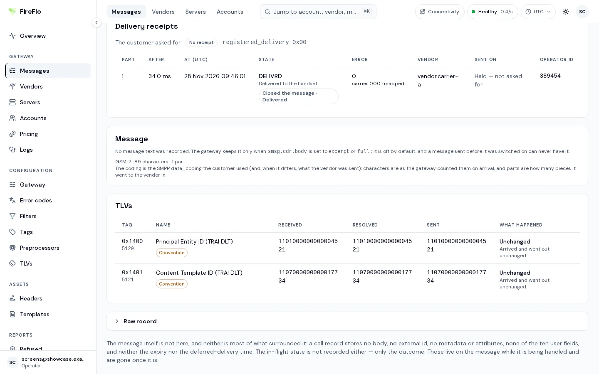
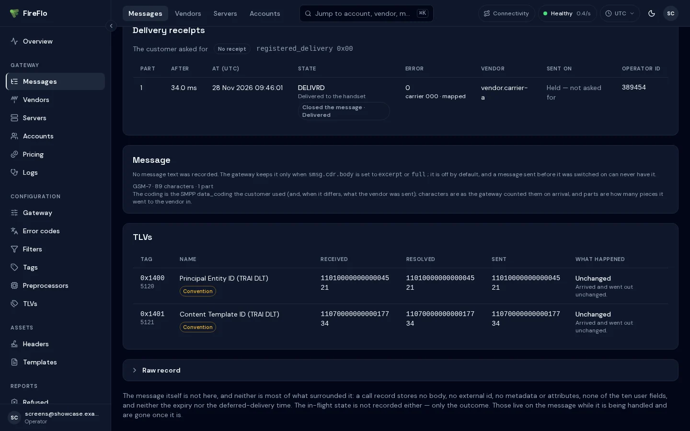

La grammaire est à [Déclarations TLV](/reference/smpp/tlvs). Lisez cela d'abord si `1400` contre
`0x1400` vous est nouveau. Cette page porte sur leur exploitation.

## Nommer un tag

**TLVs**, sous Configuration dans le panneau de contrôle, liste chaque tag avec son nom, sa
signification et ce qui l'utilise. Les tags du standard SMPP et de la convention DLT indienne sont
intégrés. **Name a tag** donne à n'importe quel autre tag un nom et une signification d'une ligne que
le panneau affichera. Les noms sont pour les personnes : seul le numéro du tag part sur le fil, donc
nommer un tag ne change rien à ce que le gateway envoie.

<Frame caption="La page TLVs : le numéro de chaque tag, son nom, sa signification, et ce qui l'utilise.">
  
  
</Frame>

## Un tag peut venir de quatre endroits

<Steps>
  <Step title="Le submit_sm du client">
    Extrait seulement si le `registered.tlvs.submit` du listener le déclare. **Les tags non
    déclarés sont écartés**, pas transmis.
  </Step>
  <Step title="Les defaultTlvs de son credential">
    Remplissent les tags que le message n'a pas portés.
  </Step>
  <Step title="L'estampille de la whitelist">
    En mode `assign`, remplit un tag qui manque au message. En mode `replace`, **écrase** ce que
    le client a envoyé — et cet écrasement *est* l'approbation.
  </Step>
  <Step title="Les default.tlvs.submit du vendor">
    Remplit tout ce qui est encore non défini au moment de l'envoi.
  </Step>
</Steps>

**La priorité est message > credential > vendor.** Les défauts ne font que combler des lacunes.
La seule exception est l'estampille de whitelist en mode `replace`, qui est censée gagner.

## Deux vérifications obligatoires, à des points différents

| Vérification | Tourne | Échec |
| :--- | :--- | :--- |
| `mandatory.tlvs.submit` du listener | À l'entrée, après les défauts du credential et toute estampille | `0xC3` au client |
| `mandatory.tlvs.submit` du **vendor** | Contre ce qui va effectivement sur le fil | Accusé FAILED, remboursement, `cdr_rejected` — **pas re-routé** |

<Warning>
La vérification du vendor tourne **après** que `registered.tlvs.submit` a filtré. Exiger un tag qui
n'est pas aussi enregistré ne peut jamais être satisfait — le gateway avertit de cet appariement
au chargement, et il vaut la peine de lire le log après l'ajout d'un tag obligatoire.
</Warning>

## Savoir ce qui manquera avant que cela n'arrive

Le rapport de couverture TLV du panneau de contrôle indique, **par ligne approuvée**, quels tags
obligatoires rien ne fournira.

Ce rapport est ce qui rend le mode d'estampillage par défaut (`off`) découvrable plutôt que
simplement silencieux. Défaut à `assign` commencerait à écrire des TLV sur des paquets traversant
des listeners qui n'en ont jamais écrit. Un changement silencieux de ce qui atteint un opérateur.

## L'échec qui s'est réellement produit

<Warning>
Tous les paramètres ne sont pas lus par listener. Un qui ne l'est pas garde sa forme nue et lit
un global que personne ne définit — donc il retourne son défaut codé quoi que vous configuriez.

`whitelist.tlvs.replace` a été livré ainsi une fois. Il lisait false sur chaque listener quelle
que soit sa configuration, donc les TLV d'un template approuvé n'étaient **jamais estampillés en
SMPP** — silencieusement, parce que ne pas estampiller ressemble exactement à n'avoir rien à
estampiller.

Si un paramètre TLV par-listener semble ne rien faire, c'est la première chose à vérifier.
</Warning>

## Le côté du client

Un client peut voir les TLV **qu'il a envoyés** sur ses propres messages, et peut proposer de
nouvelles définitions de tags qu'un opérateur approuvera. Il ne voit jamais ce qu'un vendor a
ajouté en aval.

L'enregistrement d'appel conserve trois ensembles — reçus, envoyés, et ce que la whitelist a
estampillé — de sorte qu'un litige sur ce qui a atteint l'opérateur ait une réponse plutôt que
d'être argumenté. La page d'un message dans le panneau de contrôle montre chaque tag tel que reçu, tel
que résolu et tel qu'envoyé, avec ce qui lui est arrivé.

<Frame caption="Les TLVs d'un message : les IDs d'entité et de template DLT tels que reçus, résolus et envoyés. Les deux sont arrivés et repartis inchangés.">
  
  
</Frame>

## Un cas travaillé : DLT indien

L'identifiant d'entité enregistrée appartient au **credential**, parce que c'est une propriété du
client plutôt que d'un message :

```yaml
defaultTlvs:
  peid_0x1400: "1101234567890123456"
```

L'id du template (`tmplid_0x1401`) varie par message et est habituellement estampillé par la
whitelist à l'approbation, ou fourni par le client. L'id de télémarketeur (`tmid_0x1402`) est votre
propre enregistrement auprès du vendor, il peut donc être un défaut du vendor :

```properties
outSms.default.default.tlvs.submit = tmid_0x1402=1102000000000012345
outSms.instance.smpp.mandatory.tlvs.submit = peid_0x1400,tmplid_0x1401
```

Avec les deux obligatoires, un message auquel il manque l'un ou l'autre est refusé à l'entrée
avec `0xC3` plutôt que rejeté par l'opérateur plus tard — ce qui est le but de vérifier tout court.
