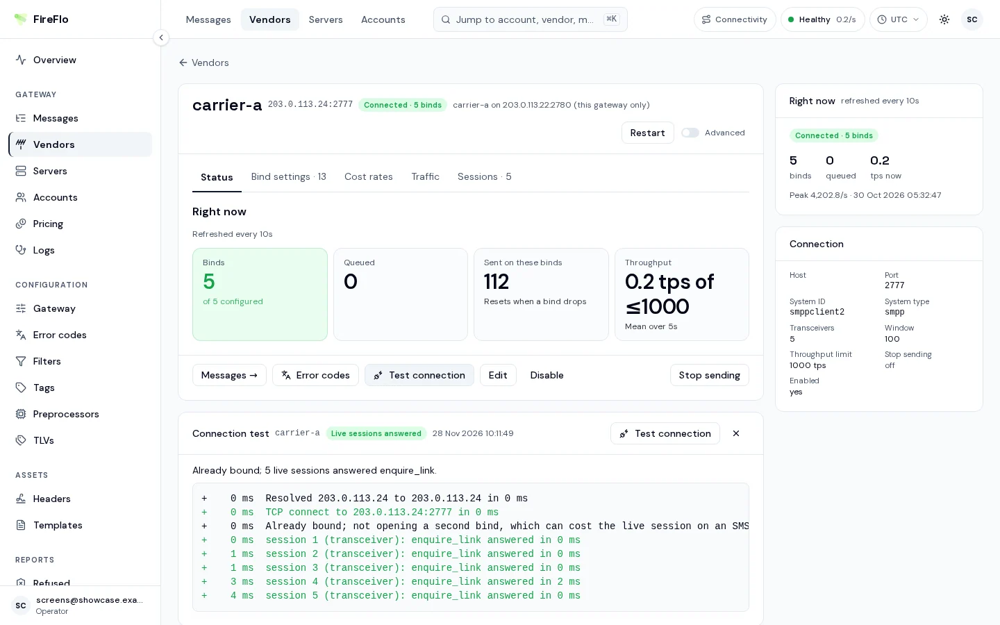
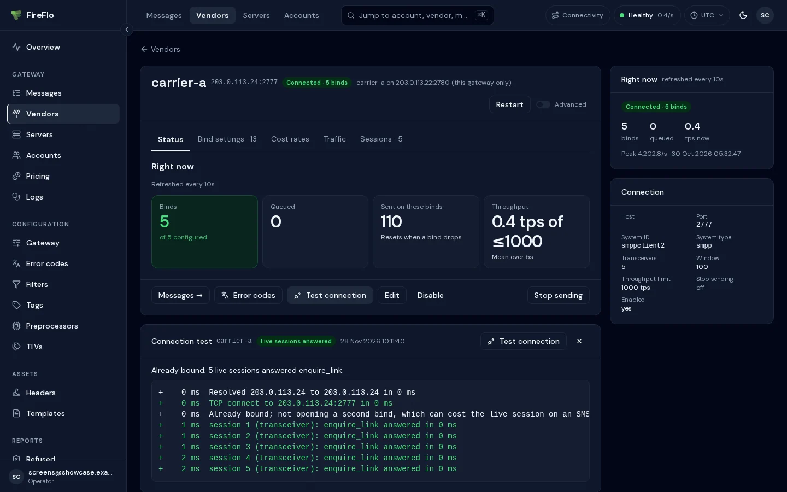
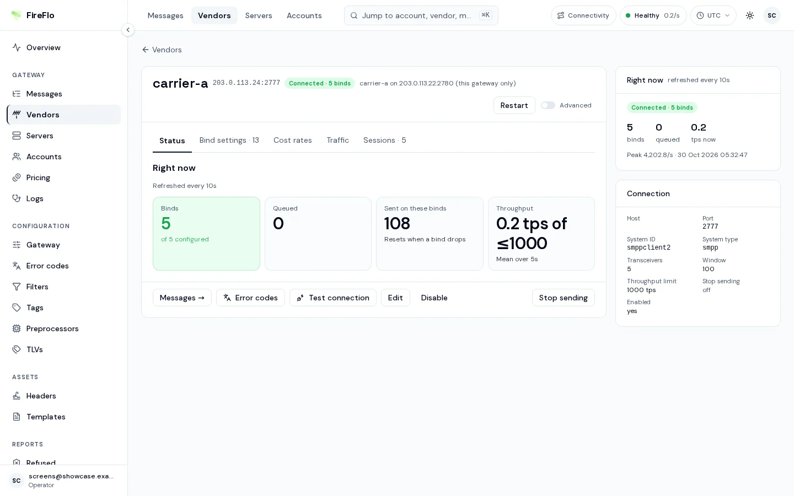
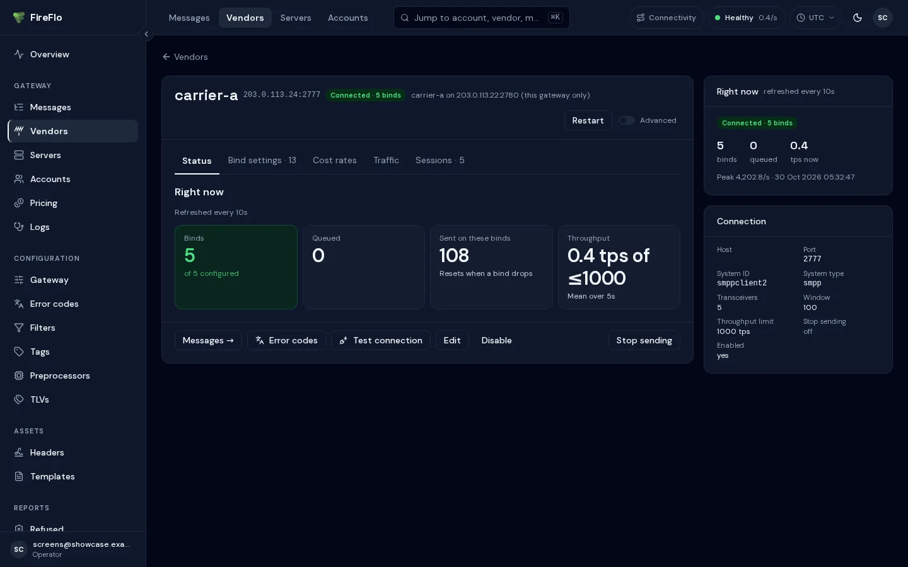
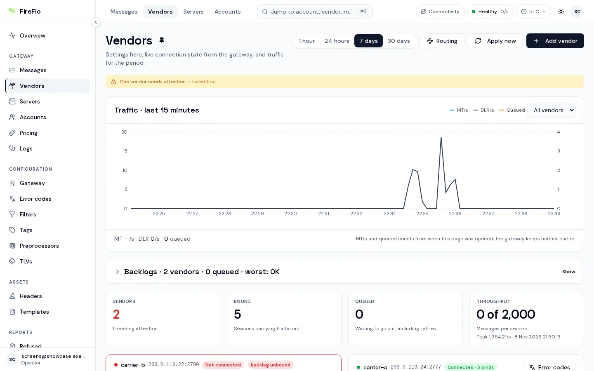
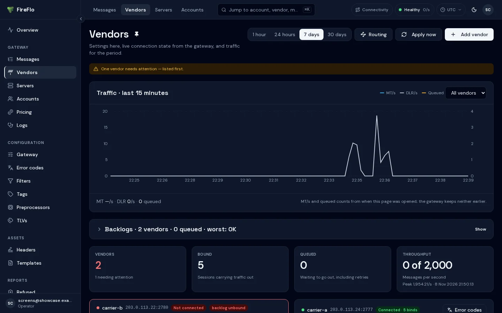
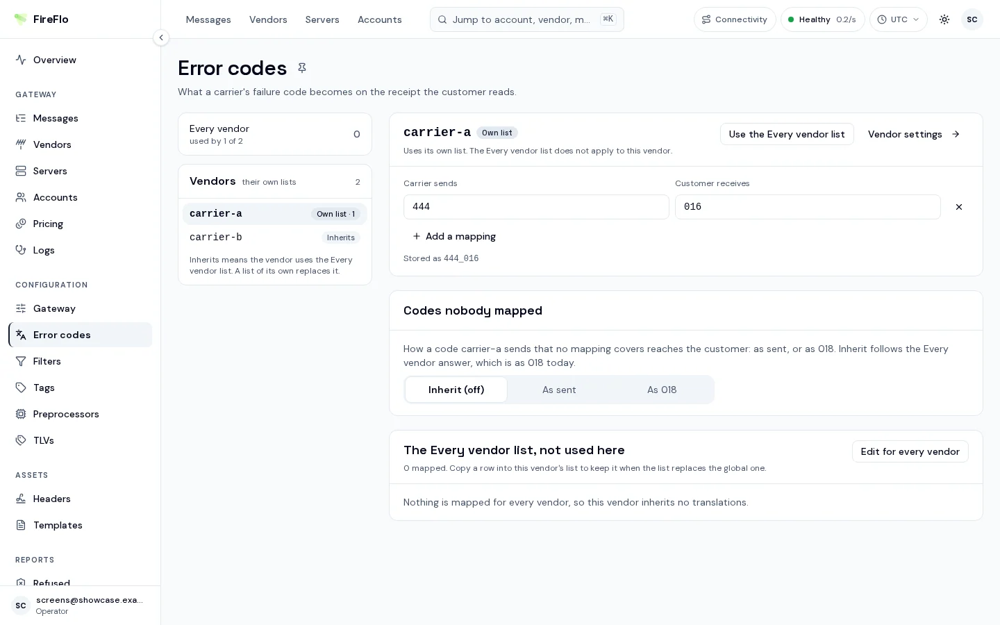
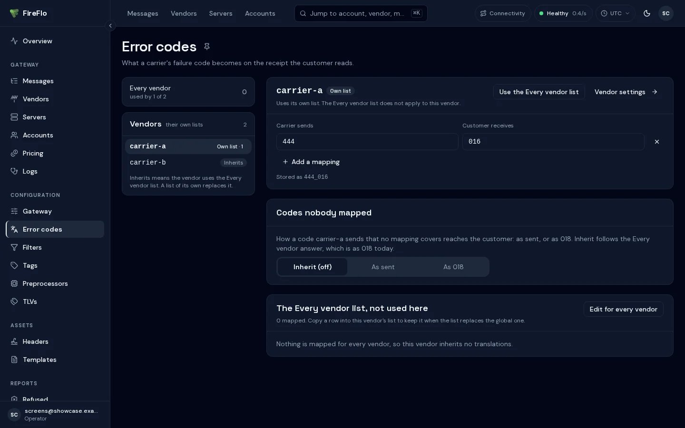

Un **vendor** est une connexion sortante vers celui qui transporte votre trafic. FireFlo le
compose.

## En ajouter un

<Tabs>
  <Tab title="Panneau de contrôle">
    **Vendors → Add vendor.** Hôte, port, system id et mot de passe. Le panneau regroupe le reste
    par ce qu'il fait, et chaque champ porte son défaut.
  </Tab>
  <Tab title="smsg.properties">
```properties
outSms.instance.vendor1.type     = smppclient
outSms.instance.vendor1.host     = smpp.example.net
outSms.instance.vendor1.port     = 2775
outSms.instance.vendor1.systemId = ourid
outSms.instance.vendor1.password = REPLACE_ME
outSms.instance.vendor1.tps      = 500
outSms.instance.vendor1.connections.transceivers = 2
```
  </Tab>
</Tabs>

Chaque paramètre est à [Paramètres du vendor](/reference/smpp/client).

## Prouvez-le avant que le trafic n'en dépende

```bash
scripts/fireflo test-bind vendor1
```

Compose une fois et rapporte chaque étape : la résolution du nom, la connexion TCP, le bind, trois
allers-retours `enquire_link` et l'unbind. Le panneau a la même chose sous **Test connection**, sur la
page du vendor.

<Warning>
**Il n'ouvre jamais de second bind pendant que le vendor est déjà bindé.** Un second bind sur le même
`systemId` peut vous coûter la session vive. Beaucoup d'opérateurs n'en autorisent qu'un. À la place,
il résout quand même l'adresse et ouvre une connexion TCP, puis envoie `enquire_link` sur chaque
session vive et chronomètre la réponse.
</Warning>

<Frame caption="Un test de connexion sur un vendor déjà bindé : l'adresse résolue, la connexion TCP, et chaque session vive qui répond à enquire_link.">
  
  
</Frame>

## Bindé n'est pas la même chose que capable d'envoyer

| Champ | Signifie |
| :--- | :--- |
| `bound` | Sessions établies |
| `bound_transmittable` | Sessions qui peuvent effectivement porter du trafic sortant |

Une session porte du trafic si elle est un **transceiver**, ou un **transmitter** sur une session
cliente. Un vendor receiver-only se binde parfaitement et n'envoie rien.

Lorsque ces deux nombres diffèrent, c'est la raison, et le panneau montre **Can send** comme un
chiffre à part pour exactement ce cas.

<Frame caption="L'onglet Status d'un vendor : ses binds par rapport à ceux configurés, ce qui est en file, ce qui a été envoyé sur ces binds et son débit par rapport à sa limite. Can send n'apparaît à côté de Binds que lorsque les deux diffèrent.">
  
  
</Frame>

## Les quatre états

| Badge | Signifie | Couleur |
| :--- | :--- | :--- |
| **Connected** | Bindé et accepte ; le badge ajoute le nombre de binds, par exemple **Connected · 5 binds** | Vert |
| **Not connected** | Aucune session — un vendor sans est cassé | Rouge |
| **Not accepting** | Suspendu ; la file se vide vers le routeur donc le trafic re-route | Ambre |
| **Holding** | Accepte mais n'envoie pas ; **la file grossit** | Ambre |
| **Disabled** | Non chargé | Gris |
| **Not loaded** | Le gateway n'a jamais entendu parler de lui | Ambre |

<Note>
**Not loaded** signifie généralement l'une de deux choses : le gateway n'a pas rechargé depuis que
le vendor a été ajouté, ou il ne lit pas du tout les workers depuis la base. Le texte détaillé du
badge dit lequel.
</Note>

<Frame caption="La page Vendors. Un vendor qui demande de l'attention est listé en premier : ici l'un affiche Not connected, l'autre Connected avec cinq binds.">
  
  
</Frame>

## Retentatives, et le nombre qui mentait

`maxRetries` borne le **total** de `submit_sm` qu'un message peut coûter chez ce vendor — à
travers les retentatives dans le worker **et** chaque aller-retour par le routeur.

<Warning>
Il ne bornait auparavant que la moitié dans le worker, et chaque saut du routeur donnait une
allocation fraîche. Un vendor pouvait voir environ 100 PDU pour un message tandis que le panneau
lisait `1`.

Si vous avez ajusté autour de l'ancien comportement, revérifiez la valeur. Basculer vers un
*autre* vendor démarre toujours un budget frais — la borne est par vendor.
</Warning>

`status.retry.worker` (par défaut `20,88`) classifie quels statuts opérateur valent la peine
d'être retentés localement ; `status.retry.router` renvoie pour une autre route.

`ESME_RSUBMITFAIL` (`0x45`) est traité comme **permanent** — une voie refusée avec échoue à la
première réponse plutôt qu'après vingt. Les opérateurs qui signifient une surcharge transitoire
par lui sont ré-optés par vendor : `status.retry.worker = 20,88,69`.

## Format du numéro du destinataire

Les destinataires arrivent chez le fournisseur exactement comme vos clients les ont envoyés, sauf si
vous activez **Convert recipient automatically** (sous **Detect sender type automatically**, dans la
section **Addressing** du fournisseur). Activée, elle réécrit chaque numéro après le routage dans la
forme que demande le **Recipient type of number** du fournisseur :

| Recipient type of number | Ce que reçoit le fournisseur |
| :--- | :--- |
| 1 — International | Indicatif du pays et numéro, chiffres seulement : `0412 345 678` → `61412345678` |
| 2 — National | Le numéro tel qu'on le compose dans le pays par défaut : `+61412345678` → `0412345678`. Un numéro d'un autre pays part en international, avec le type 1 |
| Tout autre | Inchangé |

**Recipient default country** (à côté de **Address range**) est le code ISO à deux lettres, comme
`AU` ou `IN`, des numéros écrits sans indicatif. Laissé vide, seuls les numéros écrits avec `+` sont
convertis.

Un numéro illisible part tel qu'il est arrivé ; rien n'est refusé. Seul ce qui part chez le
fournisseur change : les enregistrements d'appels, les accusés, la tarification et une nouvelle
tentative par un autre fournisseur gardent le numéro tel que votre client l'a envoyé. Les numéros
déjà dans la forme du fournisseur sont reconnus sans être analysés, le débit n'en souffre donc pas.

## Accusés

`request.dlrs` (activé par défaut) définit `registered_delivery` sur chaque `submit_sm` vers ce
vendor.

<Warning>
Désactivez-le et ce vendor cesse de rapporter des résultats, donc chaque message qui le traverse
est réglé comme `EXPIRED` à l'échéance. Votre taux de livraison pour ce vendor devient **dénué de
sens**, pas zéro.
</Warning>

## Le contrôler en direct

| Verbe | À utiliser quand |
| :--- | :--- |
| `suspend` | Vous voulez que le trafic re-route ailleurs maintenant — la file se vide vers le routeur |
| `hold` | Vous voulez qu'il cesse d'envoyer mais garde sa file |
| `disable` | Vous voulez qu'il disparaisse en un intervalle de sondage |

Sur la page d'un vendor, ce sont **Stop sending** et **Disable**, formulés délibérément plutôt
qu'iconographiques. Chacun re-route ou arrête le trafic de production au moment où il est pressé,
donc chacun demande d'abord confirmation. **Restart**, à côté, ferme toutes les connexions du vendor
et les rouvre ; les messages en vol sont réessayés. Hold n'a pas de bouton sur la page du vendor ; la
vue **Connectivity** le propose sous le nom **Pause sending (queue kept)**.

## Codes d'erreur

**Error codes**, sur la page d'un vendor, fait correspondre un code envoyé par l'opérateur à celui que
reçoit votre client. Un vendor utilise la liste **Every vendor** jusqu'à ce qu'il ait sa propre liste,
qui la remplace. **Codes nobody mapped** choisit si un code qu'aucune correspondance ne couvre atteint
le client tel qu'envoyé ou comme `018` ; **Inherit** suit la réponse de Every vendor. Les paramètres
derrière sont à [Paramètres du vendor](/reference/smpp/client).

<Frame caption="La liste propre d'un vendor : le code opérateur 444 atteint le client comme 016. En dessous, ce qui arrive à un code que personne n'a mis en correspondance.">
  
  
</Frame>

## Coût

Le scope d'un vendor dans la table de tarifs est ce qu'il **vous** facture. Sans règle de coût,
la marge sur le trafic qui y passe est inconnue plutôt que 100 %. Voir
[rates.conf](/reference/files/rates-conf).
