Ouvrez un compte et choisissez **Billing**. En haut, une carte répond aux deux questions pour
lesquelles vous l'ouvrez : à gauche, ce que le compte détient et les actions qui le modifient ; à
droite, combien de parts MT il a envoyées. En dessous, **MT usage** dans le temps à côté de **Does the
credit add up?**, et le grand livre complet en bas.

<Frame caption="L'onglet Billing d'un compte. La gauche de la carte, c'est l'argent et les actions qui le modifient ; la droite, ce que le compte a envoyé.">
  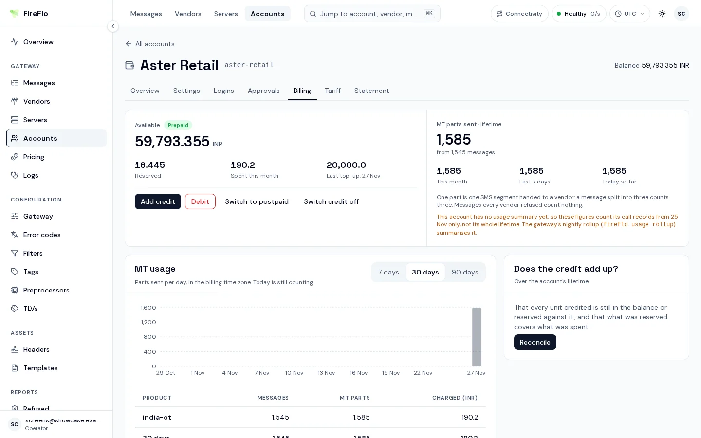
  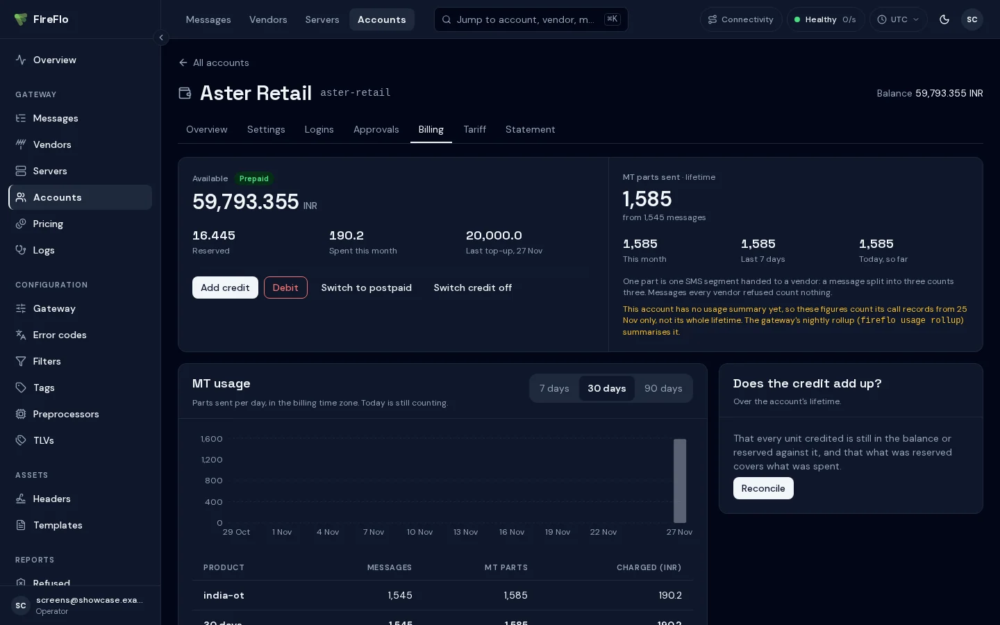
</Frame>

<Warning>
**Ajouter du crédit ne peut pas être annulé depuis le panneau.** Un rechargement n'est jamais modifié
ni annulé. Un rechargement erroné se reprend avec [**Debit**](#reprendre-du-crédit), qui écrit une
entrée distincte qui lui est propre.

Le formulaire vous demande de confirmer le montant et la référence avant d'écrire. Lisez la
confirmation plutôt que de cliquer au travers. C'est le dernier point auquel le nombre vous
appartient encore.
</Warning>

<Note>
**Un compte à unités n'a pas d'argent à afficher.** À partir de 0.16.0, un compte qui détient des
unités de message au lieu d'argent affiche les unités restantes et utilisées par produit, le compte
auquel il est facturé et son grand livre d'unités, et ne propose ni rechargement, ni débit, ni bascule
prépayé/postpayé. Voir [Comptes à unités](/platform/billing/units-accounts).
</Note>

## Ce que détient le compte

Les comptes prépayés affichent **Available**. Les comptes postpayés affichent une **Credit
limit** — ce qu'ils peuvent accumuler avant que le gateway ne les refuse, ce qui est le même refus
qu'un compte prépayé obtient quand il s'épuise. Les deux ne portent jamais le même nom.

<Note>
**Reserved n'est pas un blocage qui rétrécit à mesure que les messages sortent.** C'est du crédit
qui a été déplacé hors du solde, et il ne fait toujours que grossir jusqu'à ce qu'il soit
restitué.

Le voir grimper sur un compte actif est correct. Le voir stagner sur un compte inactif signifie
que du crédit a été bloqué par un arrêt non propre, et il est restitué en libérant le crédit
retenu. Rien n'est perdu dans les deux cas, parce que balance plus reserved plus spent est conservé.
</Note>

Une ligne de solde manquante se lit comme **No balance row — not zero, absent**, ce qui est un
état différent et plus conséquent : un rechargement contre un compte sans ligne est laissé
pending plutôt que crédité. **Open for credit** crée la ligne à zéro.

La devise n'est pas demandée. Il y a une devise par plateforme, prise depuis le gateway, et
FireFlo ne convertit jamais. Un solde en toute autre chose ne pourrait jamais être dépensé face
à un prix. Le champ n'apparaît que lorsque le panneau ne peut pas du tout lire la devise de la
plateforme.

## Ajouter du crédit

Trois champs : **Amount**, **Reference**, et une **Note** optionnelle.

<Frame caption="Add credit. La ligne sous les champs est la promesse honnête : le gateway applique le rechargement à son prochain sondage, donc le solde au-dessus ne bouge pas tout de suite.">
  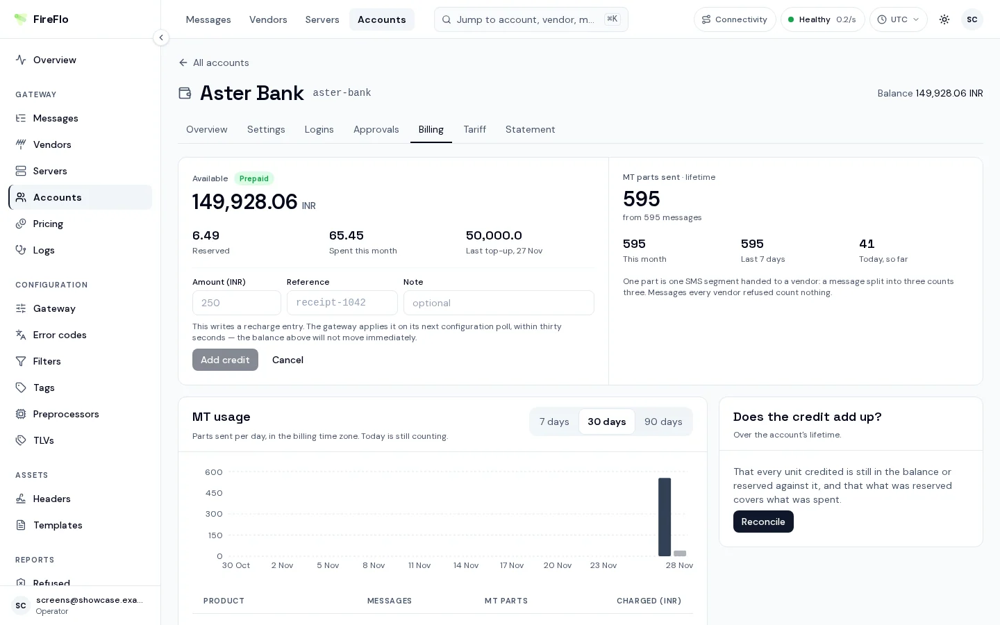
  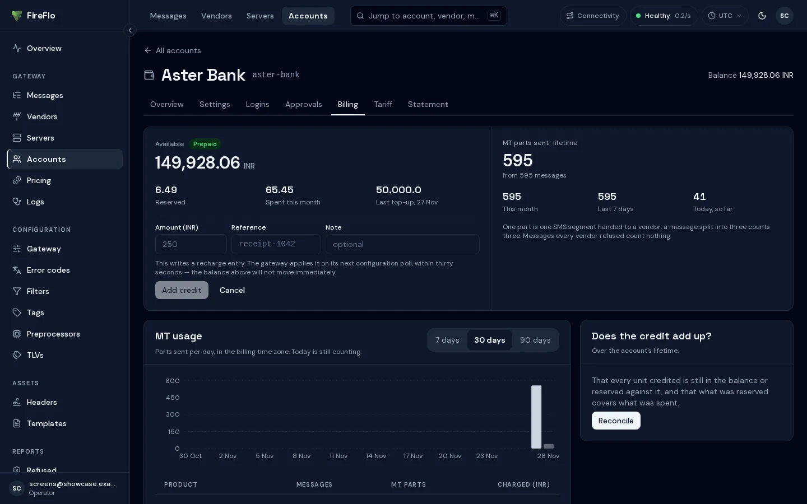
</Frame>

Une fois qu'un montant valide est tapé, le formulaire renvoie exactement ce qui sera stocké, parce
que l'argent est tenu à quatre décimales et un décimal mal placé est l'erreur coûteuse ici.

<Warning>
**La référence est le garde-fou anti-rejeu, pas un mémo.** Un id de reçu ou de transaction est
ce qui empêche le même paiement d'être crédité deux fois, et la base ne peut appliquer cela que
lorsque c'est défini.

C'est requis pour exactement cette raison. N'y mettez pas de description. Mettez la chose qui
identifie uniquement le paiement.
</Warning>

Confirmer se fait en deux étapes à dessein. Appuyer sur Entrée dans un champ ne fait rien, et le
bouton s'arme en une confirmation nommant le montant, la devise et la référence avant qu'il
n'écrive.

Après qu'il sauvegarde, **le solde ne bouge pas immédiatement**. Le panneau écrit une entrée de
rechargement et le gateway l'applique lors de son prochain sondage de configuration, dans environ
trente secondes. Un solde qui n'a pas encore changé n'est pas un échec.

## Reprendre du crédit

**Debit** retire du crédit prépayé du compte — un rechargement fait par erreur, par exemple. Il n'est
proposé que sur les comptes prépayés ; un compte postpayé est facturé, pas débité. Trois champs, tous
requis :

- **Amount** — retiré du solde immédiatement. Le crédit détenu par les gateways en marche est libéré
  d'abord et compte. Un montant supérieur au solde est refusé.
- **Reference** — votre propre identifiant pour ce débit. Le réutiliser répond « duplicate » et ne
  débite rien.
- **Reason** — affichée dans l'historique du compte et le journal d'audit, et à une plateforme qui
  gère le compte.

<Frame caption="Debit. Review montre le solde avant et après ; rien n'est retiré tant que vous n'y avez pas pressé Debit.">
  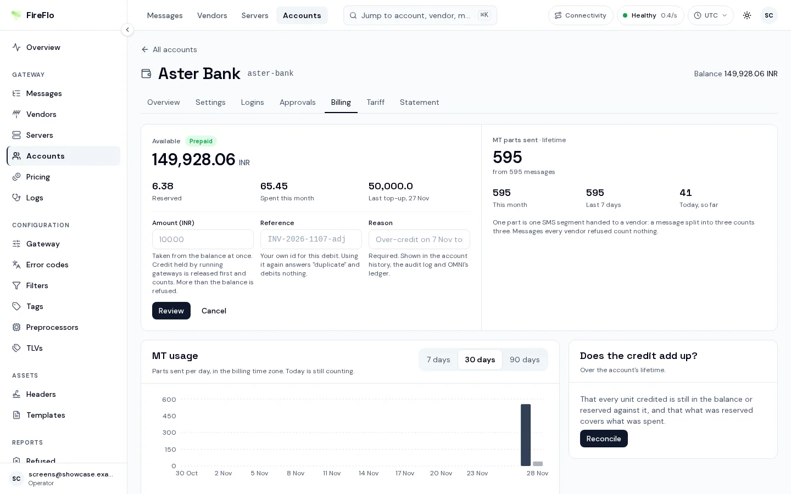
  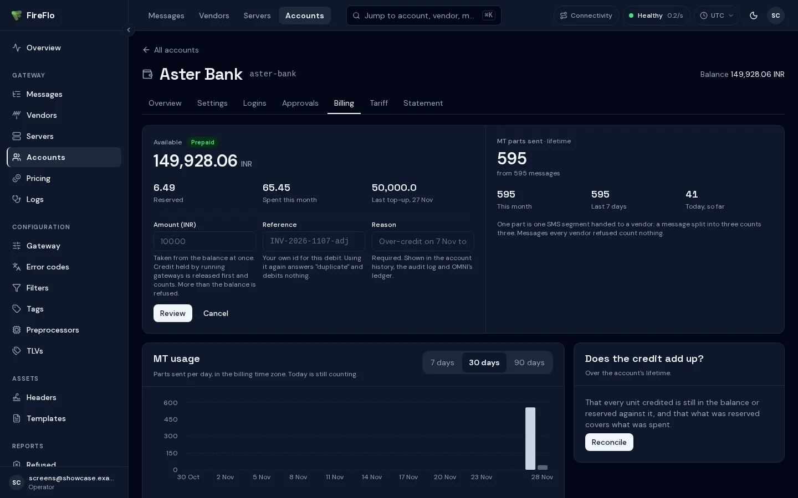
</Frame>

**Review** montre ce qui sera retiré et le solde qui restera. Un débit ne peut pas non plus être annulé
depuis le panneau : un débit erroné se corrige par un rechargement.

## Basculer entre prépayé et postpayé

**Switch to postpaid** ouvre les conditions de facturation : **Prepaid — spends a balance** ou
**Postpaid — billed in arrears**, et pour le postpayé une **Credit limit**. Sur un compte postpayé, le
même bouton s'intitule **Change limit or go prepaid**. Le formulaire avertit avant de sauvegarder dans
les deux sens :

<Frame caption="Les conditions de facturation d'un compte, ouvertes. Un compte postpayé a besoin d'une limite de crédit ; zéro signifie pas de crédit, pas illimité.">
  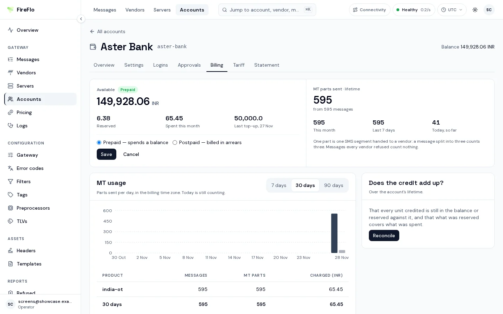
  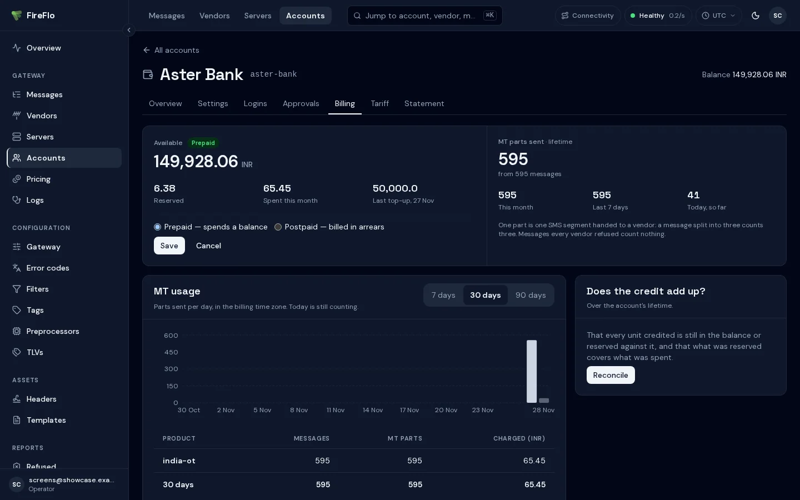
</Frame>

- **Vers postpayé** — le compte cesse de dépenser son solde. Tout ce qui est déjà réservé reste
  réservé jusqu'à ce qu'il soit libéré.
- **Vers prépayé** — la limite est effacée et le compte dépense à nouveau son solde. L'usage
  depuis la dernière facture est toujours dû.

<Warning>
**Une limite de crédit postpayée de zéro n'est pas illimitée — c'est pas de crédit**, et le
compte serait incapable d'envoyer quoi que ce soit. Le formulaire le refuse plutôt que d'accepter
un paramètre qui arrête silencieusement un client.
</Warning>

**Switch credit off** laisse un compte envoyer jusqu'à ce que le bloc qu'il détient déjà
s'épuise, puis arrête. Ce n'est pas instantané.

## Le crédit s'additionne-t-il ?

Deux identités sur toute la vie du compte : chaque unité créditée est toujours dans le solde ou
réservée contre lui, et ce qui a été réservé couvre ce qui a été dépensé.

Cela ne tourne pas tout seul — appuyez sur **Reconcile**. Deux chiffres reviennent.
**Unexplained** est le résidu, et celui sur lequel il vaut la peine d'agir. **Reserved, not yet
spent** est normal sur un compte qui envoie.

<Frame caption="Après Reconcile : rien d'inexpliqué, un peu de réservé pas encore dépensé, et une note en langage clair sur chaque chose qui vaut la peine d'être sue.">
  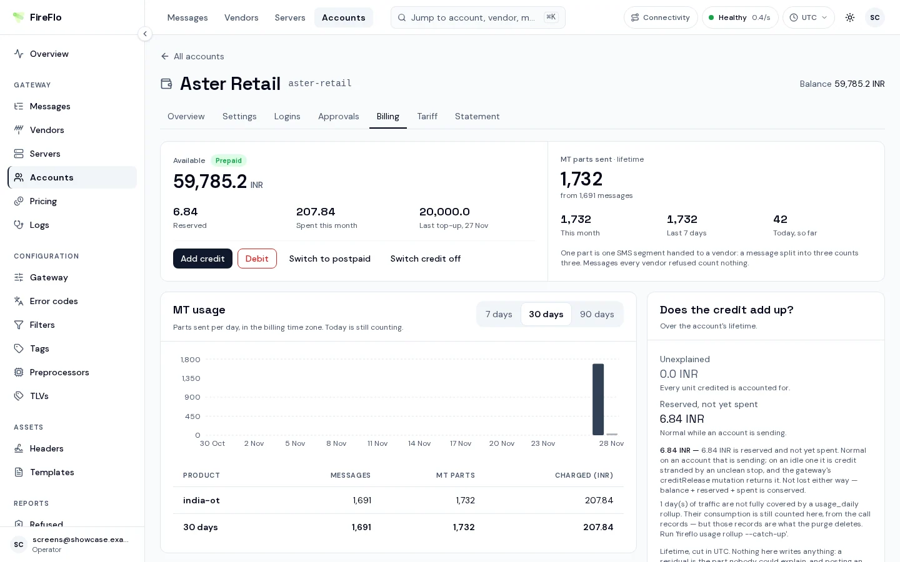
  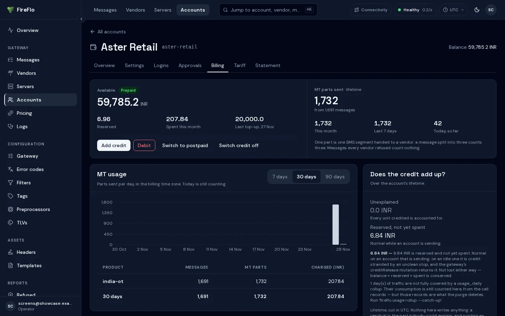
</Frame>

En-dessous, un récit en langage clair de tout ce qui ne s'est pas équilibré. Les distinctions qui
comptent :

| Verdict | Signifie |
| :--- | :--- |
| **Pending credit** | Rechargements que le gateway n'a pas encore appliqués. Pas un problème — attendez un sondage |
| **Credit lost** | Crédité, et ni dans balance, ni dans reserved, ni dans spent |
| **Credit minted** | Détenu, sans rechargement ni transfert pour l'expliquer — la direction la plus sérieuse |
| **Charged without reserving** | La consommation est réelle, la réservation ne l'est pas |
| **Held unspent** | Bloqué par un arrêt non propre. Libéré à la main, pas perdu |
| **Missing rollup** | Jours sans rollup d'usage — encore comptés ici, mais depuis des enregistrements que la purge supprime |
| **Unrated** | Messages envoyés sans prix. Sur postpayé, du revenu que personne n'a facturé |

<Note>
**Il n'y a pas de bouton « corriger », délibérément.** La réconciliation n'écrit jamais d'entrée
d'ajustement.

Un résidu est la partie que personne n'a pu expliquer, et poster un ajustement pour cela
équilibrerait les livres en cachant la cause. C'est aussi toujours sur la vie du compte, jamais
une période — une identité qui tient sur un mois mais pas sur la vie du compte n'a pas tenu.
</Note>

## Argent entrant et sortant

Chaque rechargement, transfert et débit, cherchable par référence, note ou type, triable et paginé.
Le gateway applique un rechargement ou un transfert à son prochain sondage, et un débit immédiatement.

<Frame caption="Argent entrant et sortant. Chaque rechargement avec son montant, sa référence et son état ; Applied signifie que le gateway l'a crédité.">
  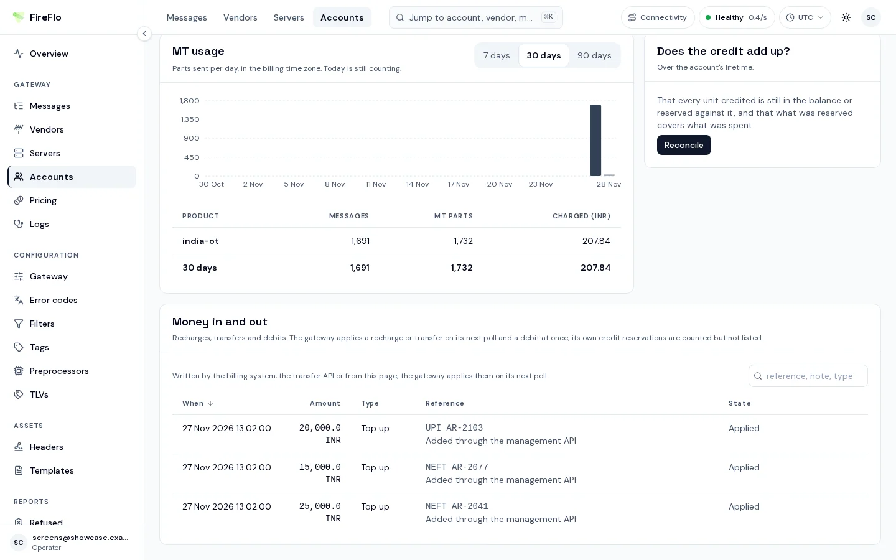
  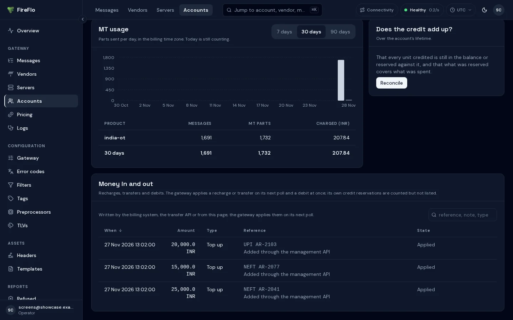
</Frame>

Par défaut le grand livre ne liste que les entrées écrites par une personne ou le système de
facturation. Les réservations de crédit propres au gateway sont cachées et comptées à la place —
environ une toutes les vingt messages, chacune déplaçant du crédit entre deux colonnes d'une
même ligne et se compensant à zéro. **Show them** révèle l'ensemble.

La colonne **State** porte la partie que les gens ratent : **Pending** signifie que le gateway ne
l'a pas encore appliquée. Là où un compte n'a pas de ligne de solde, une entrée positive dit soit
qu'elle attend la ligne et se créditera au moment où elle existera, soit qu'elle a été appliquée
avant que la ligne ne disparaisse et rien ne peut désormais dire ce qu'elle a crédité.

## En lien

<CardGroup cols={2}>
  <Card title="Comment fonctionne le crédit prépayé" icon="wallet" href="/platform/billing/prepaid-credit">
    Blocs, réservations et ce que fait le gateway quand le crédit s'épuise.
  </Card>
  <Card title="Comptes postpayés" icon="file-invoice" href="/platform/billing/postpaid">
    Facturation à terme échu face à une limite.
  </Card>
</CardGroup>
