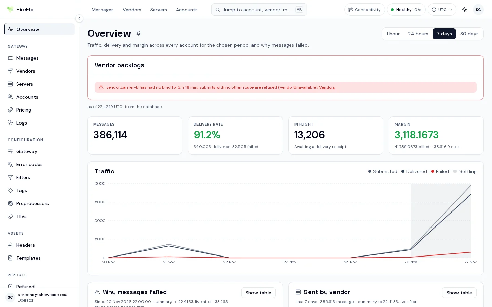
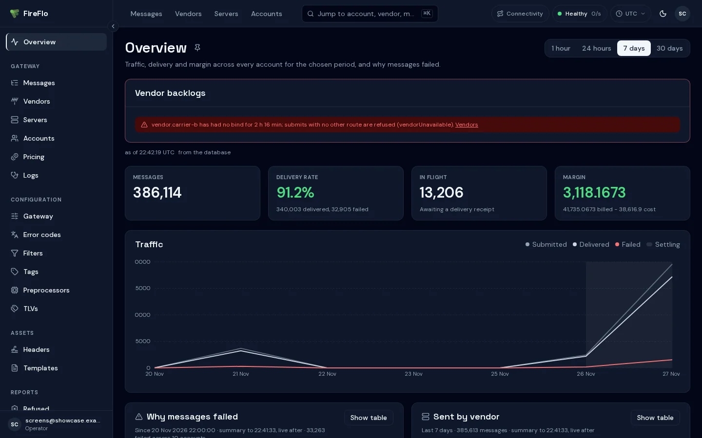

L'écran Overview répond à une question : **la plateforme transporte-t-elle ce qu'elle devrait, et
cela atterrit-il ?** Ce n'est délibérément pas un écran de santé. Savoir si le logiciel a la
mémoire et les connexions pour continuer à fonctionner est une question différente, posée sur
[Runtime](/platform/control-panel/runtime-metrics), et les deux sont séparées parce qu'un opérateur
scrutant un problème de livraison ne veut pas lire sur la taille du tas.

Tout sur la page obéit à un contrôle de plage — **1 heure**, **24 heures**, **7 jours** ou
**30 jours**. La page s'ouvre sur la dernière heure, puis ensuite sur la plage que vous avez choisie
en dernier dans ce navigateur. Elle demande des chiffres frais toutes les trente secondes, et cesse
de demander pendant que l'onglet du navigateur est en arrière-plan.

<Frame caption="L'Overview sur 7 jours. Un avertissement vendor se place au-dessus des chiffres seulement tant que quelque chose ne va pas ; la fin ombrée du graphique est encore en train de se stabiliser.">
  
  
</Frame>

**Vendor backlogs** apparaît au-dessus des chiffres quand un vendor a dépassé sa limite de backlog,
n'a pas eu de bind depuis plus longtemps que son délai de grâce, ou a un message en attente arrivé à
mi-chemin de la rétention de son topic. Chaque ligne indique où va le trafic de ce vendor à la place,
ou que les submits sans autre route sont refusés. Sur une plateforme en bonne santé, la carte n'est
pas là du tout.

## Quand les chiffres ont été lus

À partir de 0.12.16, les chiffres sont un **instantané que le panneau construit en arrière-plan**, pas
une requête lancée pour votre onglet. Une ligne au-dessus des chiffres dit quand : **as of 10:42:17
UTC** signifie que le panneau a lu la base de données pour la dernière fois à cette seconde, dans le
fuseau horaire choisi dans l'en-tête. À côté, **from the database** ou **live from the gateway** dit
d'où les chiffres ont été lus. Ouvrez la page dans trois onglets, ou laissez trois opérateurs
l'ouvrir, et la base fait le même travail que pour un seul.

L'instantané est reconstruit une fois par minute. L'essentiel de la reconstruction d'une minute est
léger : les trois dernières heures et l'heure courante sont relues, ainsi qu'aujourd'hui ; tout ce
qui est plus ancien est conservé depuis une reconstruction complète, qui a lieu toutes les quinze
minutes. La répartition des échecs est relue toutes les cinq minutes. Un message soumis à l'instant
apparaît donc en moins d'une minute, et un accusé qui change l'issue d'un message d'il y a six heures
est pris en compte en moins d'un quart d'heure. Sur un gateway qui tient le résumé d'usage horaire
(0.12.16, voir plus bas), toute la vue 24 heures est relue chaque minute, parce que là c'est peu
coûteux.

Deux mots peuvent apparaître à côté de l'heure :

- **stale** — la dernière lecture de la section nommée a échoué (la base était injoignable, ou une
  requête a expiré) et ce que vous voyez est la lecture d'avant. L'heure continue d'avancer, parce
  qu'elle indique quand le panneau a *essayé* pour la dernière fois. Un badge stale qui persiste est
  un problème de base de données, pas de trafic.
- **Settling** — dans la légende du graphique de trafic, avec la partie la plus récente du graphique
  ombrée. Les messages des heures ou jours ombrés peuvent encore recevoir un accusé, donc leurs
  comptes delivered et failed ne sont pas définitifs. L'ombrage couvre l'échéance d'accusé du gateway
  (`smsg.cdr.deadline.hours`, 48 heures par défaut) ; sur la vue 24 heures, c'est donc tout le
  graphique, ce qui est la vérité : rien sur cette vue n'est encore stabilisé.

La première requête après le démarrage du panneau n'a rien à servir et construit l'instantané pendant
que vous attendez ; si cela prend plus de huit secondes, la page dit qu'elle est en train de chauffer
et redemande à son prochain sondage.

La cadence est un réglage du panneau, `OVERVIEW_REFRESH_SECONDS` dans l'environnement du panneau :
60 par défaut, jamais en dessous de 15, et `0` désactive l'instantané et construit les chiffres à
chaque requête — ce qu'utilise le banc de tests automatisés, et pas un réglage pour une plateforme
chargée.

### D'où viennent les chiffres

Les vues 7 et 30 jours sont construites à partir du **résumé d'usage quotidien** du gateway pour
chaque jour entier qu'il a résumé, avec seulement aujourd'hui lu depuis les enregistrements d'appels
— voir [Usage et rétention](/platform/billing/usage-and-retention). À partir de 0.12.16, le gateway
tient aussi un **résumé d'usage horaire**, mis à jour chaque minute au fil du trafic, et un panneau
sur un tel gateway lit la vue 24 heures et la partie d'aujourd'hui des vues plus longues depuis ce
résumé plutôt que depuis les enregistrements : 24 petites lignes plus la dernière minute ou deux de
trafic, quel que soit le volume. Les deux résumés sont le travail du gateway, activés par défaut et
réglés sur la page des paramètres du gateway sous **Usage summaries** ; le quotidien est désormais
écrit par le gateway lui-même chaque nuit plutôt que par une commande que quelqu'un doit lancer.

Trois conséquences à connaître. Sur un jour résumé, **In flight** affiche zéro, parce que le résumé
quotidien n'enregistre pas ce qui était encore en attente ; le chiffre d'aujourd'hui est le chiffre en
direct. Un message que le gateway a réessayé à cheval sur une limite de minute peut être compté deux
fois dans le résumé horaire jusqu'à ce que le recomptage par quart d'heure des heures récentes le
corrige — les retries sont une petite fraction du trafic et le recomptage fait foi. Et un gateway
sans aucun des deux résumés lit tout en direct et ralentit à mesure que la plage s'allonge, comme
avant.

## Les quatre chiffres

| Carte | Ce qu'elle compte |
| :--- | :--- |
| **Messages** | Tout ce qui a été soumis sur la période |
| **Delivery rate** | Livré contre échoué, avec les deux comptes en-dessous |
| **In flight** | Soumis, pas encore d'accusé |
| **Margin** | Facturé moins coût vendor, en rouge si négatif |

<Note>
**Une carte blanche est encore en chargement, pas à zéro.** Les cartes affichent un
placeholder jusqu'à ce que le chiffre arrive, puis affichent soit le nombre, soit l'erreur. Elles
n'inventeront jamais un `0` pour combler la lacune, parce que « pas de trafic » et « nous n'avons
pas pu demander » sont des réponses différentes et une seule est votre problème.
</Note>

**In flight n'est pas un backlog.** C'est du trafic qui a été envoyé et facturé et qui n'a
simplement pas encore été rapporté. Un message qui n'obtient jamais d'accusé est clos à son
échéance d'expiration ; jusque-là il siège ici, et sur une plateforme active il y sera toujours.

## Trafic

Trois séries — submitted, delivered, failed — sur la plage choisie. Sans rien dans la fenêtre, le
graphique est remplacé par **No traffic in this period**, ce qui est une déclaration sur la plage
que vous avez choisie autant que sur la plateforme. Les heures de la vue 24 heures sont des heures
d'horloge en UTC ; les jours des vues plus longues sont des jours de facturation, découpés dans le
fuseau de facturation de la plateforme. La partie ombrée du graphique est encore en train de se
stabiliser (voir plus haut).

## Pourquoi les messages ont échoué

Deux cartes se tiennent côte à côte sous le graphique. **Why messages failed** dessine les échecs de
la période en anneaux : compte, puis vendor, issue, code d'erreur et code propre à l'opérateur.
**Sent by vendor** dessine de la même façon ce que chaque vendor a transporté : vendor, puis compte,
issue et code d'erreur. Choisissez un anneau pour zoomer dessus ; le centre nomme ce qui est sous le
pointeur, avec son compte et sa part.

**Show table** sur l'une ou l'autre carte liste les mêmes chiffres en lignes. Sur **Why messages
failed**, il ouvre aussi la liste des types d'échec, chaque résultat qui n'était pas une livraison,
chacun nommé en langage clair plutôt que par son code d'accusé :

- Failed at the vendor
- Rejected on submission
- Dropped before sending
- No receipt within the deadline

À côté de chaque nom, en petites lettres, siège l'état numérique de l'accusé et le code d'erreur
propre au vendor. Cela ressemble à de la duplication et ne l'est pas. `EXPIRED`, `REJECTD` et
`UNDELIV` se facturent tous de façon identique et signifient des choses entièrement différentes,
et lorsque vous allez chez un vendor pour poser une question sur un pic, **le nombre est ce sur
quoi leur documentation est indexée**. Le nom est pour vous ; le nombre est pour eux.

### Écarter un échec

Chaque ligne peut être écartée, ce qui la cache de la liste sans rien supprimer. Un pied de page
compte ce que vous avez caché et peut le remontrer.

<Tip>
**Un échec écarté revient tout seul la prochaine fois qu'il se produit.** Écarter cache ce dont
vous avez déjà traité, pas ce qui recommence.
</Tip>

Les écartements vivent dans le navigateur où vous les avez faits. Un autre opérateur, ou le même
opérateur sur une autre machine, voit la liste complète — ce qui est délibéré, puisque le triage
d'une personne n'est pas une déclaration factuelle à l'échelle de la plateforme.

Cette distinction apparaît dans les deux états vides. **No failures in this period** signifie que
rien n'a échoué. **Every failure in this period has been dismissed** signifie que quelque chose a
échoué, et vous avez choisi de ne pas le regarder. L'écran ne rapportera pas une période propre
sur la force de votre propre classement.

## Santé du gateway

Un ruban de six tuiles en pied de page — mémoire, processeur, tâches en cours, requêtes API,
tâches internes, uptime — chacune avec un sparkline, et un lien vers le détail. C'est un coup
d'œil, pas une enquête.

<Warning>
**« Internal tasks » n'est pas les connexions vendor.** C'est le travail de fond propre au
gateway : écritures en base, traitement des accusés. Partout ailleurs dans le panneau, un
*worker* désigne une connexion SMPP, donc cette tuile évite le mot entièrement. La lire comme un
vendor bloqué vous envoie chercher un problème d'opérateur qui n'existe pas.
</Warning>

La tuile **API requests** rapporte une moyenne depuis que le processus a démarré. Elle répond à
« cet endpoint est-il lent en général » et ne peut pas répondre à « était-il lent il y a cinq
minutes ».

Si un rafraîchissement échoue tandis que des chiffres plus anciens sont toujours à l'écran, une
note en pied dit que le sondage a échoué et les chiffres restent en place. L'écran préfère une
lecture périmée dont on vous informe à une lecture blanche dont on ne vous informe pas.
