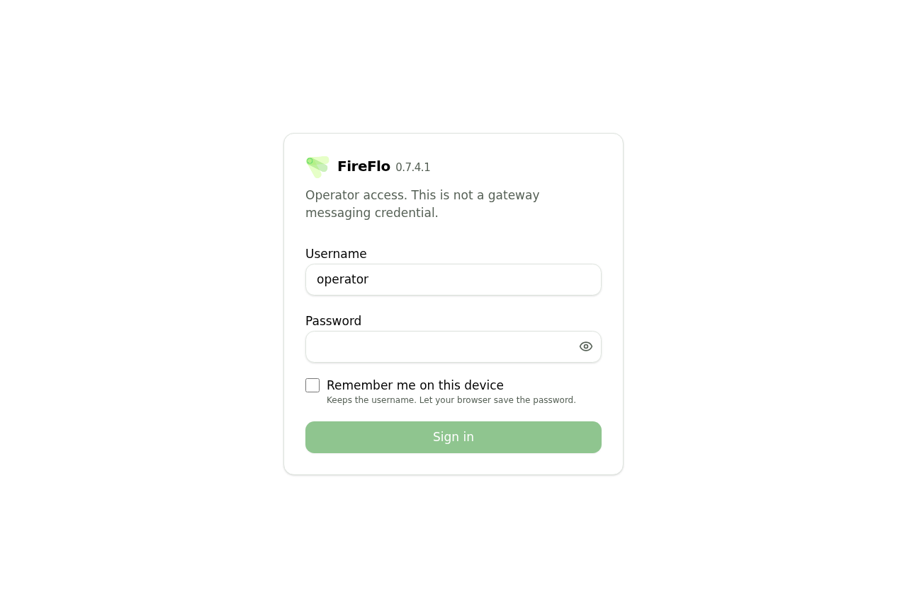

Le panneau de contrôle est la moitié opérateur de FireFlo. Vos clients ne le voient jamais — ils
obtiennent [le portail](/developers/portal/signing-in), qui leur montre leur propre trafic et rien
du vôtre.

Rien ici n'est requis pour faire tourner le gateway. Le gateway lit sa configuration depuis une
base de données ou depuis des fichiers et continuerait à porter le trafic si le panneau était
entièrement éteint. Ce que le panneau vous donne est un moyen de changer cette configuration sans
édition à la main, et un moyen de voir ce qui s'est passé sans écrire de SQL.

## La barre latérale

<AccordionGroup>

<Accordion title="Overview — le premier écran">
Trafic, livraison et échecs sur tout le gateway, sur 1 heure, 24 heures, 7 jours ou 30 jours.
Commencez ici lors d'un incident ; c'est le seul écran qui répond à « quelque chose ne va-t-il pas » sans que
vous ayez à nommer la chose que vous soupçonnez.

Voir [le tableau de bord](/platform/control-panel/dashboard).
</Accordion>

<Accordion title="Gateway — les choses qui portent le trafic">
| Entrée de menu | Pour |
| :--- | :--- |
| **Messages** | Chaque message, cherchable, avec une vue détail par message |
| **Vendors** | Connexions sortantes — de qui vous achetez |
| **Servers** | Listeners entrants — comment les clients se connectent à vous |
| **Accounts** | Vos clients, et tout ce qui y est rattaché |
| **Pricing** | Tarifs, à la fois ce que vous facturez et ce qui vous est facturé |
| **Logs** | Logs et configuration lus depuis la machine du gateway — voir [Diagnostics](/platform/control-panel/diagnostics) |

**Vendor** et **server** sont les deux moitiés de la même idée, et les confondre est l'erreur
initiale la plus courante — voir [connexions](/platform/connections/vendors).
</Accordion>

<Accordion title="Configuration — règles que le gateway applique">
**Gateway** contient les paramètres dont hérite chaque vendor et chaque listener, sauf s'il définit
les siens. **Error codes** fait correspondre les codes d'accusé de chaque vendor à ceux que reçoivent
vos clients. **Filters** sont des conditions réutilisables sur lesquelles les règles de routage et les
tarifs s'appuient ; **Tags** sont ce qu'un filtre, une règle de routage ou un prix peut tester sur un
compte ; **Preprocessors** sont des programmes auxquels une règle de routage peut confier des messages.
**TLVs** est le catalogue des paramètres optionnels SMPP, y compris ceux que vos clients ont proposés
et que vous n'avez pas encore approuvés.
</Accordion>

<Accordion title="Assets — ce que les clients peuvent envoyer">
**Headers** sont les sender IDs ; **Templates** sont les formulations approuvées. Les deux sont
le côté opérateur de ce que les clients demandent dans leur portail, et les deux ne sont
appliqués que là où vous avez activé l'application.
</Accordion>

<Accordion title="Reports — ce qui est arrivé, et ce que cela valait">
| Entrée de menu | Répond |
| :--- | :--- |
| **Refused** | Ce qui a été refoulé avant de devenir du trafic |
| **Access log** | Qui s'est connecté au portail ou au panneau, qui a été refusé, et ce qu'ils ont modifié |
| **Security** | Binds et connexions refusés par adresse, qui est bloqué, et Force disconnect |
| **Queues** | Ce qui attend en ce moment, et nettoyer ce qui ne partira jamais |
| **Archives** | Où vivent les enregistrements d'appels, et ce qu'un nettoyage de files a archivé, avec chaque exécution |
| **Receipts** | À quel point chaque vendor rapporte bien les résultats |
| **Usage** | Volume et livraison, par compte |
| **Revenue** | Facturé, coût et marge |
</Accordion>

</AccordionGroup>

## Les écrans sans entrée de menu

Huit écrans existent que la barre latérale ne liste jamais. Ils sont atteints depuis d'autres
écrans, ce qui va bien une fois que vous savez et est déroutant jusqu'à ce que vous sachiez.

| Écran | Atteint depuis | Ce que c'est |
| :--- | :--- | :--- |
| **Live health** | La pastille de santé dans l'en-tête : un point, un mot comme **Healthy**, et le débit sortant | Binds, profondeur de file et accusés en vol, maintenant |
| **Connectivity** | **Connectivity**, à côté de la pastille de santé | Une carte en direct de qui est connecté, par quel port, vers quel vendor |
| **Kafka** | **Open Kafka topics** sur la carte Kafka backbone de la page Queues | Chaque topic du broker, son groupe de consommateurs, son lag et sa rétention |
| **Runtime** | « Runtime detail » sur le ruban santé de l'Overview | Mémoire, processeur et capacité de connexions |
| **Routing** | L'écran Vendors | Tables de routage, règles et groupes de vendors |
| **Products** | L'écran Servers | Le catalogue de products : chaque product, un résumé de ses tarifs, et les logins qui le sélectionnent. Ses prix s'ouvrent sur **Pricing**, restreint à ce product |
| **Message detail** | Toute ligne sur Messages | Un message de bout en bout, y compris ses TLV |
| **Sign-in** | Se déconnecter, ou une session expirée | Le formulaire de connexion opérateur |

<Note>
**Runtime et Live health répondent à des questions différentes et sont faciles à confondre.**
Live health est *ce qui est vrai en ce moment* — quels vendors sont bindés, la profondeur des
files. Runtime est *si le logiciel a la place de continuer à fonctionner* — mémoire, processeur,
descripteurs de fichiers. Un gateway peut être parfaitement en bonne santé sur l'un et en
difficulté sur l'autre.
</Note>

## À l'intérieur d'un compte

Ouvrir un compte vous donne sept onglets, et ce sont réellement des sujets différents plutôt que
des sections d'une seule page :

| Onglet | Contient |
| :--- | :--- |
| **Overview** | Trafic et livraison pour ce client seul |
| **Settings** | Qui il est, s'il est listé, et où il se situe dans un arbre revendeur |
| **Logins** | Ses credentials SMPP et HTTP |
| **Approvals** | Sender IDs et templates qu'il a demandés |
| **Billing** | Crédit, le grand livre, et la réconciliation |
| **Tariff** | Ce que ce client se voit facturer |
| **Statement** | Ce qu'il doit pour une période |

L'en-tête au-dessus des onglets montre soit **Balance** soit **Limit**, jamais les deux. Les
comptes prépayés détiennent un solde, les comptes postpayés ont une limite de crédit, et lire
l'un comme l'autre est la mauvaise lecture qui coûte de l'argent.

<Warning>
**L'onglet Billing est le seul endroit dans FireFlo où du crédit est créé, et un rechargement ne
peut pas être annulé.** Lisez [l'onglet Billing](/platform/control-panel/accounts-billing) avant
de l'utiliser.
</Warning>

## Se connecter

<Frame caption="Connexion opérateur. La version à côté du wordmark est celle du panneau, et ses trois premiers nombres sont la release du gateway avec laquelle elle est appariée.">
  
</Frame>

Les opérateurs et les admins sont des utilisateurs détenus dans la base de données du gateway ; un
admin les ajoute et les réinitialise depuis la page **Users**, et le premier est créé sur le gateway
avec `fireflo user add`. Voir [Installer le panneau de contrôle](/platform/install/control-panel).

Les sessions sont par navigateur. Se connecter sur un ordinateur portable ne vous connecte pas
sur un téléphone, et se déconnecter met fin seulement à la session que vous utilisez. Changer votre
mot de passe est l'exception, à partir de 0.12.15 : le navigateur dans lequel vous l'avez changé reste
connecté et tous les autres sont déconnectés à leur prochaine requête.
