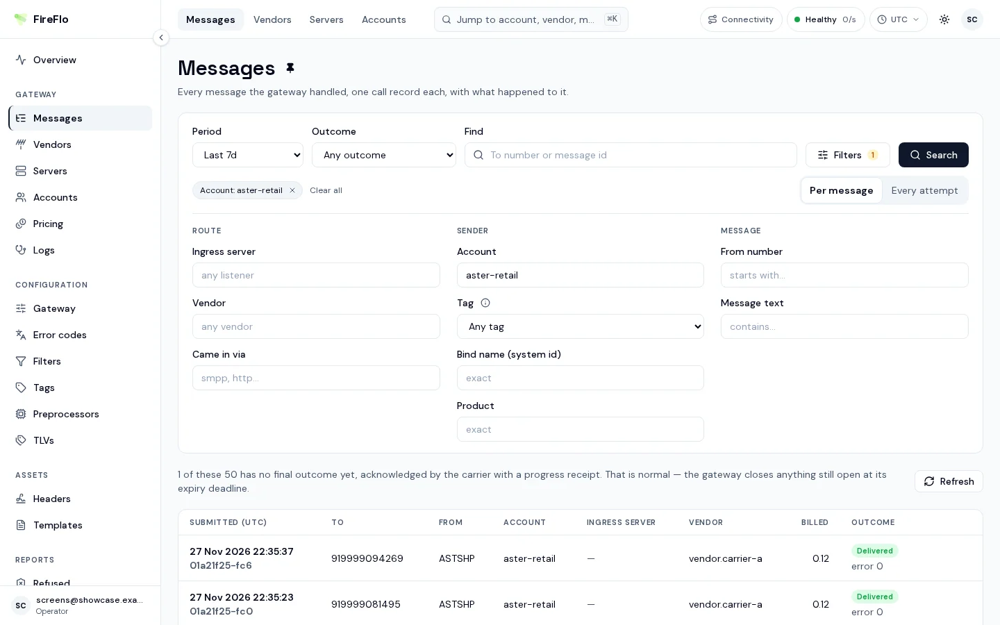
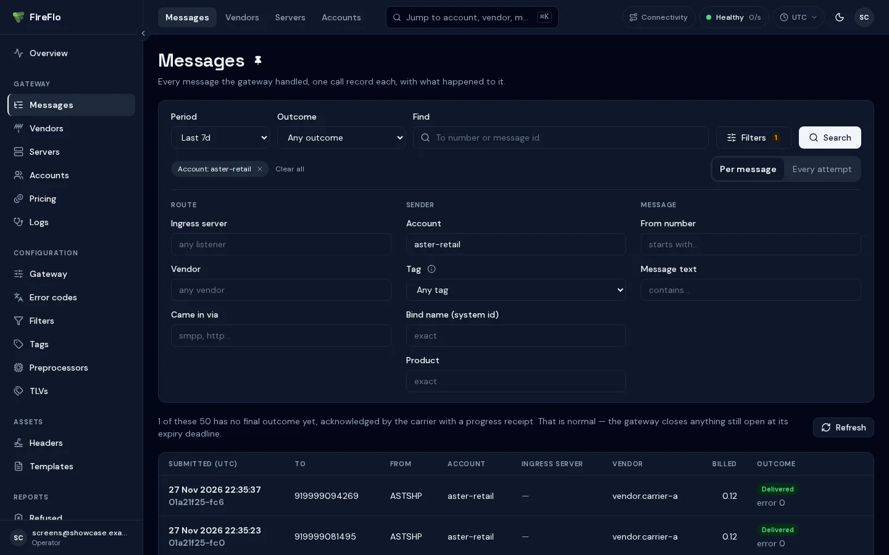
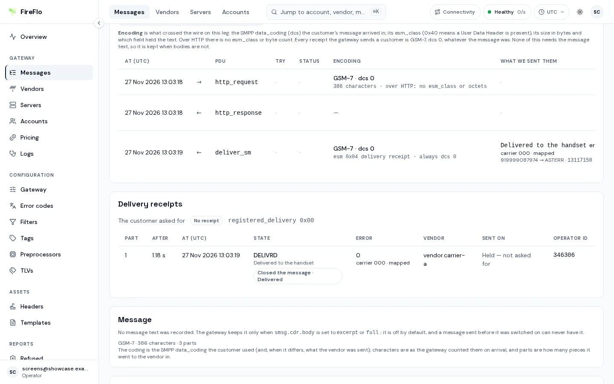
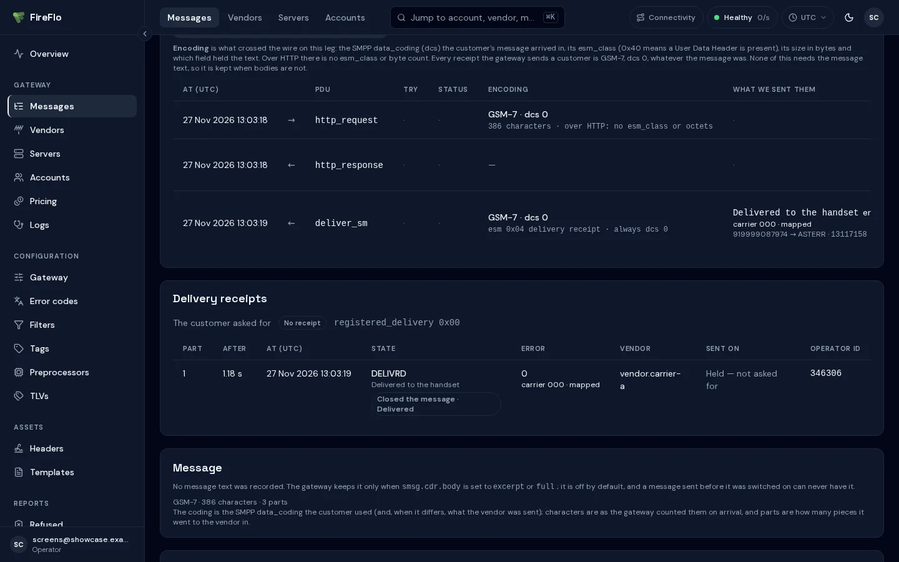

L'écran que vous ouvrirez le plus. Chaque message, cherchable, avec une vue détail qui reconstruit
un message de bout en bout.

## En trouver un

Les filtres s'appliquent quand vous appuyez sur **Search**, pas à la frappe, et ils voyagent dans
la barre d'adresse — donc une vue filtrée peut être marquée ou collée à un collègue et il verra
ce que vous avez vu.

La ligne toujours visible : **Period** (un préréglage, ou une plage de dates), **Outcome**, et
**Find**, un seul champ qui prend un numéro de destination (correspondance depuis le début) ou un
message id (exact) et les distingue tout seul. **Filters** ouvre le reste en trois groupes, et son
badge compte combien d'entre eux sont définis :

| Groupe | Filtres |
| :--- | :--- |
| **Route** | Ingress server, Vendor, Came in via |
| **Sender** | Account, Tag, Bind name (system id), Product |
| **Message** | From number (starts with), Message text (contains) |

**Tag** (à partir de 0.17.0) trouve les messages des comptes qui portent eux-mêmes cette
[étiquette de compte](/platform/routing/account-tags) maintenant. Un message n'enregistre pas les
étiquettes de son compte, et le filtre demande une période autre que tout l'historique.

Chaque filtre appliqué s'affiche comme une puce sous la barre ; retirez-en un avec sa croix, ou tous
avec **Clear all**.

<Frame caption="Les messages d'un compte sur 7 jours, avec Filters ouvert. La puce du compte sous la barre est le filtre appliqué.">
  
  
</Frame>

**Awaiting a receipt** est listé en premier parmi les résultats plutôt qu'alphabétiquement. Sur un
gateway actif en bonne santé, c'est le plus grand groupe, et c'est ce que les gens cherchent
généralement.

<Note>
**La recherche par texte de message ne trouve rien à moins que le gateway n'enregistre le contenu
du message**, ce qui est désactivé par défaut. Un résultat vide peut signifier que le texte n'est
pas conservé plutôt que rien n'a correspondu. Voir `smsg.cdr.body` dans
[la référence de configuration](/reference/config/paths).
</Note>

### Une ligne par message, ou une par tentative

Le sélecteur **Per message** / **Every attempt** à côté des filtres décide de la granularité, et cela
change ce que les nombres signifient :

| Réglage | Une ligne est |
| :--- | :--- |
| **Per message** *(défaut)* | Ce que le client a envoyé |
| **Every attempt** | Ce que le gateway a fait — une ligne par tentative chez un vendor, y compris retentatives et segments de message long |

Un message long qui s'est découpé en trois, retenté deux fois chez le vendor, est une ligne sur
le premier réglage et plusieurs sur le second. Si un compte semble trop élevé, vérifiez ce
contrôle avant de conclure quoi que ce soit.

## Colonnes

Huit par défaut : submitted, to, from, account, ingress server, vendor, billed, outcome. Le sélecteur regroupe
environ trente autres sous **Message**, **Route**, **Money** et **Outcome** — y compris coût,
marge, les deux règles de tarif, état d'accusé et code d'erreur.

<Warning>
**Une cellule vide et une cellule blanche sont différentes, et la distinction compte sur les
colonnes TLV.**

*Nothing recorded* signifie que le message n'a jamais atteint un vendor, ou est allé vers un
non-SMPP. *Recorded as empty* signifie que le vendor a été interrogé et n'en a porté aucun. Lire
le premier comme le second vous envoie chercher un défaut d'estampillage qui n'a jamais eu lieu.
</Warning>

Les choix de colonnes sont conservés dans votre navigateur. Un lien que vous partagez porte vos
filtres, jamais vos colonnes.

## Exporter

**Export these results** prépare un CSV en arrière-plan, conservé sept jours.

L'export **porte délibérément chaque colonne quel que soit votre choix à l'écran**. Deux personnes
exportant les mêmes filtres doivent obtenir le même fichier, parce que les tableurs adressent les
colonnes par lettre et un choix personnel de colonnes changerait discrètement ce que `H`
signifie.

## Un message, de bout en bout

Ouvrir une ligne reconstruit tout ce qui a été enregistré sur ce message : route, argent, une
chronologie de chaque tentative, chaque accusé de livraison, le texte s'il a été conservé, et
les TLV.

Une ligne de résumé donne parts, tentatives et accusés. Lisez les notes en-dessous — elles
expliquent des résultats qui autrement ressemblent à des défauts :

- **Vous avez demandé un id de segment.** Un long message est envoyé comme plusieurs messages
  SMPP et acquitté une fois chacun, donc le gateway a émis un id par part. Ils trouvent tous cet
  enregistrement.
- **Plus d'un accusé pour la part un.** Autorisé. Toute autre vue montre le plus ancien ; la
  chronologie les montre tous.
- **Seule la part un porte de l'argent.** Les segments ultérieurs sont écrits non tarifés sans
  montants, donc les cellules d'argent blanches à côté d'eux sont correctes plutôt que
  manquantes.

### Ce qu'un accusé a réellement dit

Chaque accusé montre le mnémonique SMPP avec sa signification en anglais simple, puis la partie
dont les gens ont besoin : s'il a **clos le message**, était **un résultat ultérieur, pas celui
qui a été facturé**, ou était **un progrès** qui a laissé le message ouvert.

<Frame caption="Les accusés d'un message long. La ligne au-dessus du tableau dit ce que le client a demandé ; Sent on dit si chaque accusé lui a été transmis.">
  
  
</Frame>

Sous l'erreur, le code propre à l'opérateur est affiché, marqué **mapped** là où vos codes d'erreur
l'ont traduit. **Sent on** affiche **Held — not asked for** quand le client n'a pas demandé d'accusés,
de sorte que rien ne lui a été envoyé.

Là où le gateway a enregistré ce que le client a demandé, cela est affiché à côté. Là où il ne
l'a pas fait, la page le dit explicitement — ce n'est pas la même chose que le client ne
demandant rien.

### L'histoire des TLV

La partie la plus utile de la page, et la raison de venir ici plutôt qu'à la liste des messages.

Une ligne par tag vu à toute étape, avec trois colonnes de valeur — **Received**, **Resolved**,
**Sent** — et un verdict :

| Verdict | Signifie |
| :--- | :--- |
| **Unchanged** | Est arrivé et est sorti tel qu'il est venu |
| **Replaced** | Un défaut de compte, sender ID approuvé ou template a remplacé ce qui a été envoyé |
| **Added** | Non envoyé par le client — ajouté par un défaut, sender ID ou template |
| **Dropped** | Le vendor ne liste pas ce tag comme un qu'il envoie, donc il n'est jamais parti |
| **Vendor default** | Le vendor l'a fourni ; le message ne portait pas de valeur |
| **Vendor overrode** | Le vendor a envoyé quelque chose de différent de ce que portait le message |

**Dropped** et **Vendor overrode** sont les deux qui vous coûtent une livraison, et ce sont les
deux que la page colorise. Là où l'un ou l'autre se produit, cela vous dit où regarder : seuls
les tags sur la liste d'envoi d'un vendor atteignent l'opérateur.

<Note>
Un tiret signifie *non présent à cette étape*. Un point médian signifie *non enregistré* — et là
où le fil est inconnu, **aucun verdict ne prétend quoi que ce soit à son sujet**. C'est l'état
honnête pour un message qui n'a jamais atteint un vendor, est allé vers un vendor non-SMPP, ou
antérieur à l'enregistrement par le gateway.
</Note>

## Ce qui n'est pas ici

Un enregistrement d'appel ne stocke pas de métadonnées de message, pas d'id externe, aucun des
champs définis par l'utilisateur, ni l'expiration ni l'heure de livraison différée. L'état en
vol n'est pas non plus enregistré — seulement le résultat. Ceux-là vivent sur le message pendant
qu'il est traité et disparaissent une fois qu'il l'est.

Si vous avez besoin du corps, il n'est conservé que lorsque le gateway est configuré pour le
conserver.
