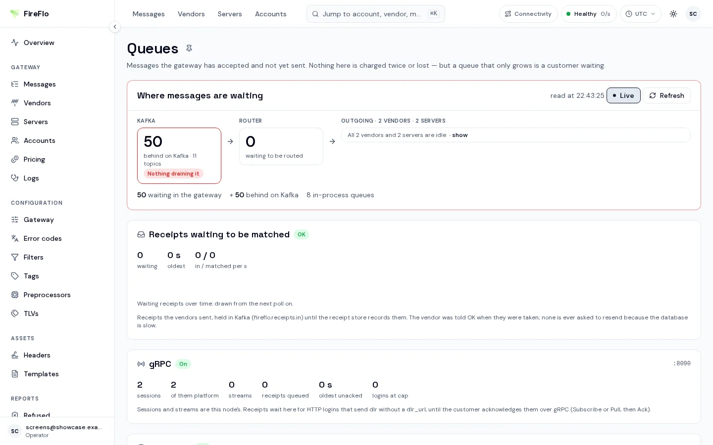
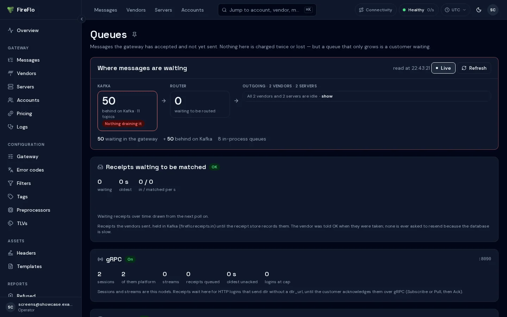
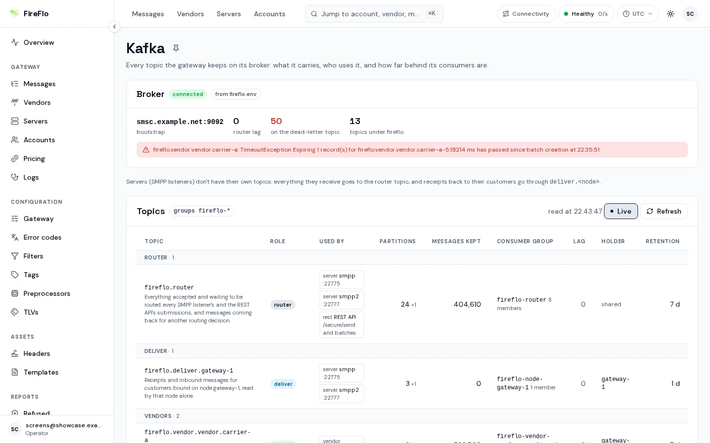
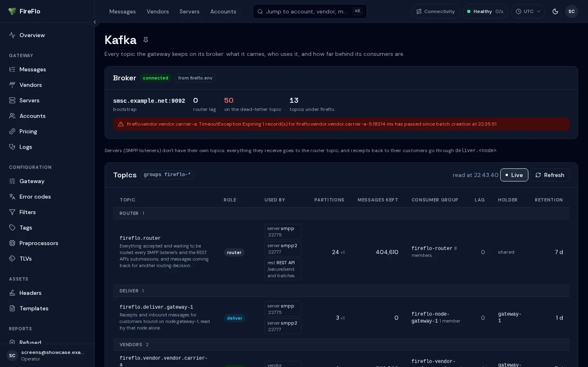
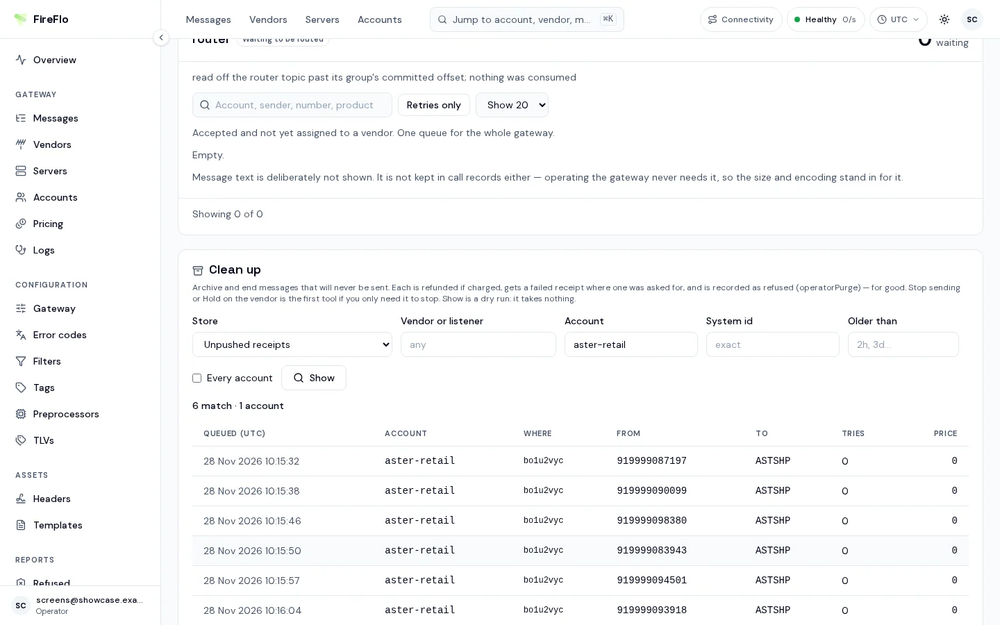
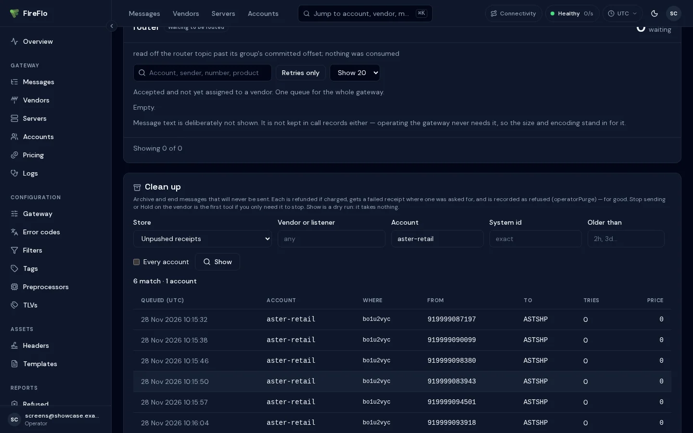

**Messages que le gateway a acceptés et pas encore envoyés. Rien ici n'est débité deux fois ni
perdu — mais une file qui ne fait que grossir est un client qui attend.**

L'écran lit en direct, re-interrogeant toutes les quelques secondes ; **Live** le met en pause,
**Refresh** lit une fois.

## Où les messages attendent

La carte du haut dispose les files selon le chemin que prend un message : **Kafka** (ou **Broker**),
puis **Router**, puis **Outgoing**, une ligne par vendor et par server. Celles qui sont inactives se
replient en une seule ligne que **show** ouvre. Sous le chemin, une ligne totalise ce qui attend dans
le gateway et ce qui est en retard sur le broker. Choisissez n'importe quelle étape pour ouvrir sa
propre carte en dessous.

<Frame caption="Rien n'attend dans le gateway, mais 50 messages sont en retard sur Kafka sans rien pour les drainer, donc le ruban est entouré de rouge.">
  
  
</Frame>

Sous le chemin viennent trois cartes qui ne sont pas des files de messages mais les expliquent :
**Receipts waiting to be matched** (les accusés qu'un vendor a envoyés, retenus jusqu'à ce que le
magasin d'accusés les enregistre ; à partir de 0.15.3), **gRPC** (ses sessions, ses flux et les
accusés qui attendent que les logins viennent les chercher ; à partir de 0.15.9), et **Database** (la
connexion, les writers qui enregistrent les messages, et la latence qui admet ou refuse les nouveaux
submits ; à partir de 0.15.1). **Slow queries** s'ouvre depuis la carte Database.

## Le broker et le routeur sont des files différentes

<Warning>
**Un backlog sur le broker de messages apparaît comme une file de routeur *plate*.**

Une fois que la file in-process passe son highwater, le consommateur cesse de tirer, donc la file
du routeur cesse de grossir et paraît calme — pendant que les messages s'empilent sur le broker
derrière.

Si la file du routeur est suspicieusement stable et que les clients rapportent des retards, regardez
d'abord l'étape Kafka (ou Broker).
</Warning>

La première étape est toujours affichée, même là où il n'y a pas de broker, parce que *non
configuré* et *configuré et ne répond pas* sont des faits entièrement différents et les deux
autrement s'afficheraient comme rien.

| État | Ce que cela signifie |
| :--- | :--- |
| **None** | Pas de broker. REST va directement au routeur |
| **Not connected** (Kafka) ou **Not answering** | Le gateway ne peut pas joindre le broker ; ce qui est dessus est bloqué |
| **Nothing draining it** | Des messages sont en file et aucun consommateur n'est attaché. Pas de lenteur — rien ne les lit |

Sur Kafka, l'étape compte combien de messages sont en retard sur l'ensemble de ses topics, et sa
carte, **Kafka backbone**, liste chaque topic avec son retard, ses partitions et ses membres. **Open
Kafka topics** sur cette carte ouvre la page **Kafka** : chaque topic que le gateway tient sur son
broker, ce qu'il transporte, qui l'utilise, son groupe de consommateurs, son lag et sa rétention. Elle
lit le broker sans rien consommer.

<Frame caption="La page Kafka : une ligne par topic, regroupés par rôle, avec les listeners et les APIs qui l'utilisent, son groupe de consommateurs, son lag et sa rétention.">
  
  
</Frame>

<Note>
Lorsque le broker est injoignable son chiffre se lit **unknown**, jamais zéro. Une file bloquée
qui afficherait « 0 en attente » serait le nombre le plus dangereux à l'écran.
</Note>

## Les files in-process

Choisir le routeur ou une ligne sortante ouvre la carte de cette file, qui dit ce qu'elle contient :

| Type | Contient |
| :--- | :--- |
| **Waiting to be routed** | Accepté, pas encore affecté à un vendor. Une file pour tout le gateway |
| **Waiting for the vendor** | Routé, en attente que la session de ce vendor les prenne |
| **Scheduled retries** | L'envoi a échoué ; en file pour réessayer |

Chaque carte offre une lecture de son propre contenu, et ce sont les phrases sur lesquelles agir :

- **Mostly retries** — le vendor échoue, pas simplement lent. Ajouter de la capacité n'aidera pas.
- **All first attempts, all from one account** — le volume d'un expéditeur, pas un défaut vendor.
- **All first attempts, spread across senders** — il en est arrivé plus que ce qui est drainé.

Cette lecture disparaît quand vous filtrez, délibérément : une vue retries-only ne peut pas
honnêtement se prononcer sur le mélange.

Au-dessus de la liste, une case de recherche la restreint par compte, expéditeur, numéro ou product,
**Retries only** sépare « il en est arrivé plus que ce que nous pouvions envoyer » de « le vendor
refuse », et **Show** fixe combien en lister par file : 20, 50, 100 ou 500.

La table montre quand chaque message a été mis en file, son compte, product, adresses, taille et
encodage, s'il est une première tentative ou une retentative, sa cible, et — sur une file de
retries — quand il est dû ensuite.

<Note>
**Le filtrage ne change jamais la profondeur d'une file.** La profondeur reste le vrai nombre et
la liste en-dessous se restreint. « 3 correspondances » parmi « 412 en attente » signifie que
trois de l'échantillon listé ont correspondu, pas que seuls trois des messages de ce client sont
en file.
</Note>

## Pourquoi le texte du message n'est pas montré

Délibérément absent, et non plus conservé dans les enregistrements d'appels. Faire fonctionner le
gateway ne nécessite jamais de lire le message d'un client, donc la taille et l'encodage en
tiennent lieu — assez pour distinguer un message Unicode de trois segments d'un court GSM sans
lire le courrier de personne.

## Clean up : archiver et terminer ce qui ne partira jamais

À partir de 0.12.19, sous les files, une carte **Clean up** termine les messages qui ne partiront
jamais — honnêtement : chacun est archivé, remboursé s'il a été facturé, reçoit un accusé d'échec là où
le client en a demandé un, et est enregistré comme refusé (`operatorPurge`). **Stop sending ou Hold
sur le vendor reste le premier outil** si vous avez seulement besoin que le trafic s'arrête.

1. Choisissez le **Store** — les messages en attente, en retry, retenus ou mis de côté d'un vendor ou
   d'un listener ; la file de routage, les retries de routage ou la réserve des échecs de routage ; les
   accusés non remis ; ou les retries de callback — et restreignez-le par **Vendor or listener**,
   **Account**, **System id** et **Older than** (`2h`, `3d`). Nettoyer un store entier sans rien nommer
   demande de cocher **Every account**.
2. **Show** est une simulation : il ne retire rien, et affiche combien correspondent, sur combien de
   comptes, et le remboursement qu'ils recevraient, au-dessus d'un échantillon des messages
   correspondants. Quiconque peut lire les files peut le lancer.
3. **Archive & clean…** n'est affiché qu'**aux admins**. La boîte de dialogue reformule ce qui va se
   passer, demande une **note** (enregistrée sur chaque entrée archivée) et la confirmation exacte
   `CLEAN <n>`.
4. Juste avant de commencer, le compte est relu. S'il a changé, la boîte de dialogue montre le nouveau
   nombre et vous demande de confirmer celui-là — elle n'archive jamais plus que ce que vous avez
   accepté. Elle travaille ensuite par lots de 10 000 au plus, en montrant les totaux courants, avec
   **Stop** (le lot en cours se termine d'abord), et finit par des liens vers les exécutions sur
   [Reports → Archives](/platform/control-panel/archives).

<Frame caption="Clean up après Show, sur les accusés non remis d'un compte : six correspondent, avec l'échantillon listé. Rien n'a encore été retiré.">
  
  
</Frame>

Sur la page propre d'un vendor ou d'un listener, la même boîte de dialogue s'ouvre depuis **Clean
queue…** en pied de page, à côté de Stop sending, Hold et Restart, tant que quelque chose y attend.
Elle est déjà restreinte à ce worker et montre le compte dans chacune de ses files — retenus, en
attente, retries, et mis de côté sur un listener — avec un compte et un âge optionnels.

Le journal opérateur enregistre chaque nettoyage au nom de la personne qui l'a lancé, et l'archive du
gateway porte le même nom. La ligne de commande fait la même chose avec `fireflo queue archive` ; voir
[Inspecter une file](/platform/operations/queues).

<Note>
Une file tenue sur le broker de messages ne peut pas être nettoyée : le broker ne peut pas montrer un
message sans le prendre. Le gateway refuse avec `broker-backed`, et la boîte de dialogue l'affiche.
</Note>

## Un écran vide est le bon résultat

**No in-process queues** signifie que chaque message qui est arrivé a déjà été remis à un vendor.
C'est à quoi ressemble un gateway en bonne santé au repos, et c'est pourquoi cet écran n'est pas
un tableau de bord — vous venez ici quand autre chose vous l'a déjà dit.

## En lien

<CardGroup cols={2}>
  <Card title="Files d'attente et retentatives" icon="rotate" href="/platform/routing/queues-and-retries">
    Comment fonctionnent la planification des retentatives et le plafond de tentatives.
  </Card>
  <Card title="Live health" icon="heart-pulse" href="/platform/operations/live-health">
    État des binds et profondeur de file depuis le gateway lui-même.
  </Card>
</CardGroup>
