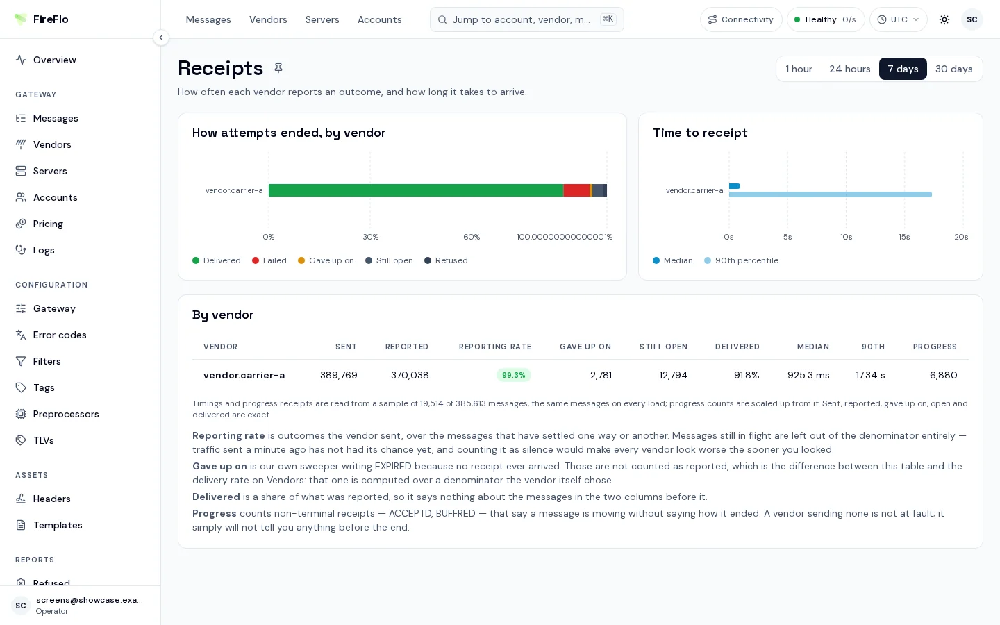
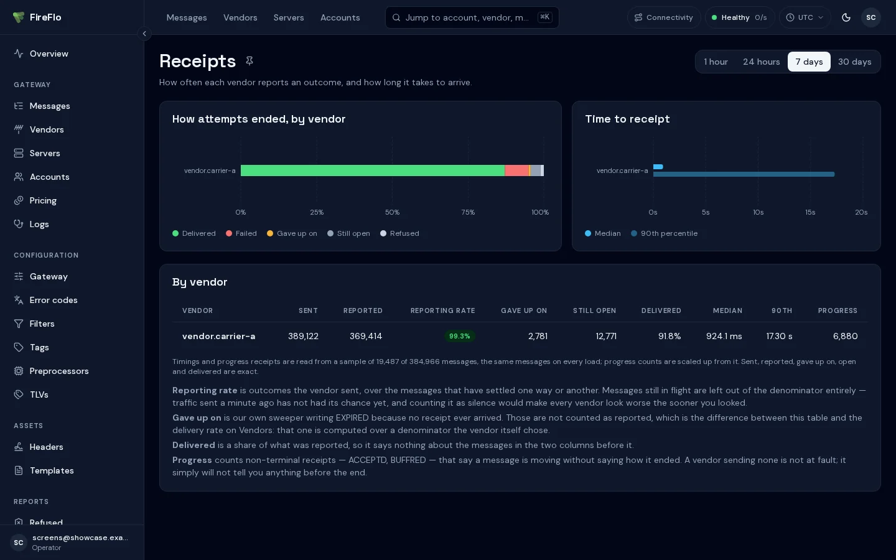
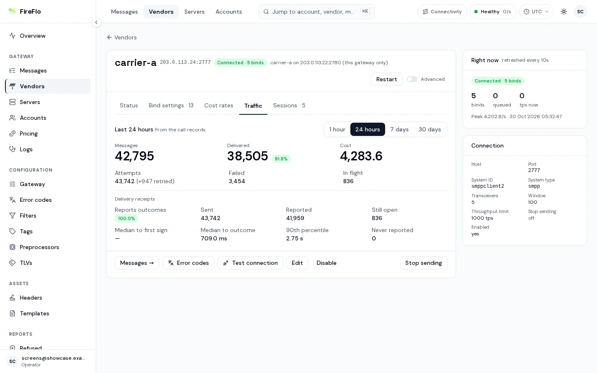
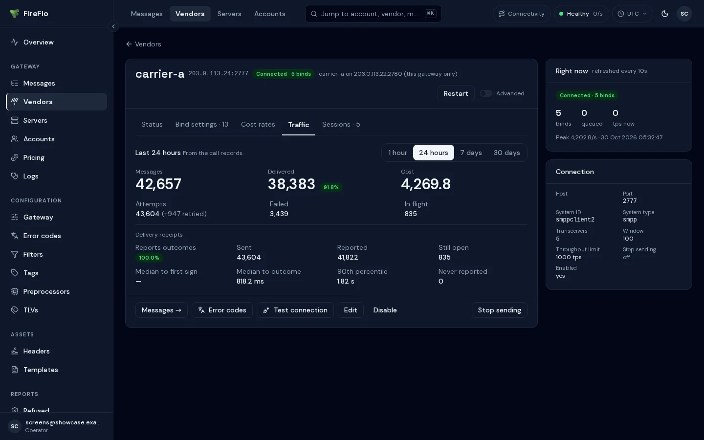

**À quelle fréquence chaque vendor rapporte un résultat, et combien de temps cela prend pour
arriver.**

Cet écran existe à cause d'une façon spécifique d'être induit en erreur. Le taux de livraison sur
la page Vendors est calculé sur le trafic *rapporté* — donc un vendor qui rapporte sur deux
messages sur cinq peut y afficher 95 % alors que trois sur cinq de tout ce que vous lui avez
envoyé n'ont aucun résultat du tout. Le taux n'est pas faux. Il répond à une question plus
étroite qu'il n'y paraît.

Cette page élargit le dénominateur. C'est **Receipts** sous Reports, lue sur **1 heure**,
**24 heures**, **7 jours** ou **30 jours** ; elle s'ouvre sur la dernière heure, puis ensuite sur la
plage que vous avez choisie en dernier dans ce navigateur.

## Les graphiques

**How attempts ended, by vendor** répartit tout ce qui a été envoyé à chaque vendor en cinq parts qui
font toujours la barre entière : livré, échoué, abandonné, encore ouvert, et refusé (une tentative que
le vendor a refoulée ne reçoit jamais d'accusé). **Time to receipt** place la médiane de chaque vendor
à côté de son 90e percentile. Les deux sont tirés des lignes de la table ci-dessous, donc ils sont
toujours d'accord avec elle.

<Frame caption="Receipts sur 7 jours. La barre d'un vendor est surtout verte, et son 90e percentile se situe bien à droite de sa médiane.">
  
  
</Frame>

## La table

Une ligne par vendor, sur la plage choisie :

| Colonne | Signification |
| :--- | :--- |
| **Sent** | Messages soumis à ce vendor |
| **Reported** | Résultats que le vendor a renvoyés |
| **Reporting rate** | Rapportés sur ce qui a été réglé |
| **Gave up on** | Clos comme expirés parce que rien n'est jamais arrivé |
| **Still open** | Envoyés, non réglés, encore dans l'échéance |
| **Delivered** | De ce qui a été rapporté |
| **Median** / **90th** | Temps de la soumission au résultat |
| **Progress** | Accusés non terminaux |

Le taux de reporting est le seul chiffre ici affiché comme badge coloré — vert à 95 % et
au-dessus, neutre à partir de 70 %, rouge en-dessous. Un vendor sous 70 % vous fait perdre votre
propre vue de ce qui est arrivé à du trafic que vous avez déjà payé.

Un vendor sans nom enregistré apparaît comme **no vendor**.

Sur une longue plage, les temps et les accusés de progression sont lus sur un **échantillon** des
messages, et une ligne sous la table dit combien sur combien. L'échantillon est fait des mêmes messages
à chaque chargement, et les comptes de progression sont extrapolés à partir de lui. Sent, reported,
gave up on, still open et delivered sont toujours exacts.

## Les quatre choses qu'il vaut la peine de lire deux fois

**Le taux de reporting laisse entièrement le trafic en vol hors du dénominateur.** Les messages
envoyés il y a une minute n'ont pas encore eu leur chance, et les compter comme du silence
ferait paraître chaque vendor pire plus tôt vous regardez.

**« Gave up on » c'est nous, pas eux.** C'est notre propre balayeur qui écrit une expiration
parce qu'aucun accusé n'est jamais arrivé. Ceux-là ne sont pas comptés comme rapportés — ce qui
est exactement la différence entre cette table et le taux de livraison ailleurs, où le
dénominateur est un que le vendor lui-même a choisi.

**« Delivered » est une part de ce qui a été rapporté.** Cela ne dit absolument rien sur les
messages dans les deux colonnes précédentes. Un vendor rapportant sur 40 % de son trafic et
livrant 99 % de cela a livré, autant que quiconque puisse le prouver, 40 % de ce que vous avez
envoyé.

**Progress compte les accusés non terminaux** — `ACCEPTD`, `BUFFRED` — qui disent qu'un message
bouge sans dire comment il s'est terminé. Un vendor qui n'en envoie aucun n'est pas en tort ; il
ne vous dira simplement rien avant la fin.

<Note>
Sur un gateway qui n'enregistre pas les accusés intermédiaires, la colonne Progress est **blanche
plutôt que zéro**, et la page le dit en-dessous de la table. Un zéro serait une affirmation sur
le vendor. Un blanc est une affirmation sur le gateway, qui est la vraie.
</Note>

## La lire lors d'un incident

Un vendor dont le taux de reporting a chuté pendant que son taux de livraison reste stable n'a
pas commencé à ne pas livrer. Il a commencé à ne pas *vous le dire*, et les deux sont
indistinguables depuis la seule page Vendors. Le trafic sort toujours, les clients sont toujours
débités, et vos preuves cessent silencieusement de s'accumuler.

Les mêmes chiffres apparaissent pour un vendor sur sa propre page, dans l'onglet **Traffic** sous
**Delivery receipts** : **Reports outcomes**, **Sent**, **Reported**, **Still open**, **Median to first
sign**, **Median to outcome**, **90th percentile** et **Never reported**. **Median to first sign** est
le temps jusqu'au premier signe de vie du vendor ; mis à côté de **Median to outcome**, il distingue
un vendor qui accuse réception tout de suite et règle tard d'un vendor qui ne dit rien jusqu'à la fin.

<Frame caption="L'onglet Traffic d'un vendor sur 24 heures. Delivery receipts donne son taux de reporting avec les comptes dont il est le rapport.">
  
  
</Frame>

## Ce dont elle a besoin pour dire quoi que ce soit

À la fois la soumission et son accusé, sur au moins deux vendors — avec un seul vendor la table
est une unique ligne et il n'y a rien à quoi la comparer. Si rien ne s'est réglé dans la fenêtre
du tout, la page se lit **No traffic in this period**.
