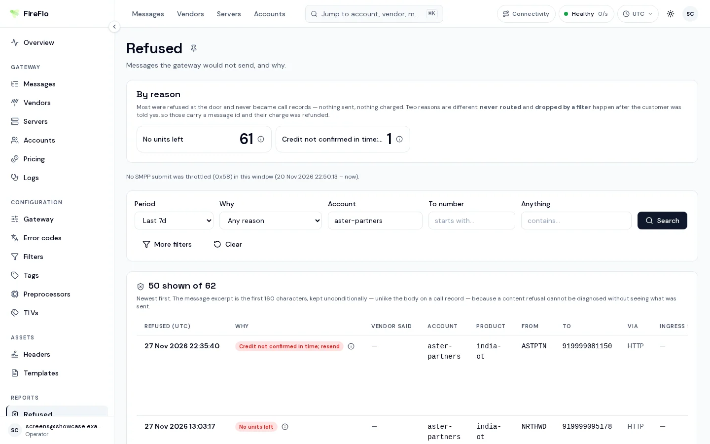
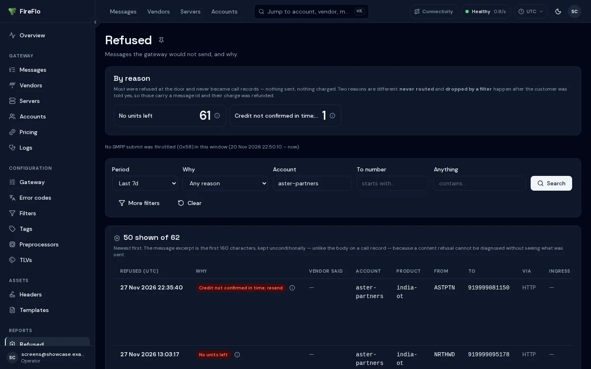
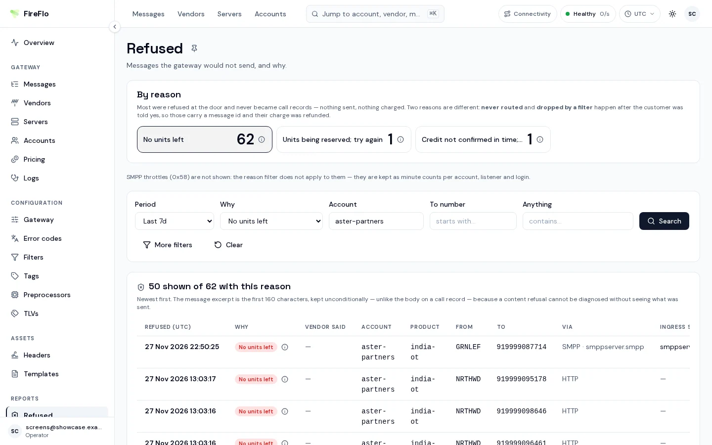
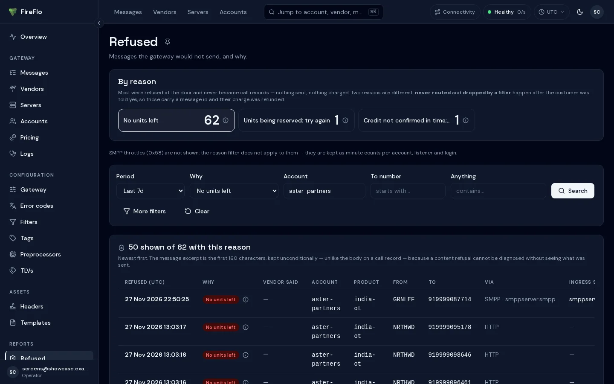

**Messages que le gateway n'a pas voulu envoyer, et pourquoi.** Le premier écran à ouvrir quand un
client dit que rien n'arrive.

La plupart des refus se sont produits à la porte : rien n'a été envoyé et rien n'a été débité.
Quelques-uns non, et la différence est la chose la plus importante sur cette page.

## Refusé à la porte, ou refusé après acceptation

<Warning>
**Quatre raisons se produisent après que le client s'est vu dire oui** — *never routed*, *vendor
refused it*, *dropped by a filter* et *expired waiting for its vendor*.

Ces messages ont été acceptés et débités, et dans le cas de *vendor refused it* réellement envoyés. Ils portent un
**message id**, ils apparaissent dans les enregistrements d'appels, et **leur débit a été
remboursé**. Tout le reste sur cette page a été refoulé avant de devenir du trafic tout court.

Le filtre **Stage** sépare les deux, et c'est le filtre à saisir lors de la réconciliation du
compte d'un client par rapport au vôtre.
</Warning>

## Les raisons

**By reason** mène la page — une carte par raison, avec un compte pour toute la fenêtre et un bouton
d'information qui l'explique. Les cartes ne bougent pas quand vous paginez, et en choisir une filtre
dessus ; choisissez-la à nouveau pour effacer le filtre. À partir de 0.12.14, le résumé est pris sur les
**50 000 derniers refus** et la page le dit : sur un gateway qui refuse davantage dans la fenêtre, les
cartes décrivent la forme récente plutôt qu'un total exact, et la table en dessous reste complète.

<Frame caption="Les refus d'un compte sur 7 jours : une carte par raison au-dessus des filtres et des refus les plus récents.">
  
  
</Frame>

<Frame caption="La même page après avoir choisi la carte No units left : la carte est mise en évidence, Why est réglé sur elle, et le compte au-dessus de la table ne vaut que pour cette raison.">
  
  
</Frame>

Les submits SMPP auxquels on a répondu par un throttle (`0x58`) ne sont pas des lignes ici. Ils sont
conservés comme comptes par minute par compte, listener et login, et une ligne sous les cartes dit
combien il y en a eu dans la fenêtre, ou qu'il n'y en a eu aucun.

| Raison | Signifie habituellement |
| :--- | :--- |
| **Sender ID not approved** | L'expéditeur n'est pas sur la liste approuvée du compte pour ce product |
| **Content not approved** | Le corps ne correspond à aucun template approuvé — un mot changé suffit |
| **Out of credit** | Le crédit prépayé ne couvrirait pas |
| **No units left** | À partir de 0.16.0. Un login d'un [compte à unités](/platform/billing/units-accounts) n'a plus d'unités de son product. Le compte affiché est le parent, qui paie |
| **Units being reserved; try again** | Les unités d'un compte à unités étaient retenues un instant par un autre nœud. Une nouvelle tentative passe |
| **Required parameter missing** | Un TLV requis par l'ingress était absent, et rien ne l'a fourni |
| **Rate limit exceeded** | Au-delà des messages par seconde du compte |
| **Product not sold** | Le login a nommé un product sans ligne activée dans le catalogue |
| **No price configured** | Aucun tarif côté vente n'a correspondu, et le gateway refuse plutôt qu'envoyer sans facturation |
| **Product not allowed for this login** | Le login n'est pas autorisé à nommer ce product |
| **Credit not confirmed in time; resend** | À partir de 0.17.2 (`creditPending`). Le crédit d'un compte approvisionné n'a pas été confirmé dans `smsg.balance.park.seconds`, habituellement parce que la base était lente ou ne répondait pas. Rien de facturé ; un renvoi passe — voir [Refus](/platform/troubleshooting/refusals#crédit-non-confirmé-à-temps) |
| **Too many waiting for credit; resend** | À partir de 0.17.2 (`creditQueueFull`). 10 000 messages du compte, ou 100 000 sur le gateway, attendaient déjà du crédit. Même cause que la précédente, en volume |
| **Queue full** | La file du routeur était à capacité et a refusé plutôt que faire grossir le tas. Avant 0.17.2, les envois REST et gRPC refusés pour un crédit non confirmé à temps étaient aussi comptés ici |
| **Could not be queued** | Accepté par les vérifications, mais n'a pas pu être passé — habituellement le broker |
| **Vendor backlog full** | À partir de 0.15.1. Chaque vendor vers lequel le message pouvait aller avait dépassé sa limite de backlog, et aucune autre route n'était utilisable. Rien de facturé |
| **Vendor unavailable** | À partir de 0.15.1. Le vendor vers lequel il irait n'a pas eu de bind depuis plus longtemps que `smsg.vendor.unbound.refuse.after.seconds`, et aucune autre route n'était utilisable. Rien de facturé |
| **Database not answering; try again** | À partir de 0.15.1. La base était trop lente pour prendre de nouveaux messages, donc les nouveaux submits ont été refusés avant que quoi que ce soit ne soit facturé. Les messages déjà acceptés continuent |
| **Gateway stopping** | Le gateway était en cours d'arrêt et ne prenait plus de nouveaux messages. Rien de facturé ; une nouvelle tentative passe dès qu'un autre nœud ou le gateway redémarré la prend |
| **Hand-off outcome unknown** | Accepté et passé au broker, et le passage s'est terminé sans réponse définitive : il a peut-être été envoyé. Non remboursé, pour qu'il ne puisse pas être facturé deux fois ; le gateway le règle dès que la réponse est connue |
| **Never routed** | *Après acceptation.* Aucune règle activée n'a correspondu ; remboursé |
| **Vendor refused it** | *Après acceptation.* L'opérateur a rejeté le submit ; remboursé |
| **Dropped by a filter** | *Après acceptation.* Un filter de routage l'a arrêté ; remboursé |
| **Expired waiting for its vendor** | *Après acceptation.* En file pour un vendor, il a attendu plus longtemps que `smsg.vendor.backlog.expire.seconds` (ou sa propre validité) et n'a pas été envoyé ; remboursé, avec un accusé d'échec là où un accusé a été demandé |

<Note>
**Les messages d'un compte approvisionné attendent leur crédit** après un redémarrage, ou chaque
fois que son bloc est épuisé, au lieu d'être refusés. De nombreux refus **Credit not confirmed in
time** sur plusieurs comptes dans les mêmes minutes désignent la base. Un **Out of credit** qui
persiste sur un compte approvisionné est une vraie pénurie, ou du crédit retenu dans `reserved`.
</Note>

Deux raisons méritent leur propre note. **Content not approved** est une comparaison exacte en
dehors des placeholders — un seul mot changé refuse. Et sur **vendor refused it**, le statut
numérique propre à l'opérateur siège à côté de la ligne ; la famille 192–196 porte toujours sur
des TLV, ce qui sur une voie DLT indienne signifie habituellement un id d'entité ou de template
manquant ou non estampillé.

Un résumé vide le dit clairement, et ajoute la vérification à faire en premier : si vous
attendiez des refus et n'en voyez aucun, confirmez que l'application est activée du tout — **une
whitelist non chargée autorise tout par conception**.

## En trouver un

La ligne toujours visible est **Period**, **Why** (la raison), **Account** (exact), **To number**
(commence par) et **Anything**. **Anything** est le grand filet : il regarde à l'intérieur de compte,
expéditeur, destination, product, login, détail de refus et extrait de message à la fois. **More
filters** ajoute **Bind name (system id)**, **Product**, **Came in via**, **Listener**, **From
number**, **Message id**, **Carrier status** et **Stage**. **Clear** les vide tous.

**Carrier status** prend le numéro de l'opérateur en décimal — 69 est le générique « refusé et ne
dira pas pourquoi » — et seuls les refus vendor en portent un.

**La page demande toujours une période, de 92 jours au plus.** Les refus ne peuvent pas être listés
sur tout l'historique : des versions antérieures affichaient discrètement les refus d'une journée sous
un titre **All time**, le genre d'erreur que l'on croit, donc à partir de 0.12.14 la page demande une
période à la place.

## La table

Dix colonnes par défaut : refused, why, vendor said, account, product, from, to, via, ingress
server, message. Le sélecteur ajoute la raison en anglais, le détail du refus, s'il a été débité et
remboursé, ce qui a été dit au client, le nom de code vendor, et les ids de ligne et de message.

L'**extrait du message** — les 160 premiers caractères — est conservé **inconditionnellement**,
contrairement au corps sur un enregistrement d'appel. Un refus de contenu ne peut pas être
diagnostiqué sans voir ce qui a été envoyé, donc c'est le seul endroit où le texte du message
est toujours disponible.

<Note>
Un tiret sous **Parts** signifie que le message a été refusé avant que ses segments ne soient
comptés — pas zéro parts. **Data coding** affiche `0`, qui est réel : c'est GSM 7-bit.
</Note>

## Exporter

Préparé en arrière-plan, conservé sept jours, et — comme sur Messages — il **porte chaque
colonne plus la raison en anglais et le code opérateur**, quoi que vous ayez choisi à l'écran.
Ces fichiers sont lus par des gens sans panneau ouvert.

## En lien

<CardGroup cols={2}>
  <Card title="Pourquoi un message a été refusé" icon="circle-question" href="/platform/troubleshooting/refusals">
    Remonter d'un refus à sa cause.
  </Card>
  <Card title="Rejets vendor" icon="triangle-exclamation" href="/platform/troubleshooting/vendor-rejections">
    Ce que signifie chaque code de statut opérateur.
  </Card>
</CardGroup>
