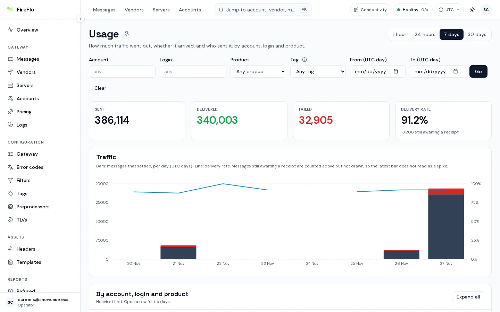
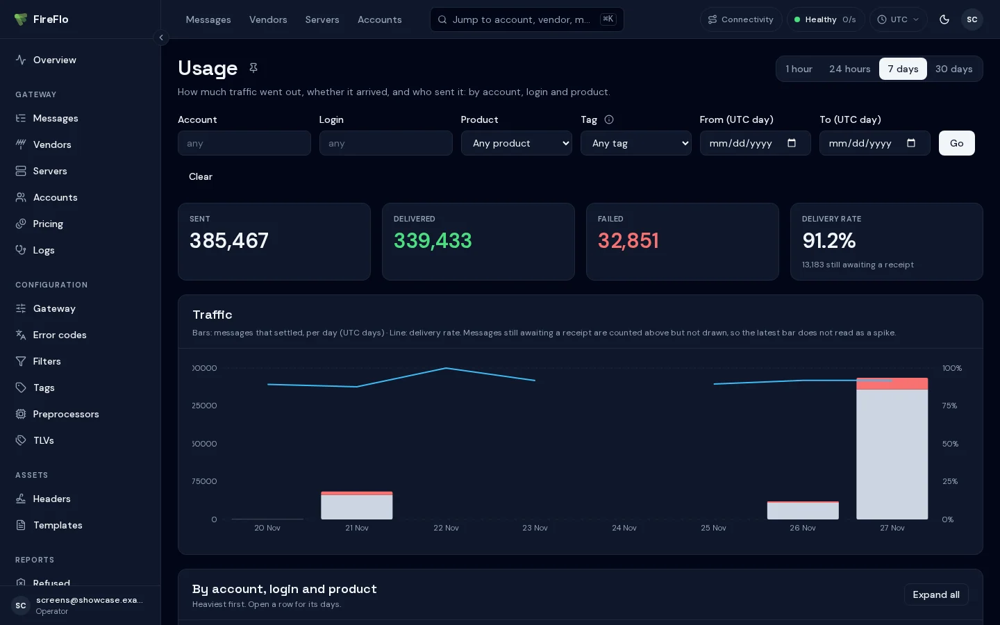
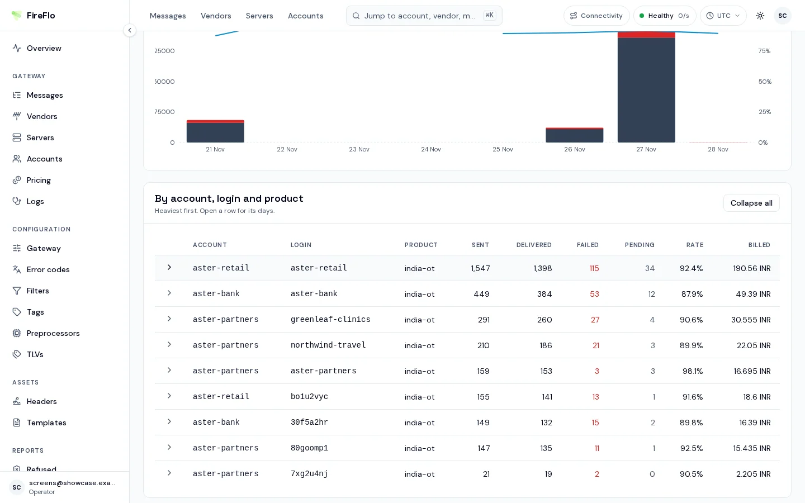
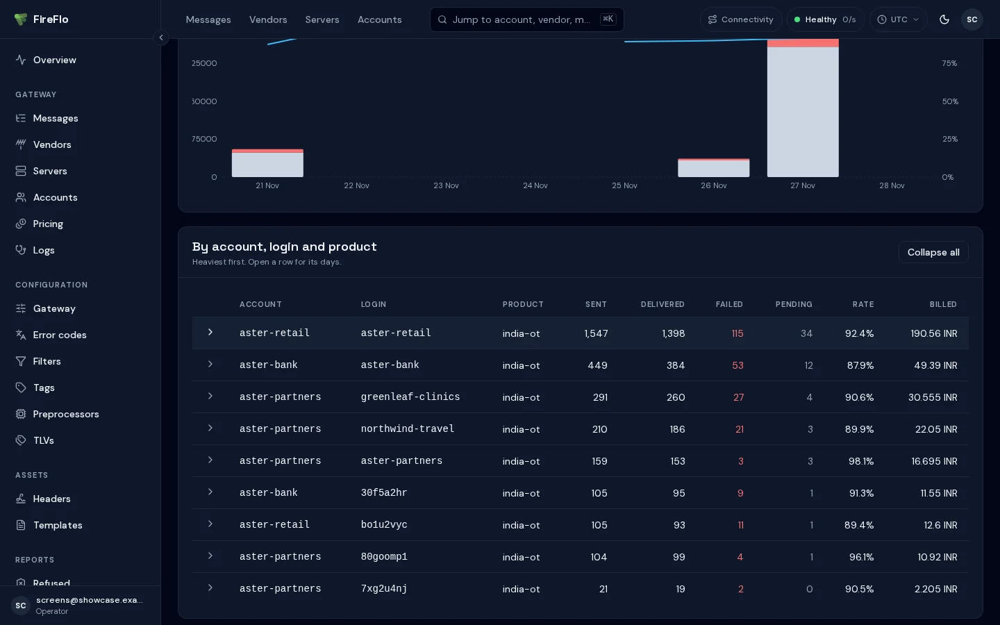

Combien de trafic est sorti, s'il est arrivé, et qui l'a envoyé : par compte, login et product. Le
volume et la livraison mènent ; l'argent est la dernière colonne plutôt que le titre — la question
commerciale est répondue sur [Revenue](/platform/control-panel/revenue).

Le sélecteur de plage offre **1 heure**, **24 heures**, **7 jours** ou **30 jours**. Comme toutes les
pages de trafic, il s'ouvre sur la dernière heure, puis ensuite sur la plage que vous avez choisie en
dernier dans ce navigateur. Un jour est l'unité dans laquelle une question d'usage est habituellement
posée ; pour un profil semaine-vs-weekend, choisissez donc 7 ou 30 jours.

<Frame caption="Usage sur 7 jours. Les barres ne comptent que les messages réglés ; la ligne est le taux de livraison contre son propre axe 0–100 %.">
  
  
</Frame>

## Filtres

Sous le titre : **Account** et **Login** (chacun suggère des noms pendant que vous tapez), **Product**,
**Tag**, et les jours **From** et **To** dans le fuseau de facturation. Rien n'est lu tant que vous
n'avez pas pressé **Go** ; **Clear** les retire tous. Une plage de dates remplace le sélecteur de plage
tant qu'elle est définie. Les filtres que vous avez appliqués sont retenus dans ce navigateur.

## Les chiffres

Quatre cartes — **Sent**, **Delivered**, **Failed**, **Delivery rate** — avec la carte du taux
notant combien de messages attendent encore un accusé.

<Warning>
**Le taux de livraison est delivered sur ce qui s'est réglé, pas sur ce qui a été envoyé.**

Diviser par sent compterait chaque message encore en vol comme un échec. Le taux s'effondrerait
chaque après-midi actif et récupérerait tout seul pendant la nuit, et personne ne pourrait
distinguer un vrai problème de livraison du trafic ordinaire.

Donc un taux de 98 % signifie 98 % *des messages qui ont un résultat*. Les messages encore en
attente sont comptés dans **Sent**, et dans **Pending** dans la table, et ne sont dans aucune
moitié du taux.
</Warning>

À partir de 0.15.1, la page ne lit que les résumés d'usage du gateway, et les enregistrements d'appels
des dernières minutes et rien d'autre, quoi qu'on filtre ou ouvre — c'est ce qui garde une vue
30 jours rapide en volume. Le **Pending** d'une heure ou d'un jour résumé est ce qui attendait encore
un accusé quand le gateway l'a résumé pour la dernière fois.

## Trafic

Delivered et failed empilés par jour (par heure sur les plages plus courtes) contre le volume à gauche, et le taux de livraison comme
une ligne contre un axe fixe 0–100 % à droite.

Deux choix délibérés à connaître :

- **Les messages encore en attente d'accusé sont comptés dans les totaux mais pas dessinés.**
  Aujourd'hui autrement se lirait toujours comme un pic d'inconnus.
- **Un jour sans rien réglé n'a pas de taux du tout**, et la ligne se rompt plutôt que de tomber
  à zéro. Un trou est « pas de preuve » ; un zéro serait « tout a échoué ».

## Par compte, login et product

Le plus lourd en premier, une ligne par compte, login et product :
**Account · Login · Product · Sent · Delivered · Failed · Pending · Rate · Billed**. Cinquante lignes
par page.

Ouvrez une ligne avec sa flèche pour voir ses jours, ou ses heures sur la vue 24 heures ; **Expand
all** ouvre les 25 premières lignes d'un coup. La vue 1 heure n'a rien à ouvrir.

<Frame caption="La table par compte, login et product sur 7 jours. La flèche de chaque ligne ouvre ses jours.">
  
  
</Frame>

Chaque compte mène à ce client, où la même question est répondue pour lui seul.

À partir de 0.17.0, le filtre **Tag** limite la page aux comptes qui portent eux-mêmes une
[étiquette de compte](/platform/routing/account-tags). Il lit les étiquettes que les comptes ont
maintenant : un message n'enregistre pas les étiquettes de son compte, donc une période passée est lue
avec celles d'aujourd'hui.

Le trafic qui n'a nommé aucun compte affiche un tiret dans la colonne **Account** — pas une erreur,
et pas un compte dont le nom est vide. C'est du trafic qui est arrivé sans, ce qui signifie
habituellement un login sans compte attaché, et cela vaut la peine d'être poursuivi parce qu'il
se tarife et se facture différemment. Les jours que le gateway a résumés avant d'enregistrer les
logins (avant 0.15.1) montrent tous les logins ensemble sur une seule ligne, et la page le dit.

## L'usage face au relevé

Cet écran compte les messages. Le [relevé](/platform/billing/statements) d'un client compte de
l'argent, et est facturé à la soumission plutôt qu'à la livraison — donc le chiffre delivered
ici continue à bouger après qu'un relevé a été coupé tandis que le montant facturé non.

Ils ne sont pas censés s'accorder sur la livraison. Ils sont censés s'accorder sur **sent**.

## En lien

<CardGroup cols={2}>
  <Card title="Revenue" icon="coins" href="/platform/control-panel/revenue">
    Le même trafic, valorisé.
  </Card>
  <Card title="Rollups d'usage et rétention" icon="database" href="/platform/billing/usage-and-retention">
    Le rollup quotidien sur lequel cet écran retombe, et ce que la purge supprime.
  </Card>
</CardGroup>
