Un **compte** est un id sur lequel un login, un scope de tarif, une ligne de solde et un
enregistrement d'appel s'accordent tous. Rien n'a besoin de le créer : un compte existe au moment
où un login le nomme ou qu'un message arrive en le portant, et la ligne `app_account` est une
étiquette boulonnée par-dessus après coup.

<Frame caption="La liste Accounts, une ligne par login. Not named yet compte les ids de compte en usage qui n'ont pas de nom propre.">
  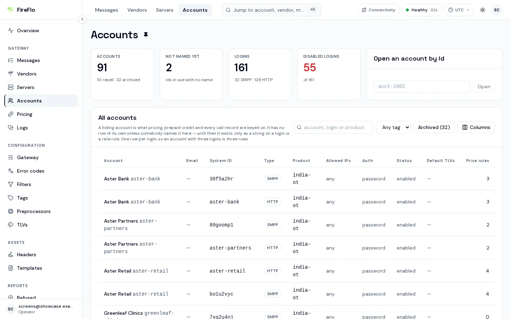
  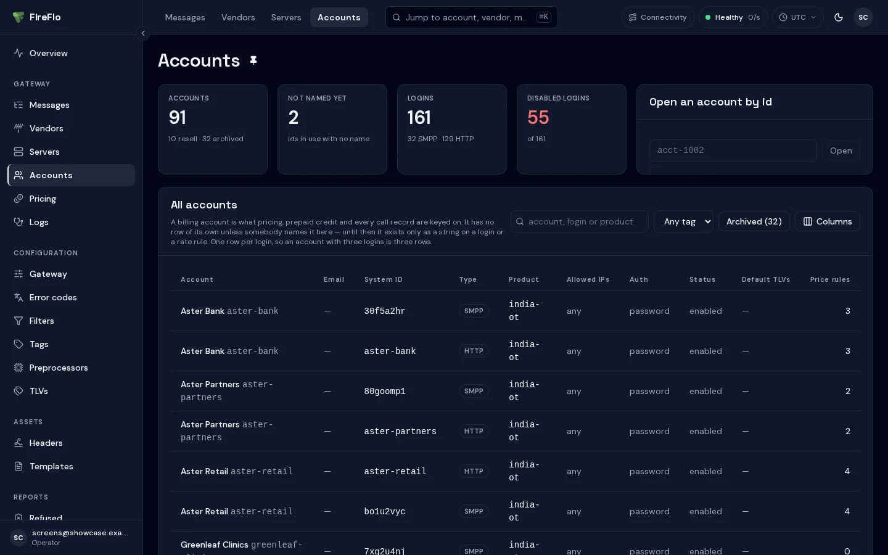
</Frame>

## Laissez `accountId` vide et autre chose devient le compte

`accountId` est optionnel sur un credential, et ce qui comble le vide **diffère par protocole**.

| Protocole | Retombe sur |
| :--- | :--- |
| SMPP | le `systemId` |
| HTTP | la *clé de recherche*, qui est l'`apiKey` lorsqu'une est définie |

<Warning>
**Un login HTTP avec un `apiKey` et pas d'`accountId` facture sur la clé API elle-même.** Le
secret atterrit dans `cdr_submit.account_id`, dans les chiffres de revenu du panneau de contrôle
et dans chaque export CSV — copié dans des enregistrements qui vivent aussi longtemps que
l'historique de facturation, et qui quittent la plateforme dans des tableurs. Faire tourner la
clé ensuite scinde l'historique de ce client sur deux ids.

Définissez `accountId` explicitement sur chaque credential et aucun repli n'a d'importance.
</Warning>

<Frame caption="Un login ouvert en édition. Account se trouve sous Billing and tariff : les scopes de tarif et les soldes prépayés sont tous deux indexés dessus, et il est figé une fois le login créé.">
  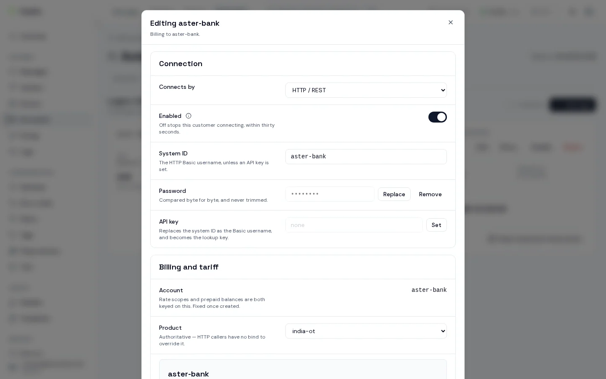
  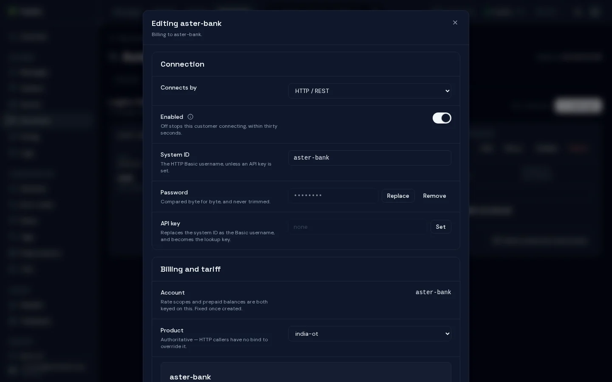
</Frame>

## Pourquoi le compte et pas le login

Un compte peut détenir plusieurs logins, et tout ce qui porte de l'argent ou un plafond est
indexé sur le compte :

| Indexé sur le compte | Où cela vit |
| :--- | :--- |
| Solde prépayé et crédit réservé | `account_balance` |
| Limite de crédit et mode de facturation | `account_balance.billing_mode`, `credit_limit` |
| Tarif — ce que ce client paie | un scope de tarif nommé d'après l'id du compte |
| Relevé et usage quotidien | `cdr_submit`, `usage_daily` |
| Plafonds de débit | le compte, pas le bind |

<Note>
Une limite par login permettrait à un client de relever son propre plafond en créant un autre
login. Indexer sur le compte est ce qui donne un sens à tout cela.
</Note>

Les approbations sont la seule chose qui peut aller dans les deux sens : une ligne de sender ID
ou de template peut nommer un `system_id` pour la lier à un login, ou la laisser null pour tous
les logins du compte. Voir [Sender IDs](/platform/customers/sender-ids).

## Ce que contient réellement la ligne du catalogue

`app_account` est nom, contact et hiérarchie. Quand le gateway charge les logins, il n'y lit que deux
choses : si le compte est activé, et s'il est archivé.

| Colonne | Signification |
| :--- | :--- |
| `id` | La clé de facturation. Trimé et non-vide, et la clé primaire. |
| `label`, `description` | Pour les personnes lisant le panneau (**Name** et **Notes**). |
| `email` | L'adresse de contact du compte et un login du portail. Un compte par adresse, sans tenir compte de la casse. |
| `enabled` | **Enabled**, sous Settings → Advanced. Désactivé, il met le compte en pause : ses logins s'arrêtent et personne ne peut se connecter au portail pour lui. |
| `resells` | **Resells services** : ce compte peut en détenir d'autres et leur transférer du solde. |
| `parent_account_id` | **Belongs to** : le revendeur sous lequel il se trouve. |

L'arbre a exactement deux niveaux de profondeur, et la base l'applique :
`app_account_two_levels` refuse une ligne qui à la fois nomme un parent et resells, donc un
compte soit en détient d'autres soit appartient à un.

<Frame caption="L'onglet Settings d'un compte. Organisation contient le nom, l'email, les notes et les étiquettes ; Advanced contient Enabled, la revente et le parent ; Archive se trouve en dessous.">
  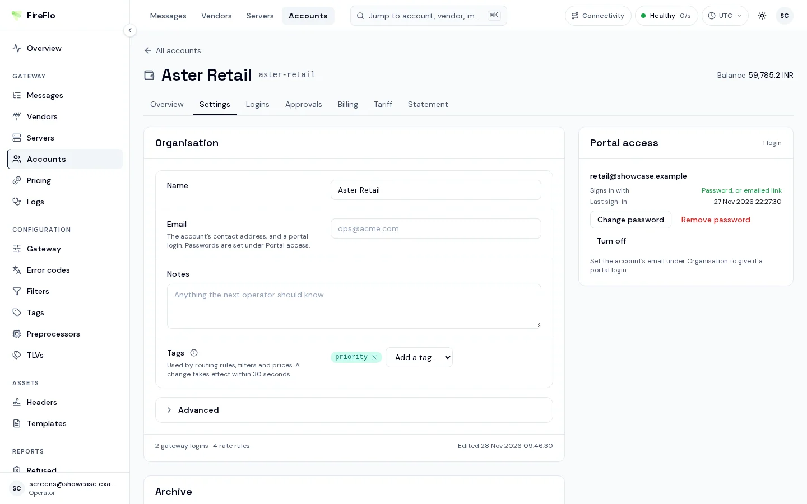
  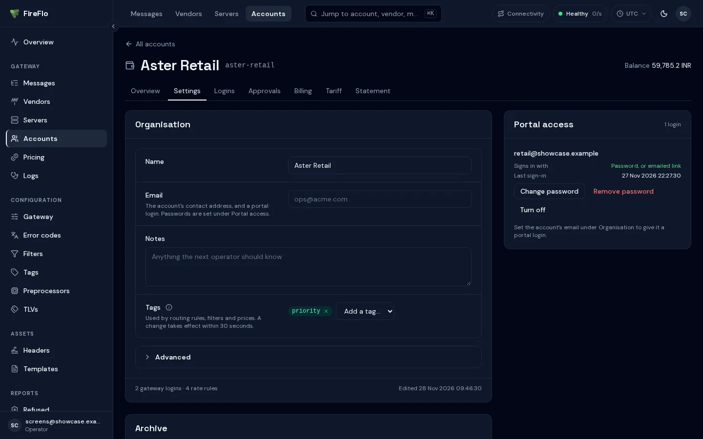
</Frame>

<Warning>
**Désactiver un compte arrête son trafic.** Le gateway cesse de servir les logins du compte en un
sondage de configuration (30 secondes par défaut), et personne ne peut se connecter au portail pour
lui. Les binds déjà ouverts restent en place jusqu'à ce qu'ils tombent.

Pour arrêter un login plutôt que tout le compte, désactivez ce **login**. Pour arrêter la dépense,
utilisez le solde.
</Warning>

Pour retirer un compte définitivement, **archivez-le** avec **Archive** au bas de l'onglet Settings.
Ses logins sont désactivés, les binds vivants sont coupés et la connexion au portail est fermée ; son
solde et son historique restent, et il quitte la liste des comptes. **Unarchive** réactive exactement
ce que l'archivage a désactivé, et les clients reconnectent eux-mêmes leurs binds.

## Revendeurs et sous-comptes

Activez **Resells services** et le compte devient revendeur. Ses équipes gèrent alors leurs propres
clients depuis le portail, sous **Customers → Sub-accounts**. Il y a deux niveaux, jamais plus : un
sous-compte ne peut pas revendre.

<Frame caption="La liste Sub-accounts d'un revendeur dans le portail. Le crédit de chaque sous-compte vient du propre solde du revendeur.">
  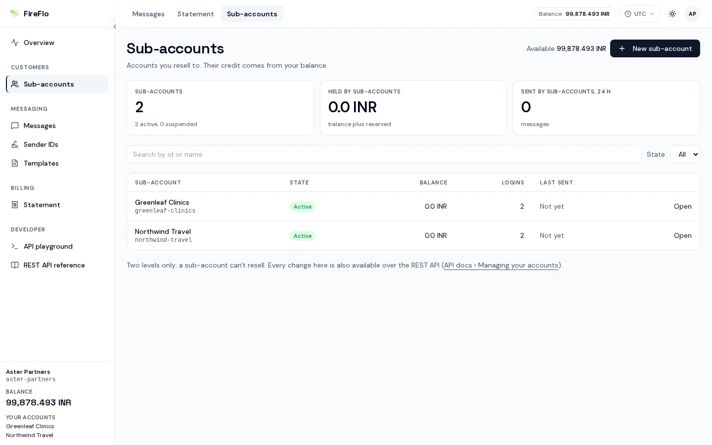
  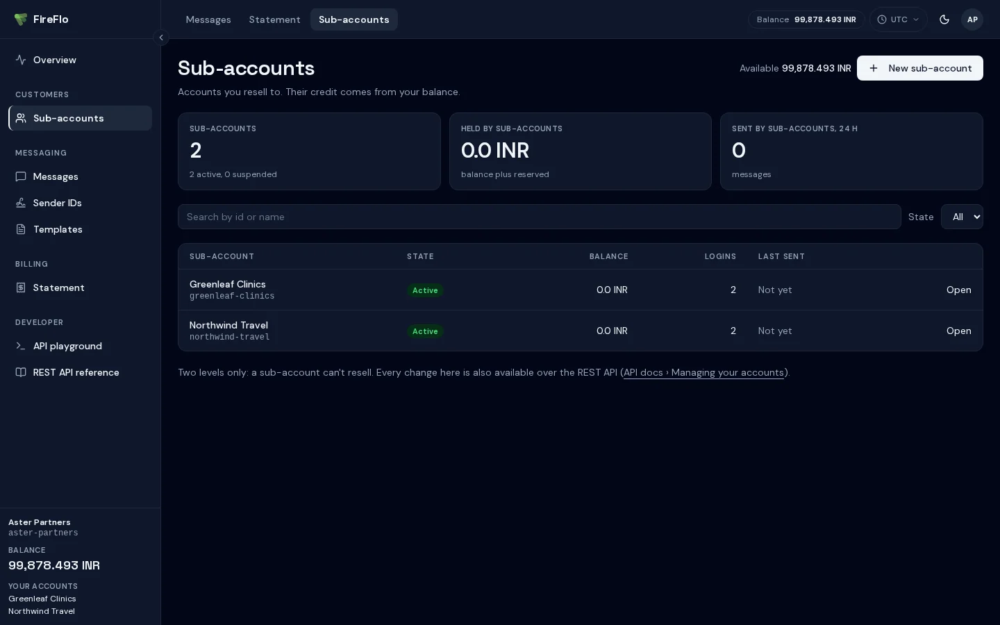
</Frame>

**New sub-account** demande un id de compte (figé une fois créé), un nom et un crédit d'ouverture,
transféré immédiatement depuis le solde du revendeur ; laissez-le à 0 pour recharger plus tard. Le
sous-compte reçoit tout de suite un login HTTP, et les logins SMPP s'ajoutent sur son onglet Logins.

<Frame caption="New sub-account. Le crédit d'ouverture montre le solde du revendeur après le transfert, avant que quoi que ce soit ne soit créé.">
  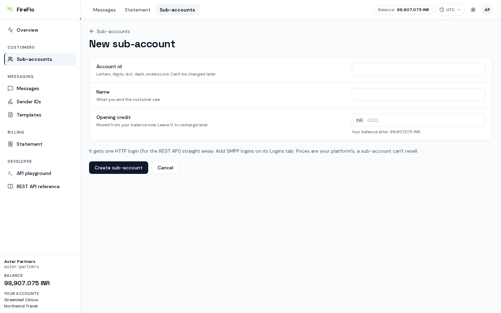
  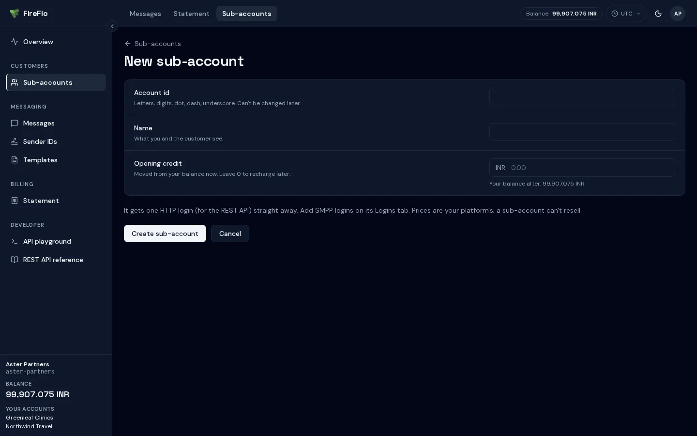
</Frame>

La page d'un sous-compte montre son solde, **Recharge** et **Withdraw** pour déplacer du crédit entre
lui et le revendeur, et ses transferts, avec des onglets pour ses logins, messages, approbations,
relevé, conditions de crédit et paramètres.

<Frame caption="Un sous-compte dans le portail du revendeur. Withdraw libère le crédit réservé pour les messages en cours d'envoi avant de le rapatrier.">
  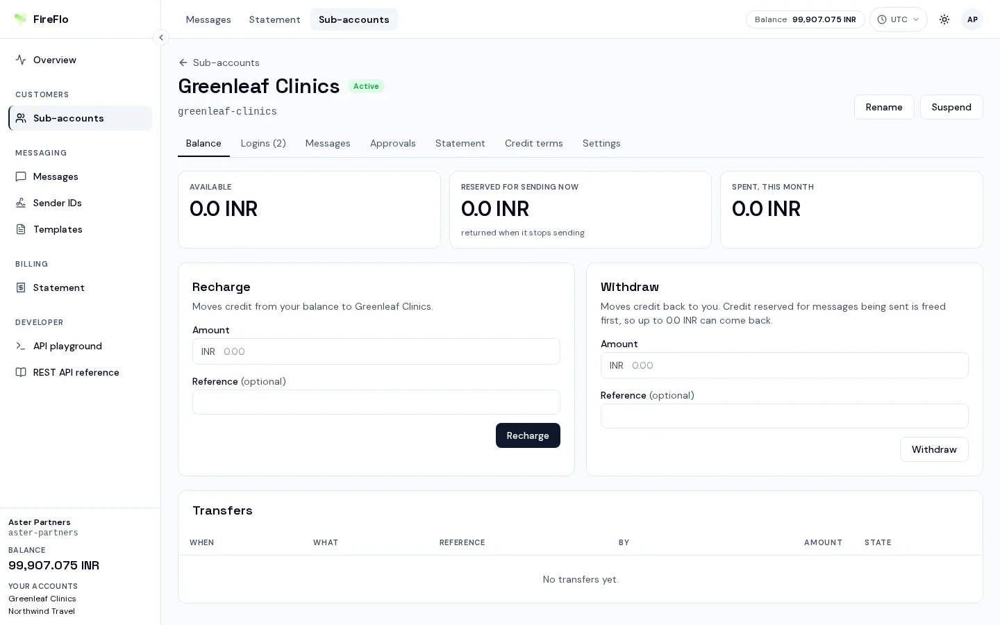
  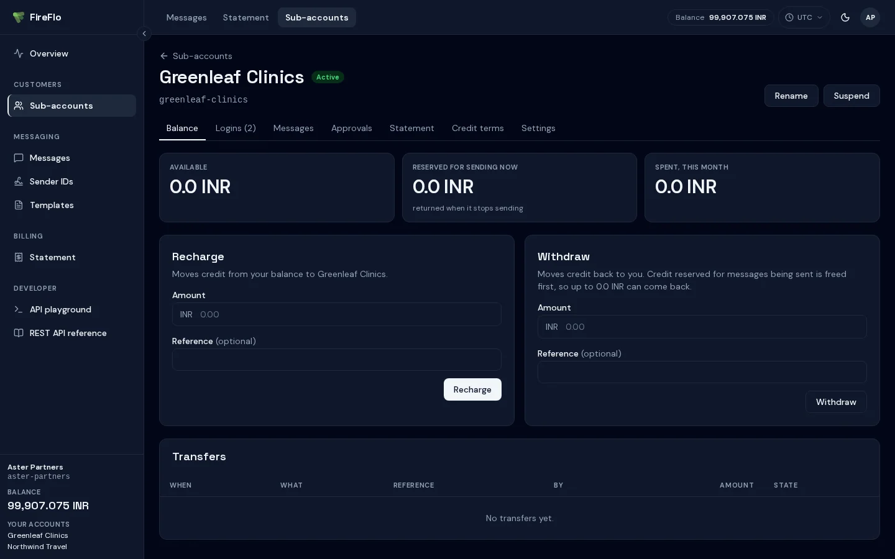
</Frame>

## Créer un login ne crée pas de solde

Un compte sans ligne `account_balance` n'est **pas à zéro** — il n'a pas de solde, ce qui est un
état différent et celui qui avale silencieusement un rechargement.

<Warning>
**Un `RECHARGE` écrit pour un compte sans ligne de solde ne crédite rien.** Il reste pending et
journalise, et s'applique au moment où la ligne apparaît — mais jusque-là le client a payé et
ne peut pas envoyer. Ouvrez d'abord le compte pour crédit (*Open for credit* sur la page du
compte), puis rechargez.
</Warning>

Le panneau distingue délibérément les deux : « no balance row » et « credit switched off » sont
affichés comme des réponses différentes plutôt que fusionnés en un chiffre vide. Voir
[Crédit prépayé](/platform/billing/prepaid-credit).

## Un id de compte qui est aussi un nom de vendor

La tarification apparie un scope de tarif par nom seul, et la même table contient les deux côtés
du marché. Un id qui est aussi un nom d'instance de vendor voit ses règles lues comme **notre
coût pour ce vendor** en plus de ce que ce client paie.

La page du compte peint cela en rouge plutôt que le laisser découvrir dans un rapport de marge.
Renommez-en un avant de tarifer l'un ou l'autre. `*` est réservé d'emblée et ne peut pas être
utilisé comme nom de compte ou de vendor.

## Ce qu'il y a sur la page du compte

Un onglet à la fois : **Overview**, **Settings**, **Logins**, **Approvals**, **Billing**, **Tariff** et
**Statement**. Un compte à unités n'a pas d'onglet Tariff ni Statement ; ses prix et son relevé sont
ceux de son parent.

<Frame caption="L'onglet Overview d'un compte : son trafic par login et product, son plafond SMPP, un contrôle de livraison et où sont allés ses messages.">
  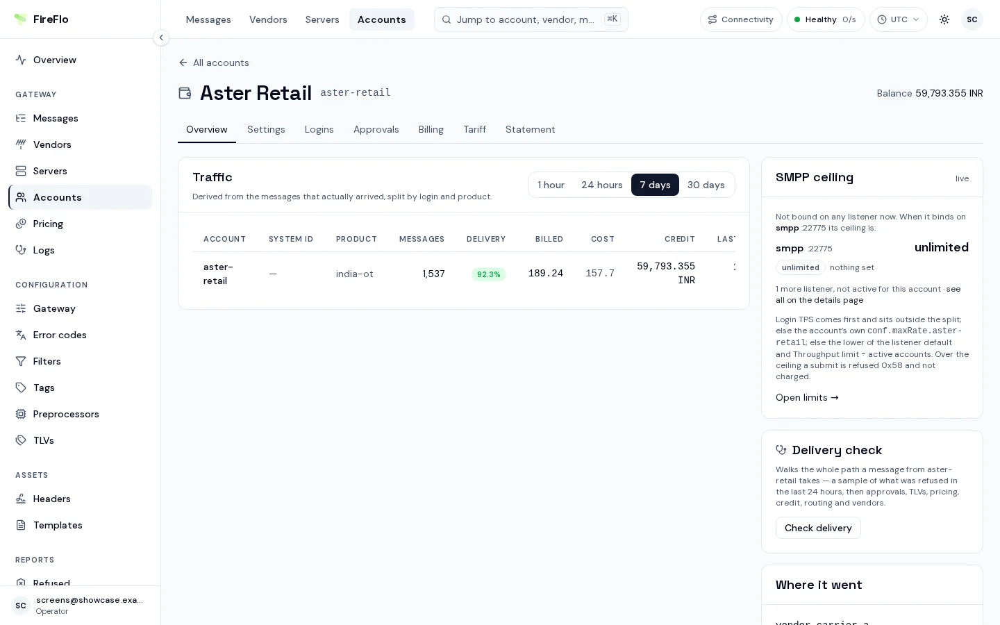
  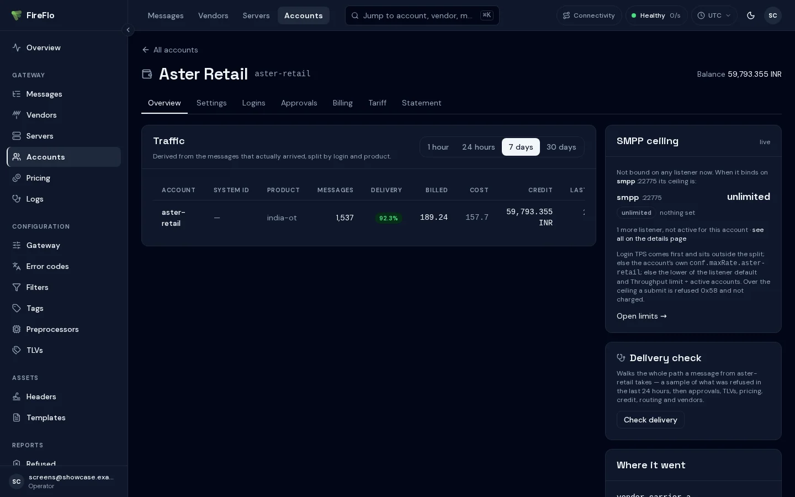
</Frame>

<CardGroup cols={2}>
<Card title="Logins" href="/platform/connections/credentials">
Qui peut se connecter comme ce compte, quel product chacun porte, et faire tourner un secret.
</Card>
<Card title="Tarif sur mesure" href="/platform/billing/tariffs">
Ce que ce compte paie. Pas de règles propres signifie qu'il est tarifé par tout attrape-tout qui
le couvre.
</Card>
<Card title="Relevé" href="/platform/billing/statements">
Ce qui est dû pour une période, facturé sur submitted — donc le montant cesse de bouger quand la
période cesse.
</Card>
<Card title="Sender IDs et contenu" href="/platform/customers/whitelisting-rollout">
Les deux listes d'approbation et l'interrupteur d'application à côté d'elles.
</Card>
</CardGroup>

Le trafic sur la page est dérivé des messages qui sont réellement arrivés, split par login et
product — donc il montre le trafic qui est entré sous ce compte depuis un login que ce panneau
n'a jamais vu.
