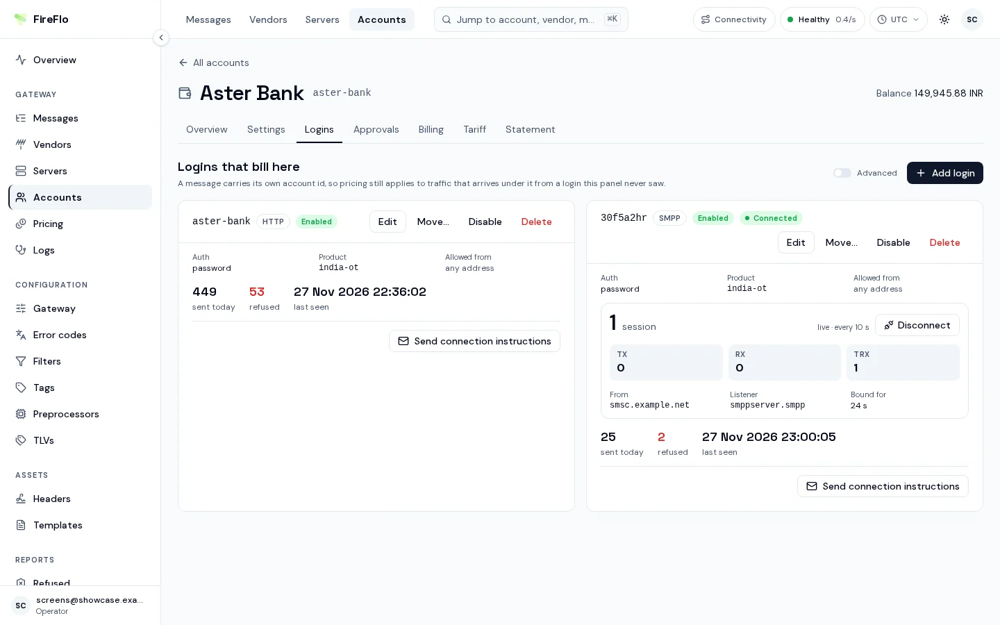
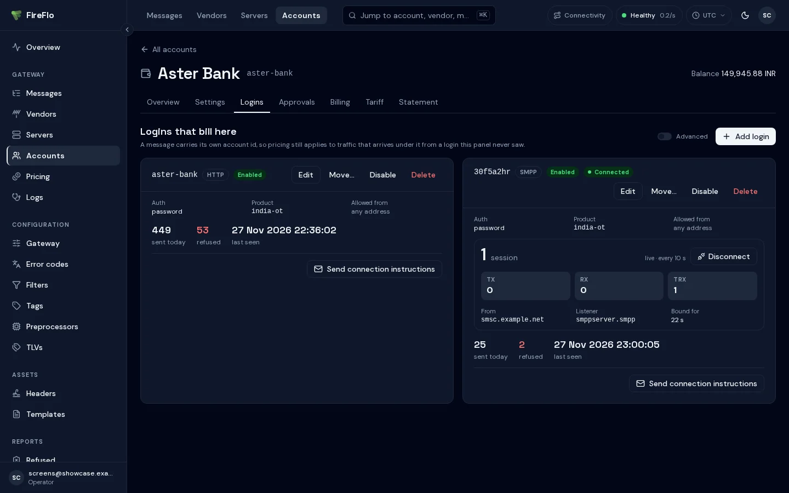

Les clients se connectent au portail avec un **login du portail** : une adresse e-mail qui se connecte par un lien à usage unique envoyé par e-mail, ou avec un mot de passe une fois qu'un mot de passe est défini. Les logins du portail d'un compte se trouvent sur son onglet **Settings**, dans la carte **Portal access**.

## Ce qu'un opérateur définit

<Steps>
<Step title="Définir l'adresse e-mail">
Le champ **Email** sur la carte **Organisation**. Un compte par adresse, en ignorant la casse. Un second compte revendiquant la même adresse est refusé plutôt que de masquer silencieusement le premier.

Une adresse mal formée est refusée à la saisie, donc une adresse enregistrée est une adresse que le portail peut faire correspondre. L'enregistrer donne au compte un login du portail pour cette adresse. Si ce login manque, la carte Portal access propose **Create a login for** l'adresse.
</Step>

<Step title="Choisir comment il se connecte">
Chaque login de la carte Portal access indique comment il se connecte : **Emailed link only**, ou **Password, or emailed link**. **Set password** ou **Change password** en définit un ; **Remove password** revient aux liens seuls. Sans mot de passe, le client se connecte par lien envoyé par e-mail et peut définir un mot de passe depuis le portail.
</Step>

<Step title="Laisser le compte activé">
L'interrupteur **Enabled**, sous **Advanced**. Personne ne peut se connecter au portail pour un compte désactivé ou archivé.
</Step>
</Steps>

<Frame caption="L'onglet Settings d'un compte. Le login du portail est à droite, avec la façon dont il se connecte et la dernière fois qu'il l'a fait.">
  
  
</Frame>

Pour empêcher une personne de se connecter, pressez **Turn off** sur son login ; **Turn on** la laisse revenir. Désactiver tout le compte arrête aussi son trafic — voir [Comptes](/platform/customers/accounts#ce-que-contient-réellement-la-ligne-du-catalogue).

## Ce dont le déploiement a besoin

Le panel doit pouvoir envoyer du courrier, et doit connaître sa propre adresse publique, sinon aucun lien ne peut être émis du tout. Là où l'un ou l'autre manque, le client est informé clairement que la connexion par e-mail n'est pas disponible sur ce panel et de contacter son gestionnaire de compte. Un refus honnête plutôt qu'un lien qui n'arrive jamais. Voir [la configuration du control panel](/reference/config/control-panel).

## Ce que le client voit, et ce qui ne vous sera pas dit

Après avoir soumis une adresse, le client reçoit toujours la même réponse :

> Si cette adresse est sur un compte, un lien de connexion est en route. Il expire dans 15 minutes.

<Note>
**Cette réponse est identique que l'adresse existe, appartienne à un compte désactivé, ou n'ait jamais été entendue.** Un formulaire qui dirait « pas de tel compte » permettrait à quiconque de tester une liste d'adresses contre votre base de clients et de savoir lesquels des clients de vos concurrents sont aussi les vôtres.

La conséquence pour le support vaut d'être connue : **le panel ne peut pas vous confirmer que l'adresse d'un client a été reconnue.** Si un client signale qu'aucun lien n'arrive, vérifiez l'adresse sur le compte plutôt que de chercher un rejet qui n'a jamais été remonté.
</Note>

Les liens fonctionnent une fois et expirent après quinze minutes. Un lien utilisé ou expiré le dit et en offre un frais. Les requêtes sont limitées en taux par compte et par réseau, et atteindre la limite par compte reçoit la même phrase neutre. Le client n'est pas informé qu'il a été bridé.

## Ce que l'accès au portail n'est pas

**L'onglet Logins n'est pas l'accès au portail.** Il contient les identifiants SMPP et HTTP, qui sont la façon dont le *logiciel* d'un client se connecte. Rien dedans n'accorde ni ne révoque la connexion d'une personne. Un compte peut avoir une douzaine de logins et aucun accès au portail, ou un accès au portail et aucun login du tout.

<Frame caption="L'onglet Logins : les logins SMPP et HTTP qui facturent au compte, si chacun est connecté, et ses sessions vivantes. Aucun d'eux n'est une connexion au portail.">
  
  
</Frame>

Une fois entré, un client voit son propre trafic, son relevé, ses sender IDs, ses templates et son API playground. Et jamais votre coût, votre marge ou quel vendeur a porté quoi. Ce qu'il peut y faire est décrit pour lui sous [le portail](/developers/portal/signing-in).
