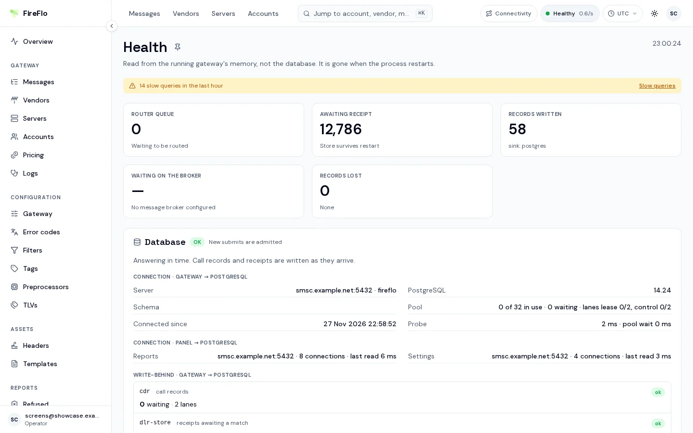
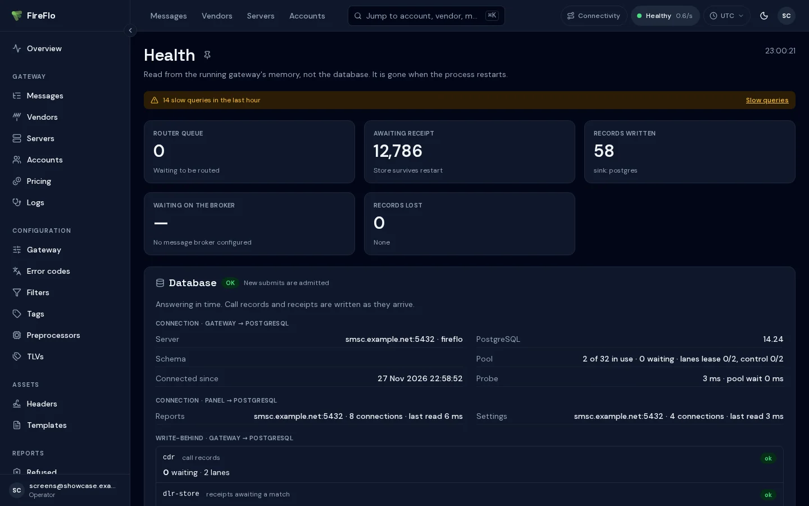
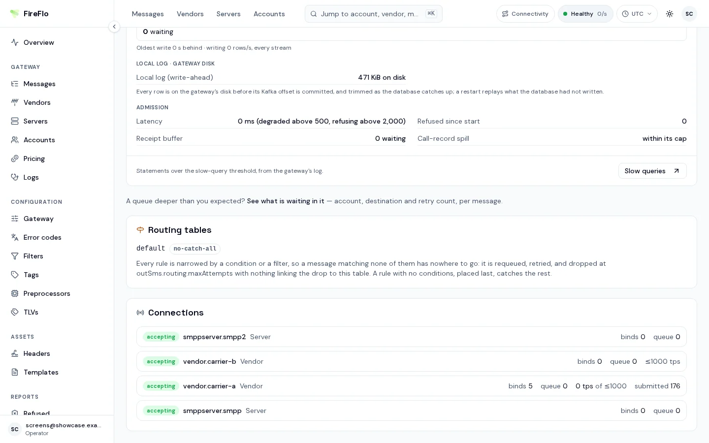
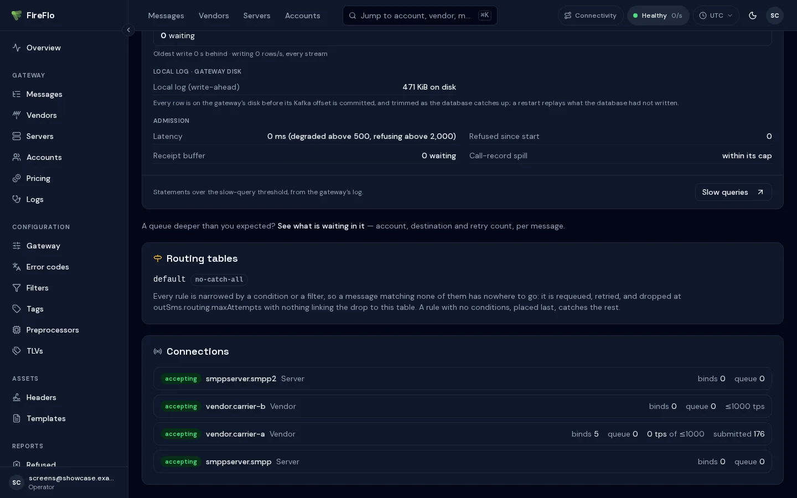
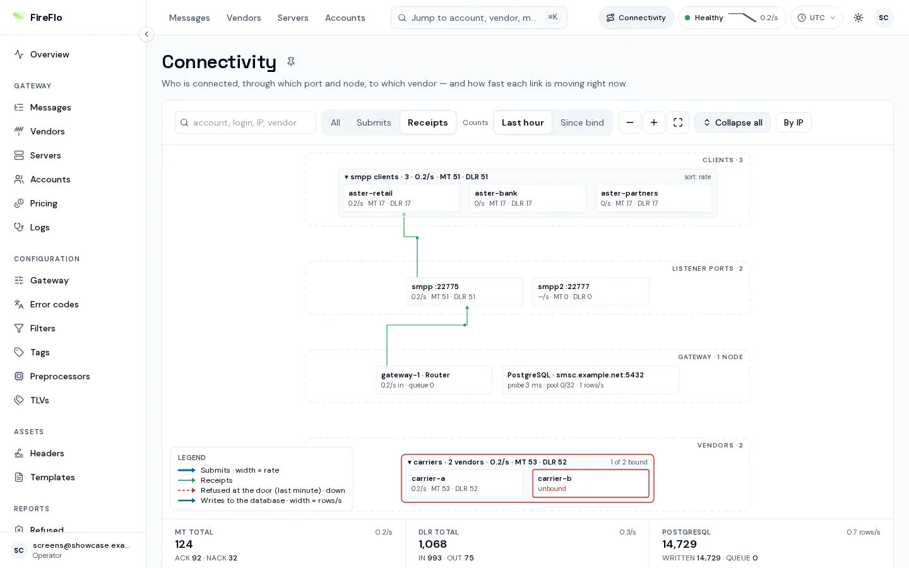
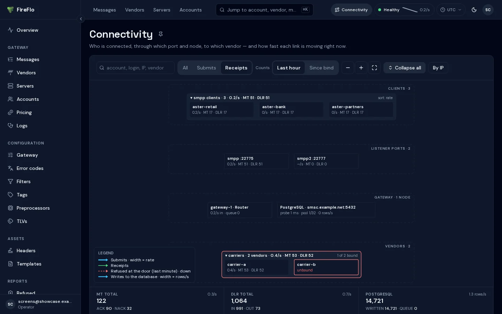

Trois surfaces répondent à trois questions différentes, et attraper la mauvaise gaspille un incident :

| Surface | Répond |
| :--- | :--- |
| `/q/metrics` | **Combien, au fil du temps** |
| Tables d'enregistrements d'appels | **Ce qui est arrivé** à un message spécifique |
| `/ops/health` | **Ce qui est vrai maintenant**. Binds, profondeur de file, accusés en vol |

La troisième existe parce que cet état ne vit que dans la JVM en cours. Rien d'autre ne peut le rapporter.

```bash
curl -H "Authorization: Bearer $TOKEN" http://localhost:9000/ops/health
```

```json
{
  "data": {
    "observed_at": "2026-08-05T11:28:50Z",
    "router_queue": 0,
    "router_queue_capacity": 50000,
    "awaiting_receipt": 5139,
    "dlr_store_persistent": true,
    "config_sources": {
      "properties": "database", "credentials": "file",
      "routing": "database", "rates": "database"
    },
    "tps_window_seconds": 5,
    "cdr": { "enabled": true, "sink": "postgres", "written": 1, "failed": 0 },
    "workers": [
      { "name": "smppclient.vendor1", "type": "smppclient", "accepting": true,
        "bound": 1, "bound_transmittable": 1,
        "queue_depth": 0, "queue_capacity": 50000, "submitted": 1,
        "tps_limit": 200, "tps_measured": 12.4,
        "sessions_total": 1,
        "sessions": [ "…" ] },
      { "name": "smppclient.vendor2", "type": "smppclient", "accepting": false,
        "bound": 0, "queue_depth": 0,
        "last_error": "Bind failed: ESME_RINVPASWD (Invalid password)",
        "last_error_at": "2026-08-06T09:12:04Z" }
    ]
  }
}
```

## `sessions` est un échantillon, pas l'ensemble

<Warning>
**Au plus 20 sessions par worker apparaissent dans cette réponse, quoi que dise `sessions_total`.**

Health est sondé toutes les quelques secondes par chaque tableau de bord ouvert, et un listener portant cinq cents binds envoyait cinq cents lignes à chaque fois.

**Compter le tableau pour répondre « combien sont bindés » donne un mauvais nombre qui semble plausible.** Utilisez `bound`, ou `sessions_total` pour le compte de lignes.
</Warning>

Pour voir ou chercher l'ensemble complet, paginez-le :

```bash
curl -H "Authorization: Bearer $TOKEN" \
  'http://localhost:9000/ops/workers/smppserver.smpp/sessions?q=acme&offset=0&limit=50'
```

```json
{ "data": { "rows": [ "…" ], "total": 412, "matched": 3, "offset": 0, "limit": 50 } }
```

`q` correspond sans tenir compte de la casse par sous-chaîne sur `account`, `system_id`, `host`, `system_type` et `bind_type`. **Les colonnes numériques ne sont délibérément pas cherchées.** Sinon `50` correspondrait à un débit de 50, un port 2750 et une session ouverte depuis 50 secondes en même temps.

`total` compte chaque session ; `matched` compte celles passant `q`. Les deux sont rapportés parce qu'un opérateur qui a filtré sur un client a toujours besoin de savoir que le listener porte quatre cents binds.

`limit` a pour défaut 50, plafonné à 200, et **la réponse renvoie la taille effectivement appliquée**. Donc un appelant demandant 10 000 peut voir qu'il a obtenu 200 plutôt que de conclure qu'il n'y avait que 200 sessions.

## Les champs qui valent la peine d'être alertés

| Champ | Surveiller |
| :--- | :--- |
| `bound_transmittable` | Zéro alors que `bound` ne l'est pas. Une session receiver-only ne porte rien |
| `last_error` | **Présent** signifie qu'un bind a été refusé ; **vide** signifie que le socket ne s'est jamais ouvert |
| `router_queue` contre `router_queue_capacity` | Une croissance soutenue est le routage plus lent que l'ingress |
| `awaiting_receipt` | La croissance signifie que les accusés ne reviennent pas |
| `queue_depth` par worker | Un seul vendeur qui s'engorge |
| `cdr.failed` | Non nul signifie que des enregistrements sont perdus |

<Tip>
**`last_error` est le champ qui sépare les deux échecs qu'un badge ne peut pas.** Une valeur signifie que le socket s'est ouvert et que le bind a été refusé. Identifiants, system type, IP, une limite de bind. Vide signifie que le socket ne s'est jamais ouvert du tout. Pare-feu, DNS, ou le bout d'en face en panne.

Il s'efface au moment où un bind réussit.
</Tip>

## `config_sources` répond à une question que les gens posent à l'envers

Il dit, par domaine, si le gateway lit les fichiers ou la base.

Cela compte parce que **un changement fait dans le panel ne fait rien si le gateway lit un fichier pour ce domaine**. Et le symptôme est « ma modification ne s'est pas appliquée », ce qui fait chercher les gens sur la modification.

## `bound: 0` sur un listener est généralement bien

Sur un **vendeur** cela signifie que rien n'est connecté et rien ne peut être envoyé.

Sur un **listener** cela signifie généralement qu'aucun client n'est connecté maintenant. Ce qui est calme plutôt que cassé. C'est pourquoi un listener sans personne bindé n'est pas peint en rouge comme un vendeur sans session.

## Dans le control panel

La **pastille de santé** dans l'en-tête de chaque page du panel lit cet endpoint : un point, un mot comme **Healthy**, et le débit sortant. Choisissez-la pour ouvrir **Health**, qui est la même réponse mise en page pour être lue. Elle est lue dans la mémoire du gateway en marche, pas dans la base de données, et disparaît quand le processus redémarre.

<Frame caption="Health : la file du routeur, les accusés en attente de correspondance et les enregistrements écrits ou perdus en haut, puis la base de données dans laquelle le gateway écrit.">
  
  
</Frame>

| Tuile | Champ |
| :--- | :--- |
| **Router queue** | `router_queue` |
| **Awaiting receipt** | `awaiting_receipt` ; la ligne en dessous dit si le magasin survit à un redémarrage |
| **Records written** | `cdr.written`, avec le sink |
| **Waiting on the broker** | la profondeur du broker, ou le fait qu'aucun n'est configuré |
| **Records lost** | `cdr.failed` ; les écritures échouées ne sont pas réessayées |

Sous les tuiles, la carte **Database** montre la connexion du gateway, ses writers et la latence qui admet ou refuse les nouveaux submits. Une carte **Routing tables** n'apparaît que lorsqu'une table a un problème qui mérite d'être signalé, comme l'absence d'une règle qui attrape tout le reste. **Connections** liste chaque listener et chaque vendeur avec son état, ses sessions bindées (et combien peuvent transmettre, quand cela diffère), sa file, son débit par rapport à son plafond et les messages soumis ; une ligne avec des sessions s'ouvre pour les lister.

<Frame caption="Les Connections de Health : un vendeur bindé cinq fois et qui envoie, l'autre qui accepte sans bind ; les listeners sans personne de bindé sont calmes, pas cassés.">
  
  
</Frame>

### La carte Connectivity

**Connectivity**, à côté de la pastille de santé, dessine le même état en direct sous forme d'une seule carte : les clients bindés en haut, puis les ports de listener par lesquels ils sont entrés, le nœud du gateway et sa base de données, et les vendeurs en bas, avec le trafic qui circule le long de chaque lien. La largeur d'un lien est son débit ; un lien rouge en pointillés signale des refus à la porte dans la dernière minute, ou un lien coupé.

- **All**, **Submits** et **Receipts** choisissent quels flux sont dessinés.
- **Counts** lit MT et DLR sur la **Last hour**, ou **Since bind** depuis les compteurs de chaque session.
- La recherche trouve un compte, un login, une IP ou un vendeur sur la carte ; le zoom et **Fit** la déplacent ; **Expand all** ouvre chaque groupe ; **By IP** divise chaque client en une boîte par adresse depuis laquelle il se connecte.
- Choisissez une boîte pour ce que vous pouvez en faire : ouvrir son compte, son listener ou son vendeur, sa santé, ses files ou sa table de routage, ou agir dessus depuis le même menu.

Les totaux de MT, de DLR et d'écritures en base se trouvent sous la carte.

<Frame caption="La carte avec Receipts choisi et chaque groupe ouvert : trois clients bindés sur un port, des accusés qui remontent vers eux depuis un vendeur pendant que l'autre n'est pas bindé.">
  
  
</Frame>

## Connexes

<CardGroup cols={2}>
  <Card title="Le port de gestion" icon="server" href="/reference/management/endpoints">
    Chaque endpoint, et quel token chacun nécessite.
  </Card>
  <Card title="Binds et listeners" icon="triangle-exclamation" href="/platform/troubleshooting/binds-and-listeners">
    Trois échecs qui ressemblent tous à « personne n'est connecté ».
  </Card>
</CardGroup>
