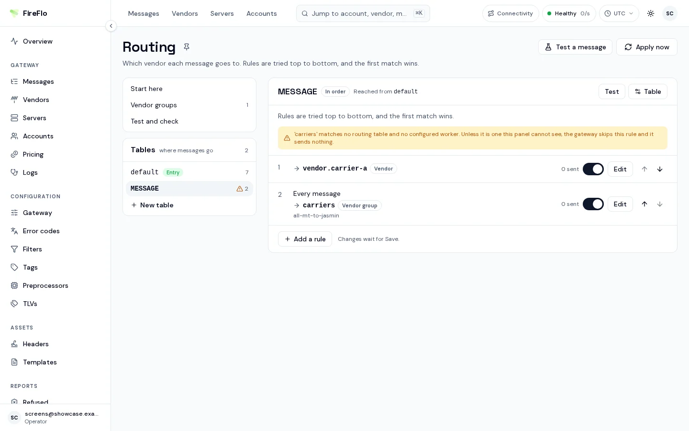
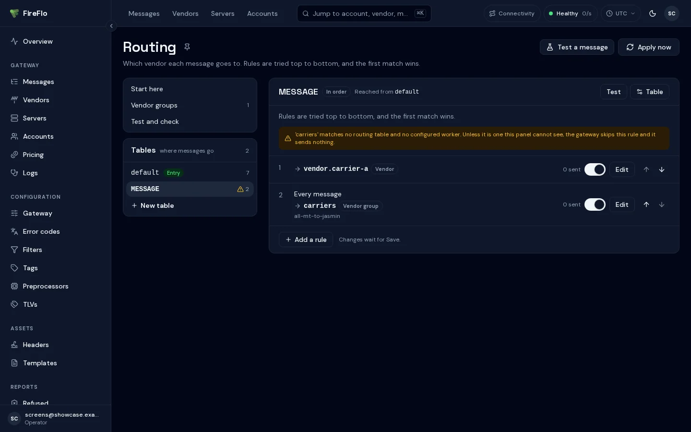
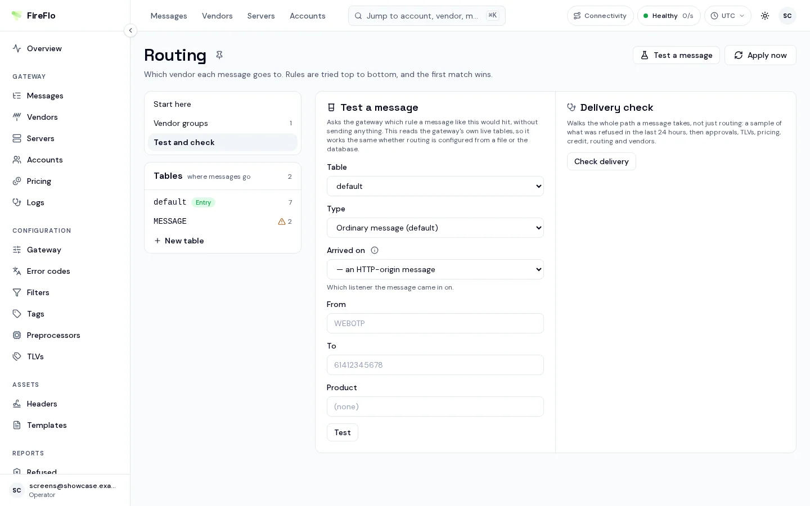
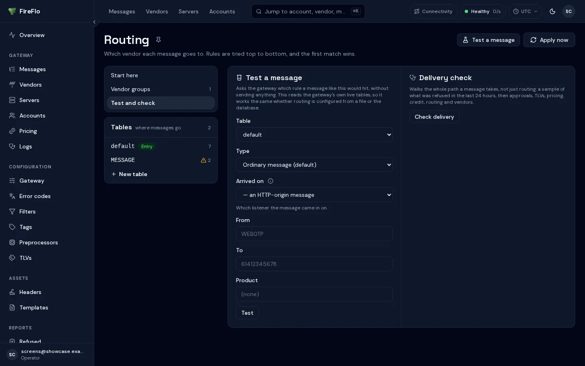
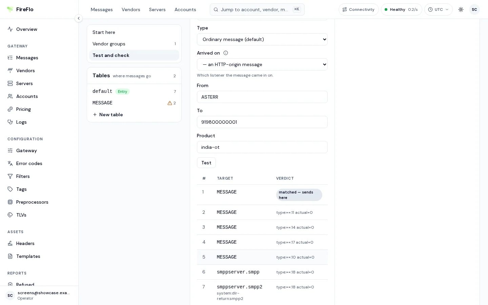
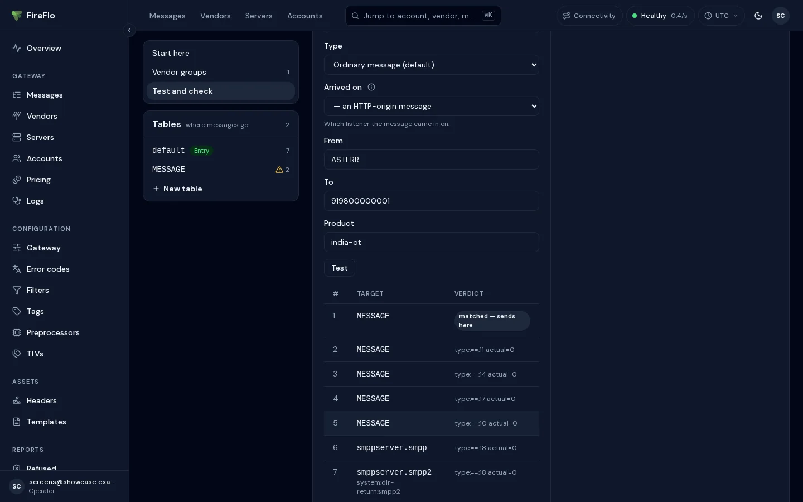
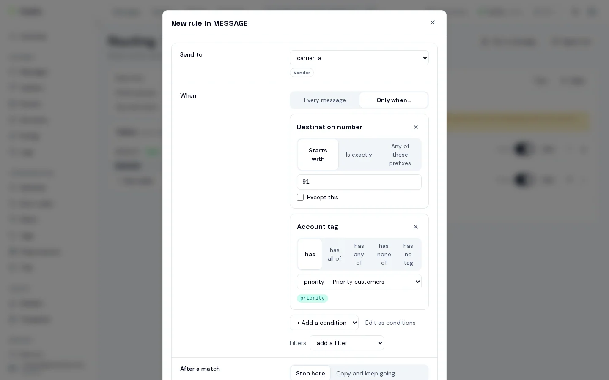
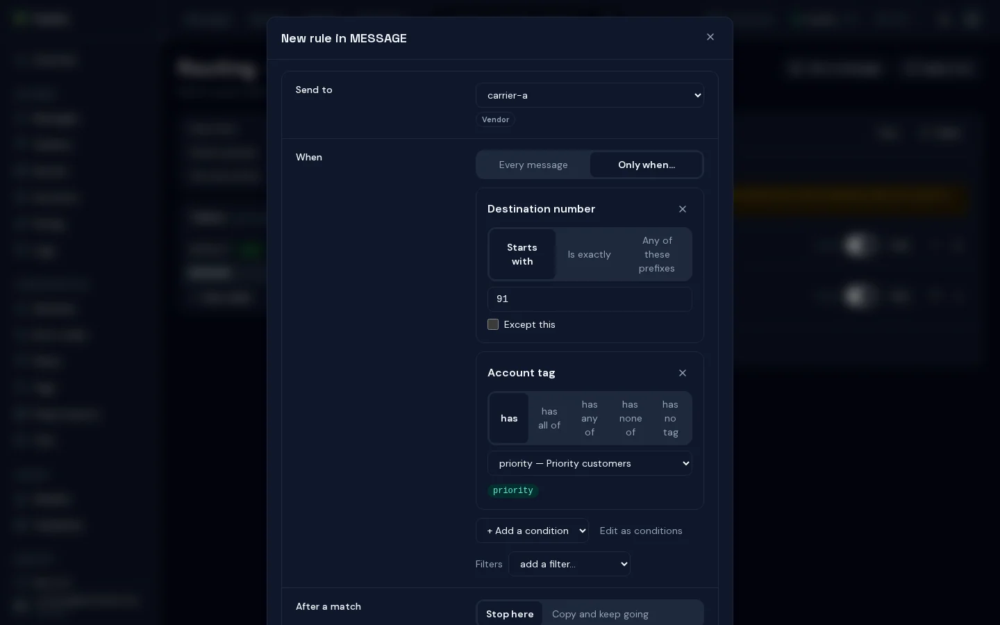

## Trois façons d'écrire une règle qui ne peut jamais être vraie

Chacune de celles-ci se charge sans se plaindre, ne correspond à rien, et coûte un après-midi.

<Warning>
**`==` est un opérateur numérique.** `vendor1:from:==:MyBrand` n'échoue pas silencieusement à
correspondre : il échoue à *parser*, ce qui fait échouer tout le rechargement et laisse la table
précédente en service. Utilisez `equals` pour du texte.

```
vendor1:from:equals:MyBrand      correct
vendor1:from:==:MyBrand          échec de parsing
```
</Warning>

<Warning>
**`matches` est une expression régulière et elle est ancrée**, parce que la passerelle appelle
`Pattern.matches` plutôt que `find`. `^61.*` correspond à toute une destination ; un simple `61` ne
correspond qu'à la chaîne de deux caractères `61`.

**`startsWith` compare du texte littéral.** Une expression régulière qu'on lui passe demande si une
destination commence littéralement par les caractères `^(?:\+61` — rien n'y correspond, donc la règle
est stockée, chargée, affichée, et ne se déclenche jamais. Le panneau de contrôle avertit à ce sujet ;
un fichier édité à la main non.
</Warning>

<Warning>
**Un champ non défini ne correspond à aucun opérateur positif.** `product:equals:premium` ne correspond
pas à un message ne portant aucun produit, et `product:startsWith:prem` non plus. Seul `isNull` le
fait.

L'inverse piège dans l'autre sens : `product:!equals:premium` **se déclenche bien** pour un message
sans produit, parce que la négation inverse la correspondance échouée.
</Warning>

## La grammaire

```
Target:Attribute:Operator:Value
```

Les règles sont évaluées de haut en bas au sein d'une table, et la première correspondance l'emporte.
`Target` est une instance de worker (`vendor1`, `smppserver.smpp`), un **groupe**, ou une autre table
sur laquelle enchaîner (`MESSAGE`).

<Tabs>
  <Tab title="Panneau de contrôle">
    **Routing** liste chaque table avec ses règles dans l'ordre, chacune avec sa cible, un
    interrupteur et le nombre de messages qu'elle a fait correspondre depuis le dernier démarrage de la
    passerelle. **Add a rule** ouvre l'éditeur ; les modifications d'une table attendent **Save**.
    L'éditeur valide l'opérateur par rapport au champ avant l'enregistrement, refuse un opérateur
    numérique sur un champ texte, et avertit à propos d'une expression régulière écrite dans un
    opérateur littéral.
  </Tab>
  <Tab title="routingTable.conf">
```ini
[MESSAGE]
vendor2:to:startsWith:614          # mobile AU
vendor2:from:equals:MyBrand        # un seul ID d'expéditeur
vendor3:systemId:equals:acme-smpp  # un seul client bindé
vendor1::default:                  # l'attrape-tout, EN DERNIER
```
  </Tab>
</Tabs>

<Frame caption="Une table de routage : ses règles dans l'ordre, chacune avec sa cible, son interrupteur et son nombre de correspondances. L'avertissement signale qu'une règle nomme une cible que la passerelle ne connaît pas.">
  
  
</Frame>

<Warning>
**L'attrape-tout se met à la fin.** Au-dessus des autres règles, il rend toutes les règles qui le
suivent inaccessibles, et rien ne vous avertit dans le fichier — elles parsent bien, elles ne
s'exécutent tout simplement jamais. Le panneau le signale ; la passerelle l'enregistre comme
`unreachable-rules` sur `/ops/health` et continue.
</Warning>

## Opérateurs

Tout opérateur peut être nié avec un `!` en tête. Dans l'éditeur de règles, c'est **Except this**
(**Except these** pour une liste de préfixes) sous une condition.

| Type | Opérateurs |
| :--- | :--- |
| Toujours vrai | `default` — attribut et valeur laissés vides |
| Texte | `equals`, `equalsIgnoreCase`, `matches`, `startsWith`, `startsWithAny`, `endsWith`, `greaterThan`, `greaterEqual`, `lessThan`, `lessEqual`, `isNull` |
| Booléen | `isTrue`, `isFalse` |
| Numérique | `==`, `>`, `>=`, `<`, `<=` |

`startsWithAny` prend une liste de préfixes littéraux séparés par des virgules, sans espaces :
`91,+91,0091`. Chacun est comparé exactement tel qu'écrit — `91` ne correspond pas à `+919812345678` —
et une longue liste ne coûte pas plus par message qu'une courte. Une liste vide, ou une entrée contenant
un espace, est refusée au chargement de la règle.

## Quand un changement prend effet

La passerelle prend en compte une table enregistrée en moins de trente secondes. **Apply now**, sur les
pages Routing, Pricing et Filters et sous une table que vous venez d'enregistrer, lui fait lire le
changement immédiatement. Sur une passerelle dont la licence n'est pas à jour, le bouton le dit : les
changements de configuration sont gelés jusqu'à ce que la licence le soit, et rien de ce que vous
enregistrez n'atteint la passerelle en marche.

## Tester un message avant qu'il soit envoyé

**Test a message**, sur les pages Routing, Pricing et Filters, prend une destination, un sender ID, un
product et un compte, et demande à la passerelle en marche ce qu'elle en ferait — rien n'est envoyé ni
facturé. Laissez le product vide et le test s'exécute comme le login du compte l'enverrait : un vrai
message porte toujours le product de son login (ou le `system_type` avec lequel il s'est bindé), et
une règle de prix enregistrée sous un product ne tarifie que les messages qui le portent. Le testeur
indique sur chaque onglet sous quel product il s'est exécuté. Trois onglets répondent à partir des
mêmes comparateurs que ceux du chemin du message :

- **Routing** parcourt les tables de `default` jusqu'au fournisseur, et montre chaque règle essayée
  avec la condition qui a échoué, face au texte exact comparé.
- **Pricing** montre la règle qui fixe le prix du compte, le coût du fournisseur, et la marge.
- **Filters** montre chaque filtre nommé, correspondant ou non, et les règles qui l'utilisent.

Quand rien ne correspond, il propose de créer la règle, ouverte dans l'éditeur avec l'indicatif pays de
la destination pré-rempli, à vous de le corriger.

**Test and check**, dans le rail de la page Routing, place un testeur de routage seul à côté de
**Delivery check**. Le testeur prend la table de départ, le type de message, le listener sur lequel il
est arrivé, un expéditeur, une destination et un product, et lit les tables vivantes de la passerelle,
que le routage soit configuré depuis un fichier ou depuis la base de données. **Delivery check**
parcourt tout le chemin d'un message, pas seulement le routage : un échantillon de ce qui a été refusé
dans les dernières 24 heures, puis les approbations, les TLV, la tarification, le crédit, le routage et
les fournisseurs. Là où il trouve un défaut, il dit comment le corriger.

<Frame caption="Test and check : le testeur de message à gauche, le delivery check à droite. Aucun des deux n'envoie quoi que ce soit.">
  
  
</Frame>

La réponse du testeur liste les règles de la table dans l'ordre : celle sur laquelle tombe le message,
et pour chaque règle qui n'a pas correspondu, la condition qui a échoué et ce que contenait le message.

<Frame caption="Le verdict d'un test : la règle 1 a correspondu et envoie ici ; pour les autres, le type que chacune voulait et le type qu'avait le message.">
  
  
</Frame>

Les quatre comparaisons texte sont lexicographiques, pas numériques : `greaterThan` sur un numéro de
téléphone compare des chaînes.

## Qui l'a envoyé

| Attribut | Source |
| :--- | :--- |
| `owner_id` | Le `accountId` du credential, retombant sur son `systemId`. Sur l'API HTTP, un paramètre `account` explicite le surcharge. |
| `systemId` | Le `systemId` du credential — le client bindé spécifique, quand plusieurs partagent un compte. |
| `product` | Le `system_type` sur le bind SMPP du client, retombant sur le `product` du credential. Les appelants HTTP n'ont pas de bind, ils utilisent donc toujours la valeur du credential. |
| `tag` | À partir de 0.17.0, les étiquettes du compte : les siennes et, pour un compte à unités, celles de son parent. Seulement `equals` (porte l'étiquette ; une liste séparée par des virgules les exige toutes), `startsWithAny` (porte l'une d'une liste) et `isNull` (n'en porte aucune), chacun pouvant être nié. Configuration en base de données uniquement. Voir [Étiquettes de compte](/platform/routing/account-tags). |

`product` est la façon dont un client sélectionne le routage par session : le même credential se
bindant avec `system_type=premium` et `system_type=bulk` produit deux sessions qui routent
différemment. Voir [Concepts](/platform/concepts).

Types de message pour les règles `type` : `0` texte, `10` binaire, `11` UCS-2, `14` flash, `17` push,
`18` accusé de livraison.

## Conditions sur la cible, pas sur le message

Préfixer un champ avec `target.` lit un champ du worker de destination à la place, ce qui permet à une
règle de contourner un fournisseur qui prend du retard :

```
vendor2:target.queueSize:>i:5000
```

Il y en a exactement quatre — `queueSize`, `sentPendingRate`, `sentDeliveredRate`, `sentFailRate` —
appariés sans tenir compte de la casse, et un champ non reconnu est refusé au parsing avec les quatre
listés.

<Note>
`marginPercentage` et `marginStatus` sont des champs de **message**, donc retirez le préfixe `target.`
et ils se résolvent. Attention à ce qu'ils contiennent : les deux sont définis sur la réponse de
soumission, après que le message est parti, donc une condition de routage sur l'un ou l'autre lit
`NOT_CALCULATED` à chaque première tentative.
</Note>

## Copier et continuer

Un `+` sur la cible copie le message vers cette cible et **continue à parcourir**, au lieu de router et
d'arrêter. Dans la base de données, c'est la colonne `copied`. Dans l'éditeur de règles, c'est **After
a match → Copy and keep going** ; **Stop here** est la règle ordinaire.

<Frame caption="Une nouvelle règle : où elle envoie, ses conditions (destination commençant par 91, étiquette de compte priority), ses filtres, et si elle s'arrête là.">
  
  
</Frame>

## Groupes de fournisseurs

Une règle peut cibler un groupe au lieu d'un seul fournisseur. Le groupe choisit un membre, **en
sautant tout membre suspendu ou n'acceptant pas** — ce saut est le failover qu'une règle à cible unique
ne peut pas faire.

```ini
[group:asia->policy(weighted)]
vendor1 = 70
vendor2 = 30

[group:primary-then-backup->policy(failover)]
vendor1
vendor2
```

| Politique | Choisit |
| :--- | :--- |
| `round-robin` *(défaut)* | Le membre suivant à tour de rôle |
| `weighted` | En proportion des poids, de façon déterministe — 70/30 est exactement 70/30 sur cent messages, entrelacés plutôt que par blocs |
| `failover` | Toujours le premier membre qui est en service, dans l'ordre déclaré |

<Warning>
**Les blocs de groupe doivent venir avant le premier en-tête `[table]`.** À l'intérieur d'un bloc de
table, une ligne de membre ne correspond à rien et est jetée silencieusement, si bien que le groupe se
retrouve avec moins de membres qu'il ne semble avoir, ou aucun.

Un poids n'est lu que par `weighted`. En définir un sur les deux autres ne change rien, et la
passerelle le dit en WARN plutôt que de vous laisser croire qu'un partage se produit.
</Warning>

<Note>
**Un message, un débit, une destination.** Un groupe sélectionne toujours exactement un membre, et
`+copied` sur une règle de groupe copie encore vers un seul membre — un fanout serait N envois pour un
seul débit.

Si tous les membres sont hors service, la règle n'envoie rien, journalise `cause=group-all-dead` en
nommant tous ceux qu'elle a essayés, et le parcours **continue vers la règle suivante**, ce qui
maintient accessible une règle de repli écrite en dessous d'une règle de groupe.
</Note>

Référence complète de la grammaire : [routingTable.conf](/reference/files/routing-table).
