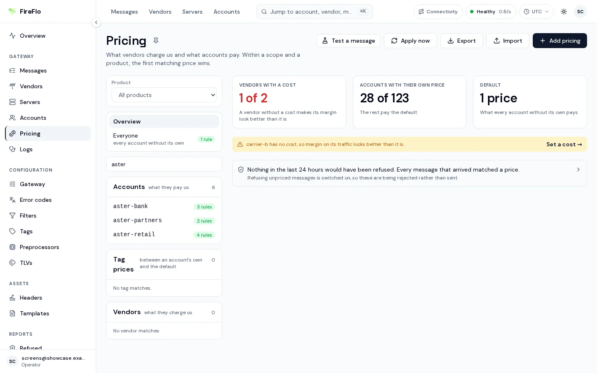
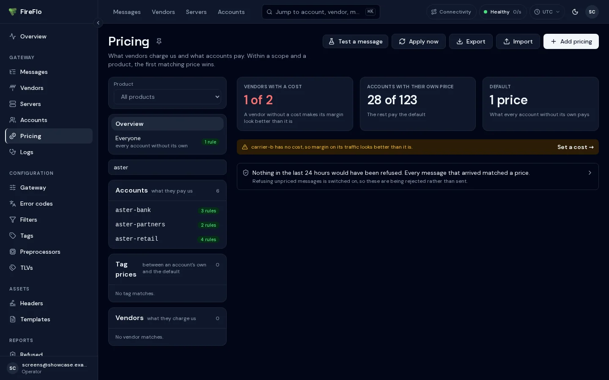
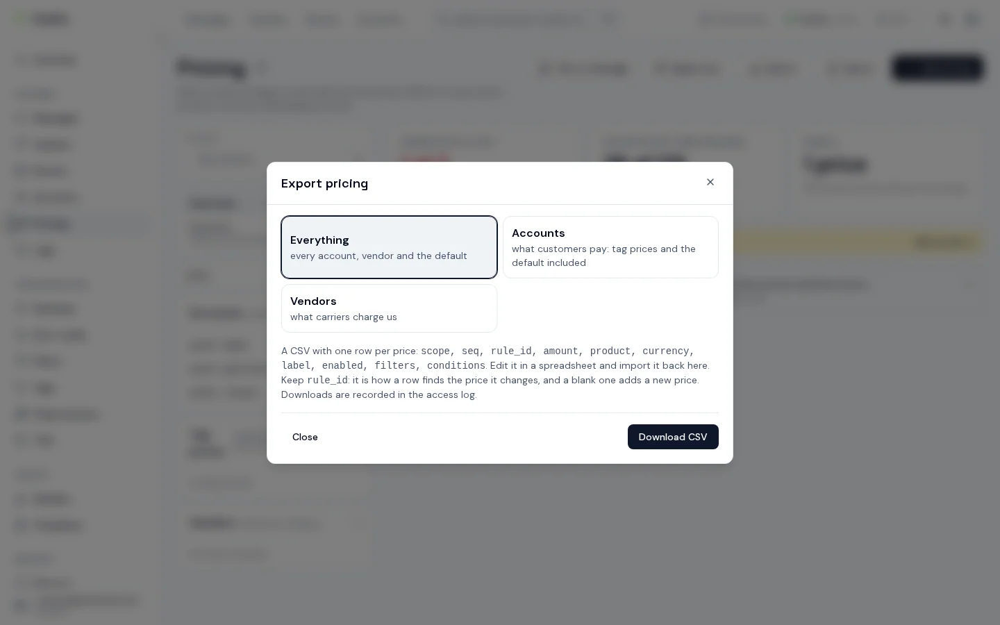
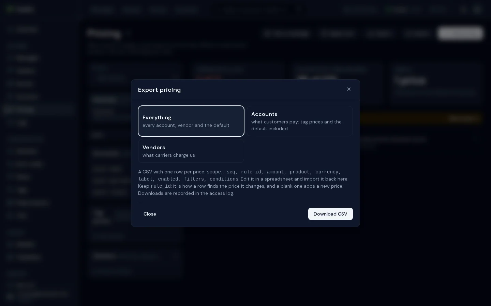

## Editing rates from the panel

Prices are edited on the **Pricing** page. Down the left are the scopes: **Everyone** (the `*`
default), **Accounts** (what they pay us), **Tag prices** and **Vendors** (what they charge us). The
**Product** picker narrows the page to one product.

<Frame caption="The Pricing page. The tiles answer the questions that cost money: which vendors have no cost, how many accounts pay their own price, and what everyone else pays.">
  
  
</Frame>

Open a scope to see its prices, grouped by product. Edits, additions, moves and switching a price on or
off are staged and saved together. **Add pricing** asks whose prices to add — an account, a vendor, a
tag or everyone — and opens that scope. When a product has no default, its page and the Pricing
overview offer **Set what everyone pays**.

From 0.17.0 the *Pricing* page also lists **Tag prices**: a price list per [account tag](/platform/routing/account-tags),
tried after an account's own prices and before the default, in the order of the Tags list.

An account's **Tariff** tab shows the same prices for that one account, and which level would price
it. When a managing platform has set a custom tariff for the account, the tab shows it above the
rules: it is priced ahead of them, and it is changed only on that platform.

<Warning>
An account's own rules are tried first and **the first match wins**, so anything the account carries
beats the default — **including a bare catch-all**.

That is what makes a negotiated tariff an override rather than a suggestion. It also means an
account-level catch-all silently disables every default you set afterwards. The same holds for tag prices: an
account's own catch-all beats them too.
</Warning>

## Exporting and importing pricing

**Export** on the Pricing page downloads prices as a CSV, one row per price: **Everything**,
**Accounts** (what customers pay, with tag prices and the default) or **Vendors** (what carriers
charge us). Downloads are recorded in the access log.

<Frame caption="Export pricing. Keep the rule_id column when you edit the file: it is how a row finds the price it changes.">
  
  
</Frame>

Edit the file in a spreadsheet and bring it back with **Import** (up to 2 MB). A row with a blank
`rule_id` adds a new price.

<Warning>
**Each account or vendor named in the file is replaced by the file's rows.** A price the file does not
list for that scope is removed. Scopes the file does not name are left as they are.
</Warning>

Nothing changes until you have read the preview. It lists, per scope, what is added, changed and
removed. Removals have to be switched on separately before **Apply** is offered, and applying asks
once more. Each scope is saved on its own, so if one fails the ones before it are already applied. The
gateway prices by the new rows from its next configuration poll.

## Two identities, not one

Whether an account's credit adds up is checked against **two** equations. Getting this wrong reports a
false discrepancy on every account, so it is worth stating precisely.

```
MONEY:        Σ(RECHARGE + TRANSFER)  =  balance + reserved
CONSUMPTION:  reserved − consumed     =  credit reserved but not yet spent   (≥ 0)
```

<Warning>
**The obvious equation is wrong.** `credited − consumed = balance + reserved` was written that way in
the design and the data refuted it immediately — it was out by exactly the consumption on every
account.

Consumption never touches the balance columns. Credit is reserved in blocks (`balance -= n,
reserved += n`), spent from an in-memory counter, and **the spent part is never written back**. So
`reserved` is a lifetime-consumed counter, not a hold, and every movement the database sees leaves
`balance + reserved` unchanged.
</Warning>

The money identity holds to the unit on every account, which is what makes a genuine discrepancy
meaningful.

### What is excluded, and why

| Entry type | Counted? | Why |
| :--- | :--- | :--- |
| `RECHARGE`, `TRANSFER` | **Yes** | Money entering the account |
| `RESERVE`, `RELEASE` | No | They move an amount between two columns of the same row, netting to zero |
| `BILL` | No | A closed period records what was invoiced and moves nothing |

## Lifetime, never a period

Credit is a **running total**. Any shorter window needs an opening balance that nothing records — and
a wrong opening figure invents a discrepancy every time it is run.

<Tip>
So "reconcile this account for March" is not a question the data can answer. "Reconcile this account"
is, and always has been.
</Tip>

## Where the two sides come from

| Side | Source |
| :--- | :--- |
| Credited | `Σ RECHARGE + TRANSFER`, **applied only** — pending entries have not moved money |
| Consumed | `usage_daily` for rolled-up days **plus** `cdr_submit` for the live tail |

Never both for one day. That is the join that makes reconciliation survive the retention window: once
a day is rolled up and purged, its consumption still counts.

## When the numbers do not agree

Work through in this order:

<Steps>
  <Step title="Are there pending recharges?">
    A `RECHARGE` for an account with no `account_balance` row credits nothing and stays pending. It is
    in the ledger and not in the balance — which is exactly a money-side gap.
  </Step>
  <Step title="Was there an unclean shutdown?">
    A `kill -9` strands credit in `reserved`. `balance + reserved` is still conserved, so the money
    identity holds — but the account has less spendable than it should until
    `POST /ops/credit/release` runs.
  </Step>
  <Step title="Is the rollup behind?">
    A day neither rolled up nor still in `cdr_submit` is consumption nobody counts. The purge is
    supposed to make this impossible; check it has not been bypassed.
  </Step>
  <Step title="Is the panel reading the same database?">
    `METRICS_DATABASE_URL` against the gateway's `FIREFLO_DB_URL`. A split here makes every figure
    disagree in a way that looks like an accounting bug.
  </Step>
</Steps>

## Related

<CardGroup cols={2}>
  <Card title="How pricing works" icon="tag" href="/platform/billing/how-pricing-works">
    Scopes, the `*` default, and LCR.
  </Card>
  <Card title="Prepaid credit" icon="wallet" href="/platform/billing/prepaid-credit">
    Blocks, reservations and the ledger.
  </Card>
</CardGroup>
