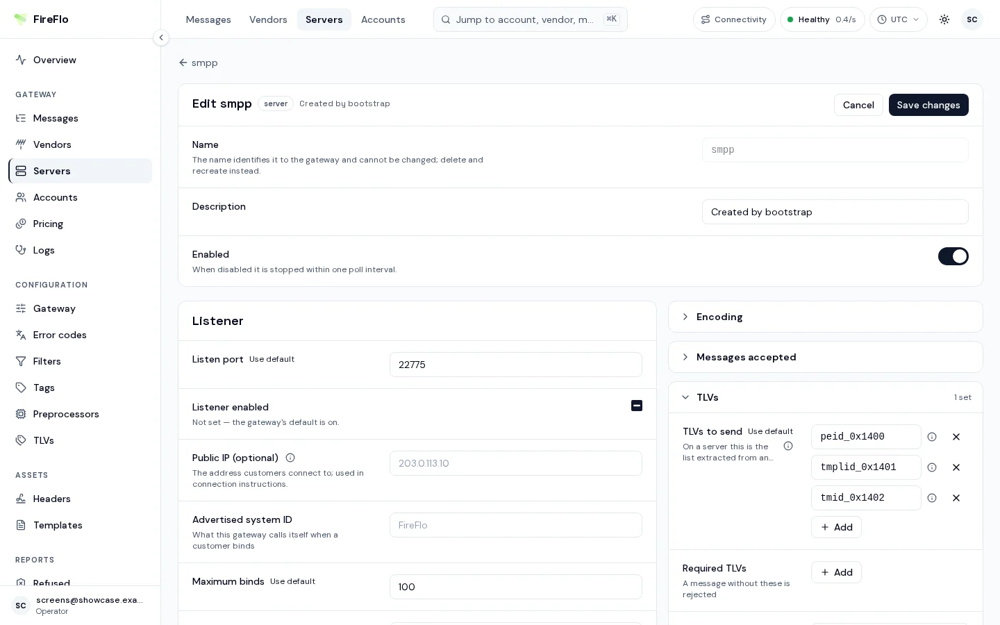
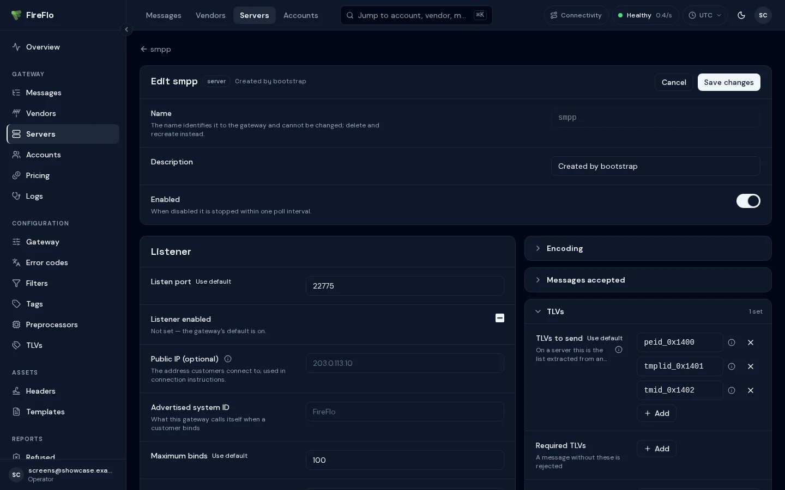
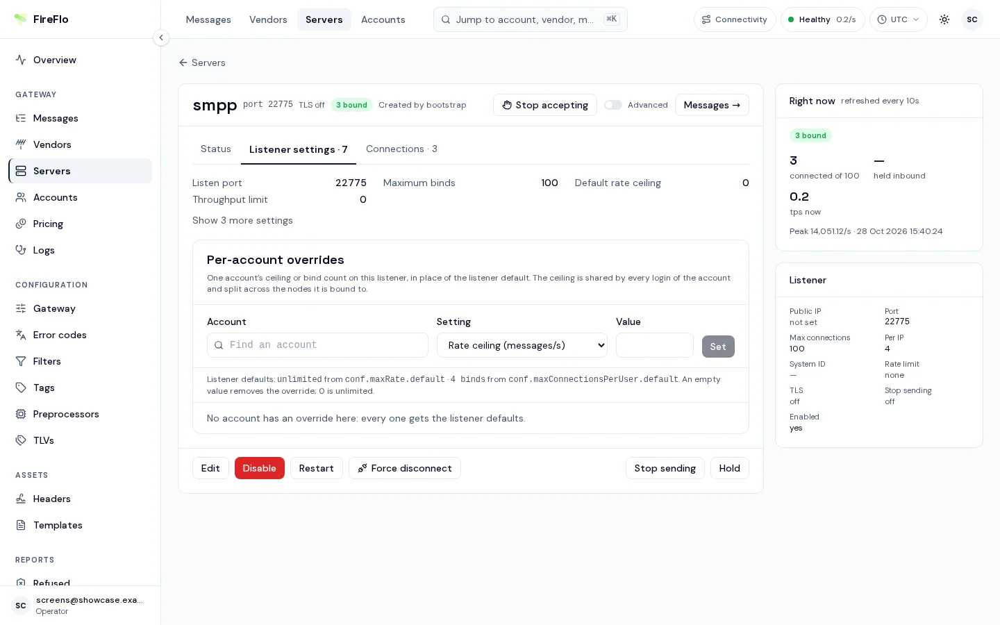
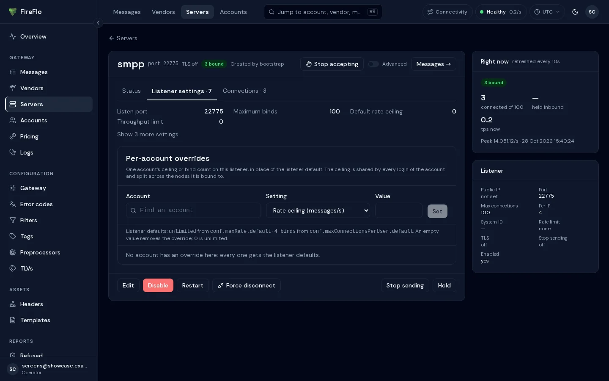
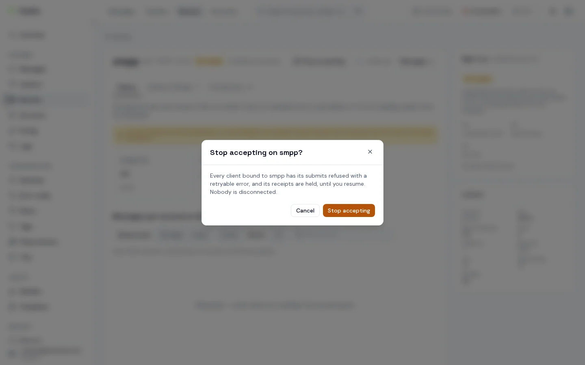
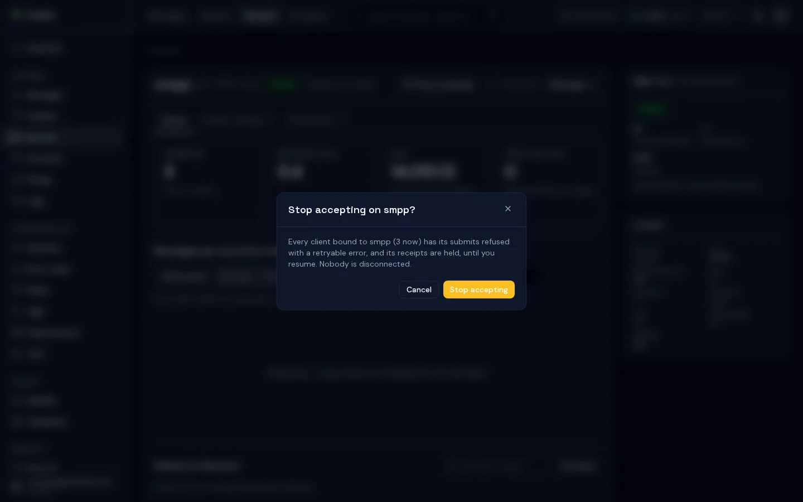
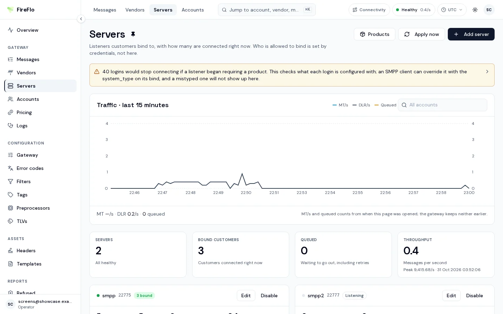
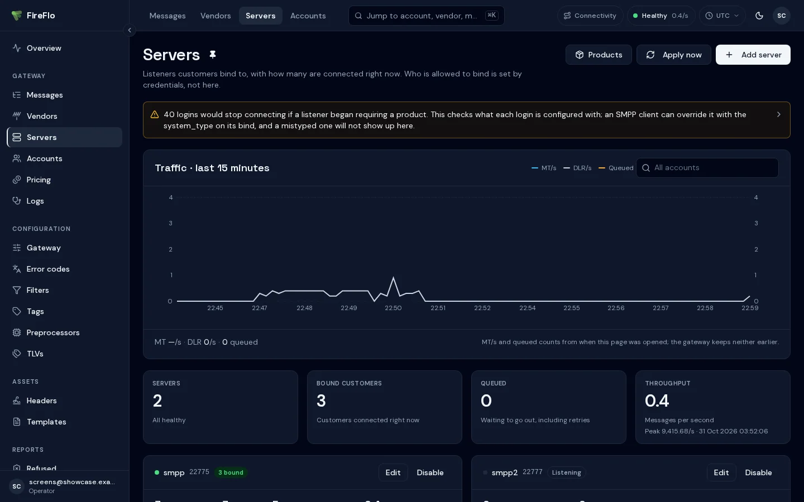
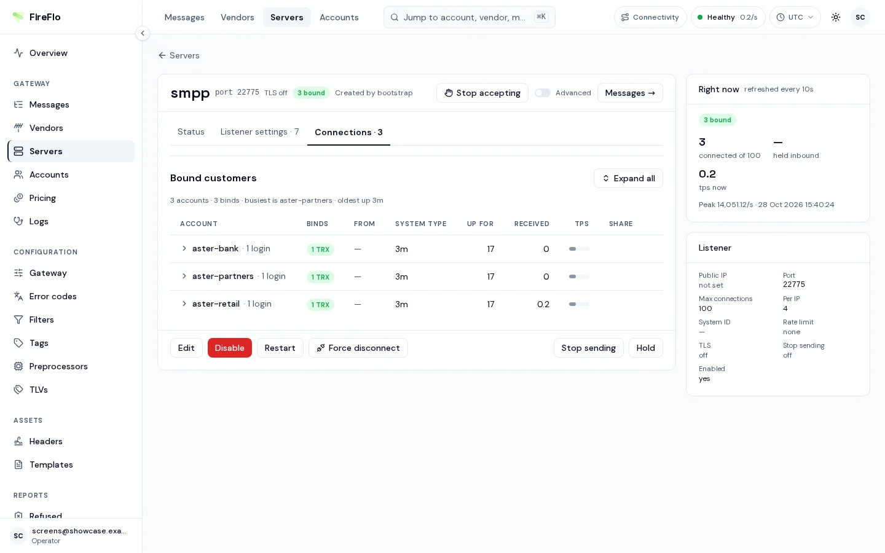
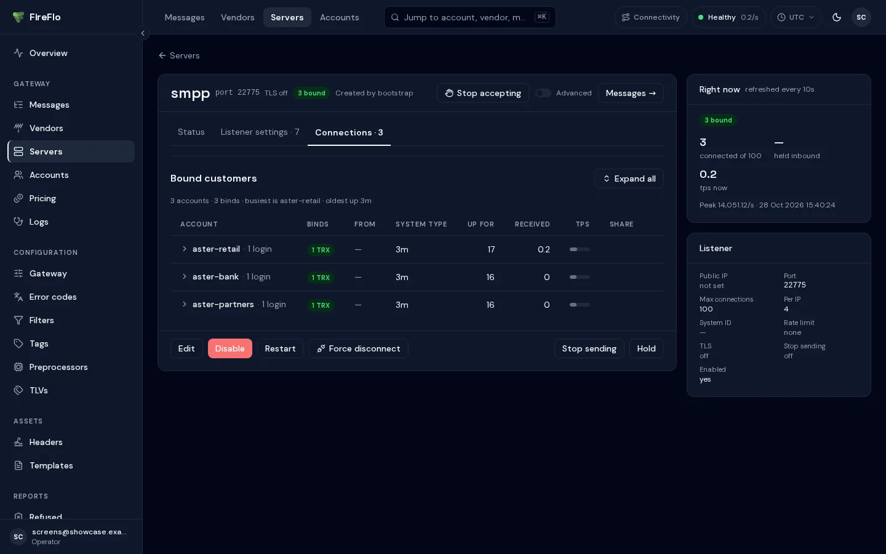

A **server** is a listener your customers bind in to. Adding one is a port, a name, and then the
policy you want applied to everyone who connects to it.

## Adding one

<Tabs>
  <Tab title="Control panel">
    **Servers → Add server.** Name and port are the only required fields; everything else has a
    working default.
  </Tab>
  <Tab title="smsg.properties">
```properties
outSms.instance.smpp.type     = smppserver
outSms.instance.smpp.srv.port = 27777
outSms.instance.smpp.enable   = true
```
  </Tab>
</Tabs>

Every setting is at [Listener settings](/reference/smpp/server).

<Frame caption="A listener's edit form. The name cannot be changed once the listener is added; delete it and add it again instead.">
  
  
</Frame>

<Warning>
**A listener that cannot take its port does not stop the gateway.** It logs and everything else keeps
running — right for a multi-listener deployment, and surprising the first time.

A clean start is not proof every listener is up. Check `/ops/health`.
</Warning>

## What a bind is checked against, in order

<Steps>
  <Step title="The credential">
    `systemId` and `password` must match an enabled `SMPP` credential. See
    [credentials.yml](/reference/files/credentials-yml).
  </Step>
  <Step title="allowedIps, if set">
    Empty means **no restriction** — unless `smsg.smpp.whitelist.first.bind` is on, when the first
    bind saves its address as the login's only allowed one. See
    [Locking a login to its first address](/platform/connections/credentials#locking-a-login-to-its-first-address).
  </Step>
  <Step title="Connection limits">
    `srv.maxConnections` overall, `srv.maxConnectionsPerIP`, and
    `conf.maxConnectionsPerUser.default` per account.
  </Step>
  <Step title="The product, if conf.product.required is on">
    The resolved product must name an **enabled** row in the product catalogue. Blank or unknown is
    refused with `0x40F` — at bind, not at submit, because the product lives on the session context.
  </Step>
</Steps>

### Repeated refused binds pause the address

From 0.12.15, five credential refusals from one address inside a minute and the listener answers
that address's binds with `ESME_RBINDFAIL` for thirty seconds **before** looking at the credential
at all. A successful bind clears the count. It is per listener and on by default;
`srv.bind.backoff.enabled = false` turns it off for a listener whose clients you would rather keep
hammering the credential store. `fireflo_smpp_bind_backoff_total` counts the paused answers, so a
client looping on a wrong password shows up there before it shows up anywhere else.

## Where the product comes from

`system_type` on the bind request when the login may name it (its own product, or one listed under
the products it may select; from 0.12.16 any other value is ignored and logged), falling back to the
credential's `product` field.

<Warning>
`system_type` is free text validated nowhere else. A customer binding `prem` instead of `premium`
passes any non-empty test and lands in the **unrated** state where messages are delivered and charged
nothing.

That is why `conf.product.required` checks **membership of the catalogue** rather than presence of a
value — and why, in file mode, where there is no catalogue, only the non-empty half applies. It is
logged once per configuration load naming the listener.
</Warning>

## What a listener applies to everyone bound to it

| Setting | Effect |
| :--- | :--- |
| `conf.maxRate.default` | Per-account throughput ceiling |
| `conf.maxPending.default` | Window size — unacknowledged requests in flight |
| `forward.dlrs` | **Off suppresses receipts for everyone here**, whatever each customer asked for |
| `conf.whitelist.enabled` | Whether sender ID and content are checked |
| `mandatory.tlvs.submit` | Tags a message must carry, else `0xC3` |
| `inQueue.capacity` | Messages held waiting for the message store |

**Per-account overrides**, on the listener's **Listener settings** tab, give one account its own rate
ceiling or bind count on this listener, in place of the listener default. The ceiling is shared by
every login of the account. An empty value removes the override; `0` is unlimited.

<Frame caption="One account's rate ceiling or bind count in place of the listener default. The defaults it replaces are shown under the form.">
  
  
</Frame>

## The states a listener can be in

| Verb | Effect |
| :--- | :--- |
| `enable` / `disable` | Loaded, or not |
| `suspend` / `resume` | Keep accepting, route nothing: submits are parked and routed on resume, oldest first; once the park is full, submits are refused with a retryable error. Receipts keep flowing to customers |
| `hold` / `release` | Refuse every submit with a retryable error (`ESME_RMSGQFUL`) and **hold receipts**. Nobody is disconnected |

In the control panel, suspend is **Stop sending** and hold is **Stop accepting** (also **Hold**, at
the foot of the listener's page). Each asks before it acts.

<Frame caption="Stop accepting asks first: bound clients have their submits refused with a retryable error and their receipts held until you resume. Nobody is disconnected.">
  
  
</Frame>

The panel shows these as one badge per card. `Listening` with nobody bound is **not** a fault — a
listener with no customers connected is quiet, not broken, which is why it is not painted red the way
a vendor with no session is.

<Frame caption="The Servers page. One listener has three customers bound; the other reads Listening, which only means nobody is bound.">
  
  
</Frame>

## Dropping one customer's bind

```bash
scripts/fireflo disconnect smpp 7
```

Session ids come from `fireflo health`. They are the listener's own counter, so they collide between
listeners and restart with the gateway.

In the control panel, open the listener's **Connections** tab, expand the account and press
**Disconnect** on the session. Tick **Also disable this login** to keep it out as well.
**Force disconnect**, at the foot of the listener's page, drops every session of an address, an
account or a login on that listener.

<Frame caption="The Connections tab: each bound account with its binds, system type, time up and messages received. Expand an account to reach its sessions.">
  
  
</Frame>

<Note>
**This ends a connection; it does not withdraw permission.** A healthy client rebinds within seconds
unless you also disable its login.
</Note>

## Inbound messages

`mo.owner.map` decides which account owns which inbound address. `mo.owner.default` is where an
unmatched one goes — and **empty means nowhere**: the listener logs `message.mo.unmapped` and consumes
it rather than guessing an owner.

Deliberate, because delivering a stranger's message to the wrong customer is worse. But unmapped
traffic disappears quietly unless you watch for that line.
