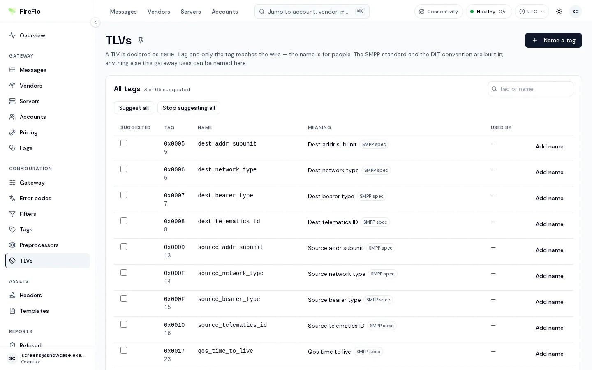
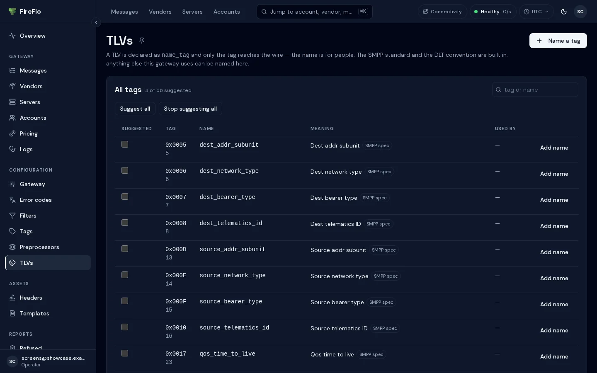
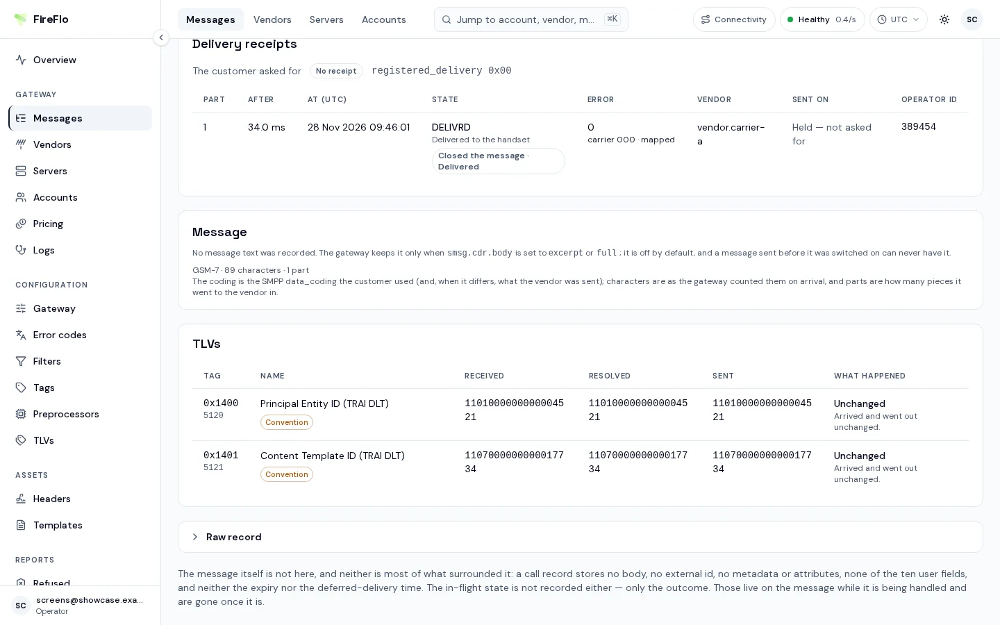
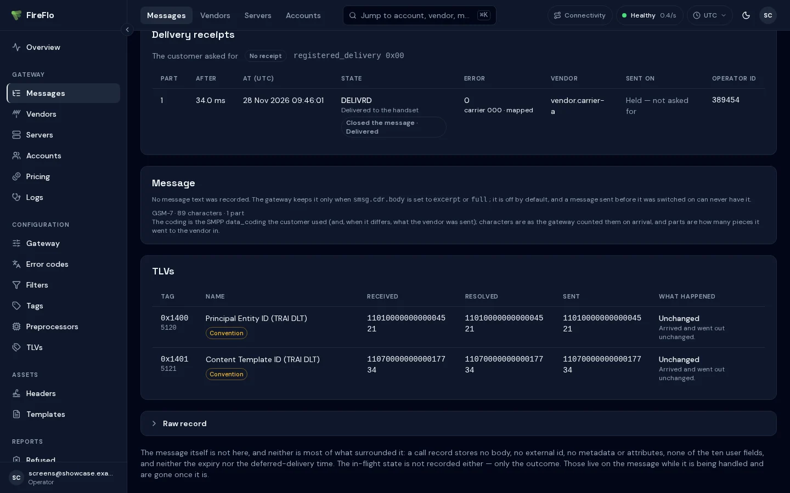

The grammar is at [TLV declarations](/reference/smpp/tlvs) — read that first if `1400` versus `0x1400`
is new to you. This page is about running them.

## Naming a tag

**TLVs**, under Configuration in the control panel, lists every tag with its name, its meaning and
what uses it. The tags of the SMPP standard and of the Indian DLT convention are built in. **Name a
tag** gives any other tag a name and a one-line meaning for the panel to show. Names are for people:
only the tag number reaches the wire, so naming one changes nothing the gateway sends.

<Frame caption="The TLVs page: each tag's number, its name, its meaning, and what uses it.">
  
  
</Frame>

## A tag can come from four places

<Steps>
  <Step title="The customer's submit_sm">
    Extracted only if the listener's `registered.tlvs.submit` declares it. **Undeclared tags are
    discarded**, not passed through.
  </Step>
  <Step title="Their credential's defaultTlvs">
    Fills tags the message did not carry.
  </Step>
  <Step title="The whitelist stamp">
    In `assign` mode, fills a tag the message lacks. In `replace` mode, **overwrites** what the
    customer sent — and that overwrite *is* the approval.
  </Step>
  <Step title="The vendor's default.tlvs.submit">
    Fills anything still unset at send time.
  </Step>
</Steps>

**Precedence is message > credential > vendor.** Defaults only fill gaps. The one exception is the
whitelist stamp in `replace` mode, which is meant to win.

## Two mandatory checks, at different points

| Check | Runs | Failure |
| :--- | :--- | :--- |
| Listener `mandatory.tlvs.submit` | At ingress, after credential defaults and any stamp | `0xC3` to the customer |
| **Vendor** `mandatory.tlvs.submit` | Against what actually goes on the wire | FAILED receipt, refund, `cdr_rejected` — **not re-routed** |

<Warning>
The vendor check runs **after** `registered.tlvs.submit` has filtered. Requiring a tag that is not also
registered can never be satisfied — the gateway warns about that pairing at load, and it is worth
reading the log after adding a mandatory tag.
</Warning>

## Finding out what will be missing before it is

The control panel's TLV coverage report says, **per approved row**, which mandatory tags nothing will
supply.

That report is what makes the default stamping mode (`off`) discoverable rather than merely quiet.
Defaulting to `assign` would start writing TLVs onto packets crossing listeners that have never written
any — a silent change to what reaches a carrier.

## The failure that has actually happened

<Warning>
Not every setting is read per listener. One that is not keeps its bare form and reads a global
nobody sets — so it returns its coded default however you configure it.

`whitelist.tlvs.replace` shipped that way once. It read false on every listener however it was
configured, so an approved template's TLVs were **never stamped over SMPP** — silently, because not
stamping looks exactly like having nothing to stamp.

If a per-listener TLV setting appears to do nothing, this is the first thing to check.
</Warning>

## The customer's side

A customer can see the TLVs **they sent** on their own messages, and can propose new tag definitions
for an operator to approve. They never see what a vendor added downstream.

The call record keeps three sets — received, sent, and what the whitelist stamped — so a dispute about
what reached the carrier is answerable rather than argued. A message's page in the control panel shows
each tag as received, as resolved and as sent, with what happened to it.

<Frame caption="A message's TLVs: the DLT entity and template IDs as received, as resolved and as sent. Both arrived and went out unchanged.">
  
  
</Frame>

## A worked case: Indian DLT

The registered entity id belongs on the **credential**, because it is a property of the customer rather
than of any one message:

```yaml
defaultTlvs:
  peid_0x1400: "1101234567890123456"
```

The template id (`tmplid_0x1401`) varies per message and is usually stamped by the whitelist on
approval, or supplied by the customer. The telemarketer id (`tmid_0x1402`) is your own registration
with the vendor, so it can be a vendor default:

```properties
outSms.default.default.tlvs.submit = tmid_0x1402=1102000000000012345
outSms.instance.smpp.mandatory.tlvs.submit = peid_0x1400,tmplid_0x1401
```

With both mandatory, a message missing either is refused at ingress with `0xC3` rather than
rejected by the carrier later — which is the point of checking at all.
