Open an account and choose **Billing**. Across the top, one card answers the two questions you open
it with: on the left, what the account holds and the actions that change it; on the right, how many
MT parts it has sent. Beneath it, **MT usage** over time beside **Does the credit add up?**, and the
full ledger at the bottom.

<Frame caption="An account's Billing tab. The left of the card is the money and the actions that change it; the right is what the account has sent.">
  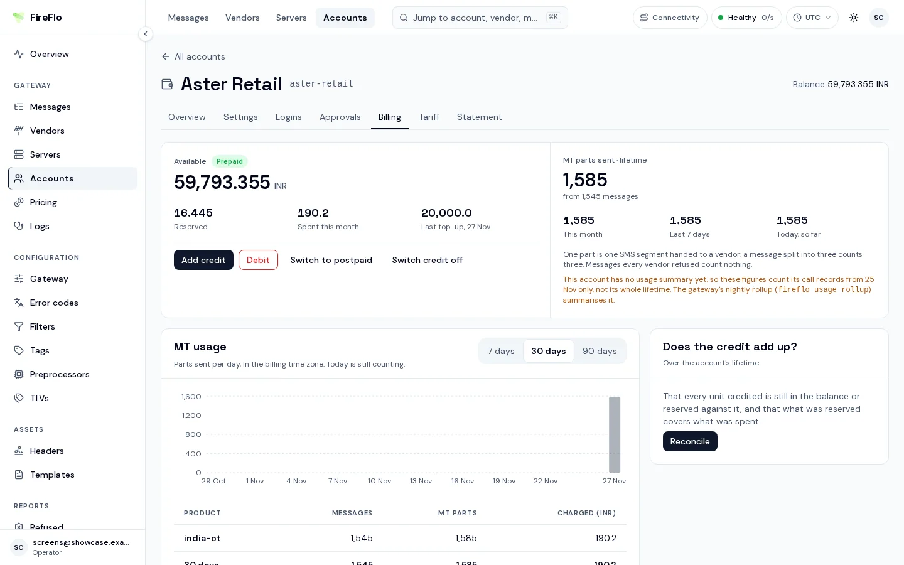
  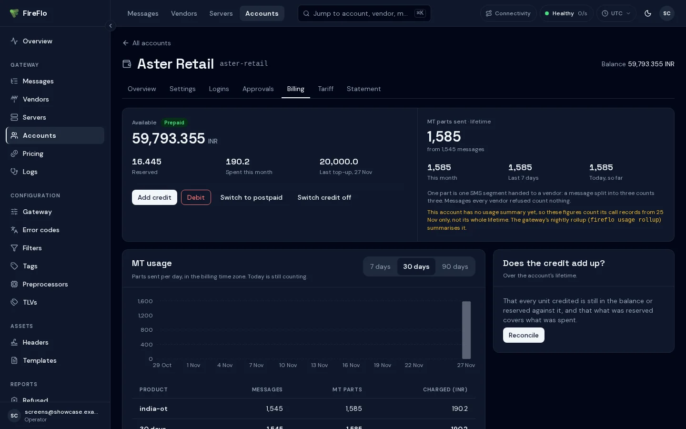
</Frame>

<Warning>
**Adding credit cannot be undone from the panel.** A top-up is never edited or reversed. A mistaken
one is taken back with [**Debit**](#taking-credit-back), which writes a separate entry of its own.

The form asks you to confirm the amount and the reference before it writes. Read the confirmation
rather than clicking through it — it is the last point at which the number is still yours to change.
</Warning>

<Note>
**A units account has no money to show.** From 0.16.0 an account that holds message units instead of
money shows units left and used per product, the account it is charged to and its unit ledger, and
offers no top-up, debit or prepaid/postpaid switch. See [Units accounts](/platform/billing/units-accounts).
</Note>

## What the account holds

Prepaid accounts show **Available**, with **Reserved**, **Spent this month** and the **Last top-up**
beneath it. Postpaid accounts show a **Credit limit** — what they may run up before the gateway
refuses them, which is the same refusal a prepaid account gets when it runs out — with lifetime and
this month's spend. The two are never given the same name.

Amounts are shown with trailing zeros trimmed, keeping at least one decimal place: `0.0000` reads
`0.0`, `0.0100` reads `0.01`. That is display only — see [Precision](/platform/billing/how-pricing-works#precision).

<Note>
**Reserved is credit a running gateway holds and has not spent yet.** What it spends is settled into
**spent** every few seconds, so on a busy account reserved stays small — a few seconds of traffic —
and spent grows.

Seeing reserved sit on an idle account means credit was stranded by an unclean stop. The gateway
returns it on its next start, and releasing held credit returns it at once — nothing is lost either
way, because balance plus reserved plus spent is conserved. (Before 0.12.23 reserved only ever grew,
because spending was never settled out of it.)
</Note>

A missing balance row reads as **No balance row — not zero, absent**, which is a different and more
consequential state: a top-up against an account with no row is left pending rather than credited.
**Open for credit** creates the row at zero.

Currency is not asked for. There is one currency per platform, taken from the gateway, and FireFlo
never converts — a balance in anything else could never be spent against a price. The field appears
only when the panel cannot read the platform currency at all.

## MT parts sent

An **MT part** is one SMS segment handed to a vendor. A message long enough to be split into three
parts counts three; a message every vendor refused counts none. The card shows the lifetime total,
how many messages it came from, and the parts sent this month, in the last seven days and today so
far. Months and days are cut in the billing time zone, the same as statements.

**MT usage** draws parts per day over 7, 30 or 90 days, with today's bar paler because it is still
counting, and a table by product with messages, parts and what was charged over the same window.

Past days come from the daily usage summary; today, and any day not yet summarised, are counted
from the message records directly, so the figures are live.

<Note>
**After upgrading to 0.12.4, days summarised before the upgrade have no part count.** They are left
out of the totals, not counted as zero, and the card says how many there are. Running
`fireflo usage rollup --catch-up` fills every such day whose message records are still kept — see
[Usage and retention](/platform/billing/usage-and-retention#mt-parts). Days already purged stay
uncounted.
</Note>

## Adding credit

Three fields: **Amount**, **Reference**, and an optional **Note**.

<Frame caption="Add credit. The line under the fields is the honest promise: the gateway applies the top-up on its next poll, so the balance above does not move at once.">
  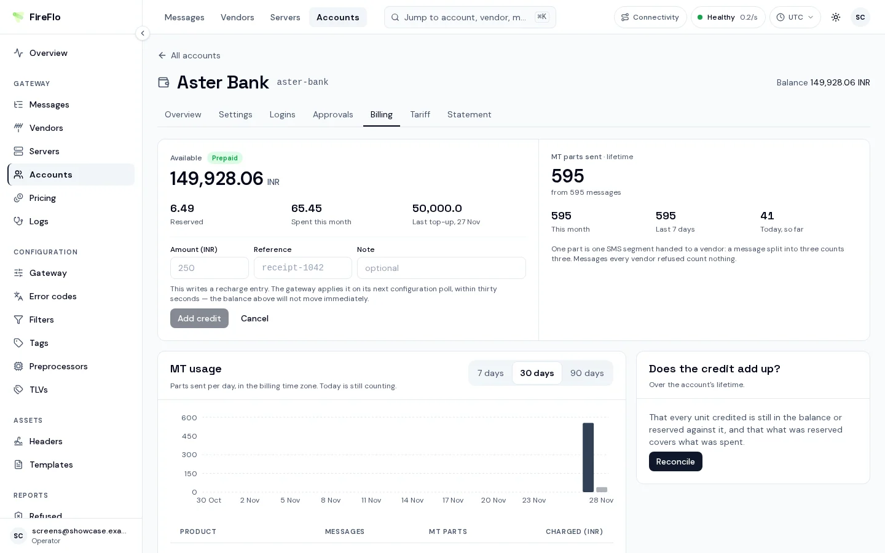
  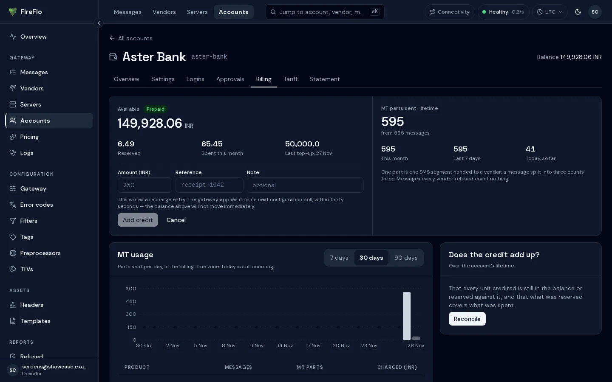
</Frame>

Once a valid amount is typed the form echoes back exactly what will be stored, because money is held
to four decimal places and a misplaced decimal is the expensive mistake here.

<Warning>
**The reference is the replay guard, not a memo.** A receipt or transaction id is what stops the same
payment being credited twice, and the database can only enforce that when it is set.

It is required for exactly that reason. Do not put a description there — put the thing that uniquely
identifies the payment.
</Warning>

Confirming is two steps on purpose. Pressing Enter in a field does nothing, and the button arms into
a confirmation naming the amount, the currency and the reference before it will write.

After it saves, **the balance does not move immediately**. The panel writes a recharge entry and the
gateway applies it on its next configuration poll, within about thirty seconds. A balance that has
not changed yet is not a failure.

## Taking credit back

**Debit** takes prepaid credit off the account — a top-up made in error, for example. It is offered on
prepaid accounts only; a postpaid account is billed, not debited. Three fields, all required:

- **Amount** — taken from the balance at once. Credit held by running gateways is released first and
  counts. More than the balance is refused.
- **Reference** — your own id for this debit. Using it again answers "duplicate" and debits nothing.
- **Reason** — shown in the account history and the audit log, and to a platform that manages the
  account.

<Frame caption="Debit. Review shows the balance before and after; nothing is taken until you press Debit there.">
  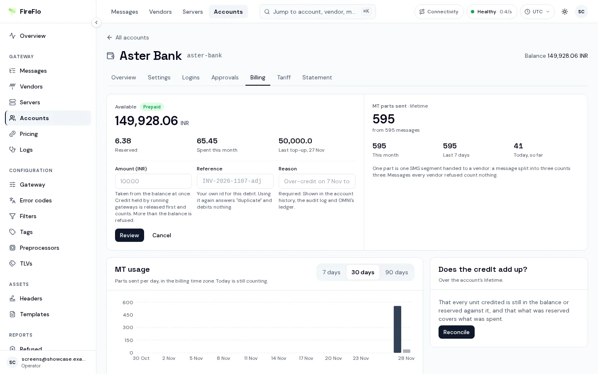
  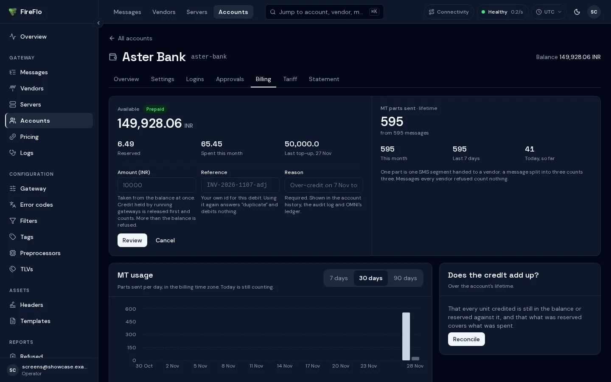
</Frame>

**Review** shows what will be taken and the balance it leaves. A debit cannot be undone from the panel
either: a mistaken debit is corrected with a top-up.

## Switching between prepaid and postpaid

**Switch to postpaid** opens the billing terms: **Prepaid — spends a balance** or **Postpaid — billed
in arrears**, and for postpaid a **Credit limit**. On a postpaid account the same button reads **Change limit or go
prepaid**. The form warns before saving either way:

<Frame caption="An account's billing terms opened. A postpaid account needs a credit limit; zero means no credit, not unlimited.">
  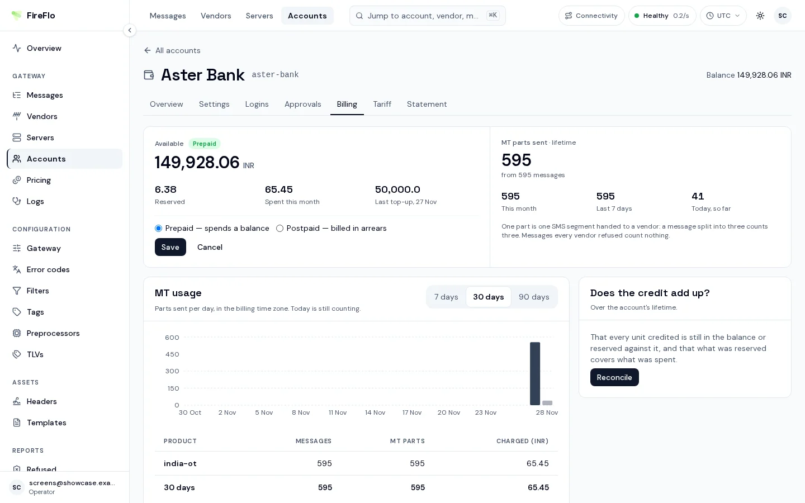
  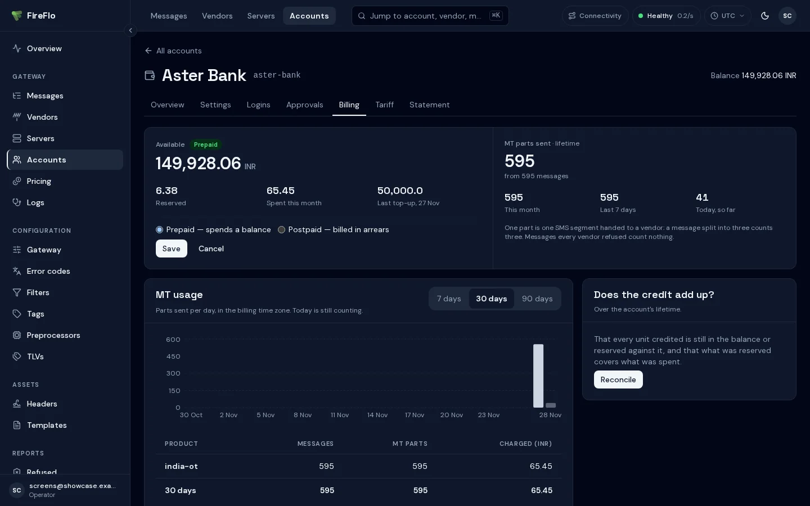
</Frame>

- **To postpaid** — the account stops spending its balance. Anything already reserved stays reserved
  until it is released.
- **To prepaid** — the limit is cleared and the account spends its balance again. Usage since the
  last bill is still owed.

<Warning>
**A postpaid credit limit of zero is not unlimited — it is no credit**, and the account would be
unable to send anything. The form refuses it rather than accepting a setting that silently stops a
customer.
</Warning>

**Switch credit off** leaves an account sending until the block it already holds runs out, then
stops. It is not instant.

## Does the credit add up?

Two identities over the account's whole lifetime: every unit credited is still in the balance,
reserved against it, or spent, and what was reserved and spent covers what the call records say was
consumed.

It does not run on its own — press **Reconcile**. Two figures come back. **Unexplained** is the
residual, and the one worth acting on. **Reserved, not yet spent** is normal on an account that is
sending.

<Frame caption="After Reconcile: nothing unexplained, a little reserved and not yet spent, and a plain-language note on each thing that is worth knowing.">
  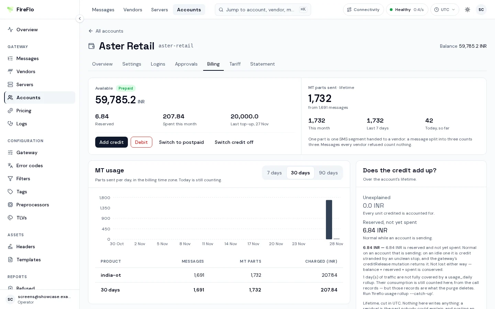
  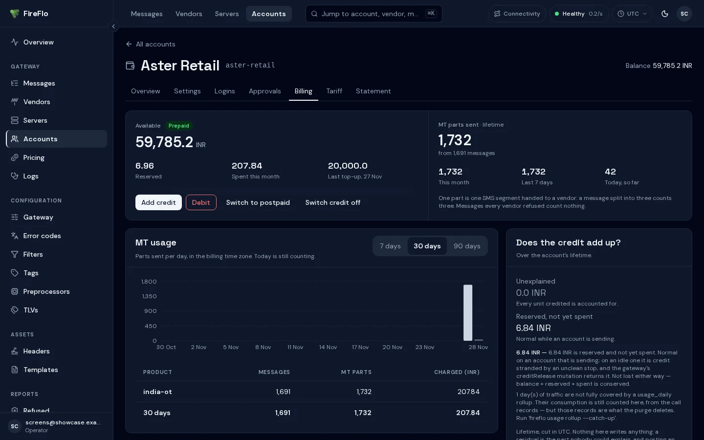
</Frame>

Beneath them, a plain-language account of everything that did not balance. The distinctions that
matter:

| Verdict | Means |
| :--- | :--- |
| **Pending credit** | Top-ups the gateway has not applied yet. Not a problem — wait a poll |
| **Credit lost** | Credited, and in none of balance, reserved or spent |
| **Credit minted** | Held, with no top-up or transfer accounting for it — the more serious direction |
| **Charged without reserving** | Consumption is real, the reservation is not |
| **Held unspent** | Stranded by an unclean stop. Released by hand, not lost |
| **Missing rollup** | Days with no usage rollup — still counted here, but from records the purge deletes |
| **Unrated** | Messages sent with no price. On postpaid, revenue nobody invoiced |

<Note>
**There is no "fix it" button, deliberately.** Reconciliation never writes an adjusting entry.

A residual is the part nobody could explain, and posting an adjustment for it would balance the books
by hiding the cause. It is also always lifetime-scoped, never a period — an identity that holds over
a month but not over the account's life has not held.
</Note>

## Money in and out

Every recharge, transfer and debit, searchable by reference, note or type, sortable and paged. The
gateway applies a recharge or transfer on its next poll, and a debit at once.

<Frame caption="Money in and out. Each top-up with its amount, reference and state; Applied means the gateway has credited it.">
  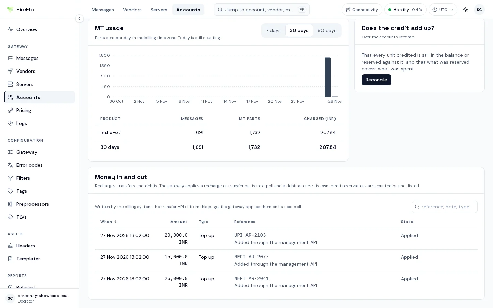
  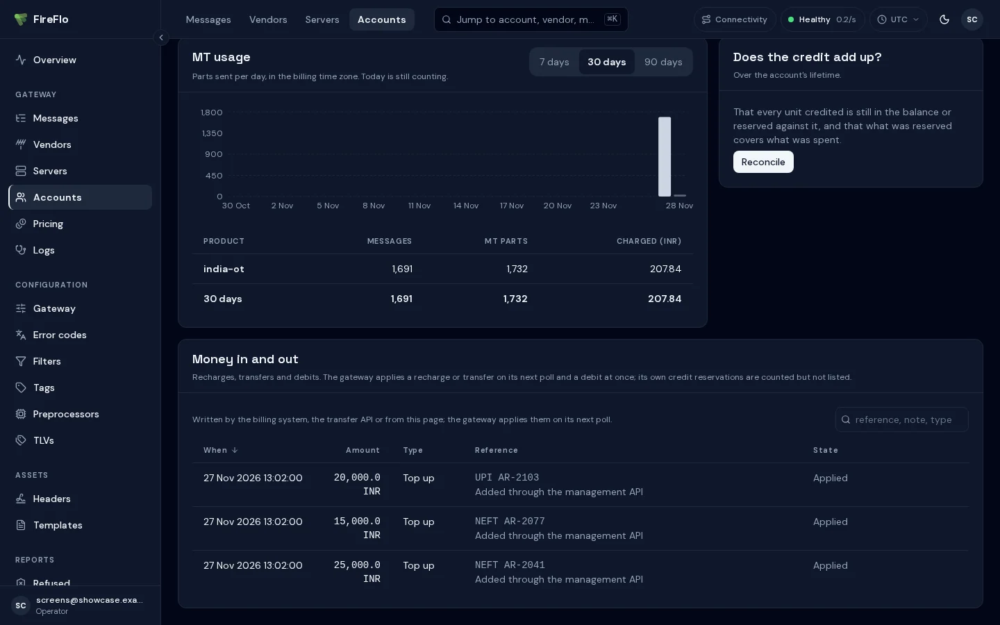
</Frame>

The ledger lists only entries a person or the billing system wrote. The gateway's own credit
reservations are bookkeeping, not money — each moves credit between two columns of one row and nets
to zero — and are kept elsewhere.

The **State** column carries the part people miss: **Pending** means the gateway has not applied it
yet. Where an account has no balance row, a positive entry says either that it is waiting for the row
and will credit itself the moment it exists, or that it was applied before the row went missing and
nothing can now say what it credited.

## Related

<CardGroup cols={2}>
  <Card title="How prepaid credit works" icon="wallet" href="/platform/billing/prepaid-credit">
    Blocks, reservations and what the gateway does when credit runs out.
  </Card>
  <Card title="Postpaid accounts" icon="file-invoice" href="/platform/billing/postpaid">
    Billing in arrears against a limit.
  </Card>
</CardGroup>
