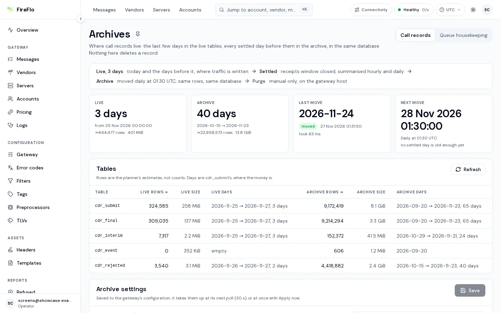
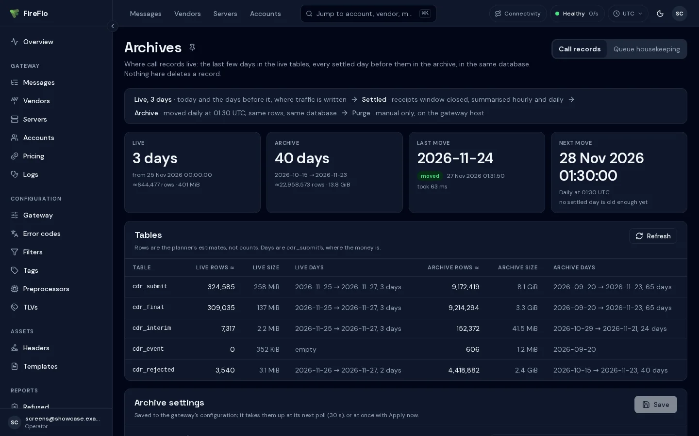
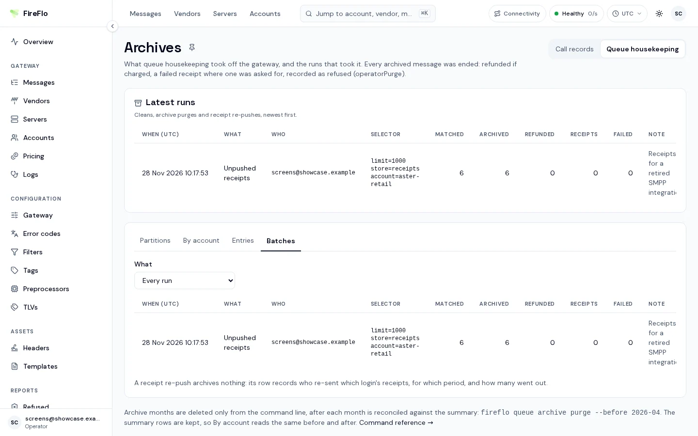
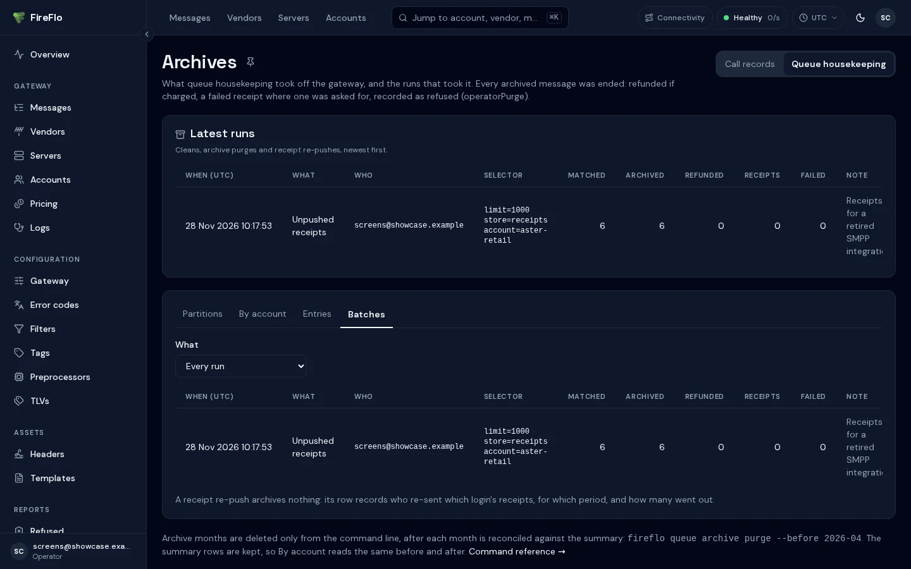
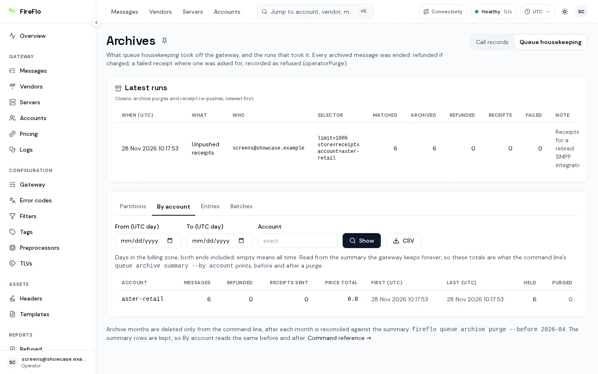
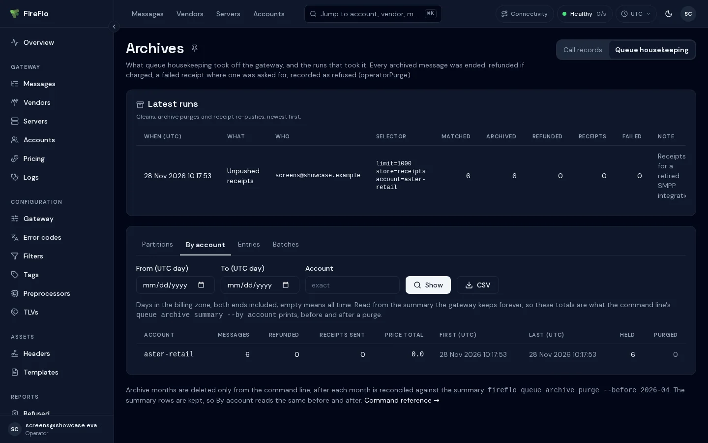

**Reports → Archives**, under Queues. The switch at the top right picks one of two sections:
**Call records**, which opens first, and **Queue housekeeping**.

## Call records

From gateway 0.15, where call records live: today and the last few days in the **live** tables,
where traffic is written, and every settled day before them in the **archive**, in the same database.
**Nothing on this page deletes a record**: the gateway's schedule moves settled days, and only a purge
run by hand on the gateway host ever deletes.

<Frame caption="Call records with 3 days live and 40 days archived. The line at the top is the whole process; the tiles say when the last move ran and when the next one will.">
  
  
</Frame>

Top to bottom:

- **Live**, **Archive**, **Last move** and **Next move** tiles: how many days are live, what range the
  archive holds, how the last move ended and how long it took, and when the next runs.
- **Tables**: each call-record table's live and archive rows, size and days. Rows are the database's
  estimates, not counts.
- **Archive settings**: **Days kept live** (`smsg.cdr.hot.days`, at least 3, because receipts arrive
  for two days after a message), **Schedule** (daily, or weekly on a chosen day, at a time in UTC),
  **Move days to the archive** (off, nothing moves and the live tables keep growing), **CSV copy on
  each move**, and the **Purge** command to run on the host. They are saved to the gateway's
  configuration, which takes them up at its next poll or at once with **Apply now**. A gateway reading
  its settings from a file shows them read-only.
- **Waiting to move**: days old enough to leave the live tables that are not settled yet, and why.
  Days move in order, so one waiting day holds back the ones after it.
- **Move log**: every run, newest first, one row per day and table, including the runs that moved
  nothing. **Failures** narrows it to the runs that failed.

Against a gateway older than 0.15 the section says call-record tiers arrive with 0.15, and shows
nothing else.

## Queue housekeeping

A read-only report, from 0.12.19, of everything a queue clean archived and every run that wrote to the
archive. Anyone who may read reports may open it; cleaning happens on the
[Queues page](/platform/control-panel/queues#clean-up-archive-and-end-what-will-never-be-sent), on a
vendor's or listener's page, or on the command line, and deleting archive months is command-line only.

Every archived message was **ended**, not parked: refunded if it was charged, sent a failed receipt
where the customer asked for one, and recorded as refused with reason `operatorPurge`. The archive is
the record of what was ended, who did it and why.

<Note>
Against a gateway older than 0.12.19 the section says **Available from gateway 0.12.19** and shows
nothing else. That is not an error: the archive arrives with that release's database update.
</Note>

Under **Latest runs** sit four tabs: **Partitions**, **By account**, **Entries** and **Batches**.

### Latest runs, and the Batches tab

**Latest runs** lists the newest runs; the **Batches** tab lists them all, and its **What** filter
picks one kind:

| Kind | A run that… |
| :--- | :--- |
| **Vendor / listener queue**, **Routing**, **Unpushed receipts**, **Callback retries**, **Spill file** | archived entries from that store |
| **Archive purge** | deleted an archive month (see below) |
| **Receipt re-push** | re-sent an SMPP login's receipts for a period — it archives nothing; the row records who, which login, which period and how many went out |

Each run shows when it started (and whether it is still running), who ran it, the selector it was
given, how many matched, were archived, refunded and sent a receipt, how many failed, and the note.
Choose the time to see that run's entries.

<Frame caption="The Batches tab: one clean-up run, with who ran it, the selector it was given, what it matched and archived, and its note.">
  
  
</Frame>

### Partitions

One row per month: the rows held, the first and last archive time, and the size on disk. A month whose
detail was purged shows **purged on &lt;date&gt;, &lt;n&gt; rows** — the entries are gone, and the
summary kept for that month says how many there were.

### By account — the reconciliation view

Per account, over an optional range of days (in the billing zone, both ends included; empty means all
time) and an optional account, read when you press **Show**: messages archived, refunded, receipts
sent, price total, first and last, and how much of the total is still **held** in detail versus
**purged**. **CSV** downloads what is shown.

<Frame caption="By account: archived messages reconciled against refunds and receipts sent, and how much of each total is still held in detail.">
  
  
</Frame>

<Tip>
This tab reads the per-day summary the gateway keeps **forever**, never the detail rows. Its totals
are what `fireflo queue archive summary --by account` prints, and they do not change when old months
are purged — Held falls and Purged rises by the same number.
</Tip>

### Entries

The archived entries themselves, newest first, filtered by period, account, vendor or listener (the
list offers the configured ones), system id, store, batch and message id; the filters live in the
address, so a filtered view can be shared. Each row shows the store and sub-store, who archived it and
why, its batch, whether it was refunded and whether a receipt was sent, and links to the message's own
page by its message id.

A **Text** column appears only when the gateway kept message text when it was archived — the same
**Keep message text** switch that governs call records.

All time is offered only together with an identifier — an account, vendor, listener, login, batch or
message id. Otherwise a period of at most 92 days.

## Deleting archive months

Command line only, with `FIREFLO_QUEUE_ARCHIVE_PURGE=true`:

```bash
fireflo queue archive purge --before 2026-04            # dry run
FIREFLO_QUEUE_ARCHIVE_PURGE=true fireflo queue archive purge --before 2026-04 --yes
```

Only whole months go, never the current one, and each month is reconciled against the summary first —
a month that does not add up is refused and nothing is deleted. Or set **Gateway settings → Call
records → Keep queue archive months for** (`smsg.queue.archive.retention.days`, default 0 = never), and
the gateway runs the same reconciled purge on its own.

## Related

<CardGroup cols={2}>
  <Card title="Queues" icon="layer-group" href="/platform/control-panel/queues">
    What is waiting, and the Clean up card.
  </Card>
  <Card title="Inspecting a queue" icon="magnifying-glass" href="/platform/operations/queues">
    What a clean does to each message, from the command line.
  </Card>
</CardGroup>
