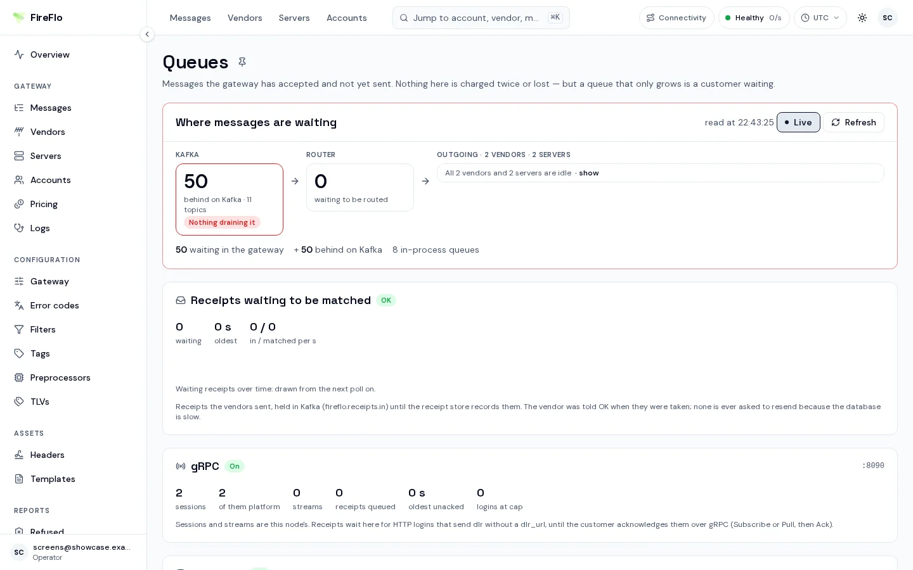
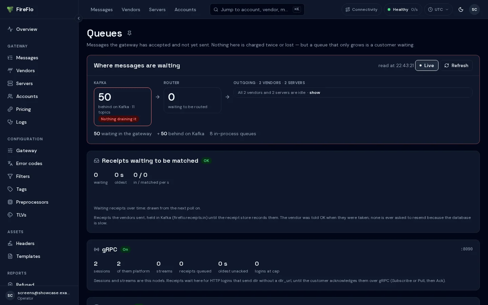
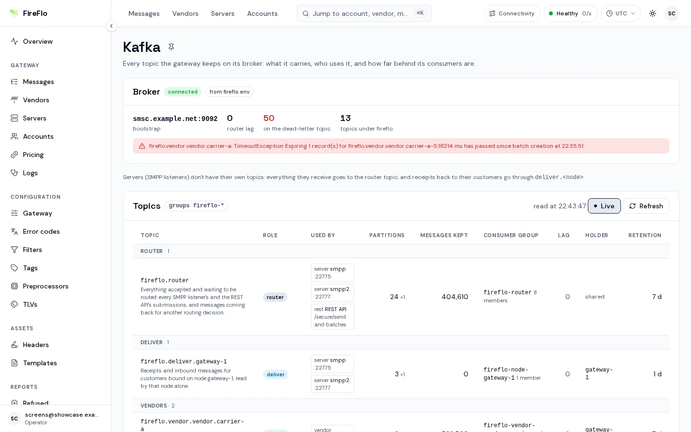
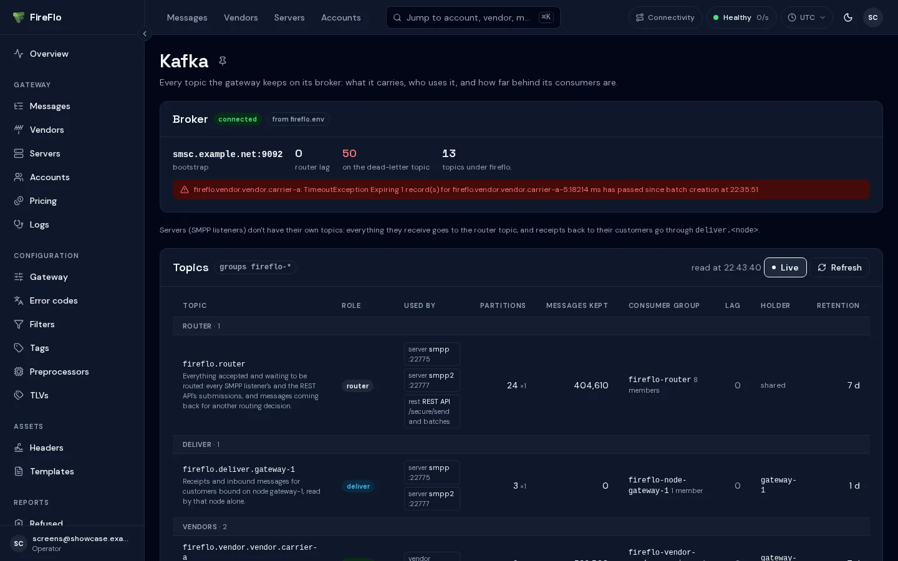
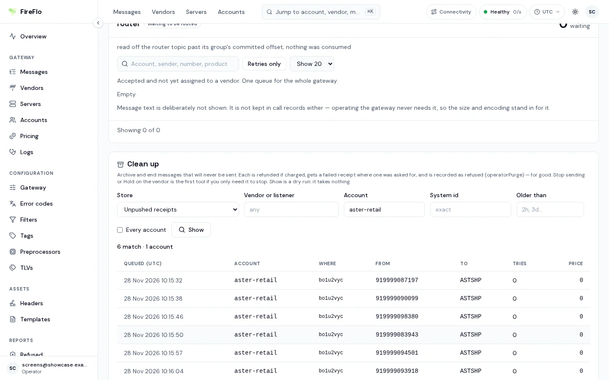
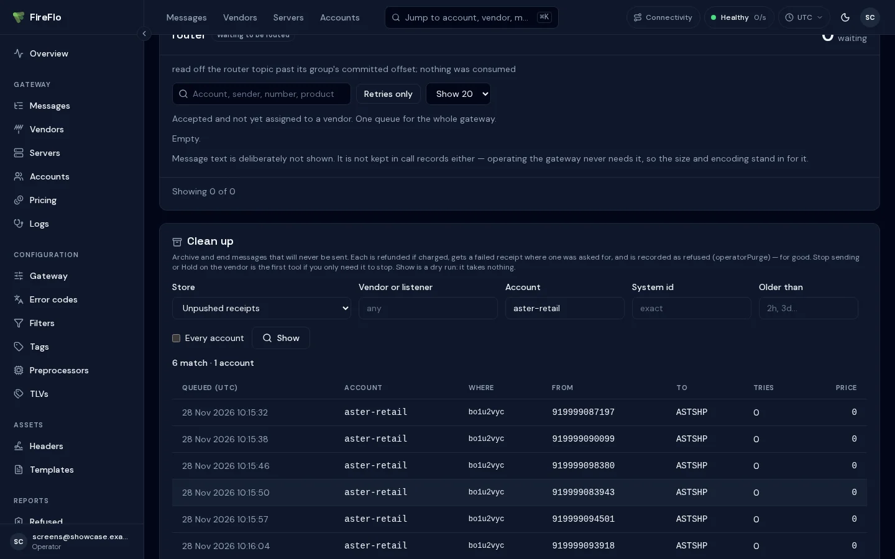

**Messages the gateway has accepted and not yet sent. Nothing here is charged twice or lost — but a
queue that only grows is a customer waiting.**

The screen reads live, re-reading every few seconds; **Live** pauses it, **Refresh** reads once.

## Where messages are waiting

The card at the top lays the queues out as the path a message takes: **Kafka** (or **Broker**), then
**Router**, then **Outgoing**, one row per vendor and server. Idle ones fold into a single line that
**show** opens. Under the path, a line totals what is waiting in the gateway and what is behind on the
broker. Choose any stage to open its own card below.

<Frame caption="Nothing waits in the gateway, but 50 messages sit behind on Kafka with nothing draining them, so the strip is outlined in red.">
  
  
</Frame>

Below the path come three cards that are not queues of messages but explain them: **Receipts waiting
to be matched** (receipts a vendor sent, held until the receipt store records them; from 0.15.3),
**gRPC** (its sessions, streams and the receipts waiting for logins to collect them; from 0.15.9), and
**Database** (the connection, the writers that record messages, and the latency that admits or refuses
new submits; from 0.15.1). **Slow queries** opens from the Database card.

## The broker and the router are different queues

<Warning>
**A backlog on the message broker shows up as a *flat* router queue.**

Once the in-process queue passes its highwater mark the consumer stops pulling, so the router queue
stops growing and looks calm — while messages pile up on the broker behind it.

If the router queue is suspiciously steady and customers are reporting delays, look at the Kafka (or
Broker) stage first.
</Warning>

The first stage is always shown, even where there is no broker, because *not configured* and
*configured and not answering* are entirely different facts and both would otherwise render as
nothing.

| State | What it means |
| :--- | :--- |
| **None** | No broker. REST goes straight to the router |
| **Not connected** (Kafka) or **Not answering** | The gateway cannot reach the broker; whatever is on it is stranded |
| **Nothing draining it** | Messages are queued and no consumer is attached. Not slowness — nothing is reading them |

On Kafka the stage counts how many messages are behind across its topics, and its card, **Kafka
backbone**, lists each topic with how far behind it is, its partitions and members. **Open Kafka
topics** on that card opens the **Kafka** page: every topic the gateway keeps on its broker, what it
carries, who uses it, its consumer group, lag and retention. It reads the broker without consuming
anything.

<Frame caption="The Kafka page: one row per topic, grouped by role, with the listeners and APIs that use it, its consumer group, lag and retention.">
  
  
</Frame>

<Note>
When the broker is unreachable its figure reads **unknown**, never zero. A stranded queue that
displayed "0 waiting" would be the most dangerous number on the screen.
</Note>

## The in-process queues

Choosing the router or an outgoing row opens that queue's card, which says what it holds:

| Kind | Holds |
| :--- | :--- |
| **Waiting to be routed** | Accepted, not yet assigned to a vendor. One queue for the whole gateway |
| **Waiting for the vendor** | Routed, waiting for that vendor's session to take them |
| **Scheduled retries** | Sending failed; queued to try again |

Each card offers a reading of its own contents, and these are the sentences to act on:

- **Mostly retries** — the vendor is failing, not merely slow. Adding capacity will not help.
- **All first attempts, all from one account** — one sender's volume, not a vendor fault.
- **All first attempts, spread across senders** — more arrived than is being drained.

That reading disappears when you filter, deliberately: a retries-only view cannot honestly pronounce
on the mix.

Above the list, a search box narrows it by account, sender, number or product, **Retries only**
separates "more arrived than we could send" from "the vendor is refusing", and **Show** sets how many
to list per queue: 20, 50, 100 or 500.

The table shows when each message was queued, its account, product, addresses, size and encoding,
whether it is a first attempt or a retry, its target, and — on a retry queue — when it is next due.

<Note>
**Filtering never changes a queue's depth.** The depth stays the real number and the list below it
narrows. "3 matches" among "412 waiting" means three of the listed sample matched, not that only
three of that customer's messages are queued.
</Note>

## Why the message text is not shown

Deliberately absent, and not kept in call records either. Operating the gateway never requires
reading a customer's message, so the size and encoding stand in for it — enough to tell a
three-segment Unicode message from a short GSM one without reading anybody's mail.

## Clean up: archive and end what will never be sent

From 0.12.19, below the queues, a **Clean up** card ends messages that will never be sent — honestly:
each is archived, refunded if charged, sent a failed receipt where the customer asked for one, and
recorded as refused (`operatorPurge`). **Stop sending or Hold on the vendor is still the first tool**
if you only need traffic to stop.

1. Choose the **Store** — a vendor's or listener's waiting, retry, held or parked messages; the routing
   queue, routing retries or the failed-routing park; unpushed receipts; or callback retries — and
   narrow it by **Vendor or listener**, **Account**, **System id** and **Older than** (`2h`, `3d`).
   Cleaning a whole store with nothing named needs **Every account** ticked.
2. **Show** is a dry run: it takes nothing, and prints how many match, across how many accounts, and
   the refund they would get, above a sample of the matching messages. Anyone who can read the queues
   may run it.
3. **Archive & clean…** is shown to **admins only**. The dialog restates what will happen, asks for a
   **note** (recorded on every archived entry) and for the exact confirmation `CLEAN <n>`.
4. Just before it starts, the count is read again. If it changed, the dialog shows the new number and
   asks you to confirm that one — it never archives more than you agreed to. It then works in batches
   of up to 10,000, showing the running totals, with **Stop** (the batch in flight finishes first), and
   ends with links to the runs on [Reports → Archives](/platform/control-panel/archives).

<Frame caption="Clean up after Show, on unpushed receipts for one account: six match, with the sample listed. Nothing has been taken yet.">
  
  
</Frame>

On a vendor's or listener's own page the same dialog opens from **Clean queue…** in the footer, beside
Stop sending, Hold and Restart, while something is waiting there. It is already scoped to that worker
and shows the count in each of its queues — held, waiting, retries, and parked on a listener — with an
optional account and age.

The operator log records each clean against the person who ran it, and the gateway's archive carries
the same name. The command line does the same thing with `fireflo queue archive`; see
[Inspecting a queue](/platform/operations/queues#cleaning-a-queue-archive-then-end).

<Note>
A queue held on the message broker cannot be cleaned: the broker cannot show a message without taking
it. The gateway refuses with `broker-backed`, and the dialog shows that.
</Note>

## An empty screen is the good outcome

**No in-process queues** means every message that arrived has already been handed to a vendor. That
is what a healthy gateway looks like at rest, and it is why this screen is not a dashboard — you come
here when something else has already told you to.

## Related

<CardGroup cols={2}>
  <Card title="Queues and retries" icon="rotate" href="/platform/routing/queues-and-retries">
    How retry scheduling and the attempt ceiling work.
  </Card>
  <Card title="Live health" icon="heart-pulse" href="/platform/operations/live-health">
    Bind state and queue depth from the gateway itself.
  </Card>
  <Card title="Archives" icon="box-archive" href="/platform/control-panel/archives">
    What a clean took off the queues, and who ran it.
  </Card>
</CardGroup>
