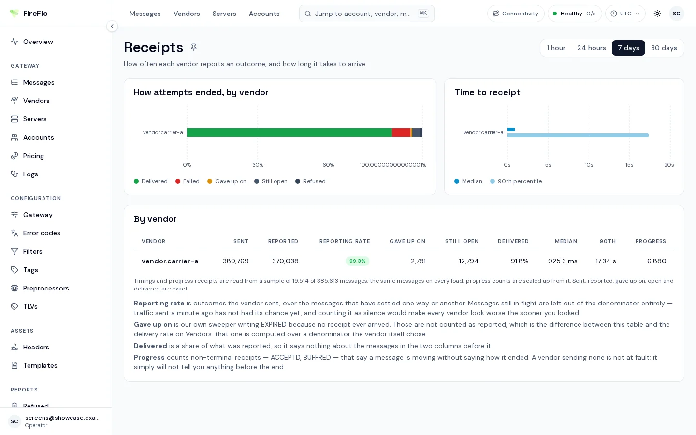
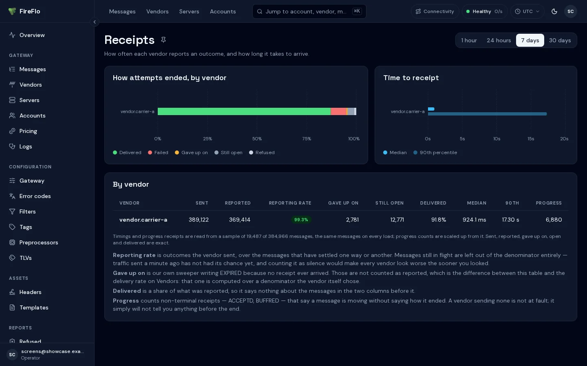

**How often each vendor reports an outcome, and how long it takes to arrive.**

This screen exists because of a specific way of being misled. The delivery rate on the Vendors page
is computed over *reported* traffic — so a vendor that reports on two messages in five can show 95%
there while three in five of everything you sent it have no outcome at all. The rate is not wrong.
It is answering a narrower question than it appears to.

This page widens the denominator. It is **Receipts** under Reports, read over **1 hour**, **24 hours**,
**7 days** or **30 days**; it opens on the last hour, and after that on whichever range you last
picked in that browser.

## The charts

**How attempts ended, by vendor** splits everything each vendor was sent into five shares that always
add up to the bar: delivered, failed, gave up on, still open, and refused (an attempt the vendor
turned away never gets a receipt). **Time to receipt** sets each vendor's median beside its 90th
percentile. Both are drawn from the rows of the table below, so they always agree with it.

<Frame caption="Receipts for 7 days. One vendor's bar is mostly green, and its 90th percentile sits well to the right of its median.">
  
  
</Frame>

## The table

One row per vendor, over the chosen range:

| Column | Meaning |
| :--- | :--- |
| **Sent** | Messages submitted to that vendor |
| **Reported** | Outcomes the vendor sent back |
| **Reporting rate** | Reported over what has settled |
| **Gave up on** | Closed as expired because nothing ever arrived |
| **Still open** | Sent, not settled, still within the deadline |
| **Delivered** | Of what was reported |
| **Median** / **90th** | Time from submission to outcome |
| **Progress** | Non-terminal receipts |

The reporting rate is the only figure here shown as a coloured badge — green at 95% and above, plain
from 70%, red below. A vendor under 70% is losing you your own view of what happened to traffic you
have already paid for.

A vendor with no name recorded appears as **no vendor**.

On a long range the timings and progress receipts are read from a **sample** of the messages, and a
line under the table says how many of how many. The sample is the same messages on every load, and
progress counts are scaled up from it. Sent, reported, gave up on, still open and delivered are always
exact.

## The four things worth reading twice

**Reporting rate leaves in-flight traffic out of the denominator entirely.** Messages sent a minute
ago have not had their chance yet, and counting them as silence would make every vendor look worse
the sooner you looked at them.

**"Gave up on" is us, not them.** It is our own sweeper writing an expiry because no receipt ever
arrived. Those are not counted as reported — which is exactly the difference between this table and
the delivery rate elsewhere, where the denominator is one the vendor itself chose.

**"Delivered" is a share of what was reported.** It says nothing whatsoever about the messages in the
two columns before it. A vendor reporting on 40% of its traffic and delivering 99% of that has
delivered, as far as anyone can prove, 40% of what you sent.

**Progress counts non-terminal receipts** — `ACCEPTD`, `BUFFRED` — which say a message is moving
without saying how it ended. A vendor sending none of these is not at fault; it simply will not tell
you anything before the end.

<Note>
On a gateway that does not record interim receipts, the Progress column is **blank rather than
zero**, and the page says so beneath the table. A zero would be a claim about the vendor. A blank is
a claim about the gateway, which is the true one.
</Note>

## Reading it in an incident

A vendor whose reporting rate has fallen while its delivery rate holds steady has not started failing
to deliver. It has started failing to *tell you*, and the two are indistinguishable from the
Vendors page alone. Traffic still leaves, customers still get charged, and your evidence quietly
stops accumulating.

The same figures appear for one vendor on its own page, on the **Traffic** tab under **Delivery
receipts**: **Reports outcomes**, **Sent**, **Reported**, **Still open**, **Median to first sign**,
**Median to outcome**, **90th percentile** and **Never reported**. **Median to first sign** is the
time to the vendor's first sign of life; set beside **Median to outcome**, it separates a vendor that
acknowledges at once and settles late from one that says nothing until the end.

<Frame caption="One vendor's Traffic tab for 24 hours. Delivery receipts gives its reporting rate with the counts it is a ratio of.">
  
  
</Frame>

## What it needs to say anything

Both the submission and its receipt, across at least two vendors — with one vendor the table is a
single row and there is nothing to compare it against. If nothing settled in the window at all, the
page reads **No traffic in this period**.
